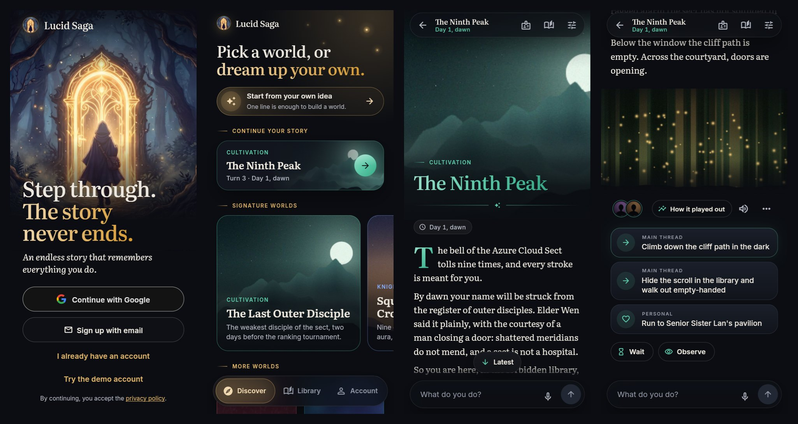

# Lucid Saga design

The look and feel of the app, and the rules every screen follows. The code lives in `lib/design/`
and every component is on show in the widget gallery (`/gallery`). Requirements are cited by id
from [`docs/REQUIREMENTS.md`](../docs/REQUIREMENTS.md).

## Direction: a reading room at night

The story is the interface. A scene should feel like a page from a well-set novel with one
painting beside it, not like a chat log or a game HUD.

- **Dark first.** The default theme is *ink*: deep blue-black layers and warm parchment text, so a
  long session at night is easy on the eyes and pictures glow. *Paper* is the light theme, a warm
  off-white with ink text. The player picks dark, light or system in Account.
- **Words in a serif, the interface in a sans.** Narration is set in Literata at reading size;
  buttons, chips and lists are in Inter. Headlines use Literata's display cut.
- **One accent at a time.** Outside a story the accent is *lucid gold*. Inside a story the accent
  follows its genre (see below), so each world has its own tint without any genre-specific layout
  (G5).
- **Chrome recedes.** Few borders, soft layers instead of shadows, generous space, and no more than
  one filled button on a screen.
- **Pictures are events.** They arrive at key moments (M1), edge to edge on a phone, faded into the
  page with a vignette. They never block the text (M3).

## Color

Widgets read colors from the theme (`Theme.of(context).colorScheme` and `context.lucid`), never from
`Palette` directly, so both themes and every accent work.

| Token | Ink (dark) | Paper (light) | Use |
| --- | --- | --- | --- |
| background | `#0B0D12` | `#F6F3ED` | Page behind everything |
| surface | `#11141B` | `#FBF9F5` | Bars, sheets |
| container low to highest | `#151922` to `#29303D` | `#F1EDE5` to `#DED7CA` | Cards, fields, chips, in rising layers |
| textPrimary | `#EDE8DF` | `#1B1D23` | Narration, titles |
| textSecondary | `#B4B8C3` | `#474B56` | Supporting lines |
| textMuted | `#9399A6` | `#545965` | Meta, hints |
| error | `#F4878A` | `#B3261E` | Errors only |

**Contrast is tested, not hoped for.** Every text color, the accent and the error color reach WCAG
AA (4.5:1) on every surface in both themes and for every accent (`test/design/contrast_test.dart`).
Accents pass through `ensureContrast`, which moves lightness and keeps the hue.

### Genre accents

`GenreAccent.forGenre` maps the story's genre label to an accent family. The table is the only place
genre touches the interface.

| Accent | Seed | Genres |
| --- | --- | --- |
| lucid | `#E3B66B` | The app outside stories, and any genre not listed |
| jade | `#5CC9A7` | Cultivation, xianxia, wuxia, martial |
| azure | `#84A9F5` | Knights and aura, chivalry, superpowers |
| ember | `#F08A5D` | Many races and monsters, fantasy, dungeons, post-apocalyptic |
| violet | `#B08CFA` | Reincarnation, isekai, regression |
| crimson | `#EF7A82` | Grounded modern, crime, mafia, noir |
| cyan | `#4FCFE0` | Science fiction, space, cyberpunk, mecha |
| orchid | `#DD8BE8` | Supernatural, urban fantasy, horror |

Wrap a story's screens in `StoryTheme(genre: …)`. It animates the accent when the story loads.

## Type

Fonts are bundled (`assets/fonts/`, SIL Open Font License), so nothing loads at runtime and text
looks the same offline.

| Style | Font | Size / line | Use |
| --- | --- | --- | --- |
| display S to L | Literata Display 500 | 30 to 44 | Page titles (`PageHeader`) |
| headline S to L | Literata Display 500 | 21 to 28 | Cover titles, sheet titles |
| title S to L | Inter 600 | 14 to 19 | List titles, buttons |
| body S to L | Inter 400 | 12.5 to 16 | Interface text |
| `narration` | Literata 400 | 18 / 1.65 | The story itself |
| `playerAction` | Literata italic | 16 / 1.5 | What the player did, above a scene |
| `overline` | Inter 600, tracked | 11 | Section labels, genre lines (uppercase) |
| `meta` | Inter, tabular figures | 12.5 | Time, turn counts |

The reading column is at most 680 px wide, about 70 characters a line. Narration supports `*italic*`
and `**bold**`; a blank line starts a paragraph with a short gap.

## Space, shape and layout

- **Spacing** is on a 4 pt grid: 2, 4, 8, 12, 16, 24, 32, 48. Screen gutters are 20.
- **Radii:** 8 (small), 12 (pictures), 16 (cards, fields), 24 (sheets, the composer), and pills for
  chips.
- **Layout:** phones get a bottom navigation bar; from 840 px wide the tabs move into a side rail.
  Lists and forms stay within 920 px, and reading within 680 px. A row of its own never stretches
  across a wide screen: Library's stories go two across from 640 px inside the gutters, and
  Account's settings keep to 680 px under the page title.
- **Discover** opens on the latest story the player can still play on (Continue your story), then
  the signature worlds, starting from your own idea, and the shelf of more worlds. On a phone the
  signature worlds are a row to swipe, one large card at a time with the next peeking in, and a
  swipe settles on a card; from 600 px inside the gutters they are two across, and the story to
  continue is as wide as one of them. The section heading names them, so the cards carry no
  badge. The first load waits for the player's stories as well as the worlds, so the story to
  continue never pushes the worlds down once they show.
- **Touch targets** are at least 48 px.

## Motion

Short and calm: 150 ms for small changes, 200 to 250 ms for entrances, eased out. New narration
fades in word by word as it streams (S3), choices rise in one after another, and pictures fade in
over their shimmer. With the platform's reduce-motion setting on, everything appears at once and
shimmers stand still (`Motion.of(context, …)`).

## Components

All in `lib/design/components/`, exported from `design/design.dart`.

| Component | What it is |
| --- | --- |
| `SceneCard` | One scene: the player's action (with a mic mark when spoken, V7), time chip, event badge, picture, narration, portraits and a footer for scene details and the scene menu. In the feed the picture comes after the narration (`pictureAfterNarration`), so a picture that lands late never pushes the words being read |
| `NarrationText`, `StreamingNarration` | Finished narration, and narration as it streams in with a breathing caret and skeleton lines before the first words |
| `StoryChoices` | Suggested choices as full-width tiles with their kind (thread, personal, side, wild), then **Wait** and **Observe** (S2) |
| `Composer` | The action box: grows to five lines, mic slot, send button with a busy state, slash-command hints (S5) and a counter near the 2000-character limit |
| `MicButton` | The mic in four states: idle, starting, listening (with a level halo) and denied |
| `PictureSlot` | A picture's place: shimmer while pending, fade-in when ready, quiet collapse when skipped or broken (M3). With `onError`, a picture that fails to load is reported once, so the play screen can fetch a fresh URL by its image id, and the shimmer stays meanwhile |
| `PortraitAvatar`, `PortraitStack` | A character's portrait, or initials until one exists; a stack shows three and counts the rest |
| `TimeChip` | How long a scene took and when it ended (W10); the accent tint when the player's clock ran apart from the world's (W10a) |
| `EventBadge` | An event, louder from personal to local to world (W16) |
| `CoverCard`, `StoryTile` | A premise or story with its cover, genre and line; a compact story row, in the Library and as Discover's story to continue |
| `showAppSheet` | A bottom sheet with a handle, a serif title and a width limit on large screens |
| `SkeletonText`, `SkeletonList`, `Shimmer` | Loading placeholders in the shape of what is coming |
| `EmptyState`, `ErrorState` | Nothing here yet, or a load that failed, in plain words with one action; errors use the typed API codes (T7) |
| `AsyncValueView` | Loading, error and data for a Riverpod `AsyncValue` |
| `ContentColumn`, `PageHeader`, `SectionLabel` | Width limits and headers |

Features add their own widgets on top of these; when one is useful to more than one screen, move it
here and add it to the gallery.

## Pictures

The app frames pictures and the pictures backend (`backend/media/`, WS8) makes them. Its house style
(`HOUSE_STYLE` and `FRAMING` in `backend/media/prompts.py`) follows this section; change the two
together.

- **Shapes come from the kind** (docs/API.md): places and scenes are 16:9, portraits and covers 3:4.
  The slot takes its shape from the scene's `image.kind` before the picture arrives, so nothing
  jumps when it lands.
- **Scenes and places** run edge to edge on a phone and get 12 px corners in a wider column. The app
  adds its own vignette and fades the bottom edge into the page, so the image keeps its focal point
  in the upper two thirds, leaves the bottom calm and dark, and has no vignette or border of its
  own.
- **Portraits** are head and shoulders with the face in the upper half, on a dark, simple
  background, so they still read cropped to a 28 px circle in a stack; in the feed a portrait is
  shown at most 280 px wide.
- **Covers** leave calm, darker space in the lower third, where `CoverCard` sets the genre and title
  over a scrim. In the Library they are a small 4:5 thumbnail; on Discover's shelf of more worlds
  they show whole, in their own 3:4 shape. A wider slot (Discover's signature cards, the create
  flow's banner) keeps the cover's upper part (`coverFocus`), where its focal point is. A cover
  not drawn yet, or still loading, shows a glow in the genre's accent, and the cover fades in over
  it (`CoverImage`). The starter premises' covers are drawn once for everyone by the backend's
  `draw_premise_covers` command, with the same framing.
- **The house style (S7, M5)** suits the dark page: stylised and cinematic with an anime influence,
  painterly light true to the moment's time of day and mood, rich shadows, atmospheric depth and a
  restrained palette with one strong accent, in the world's own era and look. A scene is lit for
  the hour on the story's clock, while its bottom edge stays calm and darker for the fade. One
  uninterrupted image, like a still from an animated film, with no border or vignette of its own
  and no writing in it: no text, logos or panels. Mild in every rating (M6).
- The placeholder art in `assets/fake/` is procedural and only stands in for the fake API.

## App icon

**The forest gate** (Miki's pick, 2026-11-04): a cloaked traveller walks through a glowing golden
doorway in a dark forest, the moment a story begins. It is the app's night and lucid gold in the
painterly anime look of its pictures, and at home-screen size it reads as a bright arch with a
dark figure.

- **The painting:** `tool/app_icon/forest-gate.jpg`, painted by Gemini on Vertex AI
  (`gemini-3.1-flash-lite-image`, 1:1, 1K) from this prompt: "A glowing doorway of golden light
  standing alone in a dark misty forest, a small cloaked traveller about to step through. Square
  mobile app icon artwork for an anime interactive story game. One bold, centered subject that
  stays readable at 48 pixels, kept inside the middle 60% of the frame, on a full-bleed background
  that fills the whole square edge to edge. Painterly anime key-art style, cinematic low-key
  lighting, deep ink-blue night tones with one strong warm gold accent. No text, no letters, no
  logos, no watermark, no border, no frame, no rounded corners, no user interface." Its file keeps
  the IPTC mark for AI-made media. It is 1024 px with the scene on an inner panel, so the App
  Store's 1024 px icon is that panel scaled up; repaint at 2K before an iOS release.
- **One source:** `tool/app_icon/icon.svg`, on Android's 108-unit adaptive-icon grid in three
  layers: `#bg`, the painting, opaque; `#fg`, empty, since the painting is one layer; and `#mono`,
  the doorway with the traveller cut out, for Android 13 themed icons.
- **Every size from it:** `tool/app_icon/render.mjs` draws Android's adaptive layers and the icon
  for Android before 8, each size in the iOS asset catalog (opaque, as the App Store requires) and
  the web's favicon, manifest icons (maskable ones full bleed) and home-screen icon. To change the
  icon, edit the SVG, run the script (how is at its top) and commit the PNGs it writes.
  `test/app_icon_test.dart` checks that no size is missing.
- **Store-safe:** like the screenshots, the icon stays 4+ in the stores (REQUIREMENTS.md, Apple
  2.3.8).

## The play screen

The story reads as one page of scenes, like a book that writes itself.

- **Where it opens:** at the top of the newest scene, a little below the bar, so the player picks
  up where they left off and its first line never sits under the bar. A title page with the genre
  and title sits above the opening scene, and a story whose newest scene is its opening opens on
  that title page, which stays whole while the opening streams in. Older scenes load above as the
  player scrolls back, and the page never moves under them. **Latest** appears when they are far
  back.
- **A turn:** the player's action appears at once, then the words stream in under it (S3). The page
  follows the scene as it grows but stops at its top, so it is read from the first word at the
  player's own pace. When it is saved, the time chip and event badge join it without moving the
  words, and the choices rise in below; a scene written faster than the page could follow is
  still brought up to its top, or to its choices when all of it fits. A standing action reads as
  **Wait** or **Observe**, in the app's words.
- **Pictures** take their place under the words they belong to, as a shimmer in the right shape,
  and fade in when painted (M3). A picture that never comes leaves no trace.
- **Why it went that way** (A8): each scene's "How it played out" sheet lists the steps with their
  outcome class (certain, contested, long shot, ruled out), any roll with its odds and result, the
  reasons in the serif, where a plan stopped (R6) and the chain of cause and effect. A standing
  action's one step reads in the app's words too.
- **When a turn fails** (T7), a calm card takes the scene's place and says what happened in plain
  words, with the way on: retry (counting down after a rate limit), say it another way, or open
  Account. Nothing was saved, and the words the player wrote are never lost. Running out of
  credits opens a sheet instead. A content limit shows the server's own words.
- **The scene menu** illustrates a scene (M2) or reports it (F6). A blocked scene collapses to one
  quiet line in its place.
- **The app bar** keeps the title and the world's date and time in sight (W10), with `/status`,
  Memory and the story's settings (S6) a tap away. `/status` and Memory show the player
  character's portrait once it is drawn (M4), and the initials until then.
- **Names from the world** start with a capital where they stand as a heading or a card's title
  (`"the inner court".asHeading` is "The inner court"), and keep the world's own spelling
  everywhere else.

## Voice

The mic sits wherever the player types (V1): in the composer's mic slot and as a field's suffix.
Use `DictationButton(tracker: InputModeTracker(controller))`, with the box's `storyId` or `draftId`.
Words are never sent on their own (V2). Online dictation (the default, V6) records until the player
taps again (a pause to think never ends it; a long dictation lands in parts meanwhile, and leaving
the app turns the mic off), then the mic spins (`MicVisual.transcribing`, "Writing down what you said")
until the words land in the box; with the phone's recognizer they appear live. A failure is a short
snackbar that says what to do: out of credits, too many dictations, or the server out of reach. The first tap asks for permission with a reason (V5); if the player
refuses, the mic shows a struck-through icon and explains how to allow it, and typing still works.
Where the platform has no recognizer, the mic hides. The tracker reports `typed`, `voice`,
`voice_edited` or `choice` with each turn (V7).

## Sign-in and account

- **Google's button** follows Google's branding rules: the four-colour G, "Continue with Google", and
  Google's dark or light fill and stroke, never the app accent. On the web the page shows the button
  Google draws itself, since Google allows no other sign-in button on the web.
- **The birth-date step is neutral** (F8): the date starts empty and in typed entry, the copy says
  why we ask, and a refusal never names the minimum age, so nobody learns which date to type.
- **Credits** read as cents below a dollar (`44.6¢`) and as dollars from one (`$1.20`), with a real
  minus sign; the owner sees "Unlimited" and still sees each cost in the history. Each line of the
  history keeps its amount and the balance after it beside the entry, wrapping within their share
  of the row at large text sizes rather than overflowing.
- **The Developer section** (which server the app talks to, and the gallery) shows only in
  development builds and to the owner, never to players.
- **Destructive steps** say exactly what goes, offer the export first, and ask the player to type a
  word before the red button works.
- Problems the server finds on a form show under their field once the player has tried to submit,
  and clear as soon as that field changes.

## Words

- Every string the player sees is in `lib/l10n/app_en.arb`, with its Spanish in `app_es.arb` (S10).
  Read them with `context.l10n`. A new or changed string goes in both files in the same change
  (Spanish from Spain, with "tú"), and `test/l10n_test.dart` fails when one is missing, loses a
  placeholder or is left in English. Spanish runs about a fifth longer than English, so check a new
  screen in Spanish at twice the text size too (`test/features/large_text_test.dart`). Only the
  developer gallery uses literal English.
- The player picks the language in Account (S10): the device's own by default, English when the
  device's isn't one the app has. Only the app's fixed text follows it. What the server writes in
  the app's language, such as the starter premises, is asked for with `appLanguageCodeProvider`.
- Sentence case, plain words, full sentences. Say what happened and what to do next: "You're
  offline. Check your connection and try again."
- Errors never show a status code or a stack trace (T7).
- **A change says what it costs before the player makes it**, next to its button: "Free: nothing
  needs redrafting", or which parts get redrafted with credits (K2). The create review does this
  with `CostNote`, from the same rules the server uses.

## Accessibility

- Contrast at 4.5:1 or better everywhere, tested.
- Text scales to 200% without clipping or overflow; the gallery is tested at 2× text.
- Every icon-only button has a tooltip and a semantics label; pictures carry a label when the scene
  gives one, and a pending picture says so.
- Reduce motion is respected throughout.

## Working on the design

- Run the app on the fake API to see every state without a backend:
  `flutter run -d chrome --dart-define=API_MODE=fake`.
- Open `/gallery` (debug builds and the fake API) to see every component. The query
  `?theme=light&accent=jade&scale=2` sets the controls up front, for screenshots.
- Change a token in `lib/design/tokens.dart` or a component, then check the gallery in both themes
  and at 2× text, and run `flutter test test/design/`.
