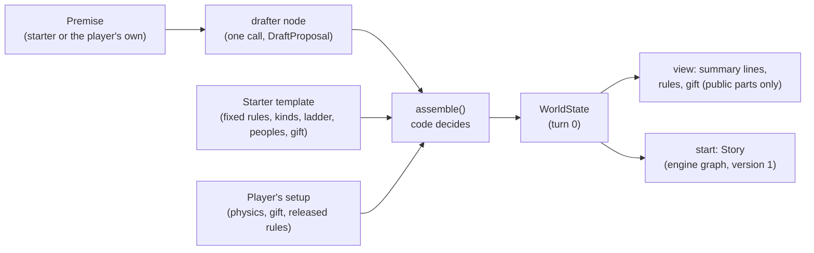

# Architecture

```
┌──────────────┐  HTTPS/JSON   ┌───────────────────────────┐   ┌──────────────────────────┐
│ Flutter app  │ ────────────▶ │ Story API (Django, ASGI)  │──▶│ Vertex AI: Gemini        │
│ app/         │  X-LLM-* hdrs │ Cloud Run, backend/       │   │ (or the user's own key)  │
│ iOS, Android │ ◀──────────── │ Ninja API, admin, engine  │   └──────────────────────────┘
└──────────────┘               │                           │   ┌──────────────────────────┐
                               │                           │──▶│ Neon Postgres (psycopg 3)│
                               │                           │   └──────────────────────────┘
                               │                           │   ┌──────────────────────────┐
                               │                           │──▶│ Cloud Storage: pictures  │
                               └───────────────────────────┘   │ (private, signed URLs)   │
                                                               └──────────────────────────┘
```

## Repo layout

| Path | What |
| --- | --- |
| `app/` | Flutter client: Riverpod, go_router, http, flutter_secure_storage, speech_to_text. See [app/README.md](../app/README.md) and [app/DESIGN.md](../app/DESIGN.md) |
| `backend/` | Python 3.13, Django and Django Ninja over ASGI (uvicorn), managed with uv, deployed to Cloud Run. Layout in [backend/README.md](../backend/README.md#layout) and [PLAN.md](PLAN.md#target-layout) |
| `neon.ts`, `package.json` | Neon config as code (`@neon/config`). Node is used only for the Neon CLI and this config. |
| `docs/` | Product and architecture notes |
| `.github/workflows/ci.yml` | Lint and test for both halves on every PR |

## Backend

Django 6 with Django Ninja, served over ASGI by uvicorn (B1). Settings come from environment
variables (`backend/lucid/env.py`), so Cloud Run, local runs and tests differ only in their env.

- **API.** One Ninja API mounted at `/v1`, with its live OpenAPI schema at `/v1/docs`. Each Django
  app adds its own router in `lucid/api.py`. Views are async; database writes that must happen
  together run in a sync function inside `transaction.atomic()` through `sync_to_async`.
- **Errors (T7).** Every error, including a 404 outside the API, a wrong method and an unexpected
  exception, comes back as the [API.md](API.md) envelope `{"error": {"code", "message", "details"}}`. Raise
  `lucid.errors.ApiError(ErrorCode.X, ...)` from any view. An unexpected exception is logged with
  its traceback and answers `internal_error`.
- **Logging (T4 to T6, B3).** JSON lines on stdout with `severity`, `request_id`, `trace_id` (from
  `X-Cloud-Trace-Context`, also linked as `logging.googleapis.com/trace`), `user_id` and
  `story_id`. `lucid.middleware.RequestContextMiddleware` opens a context per request, binds the
  story id from the URL, and writes one line per request when it ends, or when its stream ends for
  a streamed turn. The auth layer binds the user with `lucid.logs.bind(user_id=...)`. uvicorn's own
  lines go through the same formatter, and its plain-text access log is off. Fields named like keys,
  tokens, passwords or prompts are redacted, and headers, bodies and query strings are never logged.
- **Users.** A custom `accounts.User` from the first migration: the email is the login (stored
  lowercased), with display name, birth date (F8), role (`player` or `owner`, K7), Google subject
  id, whether the email is verified, and content preferences (F7). Sign-in is described in
  [Accounts and sign-in](#accounts-and-sign-in).
- **Admin (B1).** `/admin/` for staff: users, stories with their scenes, and pending events. A
  story's world state and version are read-only there, and saving a story writes only the fields
  staff changed, so the admin never undoes a turn (B12, T10). Its static files are collected into
  the image and served by ServeStatic.
- **Cold starts (B10, T3).** `/health` never touches the database, and the service refuses to start
  without `DATABASE_URL` and `DJANGO_SECRET_KEY` outside DEBUG. Model SDKs and LangChain are
  imported inside the code that uses them, off the event loop, and a test checks that loading the
  ASGI app and its URLs doesn't import them. The image answers its first `/health` about a second after the container
  starts.

## Accounts and sign-in

Requirements T8, S8, F8, K7 and T12; the endpoints are in [API.md](API.md#auth-and-account-t8-s8-f8-k7-t12).
The code is in `backend/accounts/`.

- **No Firebase (T8).** The app signs in with Google and sends the ID token once.
  `accounts/google.py` checks it with `google-auth` against Google's public certificates (cached
  for as long as Google's `Cache-Control` allows, refetched when a token names a new key, at most
  once a minute): signed with RS256 by Google, issued by `accounts.google.com`, unexpired, and for
  one of the OAuth clients in `GOOGLE_OAUTH_CLIENT_IDS`. Email and password accounts use Django's
  own password hashing and validators.
- **Our tokens (`accounts/tokens.py`).** An access token lives 15 minutes. It is signed with
  `DJANGO_SECRET_KEY` (HMAC-SHA256 through `django.core.signing`, so no extra dependency) and names
  the user and the session. A refresh token is 256 random bits, stored only as a SHA-256 hash, good
  for one refresh within 30 days. Each refresh rotates it inside the same session
  (`AuthSession`); a spent token used again after a 60-second leeway revokes the session, since two
  holders means one stole it. Rotating `DJANGO_SECRET_KEY` signs everyone out within 15 minutes
  unless the old key goes in `SECRET_KEY_FALLBACKS`.
- **Every request (`accounts/auth.py`).** One Ninja auth on the whole API: it checks the access
  token's signature and age without the database, then loads the session with its user in one
  query, so logout, a revoked session, a disabled account and a deleted account all take effect at
  once. It binds `user_id` to the request's log context (T4). Only `/v1/auth/*` opts out, and
  `/health` lives outside Ninja.
- **Ownership (S8, F8).** `stories/access.py` `owned_story()` loads a story for the signed-in
  player: `404` when it doesn't exist, `403` when it is someone else's or its rating is above the
  account's limit. Every story endpoint goes through it.
- **Owner role (K7).** A Google sign-in whose verified email is in `OWNER_EMAILS` gets
  `role = owner` with `is_staff` and `is_superuser`, and loses them at the next Google sign-in if
  it leaves the list. A password never grants it, and the role is read-only in the admin. The
  owner signs in with Google, so to use `/admin/` with a password, set one once with
  `python manage.py changepassword mikigb77@gmail.com` against the target database.
- **Taking over an email.** Email accounts are unverified until an email provider exists. When a
  verified Google sign-in matches an email account, it takes that account over and drops its
  password, because someone may have signed up first with an address they don't own.
- **Brute force (`accounts/throttle.py`).** Fixed-window counters in Postgres, so they hold across
  Cloud Run instances: 10 wrong passwords per email and 100 per address in 15 minutes, and 10
  new accounts per address per hour. Each attempt is counted before it runs, in one atomic
  upsert, so parallel guesses can't all slip under a limit, and a correct password or a sign-up
  that fails validation is handed back. Keys are HMACs, so the table holds no emails or addresses. The
  address is the `X-Forwarded-For` entry `TRUSTED_PROXY_HOPS` from the right (1 on Cloud Run, where
  Google's front end appends the address it saw). Per-user rate limits on the rest of the API are
  T9's, in `billing/`.
- **Delete and export (T12).** `DELETE /v1/me` sends `accounts.signals.account_deleting` and then
  deletes the user through the ORM inside one transaction, so stories, scenes, pending events,
  sessions and anything else with a foreign key to them cascade, and picture files are removed on
  commit. `GET /v1/me/export` collects the account and its stories (`stories/export.py`, without
  the hidden world state) and asks `account_exporting` receivers for more, such as pictures.
- **Sign in with Apple** is left for the App Store launch. Apple's guideline 4.8 requires it on iOS
  once Google sign-in is offered there. It fits the same shape: the app sends Apple's identity
  token to a `POST /v1/auth/apple`, which checks it against Apple's public keys (audience is our
  bundle id or Services ID), keeps Apple's stable `sub` on the user like `google_sub`, and issues
  our own tokens. Apple may hide the email behind a private relay address and sends the name only
  on the first sign-in, so both are saved then. It needs the Apple developer account.

## Story engine

A turn is played by the [turn graph](#turn-graph) (B5) on the rules engine
([below](#engine-package-backendengine)) and served by `POST /v1/stories/{id}/turns` as
server-sent events (B7, S3); see [Turn endpoint](#turn-endpoint).

How the reference app's memory layers map onto ours:

| Layer | Here |
| --- | --- |
| Long-term memory | the structured records (facts with importance 1–5, deeds, rumors, threads), chapter summaries every 20 turns (C3) and the rolling `summary` |
| Short-term memory | the last `RECENT_SCENES` scenes in the prompt |
| Relationships | characters' attitudes, factions' stances and the player's reputation (W3, W4) |
| Current goals | `goals` and `leads` (N2) |

Facts with importance ≥ 4 and all deaths and destructions are restated as **continuity rules** on
every turn.

**Still to build for endless stories:** retrieval of relevant facts and scenes with pgvector on
Neon (C4), so the prompt stays small however long the story runs.

## Engine package (`backend/engine/`)

The rules engine that replaces the one-call narrator above (WS2 in [PLAN.md](PLAN.md)). It is plain
Python and Pydantic, with no Django, Ninja, LangChain or model SDK imports (B4), and
`tests/engine/test_purity.py` fails if one creeps in. The turn graph (WS3) loads the story, calls
these functions and saves the result.

| Module | What |
| --- | --- |
| `engine/state/` | The world state (C2): `WorldState`, `WorldBible` (G6, G7, G18, W11, N7), `Character` with its `CharacterSheet` (G13, A1, A8, A9), `Faction`, `Place`, `Deed`, `Rumor`, `Fact`, `Goal`, `Lead`, `Thread`, `Clock`, `PendingEvent` and `RollRecord`. |
| `engine/contracts/` | What flows between the turn's steps (B5): `Intent` (interpret), `Resolution` (resolve), `DirectorPlan` (director) and `StateDelta` (what the narrator or the engine proposes to change). |
| `engine/context.py` | `TurnContext`: the story id, the turn number, story settings (S6), rating (F2) and content preferences (F7), which live outside the world state. |
| `engine/rng.py` | `SeededRng`, the seeded random numbers behind every roll (A3). |
| `engine/timekeeping.py` | How long each kind of action may take, and `advance_clock`, which moves the world clock through pending events in time order and stops at the first that needs the player (W10, W10a). |
| `engine/apply.py` | `apply_delta`: a proposed `StateDelta` applied with the C1 invariants, on behalf of the narrator or the engine, returning the new state and what it refused. |
| `engine/invariants.py` | `check_state` and `check_transition`: every C1 invariant on one state or between two, however they were made. |
| `engine/labels.py` | Time in words: dates in the world's calendar, "+8 h", "World: +0 s. You: +40 s.", "2 days ago", and the scene's time bar (W10, W10a). |
| `engine/visibility.py` | The C6 projection: `memory_view` and `status_view` in the shapes of API.md's `MemoryView` and `StatusView`. |
| `engine/world/` | The living world (WS10): deeds and witnesses (`deeds`), how severe a deed is by the world's norms (`norms`), rumors (`rumors`), attitudes, grudges, reputation and threat (`knowledge`), faction answers (`answers`, `arrivals`), discovery from traces (`discovery`), word of a death reaching close ties (`aftermath`), emerging, dormant and reviving cast (`cast`), clocks (`clocks`), the world tick (`tick`), maps and travel times (`geography`), the pending events it schedules (`scheduling`), their handlers (`events`), the catch-up loop (`passage`) and every delay, reach and cap in one place (`tuning`). No model calls. |
| `engine/pipeline.py` | The functions the turn graph calls. `catch_up`, `apply_event` and `record_consequences` call `engine.world`; `resolve` calls `engine.resolve`; `direct` has a default body that WS11 replaces. |
| `engine/resolve/` | Resolve (WS9): logic first, then dice. Turns an `Intent` into a `Resolution` in code; see [Resolve](#resolve-logic-first-then-dice). |
| `engine/samples.py` | Two sample worlds from the requirements, the Naples vendetta and the Azure Cloud Sect, for tests and development. |

**The turn, as the graph calls it** (B5). Every function takes the state as read-only and returns
a new one.

| B5 step | Function | Owner |
| --- | --- | --- |
| 1. Catch up | `catch_up(state, until_s, ctx, rng) -> TimePassage` applies events due by `until_s` (the graph passes `state.world_s`) in time order, stopping at the first that needs the player. It first makes sure every running clock has its next step pending and that the world tick is spaced so the stretch holds at most 24 ticks (K8), then runs `engine.timekeeping.advance_clock` with the world's handler. Nothing fires during a time stop | WS10 |
| 3. Resolve | `resolve(state, intent, ctx, rng) -> Resolution` | WS9 |
| 3. Time passes | `play_out(state, resolution, ctx, rng) -> PlayOut` plays the steps in order. The world catches up to each step's end through `catch_up` (one loop for every stretch of time, with the turn's own `rng`, so an event rolls the same however time is split into steps), and the actor's clock moves by their lived time. An event that needs the player cuts the plan short there (the cut step's effects and deeds don't happen, and later steps go to `unplayed`). At each finished step's end its `effects` apply as the engine's, then its consequences are recorded. The graph must not apply `effects` again | WS2 |
| | `record_consequences(state, resolution, step, ctx, rng) -> WorldState`, called by `play_out` for each finished step: each proposed deed becomes a `Deed` with its severity and witnesses, and the world's reactions are set going as pending events | WS10 |
| | `apply_event(state, event, ctx, rng) -> WorldState` applies one pending event that fell due, rolling from the event's own seed, and records on the applied event whether it needed the player. Kinds it doesn't own, such as `director.*`, are only marked applied | WS10 |
| 3. Direct | `direct(state, resolution, ctx, rng) -> DirectorPlan` | WS11 |
| 6. Apply the update | `apply_delta(state, delta, ctx, source=DeltaSource.NARRATOR) -> Applied`. Refused changes come back in `Applied.rejected` for the log and the C5 check; the rest applies. Before saving, the graph runs `check_transition(first, last)`, and a violation is an engine bug: log it and don't save | WS2 |

**Decisions the package makes:**

- **Records are keyed by id.** `WorldState.characters`, `factions`, `places`, `deeds` and the rest
  are maps from id to record, and each record's `id` must match its key. The player character is in
  `characters` under `player_id`, so attitudes, witnesses and knowledge treat everyone the same
  way (E5). `state.new_id("deed")` hands out stable ids. Never rely on map order, because Postgres
  JSONB reorders object keys: sort by time or id wherever order matters, as `due_events` does.
- **In-world time is whole seconds since the story's epoch** (W10). Everything that happens in time
  carries a `timeline_id` and a world second (W10a). A character's personal clock is
  `world_s + personal_offset_s`, so it moves with the world for free, and a time stop only adds to
  the user's offset. World processes such as rumor spread, clock steps and faction answers are
  pending events with due times, so they fire in time order wherever time passes, at the start of
  a turn and during a long action alike. The rows live in `stories_pendingevent` (B12): the turn
  endpoint loads the story's pending rows on its timeline into `state.pending_events` and writes
  back the ones the turn applied, cancelled or scheduled. `EventStatus` uses the table's values
  (`pending`, `applied`, `cancelled`).
- **Knowledge is recorded on the record.** Anything a character can know carries `known_by`, a
  list of character ids, plus `met_by` on characters, `visited_by` on places and `heard_at` on
  rumors. The Memory screen shows only records whose lists hold the player character (C6). Hidden
  truth lives in fields the projection never shows: `is_true` on rumors and facts, secrets, mystery
  answers, real attitudes behind an `apparent_affinity`.
- **Proposals versus decisions.** `StateDelta` serves the narrator and the engine. Fields marked
  engine only (terminal changes such as deaths, anything that needs a C1 `Cause`, faction
  reputation, rulings, gains, accepted backstory, rule changes) are rejected when the narrator
  proposes them, because resolve records the outcome in code before narration (F4). Resolve puts
  its own changes for each step in `StepResolution.effects`. The narrator can still introduce
  people, places and factions with real names, nudge an attitude by up to 10 points per scene,
  record facts, items and leads, and end the scene. A death, destruction or ruin is undone only by
  a `Cause` that points at a recorded deed or a fired event naming the subject, on this timeline,
  no earlier than the change it undoes, by a mechanism the world bible allows (resurrection, a
  presumed death that was false, a revival with survivors, rebuilding).
- **The living world runs on pending events** (W2, W5, W6, W10, W13, E2). Whatever the world
  does later is a `PendingEvent` with a due time and its own seed, of a kind in
  `engine.world.Kind`: `world.report` (a witness reaches a faction), `world.answer` (a faction's
  answer or one person's revenge arrives), `world.rumor`, `world.tidings` (word of a death reaches
  the victim's family and friends), `world.discovery` (a look at a secret deed's traces),
  `world.clock_step`, `clock_end`, `world.emergence`, `world.revival` and `world.tick`. Whether an
  event needs the player is decided when it applies, from the state at that moment, and stored on
  the applied event: guards who find the player where they came need them, and guards who find
  them gone search instead. Delays come from the map: a witness walks to the faction's seat (the
  outermost place it holds, else where its leader is) or calls where the world has phones (G6),
  and the answer then gathers and travels back. A route between two places is what the trip
  takes; a place inside another is a 15-minute walk from it, unless it is a region of its own (a
  city, a village, a kingdom), so two cities are as far apart as their roads say. Where the map
  doesn't say, a trip takes about an hour, never no time. Those who keep a law act within the
  region their seat is in. Every figure is in `engine/world/tuning.py`.
- **Who learns what, and what it does.** A deed is known to its doer and witnesses (asleep or
  unconscious people see nothing; in stopped time only those immune to it do). Others learn it
  from a rumor they believe, which loses accuracy with each hop and, once far enough off, turns
  into a version that no longer names the doer, or from a report. Each faction counts each deed
  once (`Deed.known_by_factions`); one deed moves esteem or fear by at most 15 points, less the
  further it already is from neutral (W9). A faction shrugs off what its own members do unless it
  is severity 4 or worse, and never answers its own leader. NPCs' deeds run through the same code
  (E5); the player character never reacts by itself (G15). Resolve proposes an attempt on someone
  as a deed even when it fails: an attempt that harmed nobody is still harm when resolve weighed
  it at 2 or more, so its target keeps a grudge and the law hears of it, and a killing nobody
  died of counts as the wounding it was. Severity floors apply only when someone was harmed.
- **Clocks** step with time (`interval_s`, from `next_step_s`) and with deeds. An `advances_on` or
  `reverses_on` entry names a deed kind (`kill`) or a kind and a victim, target or place
  (`kill:carmine`, `burn:mill`). A full clock gets a `clock_end` event; when it arrives where the
  player is (the event's place, else its owner's seat), it is a scene, and otherwise it happens
  without them, closing a tied thread of ambition, quest, threat or debt as resolved without the
  player. Mysteries, rivalries and romances stay open.
- **The cast stays bounded** (W15, K8). At most 8 key NPCs and 4 factions are active; the least
  involved go dormant, kept in state, never deleted, and come back on stage when the story returns
  to them (in the scene, in an open thread, with something on its way). New characters and factions (an avenger, a
  resistance in a conquered place, a successor) carry an `origin`. A destroyed faction gets one
  look at a revival, and comes back only with survivors, as rebuilding, with a `Cause` pointing at
  the revival event (C1); it stays rebuilding for the rest of that turn.
- **What the player sees** (C6). `engine.visibility` reads only records whose knowledge lists
  hold the player character: `known_by`, `met_by`, `visited_by`, `Rumor.heard_at`, and the
  `known_by` on each status change, so an off-screen death shows only once the player hears of
  it. A witness the player didn't notice (a hidden watcher, anyone immune to a time stop) is on
  `Deed.unnoticed_witness_ids`, so the deed reads as unseen. People show the attitude they let
  on (`apparent_affinity`), never trust or what they hide.
- **Rolls are replayable.** The graph makes one `SeededRng.for_turn(story_id, timeline_id, turn)` per
  turn, and each seam derives child streams with stable labels, such as
  `rng.child("resolve", "step", 0)`. Draws come from SHA-256, so a seed recorded on a scene replays
  its roll on any machine, and retrying a turn never rerolls.
- **The state is stored as JSONB.** Unknown keys are ignored on load and new fields need defaults,
  so a state saved by an older engine still loads. A state whose `schema_version` is newer than the
  engine's is refused, so an old revision can't drop fields it doesn't know and save the stripped
  state back during a rolling deploy. Bump `SCHEMA_VERSION` when a field is removed or changes
  meaning.

### Resolve: logic first, then dice

`engine/resolve/` (WS9) is what `pipeline.resolve` calls. It turns the interpret step's `Intent` into
a `Resolution` in code, before anything is narrated, so the narrator writes the outcome it is given
(A3) and a blocked narration never blocks the deed (F4). The model proposes facts; code checks them
against the state wherever the state can tell, and decides. Each step goes through these checks in
order, and the first one that settles it ends the step:

1. **World and sheet** (`checks.py`; G8, G14). A step against one of the world's rules, or any power
   in a world with nothing extraordinary, is ruled out with the rule as the reason, whatever the
   interpret step proposed, for NPCs too. A power the actor doesn't have or hasn't recovered, a
   technique they never learned and an item that isn't on them (vehicles and property are used
   where they stand) are ruled out too.
2. **Beats** (`checks.py`; R2). Whatever a beat uses must be the body, a power, something carried,
   something the scene holds (props, people, the place) or something an earlier beat made canon.
   Something new is canon when the place plausibly holds it, rolled for when that is uncertain, and
   an empty search when it can't, which fails the step. A claim that the scene holds something it
   doesn't is judged as new. A power a beat uses must be ready, as in step 1, and a time stop used
   in a beat stops the world clock like one named on the step. Each check is in
   `StepResolution.beats`. Words are matched one way only (`words.py`): every meaningful word the
   model wrote must be in what the state holds, so "the knife Gennaro keeps under the counter"
   doesn't hold just because Gennaro is there. The model gives ids (`ref`) where it can.
3. **Who stands in the way** (`core._opposition`; A2, A8). The targets of a harmful aim and of a
   social step always stand in the way, so leaving them out of the facts buys no free kill. The
   dead never do. A time stop freezes everyone but its user (W10a), a helpless state on the sheet
   (asleep, tied up, stunned, subdued, dying, read on whole words so "half asleep" or "bound by an
   oath" doesn't count) means they can't respond whatever was proposed, and the model's word that
   they can't respond (unaware, frozen with fear) is taken unless it claims stopped time that isn't
   in effect. A harmful aim lands only on the targets the step names, if they are alive; on whoever
   stands in the way only when it names no one.
4. **The class** (A2, G18). Power is measured on the step's axis (`power.py`), from the sheet's
   tier raised to its ladder rung, minus condition (wounds, exhaustion, an empty reserve,
   weakening). Gaps are counted in steps: the rungs of the world's ladder on that axis, or two
   tiers where it has none. Each other opponent within a step of the strongest adds half a step,
   up to one. Against someone who can respond: two or more steps up is ruled out head-on, one is a
   long shot, closer is contested, and two or more down is certain. When nothing can push back, the
   proposed means decide (clearly enough is certain, clearly not is ruled out, a close call is
   rolled: between full harm and partial harm for a blow that lands, between any result for
   anything else), capped by how far the target's body stands above the actor's might, so no
   proposal gets a kitchen knife through a sleeping dragon. A step proposed as a long shot with no
   verdict on the means is rolled as one. A harmful aim always meets that body check for every
   target it doesn't meet head-on, whatever axis the step names and whoever else stands awake
   beside them. Where nothing can be measured (a
   faction, a storm), the step is contested, or harder if the interpret step judged it so; a
   proposed class can lower the outcome there but never raise it.
5. **Chains** (`chain.py`; A9). A step with a chain of cause and effect goes around the strength
   instead of meeting it, so the gap doesn't apply. Anyone who can respond may see it coming, which
   is rolled first. Then each link holds, is rolled if the model judged it open, or breaks: when it
   rests on a fact that isn't true or on someone dead, when the model ruled it out, or when a target
   who isn't asleep or bound has an answer on their sheet. `ChainLink.answers` lists the answers in
   plain words ("teleport", "breathe without air"), and code looks for them in the target's ready
   powers, techniques, carried items and traits, which the interpret step may not see. The chain
   stops at the first link that breaks, and each link's time is added to the step (W10). The
   step's roll is the one that decided it: the roll of the link it broke on, or, when every link
   held, the hardest roll it took (the setup or an open link).
6. **The roll** (`odds.py`; A3, A5). Only contested and long-shot steps, close calls, uncertain
   finds and open links are rolled, each from its own seeded stream under
   `rng.child("resolve", "step", i)`. Odds start from the gap (even at no gap; a long shot starts
   at 1 in 10 one step up and falls toward 1 in 33), then edges, hindrances, skill, technique,
   traits and, for social steps, the target's real attitude (A3, not the one they show) shift them
   in log-odds. Each class keeps its odds in a band whatever the shifts and the difficulty do:
   contested 5 to 95%, long shot 2 to 15%, close call 20 to 80%. Difficulty shifts only those odds,
   never a certain or ruled-out step. Below the odds is a success; a quarter of the rest is a
   partial success where the facts allow one.
7. **Time** (`durations.py`; W10). Durations are bounded by the kind of action. An uncertain one is
   rolled across orders of magnitude around the proposal (a thirtieth to thirty times), still
   within the kind's bounds, and recorded on the step's roll. On a rolled step the time is the
   second draw of that roll's own seed, so the one recorded seed replays both. Inside a time stop
   the world clock stands still and the actor's lived time counts down the stop.
8. **Effects, deeds and costs** (`effects.py`; F4, W1, A1). `IntentStep.aim` says what success
   does to the targets: a kill that succeeds is a confirmed death, a partial kill leaves them badly
   wounded, a wound or a subdual does less. Only a settled step's aim on living targets changes
   the state, so claimed outcomes (A6) and injected text (A7) change nothing. Any step against
   someone proposes a deed, even a failed or ruled-out one, so the god notices the swing (A8). The
   targets it harmed are the deed's victims and everyone else who stood in the way its targets;
   `record_consequences` weighs its severity and witnesses (W12). Powers used list their costs.

A chained plan stops at the first step that doesn't cleanly succeed, with the rest in `unplayed`
(R6). Reasons are written in the world's words and speak to the player ("Elder Mo at Core
Formation against you at Qi Condensation: head-on, there is no contest."). Time stop's own rules
(immunity, hit modes, rulings on the player's theories) and growth are WS9b's, in
`engine/resolve/powers/`.

## Model layer

`backend/graph/llm/` is the one way the backend calls a model (B6, T5, T7). It is plain Python with
no Django imports (B4), and importing it loads no model SDK: LangChain and google-genai load on the
first real call (B10). The turn graph below is its main caller.

```python
telemetry = TurnTelemetry()
llm = build_client(rating=story.rating, byok=parse_byok(provider_header, key_header),
                   recorder=telemetry)
intent = await llm.structured(Node.INTERPRET, Prompt.build(system, action), Intent)
async with aclosing(llm.stream_structured(Node.NARRATOR, prompt, NarratorOutput,
                                          field="narration")) as events:
    async for event in events:  # TextDelta, StreamRestart, then Completed(value)
        ...
picture = await llm.image(Node.PICTURE, Prompt.build(style, scene, images=portraits))
```

**Nodes and models (B6, B8).** Each node has a model and defaults in `graph/llm/config.py`,
overridable with `<NODE>_MODEL` and `<NODE>_THINKING`, read like Django's settings from the
environment, `backend/.env` and the repo-root `.env.local`:

| Node | Default model | Price per 1M tokens in / out | Why |
| --- | --- | --- | --- |
| `narrator` | `gemini-3.5-flash`, thinking `low` | $1.50 / $9.00 | The one large call on the critical path. Low thinking keeps the first words under 2 s (S3). |
| `interpret` | `gemini-3.5-flash-lite`, thinking `low` | $0.30 / $2.50 | Cheap, but it reasons about cause and effect (A9), so the graph can raise its thinking for a turn that rests on a chain. |
| `checker`, `tick`, `summarizer` | `gemini-3.1-flash-lite`, thinking `low` | $0.25 / $1.50 | The cheapest model (B8). |
| `drafter` | `gemini-3.5-flash`, the model's own thinking | $1.50 / $9.00 | World and character drafts (WS12), off the turn path. |
| `picture` | `gemini-3.1-flash-lite-image` | $0.034 a 1K picture (image tokens at $30 per 1M) | The cheapest image model (M8). Bigger sizes bill more tokens. |

Prices are Vertex AI's standard prices on the `global` endpoint, checked 2026-11-03, and live in
`graph/llm/pricing.py`. A model missing from the table is priced like the dearest known model, so
the estimate never undercounts. Gemini 3.6, 3.7 and 3.8 Flash are cheaper than 3.5 Flash until the end of
2026 ($0.75 / $3.75), but stay out of the defaults until T18's narration evals have run on them.

**Providers.** `LLM_PROVIDER=vertex` uses `ChatGoogleGenerativeAI` from `langchain-google-genai`
with `vertexai=True` and Application Default Credentials (B11). `langchain-google-vertexai`'s
`ChatVertexAI` was deprecated in 3.2.0 in favour of this class, so we use it directly. Every node
shares one google-genai client (and its connections) per event loop, or per request for a player's
key. `LLM_PROVIDER=fake` (the default) is the offline model,
which answers any schema with placeholder values. Don't set `GOOGLE_API_KEY` or `LANGSMITH_TRACING`
on the service: the first changes which credentials LangChain picks, the second would send prompts
to LangSmith.

**Calls.** Every call streams from the backend, so blocks and usage look the same everywhere. The
client gives each attempt the node's deadline, counting only time spent waiting on the model and
never the caller's time between chunks, retries a transient failure (timeout, 408, 429, 499, 5xx, a
cut-off or unparseable answer) once, and otherwise raises a typed error with the API's code: `LLMUnavailable`
(`llm_unavailable`), `LLMBlocked` (`blocked`, with the categories and whether the prompt or the
response was blocked) or `BadKey` (`bad_key`, only for a player's key). A safety block is never
retried blindly: the graph retells a blocked narration as a cut-away, then a template line (F4),
and turns a blocked interpret step into `unreadable_action`.

**Streaming the narration (S3, B7).** The narrator returns one JSON object, and
`stream_structured` streams the decoded text of its `narration` field as it is written, with
`graph/llm/jsonstream.py`. The full JSON is still validated at the end. If an attempt fails after
text was shown, the client yields `StreamRestart` before retrying, which the turn endpoint sends as
`narration.reset` with reason `retry` ([API.md](API.md)).

**Safety settings (F5).** `graph/llm/safety.py` holds the table and the reasons behind it:
harassment off in Mature; hate speech, dangerous content and, in Mature, sexual content filtered
only at high probability as backstops for G12, F3 and the fade-out rule; Teen filters sexual
content from medium; pictures filter from medium, and sexual content from low (M6). WS16 tunes it
against T15's content-line evals.

**Telemetry (T5).** Each call leaves one `CallRecord` (node, model, provider, BYOK or not, outcome,
tokens in, out and thinking, pictures, latency, time to first text, attempts, retry reasons,
blocks with categories, estimated cost) with the request's `TurnTelemetry`. The turn endpoint logs
`summary()` as the turn's T5 line. `cost_usd` is always the raw cost, and billing charges the
calls made on our own account (`billable_cost_usd`; BYOK calls are free, K6) plus its margin (K2). Records hold
no prompt or story text, and a `Prompt`'s repr shows only its size (T6).

**Tests** script the fake per node: `FakeBackend().script(Node.NARRATOR, Fail(), Reply(json=...))`
for a failure and its retry, `Block(after_text=...)` for a block mid-stream, `Hang()` for a
timeout. `tests/graph/test_gemini.py` runs the real LangChain model with google-genai's network
call replaced, to check the Gemini translation: messages, safety settings, blocks, usage, errors.

## Turn graph

`backend/graph/turn/` plays one turn as LangGraph's B5 graph: seven nodes, one after the other,
with no checkpointer, because story state lives in our own tables (B9). It has no Django imports
(B4), and LangGraph loads on the first turn, not at startup (B10). The [turn
endpoint](#turn-endpoint) loads the story, runs the graph and saves what it returns.

```python
turn = TurnInput(state=world, ctx=TurnContext(story_id=..., turn=world.turn + 1, ...),
                 kind=TurnKind.ACTION, action="I throw a stone at Zhao, then run for the gate",
                 scenes=scenes)  # every scene since the last chapter, and at least the last 3
async with aclosing(run_turn(turn, llm)) as events:
    async for event in events:  # NarrationDelta, NarrationReset, then TurnCompleted(result)
        ...
```

| B5 step | Node | Kind | What it does |
| --- | --- | --- | --- |
| 1 | `catch_up` | code | `engine.pipeline.catch_up`: pending events that fell due fire in time order (W10, B12). Once 20 turns are saved since the last chapter, it also starts their chapter summary, which runs alongside the turn (C3). |
| 2 | `interpret` | model (`interpret`) | The player's words become an `engine.contracts.Intent` (V3, R2, A9). A standing action and the opening need no call. The prompt asks for each step's aim and each link's answers by name, since resolve records the aim's outcome before narration (F4) and looks for the answers on the target's sheet (A9). `check_intent` always makes the player character the actor, so the player's words never make anyone else act (A6), turns unknown ids back into words, hands back steps past the eighth unplayed, and makes an action that fits nothing one step, so nothing is refused (B5). |
| 3 | `resolve` | code | `resolve`, then `check_resolution` (A2: the class wins over a contradicting result, and a certain step keeps only a roll that picked how long it took; A3: a rolled step's result is its roll's; R6: the plan stops at its first step that doesn't cleanly succeed), then `play_out` (which stops the plan at an event that needs the player) and `direct`, then `check_plan` (pictures, events and callbacks against the state and the player's settings, F7, M1, M2). This is C5's code part, before anything streams. |
| 4 | `build_context` | code | The narrator's brief: the moment the last scene ended on (R3), the people present, the sheet, the outcome with any unplayed steps, the time that passed, the events the player could notice, the director's pick, the chapters, the rolling summary and the last 3 scenes (C3). Secrets, secret powers, mystery answers and events far away stay out (C6). |
| 5 | `narrate` | model (`narrator`), streamed | The brief's OUTCOME carries each step's checked beats when one made something canon or came up empty, so the narration plays the search and stops the step there (R2). One structured call, with the `narration` field streamed as it is written (S3, B7). A block is retold as a cut-away, then as the template line, and the deed stands (F4). Any other failure, after the client's one retry, ends the turn with `llm_unavailable` (T7). |
| 6 | `apply_update` | code | `check_update` keeps a blank scene end from erasing the last moment and leaves the dead out of the scene, then `engine.apply.apply_delta(..., source=DeltaSource.NARRATOR)` applies the rest with C1, the turn is bumped and the `SceneDraft` is built in API.md's shape: steps with class, reason and roll, the chain, where the plan stopped, the event, the planned picture with its prompt, and the time. |
| 7 | `after_turn` | code | Waits up to 5 s for the chapter summary started in step 1 (the cheapest model, B8), then runs `engine.invariants.check_transition` on the turn's first and last states. A late or failed summary is asked for again next turn. A C1 violation is an engine bug: it raises `InvariantError` and nothing is saved. |

**Events.** Nodes send `NarrationDelta` and `NarrationReset` through LangGraph's custom stream,
and the endpoint sends them as `narration.delta` and `narration.reset` (API.md). A reset is sent
only when text was shown: `retry` when the model failed partway and is being retried, `cutaway`
and `template` when the narration was blocked. `TurnCompleted.result` carries the state to save,
the scene, the intent, the resolution, the plan, the pending events that fired, the issues the
checks found and each node's time in milliseconds for the T5 line.

**Errors.** `UnreadableAction` (`unreadable_action`, 422) when the interpret step is blocked, the
one block the player sees (F4). `LLMUnavailable` and `BadKey` from the model layer otherwise, and
`InvariantError` for an engine bug. Nothing is saved on any of them, and a chapter summary still
running is cancelled, so nothing outlives the response (B8).

**Proposals versus decisions.** The interpret and narrator outputs are proposals. What
`engine.apply` refuses, and what the checks repair, is kept on the result as `Issue`s and logged as
`turn check` lines with the code only; the details can hold story text, so they are logged at
DEBUG (T6).

**Prompts** live in `graph/turn/prompts.py` with the requirement behind each rule: the interpret
prompt (V3, R2, R6, R7, A6, A9, N2, N4, W10) and the narrator's (R1 to R7, S2, S4, F1 to F3, F7,
G5, M1, C1), whose content rules follow the ratings table above.

**Tests** in `tests/graph/test_turn_*.py` run whole turns on the scripted fake: the stream, a
standing action, the opening, a blocked interpret step, a cut-away, the template, a failure mid-
stream, a careless resolve cut short by the checks, chapter summaries, replaying a turn and the
offline model.

## Turn endpoint

`backend/stories/` serves API.md's Stories contract on graph stories. A story is made by starting a
draft (WS12's `POST /v1/drafts/{id}/start`) or, in development, by
`uv run python manage.py seed_story <email> [--world grounded|cultivation]`, and its first turn is
`kind: "opening"`, which opens on the moment the draft's `scene.ended_on` describes. Stories the old
one-call narrator wrote (`Story.engine == "legacy"`), and stories whose world state was never
filled in, are not served.

`POST /v1/stories/{id}/turns` (`stories/api.py`, `stories/turns.py`):

1. **Before the stream**, in API.md's order: auth, ownership and rating (`owned_story`), the
   version (T10), the BYOK headers, the request against the story (an opening only on a story with
   no scenes, a choice only from the last scene's suggestions), then `billing.meter.astart` (rate
   limit, quota and credit hold). Each failure is an ordinary JSON error, and none counts against
   the rate limit or quota.
2. **Read** (`turns.prepare`): the world state with the story's pending rows on its timeline
   merged in (`stories/pending.py`, B12), the scenes the next chapter summary covers (those since
   the last chapter, at most 60, so summaries that were late for long catch up a window at a time)
   and at least the last 3 (C3), the player's content preferences (F7) and the story's settings
   (S6).
3. **Stream**: `turn.started` at once, then `run_turn`'s narration as `narration.delta` and
   `narration.reset`. The model client and LangGraph are built off the event loop, since the first
   turn loads their SDKs (B10) and a player's key gets a client of its own. A failure from here on is an `error` event (`unreadable_action`,
   `llm_unavailable`, `bad_key`, `version_conflict` or `internal_error`), and nothing is saved or
   charged.
4. **Save** (`turns.save`), in one transaction: the state, `turn` and `version` with an optimistic
   check (`UPDATE ... WHERE version = <read>`, so of two racing turns the second gets
   `version_conflict`), the `Scene` row with its time labels in the world's calendar
   (`engine.labels.scene_time`) and its cast, the pending events the turn scheduled, applied or
   cancelled, the picture plan (`media.plans.plan_picture`, M1; drawn in the app's own request, M3)
   and the charge (`meter.charge`, K2). A picture that can't be planned leaves the scene without
   one, and the turn still saves. Then `scene.completed` carries the scene in API.md's shape with
   the new version and clock; if its picture URLs can't be read then, it goes without them,
   since the turn is already saved.
5. **Always**, however the turn ends: the credit hold is released (a no-op after the charge; a
   stream Django closes before it started releases it too), a BYOK client is closed, and T5's one
   line is written, `Turn <outcome>`, with the turn, kind, input mode (V7), outcome (`ok`,
   `abandoned` when the player left before it was saved, or the error code), `sent` (false for a
   turn saved after its player left), the time to the first text (S3), each node's time, the issue
   codes and the telemetry summary (calls, models, tokens, cost, retries, blocks). Never the
   action, the narration or a prompt (T6): an unexpected Pydantic error, whose text quotes the
   values it rejected, is logged with its traceback and field names only, and in full at DEBUG.

**Pending events (B12).** A row's id is derived from the story and the engine's event id, and its
`payload` holds the engine's `PendingEvent`. When a turn reads them, a row's columns (status, due
time, kind) win over the state, so an event cancelled in the admin stays cancelled. A row written
outside a turn needs only its columns: it is read in with the row's id as the event's, and fires
when it falls due. Every read and write is scoped to the story.

The other endpoints read the same rows: the Library (its `world_time_label` comes from the state's
calendar and clock, read in the database, so no whole world state is loaded), a story with its last
scenes, scrollback, `PATCH` (title and settings only, under a row lock, so two changes sent
together both count and a turn saved meanwhile is never undone),
`DELETE`, and the Memory and `/status` views (`engine.visibility`, with portrait and place picture
URLs from `media.lookups`).

**Tests** in `tests/stories/` play turns over ASGI on the scripted fake model, with the real credit
meter and picture planner: every event, each error before and after the stream starts, a lost
version race, a player who leaves mid-turn or mid-save, pending rows both ways, and the T5 line.

## Drafting a world and a character

Requirements: G1, G2, S1, A1, G6, G7, G8, G18, G22, N7, C6, E2, W15. The chain is
`backend/graph/drafting/` (plain Python on the model layer, no Django, B4); `backend/drafts/` stores
drafts, serves `/v1/premises` and `/v1/drafts` ([API.md](API.md#drafting-a-world-and-a-character-g1-g2-s1-a1))
and creates the story on start.



- **A draft stores inputs, never state.** The `Draft` row holds the model's latest proposal
  (`schema.DraftProposal`), the premise and starter id, and what the player set up (physics, gift
  strength, the starter rules they let go of, difficulty, event frequency). The world state is
  `assemble()` of those inputs, the same every time, so a revision replaces one half of the
  proposal (the world or the character) and code re-decides everything else. The state is copied
  into the story only on start.
- **The model proposes; `assemble` decides.** The proposal schemas are compact and unbounded, and
  code cleans them: unique slug ids with references resolved by id or name and dangling ones
  dropped, the player always `player` with a real name, list and text sizes capped, and every C1
  invariant checked. G7: a starter's fixed rules and kinds hold, every kind has a fixed existence
  rule, and a proposal that contradicts its genre (a grounded claim in a world of qi, qi in the
  Naples vendetta) loses that part. G8: no power in a grounded world or from a kind that doesn't
  exist, and attributes stop at 5 where nothing extraordinary exists. G18: rungs are A8 tiers two
  apart and a rung sets its axis. G22: the player's gift pick beats the premise's, which beats the
  model's, `none` removes the gift, and time stop defaults to three heartbeats with a breath to
  recharge, hitting at relative speed only when overpowered. C6: secrets, agendas, faction plans,
  mystery answers and a body's forgotten past are kept where only code and the narrator see them.
  W15: at most 8 key characters and 4 factions start active. Clocks get `interval_s` and
  `next_step_s` in world seconds, with no pending events yet.
- **What the player reads is written by code** (`view.py`) from public fields only: the summary
  lines, the character lines, the rules, and the title, genre and tone. As a last guard, any line or rule that quotes five or
  more words of hidden text, or names someone the character doesn't know, is dropped.
- **Revisions and edits.** `revise(target, instruction)` sends the whole draft, hidden parts
  included, so the change fits the world, and keeps every fixed rule the model doesn't explicitly
  list in `dropped_rule_ids`; a dropped starter rule is released for this story. Direct edits
  (`plan_edit`, then `finish_edit`) make code-only changes at once and call the model only for
  rewritten summary lines, rewritten rules, a new gift strength or a rating lowered to Teen, one
  call for the world and one for the character. Rules the player wrote stay word for word, their
  list decides which starter rules hold, and a rule the leak guard hides from them survives their
  edit.
- **Around each model call** (`drafts/service.model_call`): the BYOK headers (S9), the credit meter
  with `meter.DRAFT` (the charge lands in the transaction that saves the draft), the client for the
  draft's rating (F5), the model errors as API errors (T7), and one T5 log line on the `drafts`
  logger with tokens, cost and outcome, never the premise or the prompt (T6).
- **Offline.** With `LLM_PROVIDER=fake`, `samples.offline_backend` answers with a full sample draft:
  the Naples vendetta for a grounded starter, the cultivation sample otherwise.

## App

The Flutter app (`app/`) is written against the v1 API in [API.md](API.md), and also reads the
interim shapes the backend serves until the turn graph lands (WS3): a turn answered as one JSON
object, and the raw world state as memory.

- **Design system** (`app/lib/design/`): tokens, a dark and a light theme, a per-story accent picked
  from the genre, bundled fonts, motion, and the shared components, all on show at `/gallery`.
  The rules are in [app/DESIGN.md](../app/DESIGN.md), and the picture house style in
  `backend/media/prompts.py` follows its "Pictures" section.
- **API client** (`app/lib/core/api/`): JSON over `http` with the session's bearer token. On a 401
  it refreshes once (one refresh shared by every request that hit it, as API.md asks) and retries;
  if the refresh is refused, the session ends and the router returns to the welcome screen. Errors
  are an `ApiException` with a typed code from API.md's error envelope, plus `network`, `timeout`
  and `server` for failures without one (T7). The player's own key rides only on POSTs under
  `/v1/drafts` and `/v1/stories` that may call a model, and those wait up to 3 minutes for an
  answer (other requests 30 s, and a turn's stream 150 s of silence), longer than the model
  layer's own limits. Providers retry a failed read on their own only for a network or server
  failure, three times at most (`retryTransient`); a 404, a 403 or a limit is final (T9).
- **Turns stream** as Server-Sent Events (S3). The client parses them into `TurnEvent`s that always
  end in `SceneCompleted` or `TurnFailed`, so a dropped connection is a typed error, not a hang.
  An interim JSON answer is replayed as the same events.
- **Pictures** (M3): the scene arrives with its picture `planned`; the app asks for it in its own
  request, every 1.5 s while it is pending, sizes the slot by `kind` meanwhile, and skips it quietly
  if it fails.
- **Session** (`app/lib/core/session/`): tokens in the platform's secure storage. Sign-in screens
  (WS13) post to `/v1/auth/*` through `authApiClientProvider` and hand the `Session` to
  `SessionController.signIn`, which uses new tokens at once, before saving them, because a
  rotated refresh token can't be used twice. A link opened while signed out waits on the welcome
  screen (`/welcome?to=…`) and opens after sign-in.
- **Fake API** (`--dart-define=API_MODE=fake`): an `http.Client` inside the app that speaks API.md,
  with one file per area, so the app runs and is tested end to end without a server.
- **Strings** are in `app/lib/l10n/app_en.arb`, generated at `flutter pub get` (S10).

## Bring your own key

- The app keeps the key in `flutter_secure_storage`, one per account on the device (so whoever signs
  in next never plays on it), and sends it per request as `X-LLM-Provider` and `X-LLM-Api-Key`.
- `graph.llm.parse_byok` wraps it in a `ByokKey` whose repr is masked and which refuses to be
  pickled, and `build_client` makes a Gemini API client for that request only, never cached. It is
  never persisted or logged, and error details are scrubbed of it.
- The client's base URL is pinned to `generativelanguage.googleapis.com`, so no environment
  variable (such as LangChain's `LANGSMITH_GATEWAY`) can route a player's key anywhere else.
- Only `gemini` is supported for now. A rejected key is `bad_key`, never retried.

## Credits, quotas and rate limits

Requirements: K1, K2, K6, K7, K8, M7 and T9. The code is `backend/billing/`; the app sees it through
`GET /v1/me/credits` and the errors in [API.md](API.md#auth-and-account-t8-s8-f8-k7-t12).

- **Accounts and the ledger.** One `CreditAccount` per user holds the balance, in cents to four
  decimals. Every change locks that row, applies the change and appends a `LedgerEntry` in one
  transaction, so balances can't race and always equal the sum of their entries. The ledger is
  append-only: the model refuses edits and a database trigger refuses any `UPDATE`, so a
  correction is a new adjustment entry. A check constraint refuses a negative balance. Everything
  is deleted with the account (T12); when real payments arrive (K4, K5), their records will need
  keeping for accounting. `manage.py check_ledger` checks every balance against its ledger.
- **Starter credit (K1).** A `post_save` receiver on `accounts.User` opens the account in the
  transaction that creates the user. A verified account (one with a Google sign-in at once, an
  email account once `email_verified` is set) gets $0.50, once; any later save that verifies the
  account grants it then. An account that is missing is opened on first use.
- **Staff.** The admin shows balances and the ledger read-only. Deleting a user there still
  takes their billing rows with it (T12); deleting billing rows on their own is refused.
- **Prices.** The per-model prices are the model layer's (`graph/llm/pricing.py`): each call's
  telemetry record (T5) carries its raw cost. Billing charges that cost times `1 + BILLING_MARGIN`
  and adds no fixed fee, so the spread between turn kinds is the spread of their model cost (K8).
  Only calls on our key are charged (K6), which is `TurnTelemetry.billable_cost_usd`. A model
  missing from the price table is priced at its dearest fallback, so a charge never undercounts;
  the entry says `price_known: false` and a warning is logged so the table gets fixed.
- **The flow around a model call** (`billing.meter`), the same for turns, drafts and pictures:

  ```python
  ticket = await meter.astart(user, meter.TURN, byok=byok_key is not None)  # before streaming
  ...  # the model calls, collecting telemetry
  with transaction.atomic():  # the turn's own save
      ...  # scene, state, version bump
      meter.charge(ticket, telemetry.calls, story_id=story.id, turn=turn)
  ...
  await meter.arelease(ticket)  # in a finally: gives back the hold, a no-op after charge
  ```

  `start` counts the per-minute rate limit (any key) and the daily quota (our key), then holds the
  estimated cost (`BILLING["RESERVE_CENTS"]`), all in one transaction, so a refused request counts
  against nothing. Holds are rows that count against the available balance until charged,
  released or expired (10 minutes, longer than Cloud Run's request timeout), so concurrent turns
  on several stories can't spend the same credits, and a request that died never locks credits
  for long. `charge` runs in the caller's transaction, so a turn and its charge are saved together
  or not at all. It is idempotent per ticket and never takes a balance below zero: a charge above
  the balance takes it to zero and records the shortfall (`detail.uncovered_cents`). Pictures use
  `charge_image`, and `out_of_credits` from `start` means the picture is skipped (M7).
- **Owner and BYOK.** The owner (`User.is_owner`, K7) is never held or refused for credits and gets
  an entry at zero charge that keeps what it would have cost (`detail.list_cents`). A request on
  the player's own key holds nothing, charges nothing, writes no entry and doesn't count toward
  the daily quota, but is rate-limited (K6).
- **Rate limits and quotas (T9).** `billing.limits.hit()` is a fixed-window counter in Postgres,
  one row per user and bucket (`turn:minute`, `turn:day`, `image:minute`...) that rolls over in
  place, incremented by a single `INSERT ... ON CONFLICT DO UPDATE`, so it counts exactly across
  Cloud Run instances. Day windows end at midnight UTC. The owner has the daily quota too, as a
  guard on a leaked token. The limits are in `BILLING` in `lucid/settings.py`, with the turn ones
  from env (`TURN_RATE_PER_MINUTE`, `DAILY_TURN_QUOTA`).
- **K8 cost tests.** `billing.pricing.cost_spread()` and `K8_MAX_COST_MULTIPLE` (3 for now)
  compare what a quiet, a montage and an event turn charge a normal account.
  `tests/billing/test_cost_spread.py` runs them on token budgets estimated from K8's bounds,
  priced by the model layer's table. When the turn endpoint lands (WS3), its tests should run the
  same check on the turn graph's own telemetry.
- **Wiring.** `User.credits` in `/v1/me` and the sign-in responses comes from
  `billing.credits.summary(user)`, pictures pay through `media/billing.py`, drafting meters
  every model call with `meter.DRAFT` (WS12), and the [turn endpoint](#turn-endpoint) calls
  `billing.meter` around every turn.

## Voice input

Requirements: V1 to V7 in [REQUIREMENTS.md](REQUIREMENTS.md#voice-input).

**P0: the phone's own recognizer.** The app uses a Flutter plugin over the platform recognizers,
such as [`speech_to_text`](https://pub.dev/packages/speech_to_text) (7.5.0, September 2026, for
Android, iOS, macOS and web). Audio never reaches our backend: the app puts the transcript in the
action box, and the player sends it as text.

- **iOS:** add `NSMicrophoneUsageDescription` and `NSSpeechRecognitionUsageDescription` to
  `Info.plist`. Apple stops a recognition task after about a minute.
- **Android:** add the `RECORD_AUDIO` permission and, when targeting SDK 30 or later, a `<queries>`
  entry for the `android.speech.RecognitionService` intent. Recognition stops after a pause of a few
  seconds, and that can't be changed.
- Use on-device recognition where the phone has it for the story's language, so audio stays on the
  phone (V5).
- The plugin is built for short phrases, not long dictation. That fits a single action, and V2 lets
  the player add to the box with another tap.

**P1: Gemini 3.5 Transcribe on Vertex AI.** The streaming version costs about $0.009 per minute of
speech ($3.50 per million audio tokens in, $21 per million text tokens out), and the file version
about $0.005 per minute (Vertex AI pricing page, 2026-11-03). It accepts a custom vocabulary, so we
pass the names the character knows from the scene and the story (C6), most relevant first. The app
streams microphone audio over a WebSocket to our API, which relays it to Vertex AI with Application
Default Credentials (B11) and streams the words back. Audio is never written to disk or logged.
Cloud Run supports WebSockets within its request timeout (T1). Django needs Channels or a small ASGI
WebSocket route for this, to be chosen when the work starts. The Gemini API's free tier covers this
model, which suits BYOK.

**Turn API.** The turn request gains an `input_mode` field, one of `typed`, `voice`, `voice_edited`
or `choice` (V7).

## Images

Requirements: M1 to M8 in [REQUIREMENTS.md](REQUIREMENTS.md#images). The pictures backend is
`backend/media/` (WS8), described [below](#how-pictures-work). A turn writes `Scene.image_prompt`
only for a scene code planned a picture for (M1), and plans that picture as it saves the scene.

Gemini image models on Vertex AI, at standard prices on the global endpoint, from the [Vertex AI
pricing page](https://cloud.google.com/vertex-ai/generative-ai/pricing) on 2026-11-03:

| Model | 1K picture | Other sizes | Notes |
| --- | --- | --- | --- |
| Gemini 3.1 Flash-Lite Image ("Nano Banana 2 Lite") | $0.034 | 1K only | Cheapest. Input is $0.25 per million tokens, so a reference portrait (about 1,120 tokens) adds under $0.001. |
| Gemini Nano Banana 2.1 | $0.034 | 2K $0.050, 4K $0.113 | Same price at 1K. Input is $1.50 per million tokens, so a reference portrait adds about $0.002. Google's suggested replacement for Imagen 4. |
| Gemini 3.1 Flash Image ("Nano Banana 2") | $0.067 | 0.5K $0.045, 2K $0.101, 4K $0.15 | |
| Gemini 3 Pro Image ("Nano Banana Pro") | $0.134 | 4K $0.24 | Best quality, too dear for routine pictures. |
| Gemini 2.5 Flash Image | $0.039 | | Being retired. Don't build on it. |

- Batch and Flex prices are half, but a batch can take hours, so they fit only work that can wait.
- Imagen was shut down on 2026-08-17. Google's [migration
  guide](https://firebase.google.com/docs/ai-logic/imagen-models-migration) points to Nano Banana 2.1.
- The Gemini API's free tier has no image models, so a BYOK key on the free tier can't make pictures
  (M7).
- An open model (FLUX, SDXL) on a Cloud Run GPU is cheaper only at high volume, and it would put the
  content lines (M6) on our own filters. It's out for now: everything runs on Gemini (F2).

### How pictures work

```text
turn (WS3)            the director decides a scene gets a picture (M1, WS11)
  └─ media.plans.plan_picture(scene, kind, subject_id, trigger, brief)   in the turn's transaction
app                   shows the narration, then asks for the picture in its own request (M3, B8)
  └─ POST /v1/stories/{id}/scenes/{turn}/image  →  media.service.scene_picture
       claim (row lock) → hold credits → draw on graph.llm → store → mark ready + charge (one txn)
```

- **One `Image` per subject (M4).** `media.Image` is keyed by story, kind (portrait, place, scene,
  cover), subject (a character id, a place id, `turn-12`, `cover`) and version. A portrait or place
  is drawn once and every later scene that shows it links to the same row through
  `media.ScenePicture`. A portrait or place that failed or wasn't affordable is planned again the
  next time it comes up; a blocked one only through Illustrate. `plan_picture(..., redraw=True)` with a new appearance draws a character's portrait again as
  the next version, once per change (M5); the earlier portrait goes along as the reference.
- **What to draw (S7, M5, M6).** The turn stores a `Brief` with the plan: the narrator's image
  prompt, the world's genre, era, tone and setting from the bible, and the known characters in the
  picture with the appearance from their entry (C9). `media/prompts.py` turns it into the prompt:
  one house style for every picture (the app's cinematic, dark-first look), the world's own era,
  the framing and aspect ratio per kind (portraits and covers 3:4, places and scenes 16:9), and the
  mild-in-every-rating rules. Ready portraits of up to three known characters go along as reference
  images. The picture safety settings in `graph.llm.safety` back the rules up in every rating. A
  scene nobody wrote an image prompt for (Illustrate on any scene) is described by the end of its
  narration, which the same rules keep mild.
- **Drawing (M8, B6).** `media.drawing` draws through the model layer's `picture` node
  (`PICTURE_MODEL`, default `gemini-3.1-flash-lite-image` at 1K), with its one retry, typed
  failures and call records. A player's own key draws for free (K6). A key that can't draw falls
  back to credits (M7): one that is rejected, has no picture quota (a free-tier key answers 429,
  since the free tier has no image models) or can't use the model. A timeout or server error on
  their key skips the picture instead, so an outage never spends their credits.
- **At most once (M3).** The first request to find a picture planned claims it under a row lock
  and draws it inside that request; requests that arrive meanwhile answer `pending`. A claim is a
  lease of 300 seconds, longer than a Cloud Run request can live, so a claim left by a request that
  died is taken over, at most three attempts in all. The first request to finish wins: a late one
  keeps the winner's picture, charges nothing and deletes its own file. When the player leaves
  mid-drawing, Django cancels the request: its hold is released and the picture is planned again
  for the next request, since nothing may run after a response ends (B8). A failure, a block or no
  credits marks the picture `skipped`, and a repeat answers `skipped` without drawing again; only
  Illustrate tries a skipped scene picture again. The scenes showing a picture keep
  `Scene.image_status` in step with it.
- **Paying (M7, K7).** `media/billing.py` calls the credit meter (`billing.meter`): `start` holds
  the estimated price before drawing on our account (no credits: skipped; a rate limit: the API's
  `rate_limited`, with the picture planned again), `charge` takes the real cost plus margin in the
  transaction that marks the picture ready (`charge_image`), and `release` lets a hold go when the
  picture isn't drawn. The owner's pictures are recorded at no charge, and a story from before
  sign-in, with no owner, draws free.
- **Storage (M4, B11).** `MEDIA_BUCKET` names the private Cloud Storage bucket,
  `gs://playable-anime-pictures` in `europe-west3`, made by WS5's bootstrap; files are
  `stories/<story id>/<image id>.png`. The app gets V4 signed URLs that last
  `PICTURE_URL_TTL_S` (an hour by default), signed through IAM's signBlob as the runtime service
  account with Application Default Credentials, so no key file exists. That needs
  `roles/iam.serviceAccountTokenCreator` for the service account on itself and object access on the
  bucket ([DEPLOY.md](DEPLOY.md#signed-urls-without-a-key)). A URL is reused while more than half
  its life remains, and a list of pictures is signed in parallel, so a story with many pictures
  costs one round of IAM calls. The service refuses to start with `LLM_PROVIDER=vertex`, DEBUG off
  and no `MEDIA_BUCKET`, because pictures on one instance's disk would be lost. Without a bucket,
  files go to `PICTURE_ROOT`
  (`backend/media-local/`) and `/media/<key>` serves them behind an HMAC-signed, expiring URL.
- **Deleting and exporting (T12).** Deleting a story or an account cascades to its pictures, and a
  `post_delete` receiver removes each file once the transaction commits, so a delete that rolls
  back keeps them. The account export (WS6's `account_exporting` signal) lists every ready picture
  with a fresh URL.
- **Showing pictures elsewhere.** `media.lookups` gives the story, library, memory and status
  endpoints `Scene.image`, portrait, place and cover URLs in one query each, and the export list.
- **Logs (T5, T6).** Each picture drawn or skipped writes one `media.pictures` line with a
  `picture` object: image id, kind, version, status, skip reason, trigger, model, cost, payer, BYOK
  and fallback, references, block categories, latency and size. The prompt and the key never
  appear.

## Google Cloud

| Item | Value |
| --- | --- |
| Project | `playable-anime` (number 528988811295), owned by tech.garbar@gmail.com, billing on |
| gcloud configuration | `playable-anime` (not the active one; use `--configuration=playable-anime`) |
| Region | `europe-west3` (Frankfurt), next to Neon, for Cloud Run, Artifact Registry, Secret Manager and the pictures bucket (T1); Vertex AI on the `global` endpoint |
| APIs enabled | Cloud Run, Artifact Registry, Cloud Build, Secret Manager, Vertex AI, IAM; `infra/bootstrap.sh` enables the rest the deploy needs |
| Runtime service account | `playable-anime-api@playable-anime.iam.gserviceaccount.com` with `aiplatform.user`, `secretmanager.secretAccessor`, `logging.logWriter`; the bootstrap adds access to each secret and to the pictures bucket, and lets it sign URLs as itself |
| Default narrator model | `gemini-3.5-flash` (checked working on 2026-11-03) |
| API service | Cloud Run `playable-anime-api`, 0 to 3 instances, 300 s timeout, startup CPU boost, at `https://playable-anime-api-528988811295.europe-west3.run.app` once deployed |
| Images | Artifact Registry `europe-west3-docker.pkg.dev/playable-anime/playable-anime/api` |
| Secrets | `database-url` (pooled), `database-url-direct` and `django-secret-key` in Secret Manager (T11) |
| Pictures | `gs://playable-anime-pictures`, private (M4) |
| Deploys | `.github/workflows/deploy.yml`, started by hand on `main`, signs in as `github-deployer@playable-anime.iam.gserviceaccount.com` through Workload Identity Federation, with no key (B11) |
| Budget | `playable-anime-monthly`, an email alert on the project's monthly spend (T9) |

Setup, deploys, costs and rollback are in [DEPLOY.md](DEPLOY.md); the scripts are in `infra/`.
**Don't deploy publicly before rate limits and quotas (T9) exist alongside sign-in (T8):** an open
endpoint lets anyone spend our Vertex budget.

## Neon Postgres

| Item | Value |
| --- | --- |
| Project | `divine-rice-51324513` ("PleyableAnime") in org `org-winter-dew-32019906`, `aws-eu-central-1`, Postgres 18 |
| Branches | `production` (default). Feature branches come from `neon checkout <name> --create` and expire after 7 days (see `neon.ts`). |
| Local env | `neon deploy`, `neon checkout` and `neon env pull` write `DATABASE_URL`, `DATABASE_URL_UNPOOLED` and `NEON_BRANCH` to the repo-root `.env.local` (git-ignored). The backend reads that file. |
| Driver | psycopg 3 through Django, on the pooled URL with `CONN_MAX_AGE = 0` and `DISABLE_SERVER_SIDE_CURSORS = True`, because PgBouncer runs in transaction mode (B2). No connection stays open, so the compute can scale to zero. |
| Migrations | Django migrations (`backend/*/migrations/`), run by `python manage.py migrate` over the **direct** URL: `migrate --database direct` locally, where `DATABASE_URL_UNPOOLED` is set, or `DATABASE_URL` set to the direct URL in the deploy's migration step |
| Tests | A local or CI Postgres from `TEST_DATABASE_URL`, never `DATABASE_URL` (see [backend/README.md](../backend/README.md#test-and-lint)) |

**Schema (v2, Django).**

| Table | What |
| --- | --- |
| `accounts_user` | Players and staff (custom `User`, UUID ids), with `email_verified` and `content_prefs` (F7). |
| `accounts_authsession` | One signed-in device (T8): user, sign-in method, last use, and when and why it was revoked. |
| `accounts_refreshtoken` | Refresh tokens as SHA-256 hashes, per session, with expiry and when each was spent. |
| `accounts_throttle` | Sign-in brute-force counters: an HMAC key, the window start and the hits. |
| `stories_story` | One row per story: owner (S8, required), title, premise, genre, rating, settings (S6), the engine that wrote it, the world state as JSONB (C2), `turn`, and `version` for T10. Only a turn writes it (B12). |
| `stories_scene` | One row per turn, unique per story and turn: kind, action and input mode (V7), narration, choices, details (A2, A9, R6), event (W16), in-world start and end seconds plus the player's own elapsed time (W10, W10a) and their labels, timeline id, the picture flag, kind and prompt (M1), and the cast: the other characters the player knew who were there, for the scene's portraits (M4, M5). The picture itself and its state live in `media_image`. |
| `stories_pendingevent` | Off-screen results waiting on in-world time (B12): story, timeline id, due time in in-world seconds, kind, payload, status, and the turns that scheduled and applied it. Indexed for "pending on this timeline, due by now". A row's id is derived from the story and the engine's event id, and its payload holds the engine's `PendingEvent` (see [Turn endpoint](#turn-endpoint)). |
| `media_image` | One picture of one subject (M4): story, kind, subject, version (M5), status (planned, pending, ready, skipped) and skip reason, the trigger, the brief to draw from, model, cost and payer (M7, T5), storage key, and the claim and attempts that keep it to one drawing (M3). Unique per story, kind, subject and version. |
| `media_scenepicture` | Which picture a scene shows, and whether code planned it (M1) or the player asked for it (M2). One per scene; many scenes can show one portrait or place. |

The FastAPI version's `stories` and `schema_migrations` tables are left on Neon untouched. Dropping
them deletes production data, so it waits for Miki.

**Branch-first workflow.** Per feature:
1. Run `neon checkout <feature> --create` (this repoints `.env.local`).
2. Run `uv run python manage.py migrate --database direct` in `backend/`, then test.
3. Run `neon diff` to review schema changes.
4. After merging, don't migrate `production` by hand: the deploy workflow migrates it before each
   deploy ([DEPLOY.md](DEPLOY.md#deploying)).

**Latency.** The database is in Frankfurt, and so is Cloud Run (`europe-west3`), so queries never
cross regions (T1).

**Cloud Run.** `infra/bootstrap.sh` stores the production branch's pooled URL as the secret
`database-url` and its direct URL as `database-url-direct`. The service gets the pooled one and the
migration job the direct one, both as `DATABASE_URL` ([DEPLOY.md](DEPLOY.md#what-the-container-gets)).
