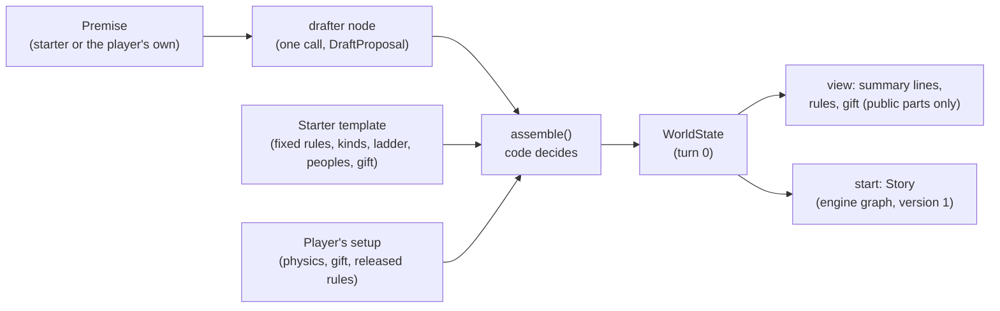

# Architecture

```
┌──────────────┐  HTTPS/JSON   ┌───────────────────────────┐   ┌──────────────────────────┐
│ Flutter app  │ ────────────▶ │ Story API (Django, ASGI)  │──▶│ Vertex AI: Gemini        │
│ app/         │  X-LLM-* hdrs │ Cloud Run, backend/       │   │ (or the user's own key)  │
│ iOS, Android │ ◀──────────── │ Ninja API, admin, engine  │   └──────────────────────────┘
└──────────────┘               │                           │   ┌──────────────────────────┐
                               │                           │──▶│ Neon Postgres (psycopg 3)│
                               │                           │   └──────────────────────────┘
                               │                           │   ┌──────────────────────────┐
                               │                           │──▶│ Cloud Storage: pictures  │
                               └───────────────────────────┘   │ (private, signed URLs)   │
                                                               └──────────────────────────┘
```

## Repo layout

| Path | What |
| --- | --- |
| `app/` | Flutter client: Riverpod, go_router, http, flutter_secure_storage, record, speech_to_text. See [app/README.md](../app/README.md) and [app/DESIGN.md](../app/DESIGN.md) |
| `backend/` | Python 3.13, Django and Django Ninja over ASGI (uvicorn), managed with uv, deployed to Cloud Run. Layout in [backend/README.md](../backend/README.md#layout) and [PLAN.md](PLAN.md#target-layout) |
| `neon.ts`, `package.json` | Neon config as code (`@neon/config`). Node is used only for the Neon CLI and this config. |
| `docs/` | Product and architecture notes |
| `.github/workflows/ci.yml` | Lint and test for both halves on every PR |

## Backend

Django 6 with Django Ninja, served over ASGI by uvicorn (B1). Settings come from environment
variables (`backend/lucid/env.py`), so Cloud Run, local runs and tests differ only in their env.

- **API.** One Ninja API mounted at `/v1`, with its live OpenAPI schema at `/v1/docs`. Each Django
  app adds its own router in `lucid/api.py`. Views are async; database writes that must happen
  together run in a sync function inside `transaction.atomic()` through `sync_to_async`.
- **Errors (T7).** Every error, including a 404 outside the API, a wrong method and an unexpected
  exception, comes back as the [API.md](API.md) envelope `{"error": {"code", "message", "details"}}`. Raise
  `lucid.errors.ApiError(ErrorCode.X, ...)` from any view. An unexpected exception is logged with
  its traceback and answers `internal_error`.
- **Logging (T4 to T6, B3).** JSON lines on stdout with `severity`, `request_id`, `trace_id` (from
  `X-Cloud-Trace-Context`, also linked as `logging.googleapis.com/trace`), `user_id` and
  `story_id`. `lucid.middleware.RequestContextMiddleware` opens a context per request, binds the
  story id from the URL, and writes one line per request when it ends, or when its stream ends for
  a streamed turn. The auth layer binds the user with `lucid.logs.bind(user_id=...)`. uvicorn's own
  lines go through the same formatter, and its plain-text access log is off. Fields named like keys,
  tokens, passwords or prompts are redacted, and headers, bodies and query strings are never logged.
- **Users.** A custom `accounts.User` from the first migration: the email is the login (stored
  lowercased), with display name, birth date (F8), role (`player` or `owner`, K7), Google subject
  id, whether the email is verified, and content preferences (F7). Sign-in is described in
  [Accounts and sign-in](#accounts-and-sign-in).
- **Admin (B1).** `/admin/` for staff: users, stories with their scenes, and pending events. A
  story's world state and version are read-only there, and saving a story writes only the fields
  staff changed, so the admin never undoes a turn (B12, T10). Story text (premises, actions,
  narration, world state, pending event payloads, picture briefs, drafts) shows only to staff who
  handle reports (T16, [Safety, ratings and reports](#safety-ratings-and-reports)). Its static
  files are collected into the image and served by ServeStatic.
- **Cold starts (B10, T3).** `/health` never touches the database, and the service refuses to start
  without `DATABASE_URL` and `DJANGO_SECRET_KEY` outside DEBUG. Model SDKs and LangChain are
  imported inside the code that uses them, off the event loop, and a test checks that loading the
  ASGI app and its URLs doesn't import them. The image answers its first `/health` about a second
  after the container starts. Measured locally in WS18 with the offline model, so only our code
  counts: `/health` answers 0.7 to 0.85 s after the process starts; the first turn after that
  sends its first words in about 0.5 s, since it imports the model layer and builds the turn
  graph, and later turns in about 30 ms (S3 allows 2 s, before the model's own time). Cloud Run's
  own start and a Neon wake come on top in production and are not in these numbers.

## Accounts and sign-in

Requirements T8, S8, F8, K7 and T12; the endpoints are in [API.md](API.md#auth-and-account-t8-s8-f8-k7-t12).
The code is in `backend/accounts/`.

- **No Firebase (T8).** The app signs in with Google and sends the ID token once.
  `accounts/google.py` checks it with `google-auth` against Google's public certificates (cached
  for as long as Google's `Cache-Control` allows, refetched when a token names a new key, at most
  once a minute): signed with RS256 by Google, issued by `accounts.google.com`, unexpired, and for
  one of the OAuth clients in `GOOGLE_OAUTH_CLIENT_IDS`. Email and password accounts use Django's
  own password hashing and validators.
- **Our tokens (`accounts/tokens.py`).** An access token lives 15 minutes. It is signed with
  `DJANGO_SECRET_KEY` (HMAC-SHA256 through `django.core.signing`, so no extra dependency) and names
  the user and the session. A refresh token is 256 random bits, stored only as a SHA-256 hash, good
  for one refresh within 30 days. Each refresh rotates it inside the same session
  (`AuthSession`); a spent token used again after a 60-second leeway revokes the session, since two
  holders means one stole it. Rotating `DJANGO_SECRET_KEY` signs everyone out within 15 minutes
  unless the old key goes in `SECRET_KEY_FALLBACKS`.
- **Every request (`accounts/auth.py`).** One Ninja auth on the whole API: it checks the access
  token's signature and age without the database, then loads the session with its user in one
  query, so logout, a revoked session, a disabled account and a deleted account all take effect at
  once. It binds `user_id` to the request's log context (T4). Only `/v1/auth/*` opts out, and
  `/health` lives outside Ninja.
- **Ownership (S8, F8).** `stories/access.py` `owned_story()` loads a story for the signed-in
  player: `404` when it doesn't exist, `403` when it is someone else's or its rating is above the
  account's limit. Every story endpoint goes through it.
- **Owner role (K7).** A Google sign-in whose verified email is in `OWNER_EMAILS` gets
  `role = owner` with `is_staff` and `is_superuser`, and loses them at the next Google sign-in if
  it leaves the list. A password never grants it, and the role is read-only in the admin. The
  owner signs in with Google, so to use `/admin/` with a password, set one once with
  `python manage.py changepassword OWNER_EMAIL` against the target database. In production the
  list comes from the `OWNER_EMAILS` GitHub secret ([DEPLOY.md](DEPLOY.md#7-the-owner-email)),
  so no address is in the repo.
- **Taking over an email.** Email accounts are unverified until an email provider exists. When a
  verified Google sign-in matches an email account, it takes that account over and drops its
  password, because someone may have signed up first with an address they don't own.
- **Brute force (`accounts/throttle.py`).** Fixed-window counters in Postgres, so they hold across
  Cloud Run instances: 10 wrong passwords per email and 100 per address in 15 minutes, and 10
  new accounts per address per hour. Each attempt is counted before it runs, in one atomic
  upsert, so parallel guesses can't all slip under a limit, and a correct password or a sign-up
  that fails validation is handed back. Keys are HMACs, so the table holds no emails or addresses. The
  address is the `X-Forwarded-For` entry `TRUSTED_PROXY_HOPS` from the right (1 on Cloud Run, where
  Google's front end appends the address it saw). Per-user rate limits on the rest of the API are
  T9's, in `billing/`.
- **Delete and export (T12).** `DELETE /v1/me` sends `accounts.signals.account_deleting` and then
  deletes the user through the ORM inside one transaction, so stories, scenes, pending events,
  sessions and anything else with a foreign key to them cascade, and picture files are removed on
  commit. `GET /v1/me/export` collects the account and its stories (`stories/export.py`, without
  the hidden world state) and asks `account_exporting` receivers for more, such as pictures.
- **The owner's own stories (T16).** To review real play, `manage.py export_owner_stories` hands
  over the stories of the owner accounts only (the role and an email still in `OWNER_EMAILS`, K7),
  whole, with the world state and pending events (`stories/owner_export.py`), sealed to a public
  key the reader made (`stories/sealed.py`: X25519, HKDF-SHA256, ChaCha20-Poly1305). The Deploy
  workflow starts it as the migration job
  ([DEPLOY.md](DEPLOY.md#reading-the-owners-own-stories)); nothing readable is logged or stored.
- **Sign in with Apple** is left for the App Store launch. Apple's guideline 4.8 requires it on iOS
  once Google sign-in is offered there. It fits the same shape: the app sends Apple's identity
  token to a `POST /v1/auth/apple`, which checks it against Apple's public keys (audience is our
  bundle id or Services ID), keeps Apple's stable `sub` on the user like `google_sub`, and issues
  our own tokens. Apple may hide the email behind a private relay address and sends the name only
  on the first sign-in, so both are saved then. It needs the Apple developer account.

## Story engine

A turn is played by the [turn graph](#turn-graph) (B5) on the rules engine
([below](#engine-package-backendengine)) and served by `POST /v1/stories/{id}/turns` as
server-sent events (B7, S3); see [Turn endpoint](#turn-endpoint).

How the reference app's memory layers map onto ours:

| Layer | Here |
| --- | --- |
| Long-term memory | the structured records (facts with importance 1–5, deeds, rumors, threads), chapter summaries every 20 turns (C3) and the rolling `summary` |
| Short-term memory | the last `RECENT_SCENES` scenes in the prompt |
| Relationships | characters' attitudes, factions' stances and the player's reputation (W3, W4) |
| Current goals | `goals` and `leads` (N2) |

Facts with importance ≥ 4 and all deaths and destructions are restated as **continuity rules** on
every turn.

**Still to build for endless stories:** retrieval of relevant facts and scenes with pgvector on
Neon (C4), so the prompt stays small however long the story runs.

## Engine package (`backend/engine/`)

The rules engine that replaces the one-call narrator above (WS2 in [PLAN.md](PLAN.md)). It is plain
Python and Pydantic, with no Django, Ninja, LangChain or model SDK imports (B4), and
`tests/engine/test_purity.py` fails if one creeps in. The turn graph (WS3) loads the story, calls
these functions and saves the result.

| Module | What |
| --- | --- |
| `engine/state/` | The world state (C2): `WorldState`, `WorldBible` (G6, G7, G18, W11, N7), `Character` with its `CharacterSheet` (G13, A1, A8, A9), `Faction`, `Place`, `Deed`, `Rumor`, `Fact`, `Goal`, `Lead`, `Thread`, `Clock`, `PendingEvent` and `RollRecord`. |
| `engine/contracts/` | What flows between the turn's steps (B5): `Intent` (interpret), `Resolution` (resolve), `DirectorPlan` (director) and `StateDelta` (what the narrator or the engine proposes to change). |
| `engine/context.py` | `TurnContext`: the story id, the turn number, story settings (S6), rating (F2) and content preferences (F7), which live outside the world state. |
| `engine/rng.py` | `SeededRng`, the seeded random numbers behind every roll (A3). |
| `engine/levels.py` | One scale of levels for moves, skills, bodies and things (A3, A4, G14, G18), which the dice are built on: the dice a move throws by its mastery, a step by its skill and a raw feat by its attribute, the level of each of the six challenge words, the number a level sets (ten for each level, less what the difficulty takes off: 6 on Story, 3 on Balanced, nothing on Brutal), the step of 5 everything else moves a number by, and how mastery grows: `grown` (6 uses, then 15, then 30, divided by the pace talent sets), `starting_mastery` (two steps under the skill, or practiced at a genius's pace and skilled at one of a kind's) and what a plain use, a resisted use and an insight count for (1, 2 and 3). Nothing here throws: `engine/resolve/throw.py` does. |
| `engine/talent.py` | How fast a character learns each thing (A4). Reads the sheet and changes nothing: `talents_of` (the sheet's talents as the engine reads them: one of a kind said about everything is a general genius, and past three the rest are genius; a sheet with none is read from its traits' words), `standing` (how fast a thing grows, from the ruling on it and the bridges that held: the paces of the talents that reach it add, counting only the strongest of those that cover everything, a weakness halves the sum, and two talents that cover it fully show an insight on 15), and the keys rulings name things by (`technique_key`, `skill_key`, `ladder_key`). The rulings and bridges themselves are made in `engine/resolve/powers/talents.py`. |
| `engine/timekeeping.py` | How long each kind of action may take, the seconds until a time of day ("until nightfall"), and `advance_clock`, which moves the world clock through pending events in time order and stops at the first that needs the player (W10, W10a). |
| `engine/apply.py` | `apply_delta`: a proposed `StateDelta` applied with the C1 invariants, on behalf of the narrator or the engine, returning the new state and what it refused. Each item change goes through `engine.possessions`. The narrator never hurts the player character: a worse health, a wound or a passing state that names an injury is refused (N6), unless `may_hurt_player` says something recorded this turn caused it (a power's toll in health or blood, `injuries.pays_in_body`, or the first opening's premise). Healing still applies, and a new wound on an unhurt body leaves it hurt. A goal the narrator names in `goals_over` closes as achieved or failed, or, when it repeats another active goal, the later of the two closes as merged into the older (N2), and only with `player_acted`, which the turn graph sets when the player acted this turn. A goal the narrator names in `goals_moved` keeps the sentence on where it stands (`Goal.progress`, at most `MAX_PROGRESS` characters) and becomes the one the story last moved; the goal's own words never change, a goal that is not active or a sentence that only says the goal again is refused, and a goal merged into another hands both to the one that stays. The narrator moves only the feelings of the people in the scene (`scene_people`, W4): those the last scene left there (`geography.scene_ids`), those this scene's end lists, anyone the scene brings in and whoever the turn reached (`reached`, from `pipeline.reached`). An attitude shift for anyone else is refused, since the engine moves how they feel once a witness or word reaches them (W2). |
| `engine/injuries.py` | Hurt bodies come only from the record (N6, G13): `names_injury` spots a wound, an injury, pain or an illness in a model's words (English, Spanish and Catalan; "broken" or "twisted" only beside a body part, so a broken lock is no injury), `is_hurt` reads it off a character's condition, and `unrecorded_harm` leaves out of a step's facts every edge and hindrance that leans on an injury the record doesn't hold: words naming someone in the scene or someone the step faces stand only when that person is hurt on the record (and the words name no part the record says is whole), a hindrance naming nobody else is the actor's and stands only for one of their flaws, passing states or wounds that last (the odds already weigh their health), and an edge naming nobody stands when someone the step faces holds it. `pays_in_body` says whether a step that played paid a power's toll in health or blood. `Condition.set_health` heals every wound that doesn't last once a body is back to unhurt, and loading a state does the same. |
| `engine/possessions.py` | What everyone has, gains and loses (C10): `move` makes one `ItemChange` from someone to someone (a character, or `world`), refusing what the player character doesn't hold (their belongings are the complete record; an NPC's are only what the story told, N7) and an item someone else holds, cutting a loss to what the player character holds, keeping money in the holder's currency, and recording each move as a `Transfer` (the latest 200) with who saw it. `holding` counts what a character holds of a thing, `prompt_lines` and `gone_to` say where it went, and `already_given` whether letting someone keep it moves nothing. |
| `engine/text.py` | Word matching shared by resolve and possessions: `stems` and `mentions`, so "the knives" matches "knife" and nothing reads more than the model wrote. Spanish and Catalan articles and prepositions count for nothing, like English ones, and accented letters stay in their word (S10). `normalize` folds a text to lowercase ASCII words, for matching whole words and names as they are written. |
| `engine/naming.py` | Who words name, among the people on record (V3, W1, F3): a name or alias of several words wherever the words carry it, and one word of a name only with a capital that doesn't just open a sentence, so "Mo" is Elder Mo and the "sol" of "under the sun" is nobody. `named_in` singles someone out or names nobody, which is how the reading's check aims a blow (`graph.turn.check`); `everyone_called` and `everyone_named` give everyone the words could mean, the nearest first, which is how the hard limits find who a kiss is with (`engine.limits`). |
| `engine/tally.py` | `turn_tally`: what a turn's log line counts about the logic of play (T5), in numbers only: steps refused, moves refused as not the character's own, searches thrown for and those that came up empty, rumors heard and those no scene told, and goals still open. Pure: it reads two states, a resolution and a plan. |
| `engine/invariants.py` | `check_state` and `check_transition`: every C1 invariant on one state or between two, however they were made. |
| `engine/looks.py` | When a place or a face changes for good, so its picture is drawn once more (M1, M4, M5): a place's look version from its status history, and the appearance a stated lasting change (`look_change`) leaves a character with. |
| `engine/labels.py` | Time in words: dates in the world's calendar, "+8 h", "World: +0 s. You: +40 s.", "2 days ago", the scene's time bar and its heading when hours or days passed ("Three days later", `passage_label`), and the `moment` the models read: the date, the 24-hour time and the part of the day (W10, W10a). `date_label` is the date alone ("Day 3"), for the day a goal was set or closed. |
| `engine/visibility.py` | The C6 projection: `memory_view` and `status_view` in the shapes of API.md's `MemoryView` and `StatusView`. `status_view` sends the sheet twice: in parts (`SheetView`, API.md's `Sheet`: who they are, condition, each ladder as far as they know it (their rungs with the day each was reached and left, read from the breakthroughs in their growth, their own with the stage of their rank and how full it is, from `growth.rank_of`, and over their own the rungs they have heard of, with who they have seen stand higher still, from `engine/path.py`), belongings, skills, powers, techniques, traits and talents, and how they grew: each gain on record, the latest first, read back through `growth.read_gain` and said with its day and how it was made), which the app lays out, and as plain lines for apps from before the parts. Every label it adds is worded here, in the story's language, beside the value it says, with the dice a skill or a technique throws read from `engine/levels.py`. `memory_view` does the same for Memory: how someone takes the character (`attitude`), whether they live as far as the character knows (`status`, `presumed`), a faction's regard and fear (`esteem`, `dread`) and who saw a deed (`seen`), each beside its label. Under who saw it, a deed of the character's tells what they know became of it since (`trail`, each line with its `kind`): whom of those who saw it they saw go off to tell and to whom (`Deed.went_to_tell`, which `engine/world/carriers.py` writes when a runner leaves their scene), who of them is dead as far as they know, what a scene told them is said of it (the rumors of it they heard) and who came to them over it (an answer that found them, which is one a fact they know came of). Where who else knows is an open question it ends on a line that says they can't tell (`open_label`). Nothing the world keeps to itself is read for it: whether a runner got there, who was told, who has only heard it (C6). The goals come grouped (N2, `engine.director.goals.kind`): the thread followed first, then the player's own, then the ones on the side, the one set or moved last first in each, each with where it came from in words ("Asked of you by Master Wen, day 3", naming whoever asked only when the character knows them) and where it stands; `goals_done` lists the present character's goals that are over with the day each closed. |
| `engine/director/` | The story director (W16, E4, E6, E7, N1, N2, S2, M1, M2): stall pressure, where events come from and the seeded deck, threads, goals and leads, suggestions, pictures and the rolls inside a time skip. See [The story director](#the-story-director). |
| `engine/world/` | The living world (WS10): deeds and witnesses (`deeds`), how severe a deed is by the world's norms (`norms`), rumors (`rumors`), attitudes, grudges, reputation and threat, and how far anyone goes against a doer by how they know (`knowledge`: `Grounds` is talk heard, word of someone who knows, or seen; `proven` is what is beyond one person's word; talk is recorded in `Deed.heard_by` and `heard_by_factions` and brings no grudge and no hostile answer; W4, W5), who carries word of a deed and when it gets out (`carriers`: a witness's report to a faction, the talk that starts once a witness is free to talk, who is leaving the player character's scene to tell; W2, W11), faction answers (`answers`, `arrivals`: those who look into a crime ask a witness who is still there, then read its traces, and someone who comes to face the doer over what they were told comes for revenge only after, and is at the place they came to from then on, found or not; W4, W11), discovery from traces (`discovery`), word of a death reaching close ties and the victims' factions (`aftermath`), deeds told in the world's words (`telling`), emerging, dormant and reviving cast (`cast`), births (`births`), clocks (`clocks`), the world tick (`tick`), maps, travel times and who is there to see what is done at a place (`geography`: `scene_ids`, `onlookers`; W2), the player's trips (`journeys`: where a step goes, how long the way is, what is left of a trip that stopped, and the routes new ground writes; W10, W7), what a place is saying to someone who comes there later (`hearsay`: the rumors that reached it before them, heard only once a scene told one; W2, C6), the pending events it schedules (`scheduling`), their handlers (`events`), the catch-up loop (`passage`) and every delay, reach and cap in one place (`tuning`). No model calls. |
| `engine/pipeline.py` | The functions the turn graph calls. `catch_up`, `apply_event` and `record_consequences` call `engine.world`; `resolve` calls `engine.resolve`; `direct` and `record_direction` call `engine.director`. |
| `engine/path.py` | What a character knows of the world's ladders (G18, C6). `news(state, text)` reads a scene's own words for the names of the rungs above the player character's own (`named`: whole words whatever their case or accents, the plural too, and a name of a letter or two only beside a word for a rank): each is heard of from now on, and a rung they have heard of is known once someone who shows it (G20, `sensing.shown_rung`) has stood before them, which is anyone they have met or anyone in the scene. It changes nothing; `keep` writes what it found on the sheet (`CharacterSheet.rungs_heard`), and `hear` does both. `known(state, character, ladder)` is what a screen shows above their own rung: those rungs, plus the ones everyone in the world has heard of (`PowerLadder.known_to_all`, the lowest ones, which need no scene to name them and are confirmed the same way) and any a thing they know names (known when it is true and no mere belief), each with whether rungs nobody named lie under it. `about` lists what they learned or heard that names a rung. `higher_still(state, player, ladder, top)` is who has stood before them, alive, and shows a rung above the highest one they know of: those they can name first, then the story's key people. A story starts by hearing what its draft's screen and the player's premise said (`drafts.service.start_story`, `graph.drafting.view.shown`). |
| `engine/encounters.py` | W10's encounters, which code starts and ends inside `play_out` (WS20): a fight from a step that aims harm at someone, another kind from the interpret step's proposal when someone who can respond faces the step, and the end once no opponent is still in it, the player character gets cleanly away from all of them (N6), the player character falls, or ten in-world minutes pass with no exchange. A fight both sides agreed to keeps its terms here (`Encounter.bout`, W1): from the step that began the bout (`StepResolution.bout`), even one that met no one, until the encounter ends or a blow goes beyond them (`StepResolution.broke_terms`). A fight in which a blow outside any terms harmed someone, or whose terms were broken, is one in earnest (`Encounter.in_earnest`) and never gets any. The telling never ends one: `facing` is whom the encounter still has the player character facing, which the narrator's brief shows as the outcome's `still_on`, and `keep` puts whoever is still in it back in the scene once the narrator's update is applied. Also `strong_foe`, M1's key opponent. |
| `engine/resolve/` | Resolve (WS9): logic first, then dice. Turns an `Intent` into a `Resolution` in code; see [Resolve](#resolve-logic-first-then-dice). Powers, theories and growth (WS9b) are in `engine/resolve/powers/`; see [Powers](#powers-theories-and-growth). |
| `engine/heirs.py` | Heirs (N6): `heirs` lists who of the player character's family can carry the story on at its ending (living descendants, and a child on the way whose carrier lives, a dying carrier's child settled by a seeded roll in `unborn_lost`), and `time_jump` runs the world on to the day an heir too young to act turns 16. No model calls. See [Carrying a story on as an heir](#carrying-a-story-on-as-an-heir). |
| `engine/kin.py` | Lineage (N6): `ancestors`, `descendants` (with how many generations down) and `related` over `Character.parent_ids`. See [Families and births](#families-and-births). |
| `engine/succession.py` | Carrying a story on as someone else after its ending (N6): `draw` picks a random person of the world by its population odds (place, people, age, station, might, a hidden master as rare as the world makes them, and how rare that is), and `carry_on` makes them the player character, keeping the old one in the world (`WorldState.fallen`) and setting `opening_due`. No model calls. See [Carrying a story on](#carrying-a-story-on-as-someone-else). |
| `engine/samples.py` | Three sample worlds: the Naples vendetta and the Azure Cloud Sect from the requirements, and T17's quiet farm, for tests and development. |

**The turn, as the graph calls it** (B5). Every function takes the state as read-only and returns
a new one.

| B5 step | Function | Owner |
| --- | --- | --- |
| 1. Catch up | `catch_up(state, until_s, ctx, rng) -> TimePassage` applies events due by `until_s` (the graph passes `state.world_s`) in time order, stopping at the first that needs the player. It first makes sure every running clock has its next step pending and that the world tick is spaced so the stretch holds at most 24 ticks (K8), then runs `engine.timekeeping.advance_clock` with the world's handler. Nothing fires during a time stop | WS10 |
| 3. Resolve | `resolve(state, intent, ctx, rng) -> Resolution` | WS9 |
| 3. Time passes | `play_out(state, resolution, ctx, rng) -> PlayOut` plays the steps in order. The world catches up to each step's end through `catch_up` (one loop for every stretch of time, with the turn's own `rng`, so an event rolls the same however time is split into steps), and the actor's clock moves by their lived time. An event that needs the player cuts the plan short there (the cut step's effects and deeds don't happen, and later steps go to `unplayed`). Before the clock moves through a step of a day or more, `director.schedule_stretch` rolls that stretch's W16 events (E7), so a time skip stops at the first that needs a decision; a trip of the player character's of an hour or more rolls what the road brings in its place (`director.schedule_road`, W10). A step that goes somewhere (`StepResolution.trip`) leaves the actor at the place it reached once it has played in full, and one cut short leaves the player character on the way with what is left kept in `WorldState.journey` (`journeys.follow`). An arrival somewhere they have never been is marked on the step (`Trip.first_visit`), for the narrator. Nothing is heard by arriving (W2). At each finished step's end its `effects` apply as the engine's, then its consequences are recorded, then `engine.encounters` starts, carries on or ends the scene's encounter from what the step did (a time skip, or a step of ten minutes or more that doesn't itself fight or carry on the encounter, ends it before the stretch is rolled, and a time skip never starts one). The graph must not apply `effects` again | WS2 |
| | `record_consequences(state, resolution, step, ctx, rng) -> WorldState`, called by `play_out` for each finished step: each proposed deed becomes a `Deed` with its severity and witnesses, and the world's reactions are set going as pending events. What is done by or to someone in the player character's scene is witnessed by the people in the scene, with those the deed fell on and whoever the step faced or made real, and by everyone the record puts at the place when the deed is public or the character has only just arrived (W2) | WS10 |
| | `apply_event(state, event, ctx, rng) -> WorldState` applies one pending event that fell due, rolling from the event's own seed, and records on the applied event whether it needed the player. Kinds it doesn't own, such as `director.*`, are only marked applied | WS10 |
| 3. Direct | `direct(state, resolution, ctx, rng, intent=None) -> DirectorPlan`, on the state `play_out` returned, with the turn's `Intent` (its `responds_to` and `goals`). It only decides and never changes the state | WS11 |
| 6. Talk | `hear_talk(state, plan, ctx, rng) -> WorldState`, once the narrator says its scene told the talk the plan offered (`NarratorOutput.told_talk`): the player character has heard that rumor, as of the scene's end, so Memory shows it. Talk the scene left out stays unheard (W2, C6) | WS10 |
| | `record_direction(state, plan, ctx) -> WorldState` writes `plan.updates` into the state. Call it right after `direct`, before the narrator's changes apply, so the plan's ids stay the ones the narrator sees | WS11 |
| | `reached(state, resolution, plan) -> list[str]`: whom the turn reached besides the people in the scene, for `apply_delta`: those a step faced, struck at, made real or changed, those who struck back, the cast of the plan's event, happenings and moment, and after a stretch of a day or more everyone living in the player character's region (W4) | WS10 |
| 6. Apply the update | `apply_delta(state, delta, ctx, source=DeltaSource.NARRATOR, reached=...) -> Applied`. Refused changes come back in `Applied.rejected` for the log and the C5 check; the rest applies. Before saving, the graph runs `check_transition(first, last)`, and a violation is an engine bug: log it and don't save | WS2 |
| | `settle_trips(played, state, resolution, told=...) -> (WorldState, notes)`, right after the update is applied: the scene ends where the turn's trips left the player character (put there when the narrator's scene stayed behind, put back when it ended in a place the trip didn't reach, each logged as `trip_place`), a trip over ground the map didn't cover writes its route, a place the scene added and ended in without saying where it lies or how far it is, reached with no real trip (none at all, or a step that named it and took no time for the way, read as `first_visit` reads one), is put where the player character already was (`journeys._lies_in`, R8: within the place they were in, or, when they may have come out into the open, within the nearest place around it that isn't closed in; logged as `trip_place`), and a journey stopped on the way goes with the scene to the place it stopped in and through a step aside of under an hour (`journeys.NEARBY_S`), and is dropped once the player character set out somewhere else or the scene stands at either end of it (W10, W7, R8) | WS2 |
| | `settle_witnesses(played, state, turn) -> (WorldState, left, kept)`, after `settle_trips`: code decides who runs, whatever the scene's end listed (W11). Of those the scene had as it played (its record, its fight and whoever saw a deed of that turn done there), whoever has word to bring and is yet to set off, or is held in a fight with the player character, is put back in the scene when its end left them out (`engine.world.carriers.keep`, logged as `witness_kept`), and one it left out who has set off, or whom it sent somewhere else, went in front of the player character (`Deed.went_to_tell`, C6); a scene that ended in another place left them behind. Then whoever has set off by now is out of the scene (logged as `witness_left`), and where the scene let go of a witness who was kept from telling, the world's next question about them (`world.word` asked again, a `world.report` that waits) is brought forward to now (W2, `engine.world.carriers.settle`) | WS10 |
| | `settle_encounter(played, state) -> (WorldState, kept)`, after `settle_witnesses`: code ends an encounter and the telling never does (W10). Whoever is still in the scene's fight, chase or talks (`engine.encounters.facing`) is put back in the scene when its end left them out (`engine.encounters.keep`, logged as `encounter_kept`); a scene that ended in another place, even out in the place around the one it was in, left them behind, and someone the update felled or moved away is out of it | WS20 |
| | `settle_path(state, told) -> (WorldState, added)`, after `settle_encounter` (`told` is the scene's own words): what the scene told of a ladder is what the character knows of it (G18, C6, `engine.path.news` and `keep`). A rung above their own that it names is heard of from now on, and one they had heard of is known once someone who shows it has stood before them. Returns the same state, uncopied, when the scene added nothing | WS9 |

**Decisions the package makes:**

- **Records are keyed by id.** `WorldState.characters`, `factions`, `places`, `deeds` and the rest
  are maps from id to record, and each record's `id` must match its key. The player character is in
  `characters` under `player_id`, so attitudes, witnesses and knowledge treat everyone the same
  way (E5). `state.new_id("deed")` hands out stable ids. Never rely on map order, because Postgres
  JSONB reorders object keys: sort by time or id wherever order matters, as `due_events` does.
- **In-world time is whole seconds since the story's epoch** (W10). Everything that happens in time
  carries a `timeline_id` and a world second (W10a). A character's personal clock is
  `world_s + personal_offset_s`, so it moves with the world for free, and a time stop only adds to
  the user's offset. World processes such as rumor spread, clock steps and faction answers are
  pending events with due times, so they fire in time order wherever time passes, at the start of
  a turn and during a long action alike. The rows live in `stories_pendingevent` (B12): the turn
  endpoint loads the story's pending rows on its timeline into `state.pending_events` and writes
  back the ones the turn applied, cancelled or scheduled. `EventStatus` uses the table's values
  (`pending`, `applied`, `cancelled`).
- **Knowledge is recorded on the record.** Anything a character can know carries `known_by`, a
  list of character ids, plus `met_by` on characters, `visited_by` on places and `heard_at` on
  rumors. The Memory screen shows only records whose lists hold the player character (C6). Hidden
  truth lives in fields the projection never shows: `is_true` on rumors and facts, secrets, mystery
  answers, real attitudes behind an `apparent_affinity`. The one way `is_true` reaches the screen is
  through what the character knows for themselves: a rumor of a deed in their `known_by`, or one
  whose `seen_by` holds them, shows confirmed or false (`engine.world.rumors.certainty`).
- **Proposals versus decisions.** `StateDelta` serves the narrator and the engine. Fields marked
  engine only (terminal changes such as deaths, anything that needs a C1 `Cause`, faction
  reputation, rulings, gains, accepted backstory, rule changes) are rejected when the narrator
  proposes them, because resolve records the outcome in code before narration (F4). Resolve puts
  its own changes for each step in `StepResolution.effects`. The narrator can still introduce
  people, places and factions with real names, nudge an attitude by up to 10 points per scene,
  record facts, items and leads, and end the scene. Ending the scene at a known place moves the
  player character there, with everyone in the scene who was with them and isn't already somewhere
  inside it, so the world and the director find people where the story left them (R3, C2). That
  exact spot is kept only while the scene stays where the last one was: a scene that ends
  somewhere else has moved everyone who came with the player, even out to the place around the
  one they were in (out of a temple into the forest it lies in), so nobody stays recorded inside
  (R8). The player character knows and has been to the place their scene ends in (C6). The
  narrator's schema always asks for the scene end and its `place_id` (R8): the place is read by its
  exact id, or by its id or name however it is spelled among the places the character knows of,
  the scene names or they are in (`engine.world.geography.find_place`), and failing that the one
  place the delta marks `visited` stands for it; a place on no record is refused (`scene.place` on
  the turn's log line) and the scene stays where it was. The narrator's `setting` is read in any
  case, and a word that is none of the four is left untold. A place's `setting` (outdoors,
  indoors, underground, underwater) is set once, and only the engine changes it. Naming
  someone far off, missing or dead as present moves no one. A death, destruction or ruin is undone only by
  a `Cause` that points at a recorded deed or a fired event naming the subject, on this timeline,
  no earlier than the change it undoes, by a mechanism the world bible allows (resurrection, a
  presumed death that was false, a revival with survivors, rebuilding).
- **The living world runs on pending events** (W2, W5, W6, W10, W13, E2). Whatever the world
  does later is a `PendingEvent` with a due time and its own seed, of a kind in
  `engine.world.Kind`: `world.report` (a witness reaches a faction, if they can still bring it;
  its payload holds when they set off, `sets_off_s`, or that it waits for a witness who is kept
  from telling, `waits`), `world.word` (whether a witness is free to talk, so that word of a
  witnessed deed gets out: the rumor, the region's opinion and the tidings start then, and
  `Deed.word_out_s` records when; W2), `world.answer` (a faction's
  answer or one person's revenge arrives), `world.rumor`, `world.tidings` (word of who did a
  death or a grave harm reaches the victim's family and friends, or one of the victims' factions
  and the factions those sit in), `world.discovery` (a look at a secret deed's traces),
  `world.clock_step`, `clock_end`, `world.emergence`, `world.revival`, `world.birth` (a child born
  when due, N6) and `world.tick`. Whether an
  event needs the player is decided when it applies, from the state at that moment, and stored on
  the applied event: guards who find the player where they came need them, and guards who find
  them gone search instead. Delays come from the map: a witness walks to the faction's seat (the
  outermost place it holds, else where its leader is) or calls where the world has phones (G6),
  and the answer then gathers and travels back. A route between two places is what the trip
  takes; a place inside another is a 15-minute walk from it, unless it is a region of its own (a
  city, a village, a kingdom), so two cities are as far apart as their roads say. Where the map
  doesn't say, a trip takes about an hour, never no time. Those who keep a law act within the
  region their seat is in. Every figure is in `engine/world/tuning.py`.
- **Who learns what, and what it does.** A deed is known to its doer and witnesses (asleep or
  unconscious people see nothing; in stopped time only those immune to it do). Others learn it
  from a rumor they believe, which loses accuracy with each hop and, once far enough off, turns
  into a version that no longer names the doer, or from a report. Each faction counts each deed
  once (`Deed.known_by_factions`); one deed moves esteem or fear by at most 15 points, less the
  further it already is from neutral (W9). A faction shrugs off what its own members do unless it
  is severity 4 or worse, or a wounding or an attempted murder of one of its own (severity 3 and
  up), and never answers its own leader. NPCs' deeds run through the same code (E5); the player
  character never reacts by itself (G15). Resolve proposes an attempt on someone as a deed even
  when it fails: an attempt that harmed nobody is still harm when resolve weighed it at 2 or more,
  so its target keeps a grudge and the law hears of it, and a killing nobody died of counts as the
  wounding it was. Severity floors apply only when someone was harmed. How far a bystander turns
  against the doer follows severity steeply (`BYSTANDER_HOSTILITY`): a brawl barely moves them,
  and a massacre leaves even a stranger who saw it cold or hostile, with a grudge (W8, W12).
- **Who was there** (W2, W4). A place on the map can be a forest or a whole city, so where the
  player character is, those who see what is done by or to someone in their scene are the
  people in the scene (`geography.onlookers`): the player character, those the last scene's end
  listed (`SceneFrame.present_ids`), those in its encounter, those the deed fell on or was
  aimed at when they are at the place, and whoever the step faced or made real (`onstage`).
  Nobody else the record puts at the place saw it. What others do there outside the scene is
  seen by everyone at the place but the scene's people. Everyone at the place saw a deed done
  somewhere else, one done where no scene has shown who is around (a step of the plan arrived
  there) and a public one. A deed is public when it was done before a crowd, the people the scene
  doesn't name (`StepFacts.crowd`, which the interpret step always answers), and is news by the
  world's norms, severity `RUMOR_MIN_SEVERITY` or more (`resolve.core._before_a_crowd`): its
  rumor starts at once at accuracy 100 and travels one hop further, and when it is harm outside
  any agreed terms that nobody on record but the doer and those it fell on is awake to see,
  `strangers.onlooker` makes one of the crowd real to witness and report it (W11). A smaller
  thing before a crowd, and anything done in stopped time, stays as seen as it would be
  anywhere. The player character hears word only when a scene tells it (`hearsay`):
  `rumors.on_rumor` and `rumors.start_rumor` leave them out, so word that comes to where they
  are, or starts there, is the talk of the place, and what they did or saw is a deed in their
  memory (C6). The one thing `start_rumor` marks for them is what they were there to see
  happen, a clock's end that came with them (`Rumor.seen_by`); a price a faction puts on a
  head is set off screen, so `arrivals` never counts them among those there. The
  narrator's update moves only the feelings of the scene's people and of whom the turn reached
  (`apply.scene_people`, `pipeline.reached`).
- **What both sides agreed to is no attack** (W1, W4, W11). A proposed deed that stayed inside
  the terms of a bout carries them (`Deed.terms`). With no victim it is the bout itself
  (`Deed.is_bout`): `record_consequences` records it once for the encounter however many blows
  propose it, and `react` does nothing with it but `knowledge.fought_bout`, which adds
  `BOUT_REGARD` to affinity and trust between those who fought, up to `BOUT_REGARD_MAX`. No
  witness reacts, no rumor starts, nobody reports it and nothing waits to be discovered. A death
  inside terms that accept death (`Deed.agreed`, with a victim) is no crime (`norms.is_crime`),
  is reported by nobody, shakes no place and calls up no avenger of its own; bystanders only
  fear the doer, factions and regions only move the player's reputation (a little esteem lost
  with the dead one's own faction, some fear everywhere), and the victim's close ties still get
  word, lose affinity, keep a grudge and may come for revenge. A deed that went beyond the
  terms (`Deed.broke_terms`) is an attack like any other, its trust loss multiplied by
  `BROKEN_TERMS_TRUST`, and the one struck keeps a grudge however light it was. `telling` says
  "sparred with", "fought a duel with" or "killed ... in a duel".
- **Beasts are not people** (G24). A character whose `people_id` names one of the bible's
  creatures is a beast, and a faction whose every member is a beast (a wolf pack) is no person
  either. Harm that falls only on beasts is a hunt (`Nature.HUNT`): no crime, no report to anyone
  but the beast's own pack, no harm to a region's people, and a severity set by how notable the
  beast was (one step per four tiers, one more for a key beast), so a forest wolf is a trifle and
  an ancient dragon is news. The beast's kin (its pack, its mate) keep a grudge. Beasts don't
  follow people's talk: they hear no rumors and get no word of a person's death.
- **Secret deeds and their traces** (W13). A body left where it fell is a trace when anyone is
  at the place (found within moments) or close by (`BODY_NEARBY_STRENGTH`); nobody near, no body
  trace, so a hermit can vanish. In stopped time a body or a blast shows nobody near it, unless
  the world knows the doer stops time (the power isn't secret, or another stopped-time deed was
  laid at their door): then it points at them as a wound only their power makes would. Once the
  doer of a death or grave harm is known, word goes to the victims' factions and the factions
  those sit in, so a kingdom hears who wiped out its army even with no survivor to report it.
- **The world's words** (G16). Rumors, grudges and event titles never repeat a deed's own text,
  which is the player's step with resolve's outcome note. `engine/world/telling.py` tells a deed
  from its kind, doer, victims and place ("Lin Feng killed Zhao Kun at the outer-court well";
  "Someone tried to kill Zhao Kun"; "Old Pan, Widow Lu and four others were found dead"). A
  deed's fallback picture prompt is told the same way. The Memory screen's deeds and the status
  screen's recent moments are told by what the player character knows (C6), through a `Teller`:
  "you" for themselves, only names they know ("You wounded someone at the well"), a beast they
  never named by its kind ("You killed an ash wolf and one other"), and a death only where they
  know the deed caused it, on this timeline. Nameless victims are counted ("massacred three
  people"), and where some died and some lived both are told ("killed Elder Mo and wounded you").
  A deed the world has no words for keeps its own text.
- **In the story's language** (S10). `telling` tells a deed in English, Spanish or Catalan
  (`account(..., language=)`, `tell`, `found`, `unexplained`, `garbled`, `listing`): the same
  facts pick the same kind of sentence, and a book per language says it (`_BOOK`, each kind of
  deed as anyone did it and as "you" did it; `_WORDS`). Spanish puts "a" before a person and
  says "you" with the verb ("Mataste a Zhao Kun en el pozo."), Catalan tells the past with "va"
  ("Lin Feng va matar Han Jie al pou."), a deed that fell on the player or on its own doer is
  said with "te", "se", "et", "es" ("Zhao Kun te hirió", "Lin Feng se hirió e hirió a Zhao
  Kun"), a small word runs into a name's article (`with_word`: "al viejo Hu", "d'Olot") and
  "y" is "e" before the sound of an i. Nothing on record says whether someone is a man or a
  woman, so no sentence needs to know ("otras dos personas", "apareció sin vida"). The world
  passes `ctx.settings.language` wherever it keeps a telling: a rumor's text (`carriers.word_out`,
  `discovery.name_the_doer` and what people make of a find, `rumors._garbled`) and a grudge's
  reason (`knowledge.character_learns`, an avenger's). Those are stored, so a story under way
  keeps the English ones it has. Memory tells its deeds at view time
  (`visibility._Knowledge.deed_text`), so they change at once; a deed with no words in the world
  keeps its own text with resolve's outcome note in the language (`own_words`: "(salió bien)"),
  and a wound the engine named itself is shown by `wound_said`. What only the narrator or the
  engine reads stays English: a trace's text, the titles of the world's pending events, an
  answer's title, picture prompts.
- **Threats backed by force** (W5, A3). An intimidation from someone whose might, as the world
  can know it (their rung or sheet, hidden strength as shown, a light-speed time stop once known),
  is above their standing is measured on might after their condition, against the target's own
  might or standing, whichever is higher. A known light-speed thrower's threat lands on a king; a secret one's
  doesn't, and a target as strong as the threat isn't cowed.
- **Clocks** step with time (`interval_s`, from `next_step_s`) and with deeds. An `advances_on` or
  `reverses_on` entry names a deed kind (`kill`) or a kind and a victim, target or place
  (`kill:carmine`, `burn:mill`). A full clock gets a `clock_end` event; when it arrives where the
  player is (the event's place, else its owner's seat), it is a scene, and otherwise it happens
  without them, closing a tied thread of ambition, quest, threat or debt as resolved without the
  player. Mysteries, rivalries and romances stay open.
- **The cast stays bounded** (W15, K8). At most 8 key NPCs and 4 factions are active; the least
  involved go dormant, kept in state, never deleted, and come back on stage when the story returns
  to them (in the scene, in an open thread, with something on its way). New characters and factions (an avenger, a
  resistance in a conquered place, a successor) carry an `origin`. A destroyed faction gets one
  look at a revival, and comes back only with survivors, as rebuilding, with a `Cause` pointing at
  the revival event (C1); it stays rebuilding for the rest of that turn.
- **What the player sees** (C6). `engine.visibility` reads only records whose knowledge lists
  hold the player character: `known_by`, `met_by`, `visited_by`, `Rumor.heard_at`, and the
  `known_by` on each status change, so an off-screen death shows only once the player hears of
  it. A witness the player didn't notice (a hidden watcher, anyone immune to a time stop) is on
  `Deed.unnoticed_witness_ids`, so the deed reads as unseen. People show the attitude they let
  on (`apparent_affinity`), never trust or what they hide.
- **Rolls are replayable.** The graph makes one `SeededRng.for_turn(story_id, timeline_id, turn)` per
  turn, and each seam derives child streams with stable labels, such as
  `rng.child("resolve", "step", 0)`. Draws come from SHA-256, so a seed recorded on a scene replays
  its roll on any machine, and retrying a turn never rerolls.
- **The state is stored as JSONB.** Unknown keys are ignored on load and new fields need defaults,
  so a state saved by an older engine still loads. A state whose `schema_version` is newer than the
  engine's is refused, so an old revision can't drop fields it doesn't know and save the stripped
  state back during a rolling deploy. Bump `SCHEMA_VERSION` when a field is removed or changes
  meaning.

### The story director

`engine/director/` fills the `direct` step (WS11). Model nodes propose and code decides: every
choice below is made in plain Python with the turn's seeded `rng`, and the narrator only dresses
what it is given in the world's own form (G9).

| Module | What it decides |
| --- | --- |
| `pressure.py` | W16's stall pressure: turns since the last decision with stakes, plus half a point for each repeat of the same low-stakes action, plus a point for each running clock one step from its end with that step within two days (at most two). An encounter turn or a decision with stakes resets it. The thresholds are 10, 5 and 3 for calm, normal and dramatic; an event may come early from 60% of the threshold. E6's drift moves the threshold by up to 20% either way: it rises 0.1 a turn while the player is comfortably in control and drops 0.6 after a big event. |
| `sources.py`, `deck.py` | W16's order once pressure calls for an event: what came due, then key NPCs and factions with plans the player is tied to (E3, W6), then a dormant thread quiet for at least 8 turns, then a character or faction that emerged (W15), then a draw from the seeded deck (E4). The deck has one table per size with good things in each; the size comes from the story's scale (personal, local or world, read from threat, fear and memberships), so a farm never draws a world event. A source used in the last 6 events waits. Titles never name what the player doesn't know (C6). |
| `clock.py`, `moments.py` | W16, W10: what comes fits the story time that passed. Pressure says when, in the player's quiet turns, and `clock.sizes_in_time` says what there is room for, from `DirectorState.last_event_s`: two hours since the last event for a personal one, two days since the last local or world one for a local one, two weeks since the last world one for a world one (`rules.EVENT_GAP_S`), and every source and the deck keep to those sizes. When no event fits, `moments.draw_moment` draws a moment (`DirectorPlan.moment`): one of twelve small things of here and now, generic like the deck, that opens no thread, schedules nothing and shows no event in the app. A moment and the talk of the place both need ten minutes since the last small thing or event (`clock.small_thing_fits`, `rules.SMALL_GAP_S`, `DirectorState.last_small_s`); sooner than that nothing comes and the quiet goes on counting. A moment starts the quiet over. None comes in an encounter, on the opening, inside stopped time or in a scene that already tells happenings. |
| `titles.py` | W16, S10: the director's titles in Spanish and Catalan. `said(title, language)` reads a book: every card of the deck and the road, the titles the sources write the same way ("Someone takes an interest in you", "A stranger appears") and the ones built around a name ("Elder Mo seeks you out": "Elder Mo te busca"; "Old Hu's plans": "Los planes del viejo Hu"). The event's own title stays as the director wrote it, in English, for the narrator's brief, its play-out and its origin. What the player keeps of an event is titled in the story's language when it is recorded (`plan._open_event`): the thread it opens (N1) and the lead it offers (N2). A title the director didn't write stands as it is. A test fails when a card or a source's title is missing from the book. |
| `themes.py` | F7, F2, F3: an event carries only themes the player switched on, gore only in Mature with gore above low, and romance only for a player character with an adult age recorded. A romance event casts only adults. |
| `plan.py` | `direct` itself, in this order: what came due, play-outs of events the player took up (cancelled), something new if it's time (an event the story time has room for, else a moment, else nothing yet), thread changes and callbacks, suggestions, the talk of the place, the picture, the director's memory, goals and leads. One decision at a time: when two events that need one come due in a turn, the second waits for the next scene. |
| `threads.py` | N1: a thread nobody touched for 12 turns goes dormant; acting on its people or naming it wakes it; it closes when its mystery is solved, its clock ends (unless it is a mystery), or everyone it pits the player against is dead. One or two dormant threads the player knows are called back each scene. |
| `goals.py` | N2: goals come only from `Intent.goals` or from taking up a lead (`responds_to` names it), and one that says what an active goal says, give or take case, accents and punctuation, isn't added again. Nothing rewrites one. A goal closes when the player drops it (`Intent.dropped_goals`, abandoned) or the thread of its lead, or of a goal merged into it, closes (achieved, failed or abandoned with it); a scene closes one through the narrator's `StateDelta.goals_over` (`engine/apply.py`). Leads expire on in-world time. Memory tells the goals apart by the record alone: `followed` is the active goal the story last moved (`Goal.moved_turn`, set when the player takes up its lead or a scene notes how it stands), `kind` puts each goal with the thread followed, the player's own or the ones on the side, `origin` says where it came from, and `theirs_since` is the turn after which goals are the present player character's (N6). |
| `suggestions.py` | S2: zero to four choices, always at least one personal, side or wild, and none when suggestions are off. After a long run of scenes that took next to no time (`clock.clock_is_slow`: `rules.SLOW_CLOCK_SCENES` in a row ending within `rules.SLOW_CLOCK_S`, from `DirectorState.recent_clock`), a quiet scene's choices hold one of kind `time`, a way to let time pass: a fourth choice, or in place of the side one. `plan.py` offers it only where the scene has room (no encounter, stakes, event that needs a decision, trip under way or stopped time) and then starts the run over. `graph.turn.scene.choices` shows a `time` choice only where the plan asked for one. |
| `talk.py` | W2: whether the scene may carry one piece of the talk of the place it is in (`DirectorPlan.talk`). Never a scene with an encounter, an event, a happening, a decision with stakes or a trip in it, nor one inside stopped time, on the way of a journey or with no steps (an opening). Otherwise the first rumor `hearsay.talk_of` has for the player character is offered about one time in three, and always when they only look on; where there is none, talk of the narrator's own making about one time in ten. Unless they only look on, it keeps ten minutes of story time from the last small thing or event (`clock.small_thing_fits`). The narrator may leave it out. When a step asks or listens for what people are saying (`StepFacts.asks_talk`, which the interpret step always answers), the scene gets that rumor, or talk of the narrator's own making where there is none, marked `asked`, whatever else the scene carries and whatever the clock says, short of a fight, stakes, the road or stopped time, and the narrator tells it. |
| `pictures.py` | M1, M2: the trigger list in priority order and the budget (below). |
| `montage.py` | E7, K8: a stretch of a day or more is split into at most 12 steps, each with a chance of an event from the frequency setting (a mean gap of 16, 8 or 4 days for calm, normal and dramatic, `rules.MONTAGE_MEAN_GAP_S`), and rolling stops at the first event that needs a decision, so the time a player skips is the story's to grant: on normal a week is cut short a little over half the time. A longer stretch is told more coarsely (`stretch_gap`): the gap grows to half the stretch's length, so anything from a month up is cut short about four times in five, a year some months in. What is rolled keeps to `clock.sizes_in_time` at that point of the stretch. Rolls the clock never reached, because something earlier cut the stretch short, are cancelled. |
| `record.py`, `ids.py` | `record_direction`: mechanical writes of the plan's updates, with provisional ids that are remapped if one was taken in the meantime. |

**Ignoring an event is a choice** (W16, W10). An event that needs a decision opens a thread and
schedules a `director.plays_out` pending event at the end of its in-world window (a day to a week
by size, or the card's own). If the player names the thread or a lead in `Intent.responds_to`, or
acts on the event's people, the play-out is cancelled. Otherwise it comes due through `catch_up`
like any world event, and the director tells it as a happening with the event's consequence: its
thread goes dormant if the matter lingers, else it closes as resolved without the player. A
play-out that the clock applied during the very action that took it up is cancelled after the
fact.

**The road** (W10, W16). A trip of the player character's of an hour or more is rolled by
`director.schedule_road` in place of `schedule_stretch`: at most twelve legs, each with a chance
from its length and `rules.ROAD_MEAN_GAP_S` (four days, two days or one day on the road between
events for calm, normal and dramatic), drawn from `deck.ROAD`, the road's own eight cards, with no
place of their own, since they happen on the way. The first that needs a decision stops the clock
there, so `play_out` cuts the trip (`Trip.arrived` false), `journeys.follow` keeps what is left of
the way in `WorldState.journey` and counts the stop in `DirectorState.road_stops`, and `direct`
makes it the scene's event like any rolled one. Each stop doubles the mean gap for the rest of the
way, up to four times, and the journey's end sets the count back to nothing. The journey holds
wherever it is under way (`journeys.under_way`: the place it stopped in, one inside it or the one
it lies in), so a room at the inn, a fight or a look at the ruin off the road leaves it as it is,
and "I walk on" from there takes what is left. A journey over ground no route covers keeps the
time judged for the whole way when it was first stopped (`Journey.mapped` false) and writes it as
the route once it arrives.

**Pending event kinds the director owns.** `director.event` is an event rolled inside a time skip
(its payload holds the pick, and `needs_player` stops the clock at it). `director.plays_out` is an
ignored event's play-out. `apply_event` only marks either applied, since the director plays them
out itself. A world event that needs the player
(`needs_player`) becomes the scene's event as it is; WS10 can give it a size, kind, brief and
themes in `payload["event"]` (`{"size": "local", "kind": "disaster", "brief": "...", "themes":
[]}`), and the director defaults to a personal arrival without them.

**Pictures** (M1, M2). At most one a scene, highest first: the player's portrait at the start; a
key character's death the player knows of; the decisive blow of a key fight (the blow that kills
an opponent or the player character, leaves them badly wounded or dying, or subdues them, never a
swing that fails or only wounds, and still pictured when that blow ends a fight begun the same
turn, from `TurnFacts.fought`); a breakthrough on a
power ladder (a gain growth records with source `breakthrough`, or one named for a ladder);
hidden strength revealed; a deed of severity 4 or 5; an arc ending; the start of a
fight with a key NPC or a strong foe (a key character, or two tiers above the player in might); a
local or world event; the cover from the second scene; the player's place when it changed for
good since its picture (or a first visit to one already ruined or occupied); a key NPC's first
portrait; a place on the first visit; and the portrait of the player or someone in the scene whose
look changed for good since it was drawn. Portraits, places and the cover come once per subject and
look version, keyed in `DirectorState.pictured` (`portrait:<id>`, `place:<id>`, `cover`, and
`portrait:<id>:v<n>`, `place:<id>:v<n>` for each look drawn). A first portrait, a first visit and
the cover don't spend the budget. Key scenes spend a credit from a bucket that refills 0.1 a turn
on key moments (0.2 on more, capped at 2 and 3), so about one in ten turns. A key scene needs a
full credit, and so does drawing a changed place or face again, which waits for it while the place
or the person is still there. A fight's start may spend down to zero and its decisive blow, once
the start was pictured, down to −2, so a fight gets both pictures and the average still holds.
`PictureDecision.subject_id` is the character for portraits, deaths, blows, fight starts,
breakthroughs and reveals, the place for places, the deed for a big deed, and the thread for an
arc end or an event. `PictureDecision.version` is the look version of a portrait or place
(`engine.looks`): a place moves on each time it becomes or stops being ruined or occupied (its
status history counts them, so a narrated occupation and a chain that burns a hall count the
same; damage mends, so it doesn't), and a character's `look_version` moves on when `apply` gets a
`CharacterChange.look_change` that names something, such as a lost eye or grey hair after years
(G17). The narrator or the engine proposes it with the whole appearance written again; `apply`
keeps that appearance if it shows something new, or adds the change to the old one, so the kept
look always shows it. An appearance written again without a `look_change` never moves the look.
The director decides before the scene is told, so after the narrator's update
`pipeline.settle_picture` moves a planned portrait or place to the look the scene left it with and
marks that look pictured: a first meeting that leaves a scar draws the scar, once.

**The director's memory** lives in `WorldState.director` (`DirectorState`): the stall counters, the
last action's signature, the drift, the last few sources used, when the last event of each size
and the last small thing came in on the story's clock, the last few moments drawn, the clock at
the end of each of the last scenes since a way to let time pass was offered, the picture credit
and what was pictured, and the key fight being followed.

### Resolve: logic first, then dice

`engine/resolve/` (WS9) is what `pipeline.resolve` calls. It turns the interpret step's `Intent` into
a `Resolution` in code, before anything is narrated, so the narrator writes the outcome it is given
(A3) and a blocked narration never blocks the deed (F4). The model proposes facts; code checks them
against the state wherever the state can tell, and decides. Each step goes through these checks in
order, and the first one that settles it ends the step:

1. **World and sheet** (`checks.py`; G8, G14). A step against one of the world's rules, or any power
   in a world with nothing extraordinary, is ruled out with the rule as the reason, whatever the
   interpret step proposed, for NPCs too. A power the actor doesn't have or hasn't recovered, a
   technique they never learned and an item that isn't on them (vehicles and property are used where
   they stand) are ruled out too, but only when no record of theirs holds it (`on_record`, decided
   2026-11-10): a move made of the world's energy they hold in a power, a technique, a reserve or a
   ladder (`energy_move`), or one that names a technique they know or are still learning, whole or
   in part, is theirs to try with nothing of the sheet added. The same move is checked against every
   record whatever part of the sheet the interpret step filed it under: a technique named as a power
   is that technique (`known_technique`), and something filed as carried is at hand when it is such
   a move, when the scene's record holds it, or when their looks say they wear it and no transfer
   says it left them (`_at_hand`). Money named as an item is the purse. A power is found by its id,
   its name or a word of its name (`find_power`, `named_by_word`), and a move made with one of the
   actor's powers (`checks.Move`: "an aura blade" and their aura, by the words the move shares with
   the power's name and description, or the one power the step names) is that power at work, not an
   unlearned technique (`made_with`); a power over time is found only by its id or whole name. A
   learned technique of a power uses that power too. A technique is found by its id or its name,
   said in fewer words or in more (`same_way`). When a step with a move of the actor's own comes
   off cleanly, the move becomes a technique of theirs, once per plan (`growth.proven`, A4, G25),
   unless a technique on their sheet already is that move or someone else's has that name. A move
   of their own is one that shares words with its power, one made of the world's energy they hold
   (never the energy alone), or a technique they were still learning, which is then theirs in its
   teacher's name with its practice cleared; a new way to use a power is never learned by doing
   it (A9). It starts at the mastery their skill gives a new move (`levels.starting_mastery`).
   Each technique a step used counts toward its mastery (`growth.used`: once, twice where a
   throw of the actor's own decided the step, three times on an insight, which is the move's
   violet die at 18 or more, 16 where two talents cover the move, or any throw over the top, and once a turn at its best step), and a training step on a technique
   they know is practice that counts an hour for a use (`growth.practised`, and `practice_cut`
   from `pipeline` when an event cuts it short). A rise is a `Gain` and a sentence in the step's
   reason. `StepResolution.drew_on` names what the step used once past this check, so the narrator
   tells a miss in what stood in the way (A3), and `StepResolution.hand` says what the step was
   done with and how well the actor has it ("Swordsmanship (novice)", from
   `capability.Brought.told`), thrown or not, so the telling fits the sheet whatever the result
   (R4).
   **Exchanges** (`exchanges.py`; C10) come next: whatever the step gives or spends must be the
   actor's, counting what earlier steps of the plan moved, or the step is ruled out with no roll
   and a reason that says where it went ("You have no copper coins. They went to Milo."). Letting
   someone keep what they already took moves nothing. Once the step settles, what it gives or
   takes is added to its `effects` as `ItemChange`s on a success or a partial success, and what it
   spends whenever it was tried, so `play_out` moves it before narration (F4).
2. **Beats** (`checks.py`; R2). Whatever a beat uses must be the body, a power, something carried,
   something the scene holds (props, people, the place) or something an earlier beat made canon.
   Something the engine has no record of is there, and becomes canon, unless the interpret step says
   otherwise: it is settled by the world's die when that step calls it uncertain, which is kept for what is hidden,
   rare, valuable or decisive, and it is an empty search, which fails the step, when the place can't
   hold it. A judgement left out counts as there. What the scene's record or this turn's canon holds
   is there whatever source it was filed under, so nothing on record is rolled for; only a plain
   "absent" for something new stands against a loose match of words. A power a beat uses must be
   ready, as in step 1, and a time stop used in a beat stops the world clock like one named on the
   step. Each check is in `StepResolution.beats`, with a line that names the thing ("There is a
   loose stone here."): the engine gives it "a" or "an" unless it came with an article of its
   own, in English, Spanish or Catalan, since a story names its things in its language (S10:
   "una piedra suelta"). A thing the story names as the one it is reads as that one: "La pedra
   del pati is here.", "Las piedras del patio are here." Words are matched one way only (`words.py`): every
   meaningful word the model wrote must be in what the state holds, so "the knife Gennaro keeps
   under the counter" doesn't hold just because Gennaro is there. The model gives ids (`ref`) where
   it can.
3. **Who stands in the way** (`core._opposition`; A2, A8). The targets of a harmful aim and of a
   social step always stand in the way, so leaving them out of the facts buys no free kill. The
   dead never do. A time stop freezes everyone but its user and the immune, unless the step outlasts
it (W10a), a helpless state on the sheet
   (asleep, tied up, stunned, subdued, dying, read on whole words so "half asleep" or "bound by an
   oath" doesn't count) means they can't respond whatever was proposed, and the model's word that
   they can't respond (unaware, frozen with fear) is taken unless it claims stopped time that isn't
   in effect, or claims it of a hidden master (below). A harmful aim lands only on the targets the
   step names, if they are alive; on whoever stands in the way only when it names no one. Harm the
   actor aims at their own body (a knife to their own heart, a jump from the battlements) lands
   on them too: they never stand in their own way, so only the means decide it (F1, G15). It is
   no deed and no fight, and once it kills them the rest of the plan is ruled out ("You are
   dead.") and takes no time.
   A harmful aim at someone the scene hasn't named ("some random guy") carries the interpret
   step's `stranger`: who they are and whether the place holds them now. `strangers.meet` checks the find like a beat (plausible is found, uncertain is
   settled by the world's die, absent ends the step), then makes them real: a minor character where the actor is,
   with might drawn by the world, hidden, since it tests nothing of the actor's (most ordinary
   at tier 1, about 1 in 15 one step tougher, and a hidden master one step above the actor,
   capped at the strongest the world holds and always able to respond, from 1 in 1,000 in a
   grounded world to 1 in 200 where powers are common). Someone who can fight comes with the
   body for it, since the dice read levels from the sheet: a tough stranger has strength, speed
   and toughness 4, and a hidden master 5 with wits 5 (`CharacterChange.attributes`, engine
   only and kept out of the narrator's form, applied only to someone the engine makes real).
   They go first in the step's `effects` and in `StepResolution.strangers`, and the narrator
   meets them under those ids (`met` in OUTCOME). So does the onlooker a step done before a
   crowd makes real (`StepFacts.crowd`, W2): whoever the deed was done to, when it is news, does
   someone harm outside any agreed terms and nobody else on record is awake to see it.
4. **Settled or open** (`core.py`; A2, G18). A step is settled with no throw when the facts leave
   nothing open, and otherwise the actor throws for it (point 6); the class recorded is certain or
   ruled out for a settled step, and for a thrown one a long shot when its exact chance is under
   15% and contested otherwise (`throw.class_of`). A gap in power never settles a step by itself.
   A refusal names a fact: a rule of the world or something the sheet lacks (points 1 and 2), a
   ruling already made (A9), a force a body takes unhurt (W10a), a link that breaks (point 5), or
   what the world's ladder says a rung shrugs off (`core._shrugged_off`, `PowerLadder.shrugs_off`,
   three steps of power with no ladder): harm by ordinary means, with no power, technique, move or
   item with a history behind it, never gets through to a body that many rungs up, awake or
   asleep.
   Against someone who can respond (`_contested`), the step is certain only when their level is
   two or more under the dice the actor throws (`throw.open_against`). Where nobody can respond
   (`_unopposed`), the proposed means decide: clearly enough is certain, clearly not is ruled out,
   and a close call is thrown for, between full and partial harm for a blow that lands and
   between any result for anything else. With no verdict on the means, a thing judged a real
   effort or harder is a close call. A body a rung or more above whoever strikes it is at most a
   close call, thrown against its toughness plus the rungs between them, and where a blow lands on
   a sleeping body while someone awake can answer, the harder of the two numbers is the one
   thrown against (`_toughest`). A technique the actor has at practiced or better, with nothing
   named in the way, works as they know it to. A thing in the way that is two levels or more
   under the hand can't stop them; a faction in the way is never nothing, so it is always thrown
   for. A step that only the actor's own
   temperament, fear or pride stands in the way of (`StepFacts.inner`, the actor named as the
   opposition, or words that name only an inner state, such as "his temper" or "Lin's own pride",
   with no one else, no faction, no harm aimed and means not clearly short; words naming anything
   else outweigh the flag) is the player's choice (G15): certain when the interpret step judged it
   easy or it is two levels under what they throw, otherwise thrown with
   only success or partial allowed (`throw.OWN_CHOICE`), so
   a hot temper raises the number and the strain can show, but it is done, and the plan carries
   on past it.
5. **Chains** (`chain.py`; A9). A step with a chain of cause and effect goes around the strength
   instead of meeting it, so the rungs don't count. Anyone who can respond may see it coming, which
   the actor throws for first, yes or no, against their level with no rungs. Then each link holds,
   breaks, or, if the model judged it open, is settled by the world's die (`throw.world_die`: one
   grey die, 11 or more for an even chance, 19 or more for a long shot, never moved by the
   difficulty). A link breaks when it
   rests on a fact that isn't true or on someone dead, when the model ruled it out, or when a target
   who isn't asleep or bound has an answer on their sheet. `ChainLink.answers` lists the answers in
   plain words ("teleport", "breathe without air"), and code looks for them in the target's ready
   powers, techniques, carried items and traits, which the interpret step may not see. The chain
   stops at the first link that breaks, and each link's time is added to the step (W10). The
   step's roll is the one that decided it: the die of the link it broke on, or, when every link
   held, the hardest throw it took (the setup or an open link).
6. **The throw** (`throw.py`, `capability.py`, `levels.py`; A3, A5, G14). Each throw comes from
   its own seeded stream under `rng.child("resolve", "step", i)` and is kept whole on the step's
   `RollRecord.throw` (`Throw`: every die with its kind and face, the hand and why, the green
   dice's reasons, the number and what it is made of, the total, the mark, what it was up
   against, and whether it was Deadly), so the recorded seed replays it exactly. `RollRecord.odds`
   is the exact chance the hand had (`throw.shares` lists every way the dice can fall), and
   `odds_label` the throw in one line, "31 against 27", which a build from before the dice shows.
   **The hand** (`capability.hand_for`): a technique of the actor's the step uses throws by its
   mastery, one to five dice, with its own die last, violet below second nature (18 or more is an
   insight) and gold from it (never counting below 10); a move they are trying for the first time
   throws where their skill puts a new move, with a violet die. With no move, the skill the step
   draws on, by name or by the step's own words (`skills_for`): untrained and novice one die,
   fair two, skilled three, expert four, master five. With no skill, the attributes the step
   tests (`SheetPart.ATTRIBUTE`, found by words such as "agility" for speed; when it names none,
   by the activity in the step's own words, "climb" or "leap" for speed and "search" for wits, and
   failing that by the axis): two dice for an average adult, one more for each level above. Where
   a power does the work only the attributes the step names count, and with nothing to go by it
   is an ordinary hand of two dice. Any die that shows 20 throws one more, plain.
   **Green dice** (`capability.advantages`): `StepFacts.edges` are the advantages the interpret
   step proposes, each an `Edge` with its source. `holds` checks it: a step of this plan that
   came off cleanly, by its number; a record, which is a true fact, an item the actor carries,
   someone alive at their side who is not whom the step is up against, or the place they are in;
   or the scene, whose own words (the last scene told, where it ended, positions, props and the
   place) must show each meaningful word of the quote. An opening the actor holds on someone the
   step faces goes first (`WorldState.openings`). Two count at most.
   **The number** (`capability.level_of`, `thing_number`, `number_for`): ten for each level, less
   the difficulty's share. Someone who answers has the level of their technique, skill or
   attribute at `StepFacts.answers_with`, read from their sheet, and failing that their skill at
   what the step draws on, or the attributes the axis calls on. The strongest who can answer sets
   it. Where the step meets their power head-on (`StepFacts.head_on`, always asked for; a harmful
   aim is always head-on, and a blow is measured on might whatever axis the step names), the
   whole rungs between them count `PowerLadder.rung_levels` levels each (`power.rungs_above`, on
   where each stands before wounds, less any recorded weakening), as a part of its own in the
   world's words (`power.rung_words`). A thing has the level of `StepFacts.challenge`
   (`levels.CHALLENGE_LEVEL`; a real effort, level 2, when it wasn't judged), and its place keeps
   the level it was first judged at (`Place.judged`, keyed by the word stems of what was tried,
   `capability.thing_key`; `PlaceChange.judged` is engine only). Then steps of 5, each named:
   each other foe within a level of the strongest (10 at most); wounded 5, badly wounded 10,
   dying 20, exhausted 5 or 10 and a reserve run dry 5, on either side; each hindrance in the
   scene, two at most (`check_intent` has already left out any that lean on an injury the record
   doesn't hold, N6); a flaw in the way; a body or mind clearly better or worse at what the step
   tests, unless the dice already came from it; a gift that fits; and, in a step of words, a
   listener who likes and trusts the actor, or fears them when they threaten, or neither likes nor
   trusts them (their real attitude, not the one they show). All help together takes at most 10
   off. No run of misses lifts anything (`WorldState.misses_in_a_row` is kept only so saved
   stories load).
   **The mark** (`throw.mark_of`, `result_of`): reaching the number passes; short by 5 or less is
   so close, a partial success where the facts allow one and otherwise a failure; short by more
   is missed. A pass whose total is past 20 for each die in the hand is over the top, and
   `core._over_the_top` adds its one fixed effect, in `StepResolution.extra`: after a blow or a
   clash those who answered are staggered and become `opening_ids`, which `pipeline.play_out`
   keeps in `WorldState.openings` for the next step that faces them, in the same fight; words move
   each listener's trust, or their fear after a threat, one notch (10); a task on a thing takes
   half the time. A throw the actor's own hand decided counts two uses for a move it used, and
   three on an insight or over the top (A4).
   The reason reads the throw (`throw.told`): "Swordplay (skilled), 3 dice, and a green die for
   the opening on Wei, against Wei's swordplay (fair), level 2: 44 against 17, passed."
7. **Time** (`durations.py`; W10). Durations are bounded by the kind of action. A step that goes
   somewhere (`engine.world.journeys.heading`: `IntentStep.destination` by id or by a name the
   actor could mean, else the one place a move or a trip targets, else the journey a nameless
   "I walk on" carries on) takes the time the map's routes give the way (`geography.route_s`,
   or what is left of `WorldState.journey`), whatever the bounds and never rolled; something of
   the actor's own that the step drew on makes it the proposed time when that is shorter. A trip
   the player timed (`until`, or `IntentStep.timed`, which "we walk a bit" sets too) stops when
   the time is up when the way is longer, and over ground no route covers its arrival is left
   open (`Trip.arrived` None). Neither the map's time nor a time the player set is halved by a
   throw over the top, and inside a time stop the way, not the proposal, says whether the step
   outlasts the stop. Only a step that is the going itself (kind travel or move,
   `journeys.GOING`) takes exactly the map's time and meets what the road brings: any other kind
   with a destination, such as a night at the inn in the village, takes its own time and at
   least the way. Each later step of the plan sets out from where the last one arrived. A step timed by the
   clock ("until nightfall") names a time of day, and `until_time` counts the seconds to it from
   where the plan has got to, on the world's calendar, never rolled and held past the kind's
   longest, since the player named it (not in a stop or a haste, where the proposal stands). An uncertain one is
   rolled across orders of magnitude around the proposal (a thirtieth to thirty times), still
   within the kind's bounds, and recorded on the step's roll. On a rolled step the time is the
   second draw of that roll's own seed, so the one recorded seed replays both. Inside a time stop
   the world clock stands still and the actor's lived time counts down the stop; a step that
   outlasts it takes world time for the rest. A haste divides world time by its rate.
8. **Effects, deeds and costs** (`effects.py`; F4, W1, A1). `IntentStep.aim` says what success
   does to the targets: a kill that succeeds is a confirmed death, a partial kill leaves them badly
   wounded, a wound or a subdual does less. Only a settled step's aim on living targets changes
   the state, so claimed outcomes (A6) and injected text (A7) change nothing. Any step against
   someone proposes a deed, even a failed or ruled-out one, so the god notices the swing (A8). The
   targets it harmed are the deed's victims and everyone else who stood in the way its targets;
   `record_consequences` weighs its severity and witnesses (W12). Powers used list the costs
   their sheet gives them, and nothing else: the narrator shows only those (G13). The drafter
   gives a power only the costs its world's rules or the premise give it, and the draft summary
   and Status show them, so the player can change one before playing.
9. **What strikes back** (`perils.py`; N6, A2, A3, A5). After each step the player character takes,
   `strike_back` settles what answers it, as `StepResolution.perils`, with its harm in the step's
   `effects`. First the foes still in the fight: those of the scene's fight, those this plan
   fought, and, when the step aims harm or fights, those it faced, unless they are dead, helpless,
   elsewhere, frozen in the character's time stop, taken out by this plan, or left behind by a
   move that harms no one and cleanly succeeded against them, such as a run or a leap
   (`StepResolution.escaped`, which ends the fight in `engine.encounters` once no one in it is
   left). A foe the step cleanly got the better of has no answer to it. Waiting or watching in a
   fight, the foes strike all the same. What they mean is
   `StepFacts.foes_mean` (a sparring partner subdues), or the step's own aim when it was aimed at
   them, or at least a wound. Every die is the character's own: they throw their defence
   (`capability.defence_hand`: the skill the step drew on, or their speed, whichever gives more
   dice) against the level of the strongest foe at what they strike with, plus the rungs that foe
   stands above them on might. Each other foe near the strongest adds 5 (10 at most), a step of
   theirs that just missed adds 5 (`EXPOSED`), and wounds and exhaustion count on both sides.
   With no throw: a character who is helpless takes the blow, foes whose level is two or more
   under the hand can't get past their guard, and foes as many rungs below as the ladder says a
   rung shrugs off can't hurt them by ordinary means. When the foes mean to kill, the throw is
   marked Deadly before the dice (`Throw.deadly`, with `miss_costs` from the interpret step or
   the engine's own line). How far it fell short decides the harm (`_harm`): a killing blow kills
   on a miss, and leaves them badly wounded when it was so close, maimed with a lasting wound
   (`ConditionChange.lasting_wounds`, engine only) when short by 4 or 5 (`MAIMS_SHORT_BY`); a
   wounding blow wounds or hurts; a subduing one brings them down or hurts. A step that is itself
   the defence (a parry, a block, a dodge against foes who can answer, `core._defending`) is the
   one throw: it is marked Deadly when they mean to kill, and where it fell short the peril
   reuses its mark with no second throw. A defence over the top turns the blow and wins an
   opening on those foes (`Struck.openings`). Then a danger the step met (`StepFacts.danger`,
   `danger_class`, `danger_harm`): the same defence throw against a level from how surely it
   hurts an ordinary person (a long shot 1, contested 2, certain 4), less one for each step of
   might the character stands above a person's peak, Deadly when it can kill, and never for harm
   they turn on themselves. A danger certain to hurt a person lands on a body no tougher than a
   person's with no throw. Harm builds up a step at a time, and anything harmful on
   top of dying kills. Each foe's blow is their deed against the character (W1), and a death
   ends the plan like one by the character's own blast.
10. **A bout both sides agreed to** (`bouts.py`, `core._under_terms`, `perils._held`; W1, W4,
   N6). The interpret step proposes the terms of an agreed fight (`StepFacts.terms`: `no_harm`,
   `wounds` or `death`) and whether the character means to go beyond them
   (`StepFacts.breaks_terms`); code decides. The terms are a required answer, null when the
   fight is no bout, because Gemini leaves out what a schema doesn't require as often as not.
   A step is a blow at whom it names as its targets, or when it names none, at whoever stands
   in its way (`bouts.against`), and it is a blow when it aims harm, is told as a strike
   (`attack`, `strike`, `stab`: an `assault`, `wound` or `kill` in the world's norms) or is an
   exchange of a fight (`bouts.is_blow`), so a practice blow that aims no harm and names no
   target is still one, while an insult, a theft or a healing stays the deed it is. A step that fights someone with no fight on starts
   a bout when it proposes terms and everyone in it can agree (`bouts.can_agree`: alive, able to
   answer, there, no beast), and the fight that keeps the terms begins with it even when the
   blow aimed no harm, or met no one because code stopped it before it was tried
   (`encounters.follow` begins it with those of `Bout.with_ids` still there). A blow beyond the
   terms that met no one broke nothing (`_settle_step` puts the bout back as it stood). The
   interpret step is asked for the terms on every blow of the bout. The bout lives on the
   encounter (`Encounter.bout`, with whom it was
   agreed), so a later blow at those in it comes under its terms whether or not the step names
   them, and proposing terms again can only make them milder. A fight in earnest, in which
   someone was harmed outside any terms or whose terms were broken, never becomes a bout
   (`Encounter.in_earnest`, `_Frame.open_fight`); a first blow without terms that hurt nobody
   doesn't make it one, so terms the interpret step left out once can still be agreed. Someone
   new joins a bout only by taking up its terms while not already fighting the character.
   Inside the terms the step's
   aim is held to the worst they accept (`bouts.held`) before anything is settled, so under
   `no_harm` the engine changes nobody's health or state (`aim_effects(pulled=True)`), and the
   deed the step proposes is the bout itself (`records.BOUT`, no victims, `ProposedDeed.terms`),
   except a death inside `death` terms, which is its own deed with the terms on it. What strikes
   back comes under the same terms when everyone answering is in the bout: it is no deed unless
   it kills (a death inside `death` terms carries them; one the terms never accepted is a plain
   killing), and a `no_harm` blow that lands is told as a touch or as the character brought down
   unhurt (`Peril.terms`). Under `no_harm` a partner answers only the bout's exchanges, a blow
   at them or an `exchange` step, unless `foes_mean` says they strike: they wait while the
   character talks or looks on. The actor goes beyond the terms only with `breaks_terms` (which
   the interpret step always answers, and which the larger model reads a second time before
   code acts on it, B8, `graph.turn.check.doubtful`) and an
   aim they don't allow, or failing an aim a verb that says as much (`bouts.meant`: a blow
   to maim is a wounding); those answering only when `foes_mean` is beyond them and one of them
   bears the character ill will (`bouts.bears_ill_will`: affinity at or under `ILL_WILL`, or a
   grudge). Either way the blow is an ordinary attack with `broke_terms` on its deed, and the
   bout is over.

A chained plan stops at the first step that doesn't cleanly succeed, or after which something
struck back and hurt the player character (`StopReason.STRUCK`), with the rest in `unplayed`
(R6), except past a step only the actor's own nature stood in the way of, which was done (G15).
Each step also records its `kind`, the `opponent_ids` it fought or faced and the `encounter` it
starts or carries on, which `engine.encounters` follows (W10). Reasons are written in the world's words and speak to the player ("The ancient
dragon stands six rungs above you, and harm from that far below can't get through by ordinary
means.").

### Powers, theories and growth

`engine/resolve/powers/` (WS9b) is called from `resolve/core.py`. Each module is plain Python, and
each figure is a named constant at the top of its module, rough as A9 asks.

| Module | What |
| --- | --- |
| `time_stop.py` | W10a's time stop: who is immune, which hit mode a stop uses (`default_hit_mode`, `throw_mode`, `controlled`), the conventions (`drop_convention_hindrances`), `stopped_hit` for a blow or throw at a frozen target, `blast_outcome` once time restarts, `witnesses` and `stopped_traces` for its secret deeds, and `might_with_powers`, the measure the world answers (W5). |
| `force.py` | Raw force (A9): energy at 0.9c, tiers on the bible's `ForceScale`, blast reach, and the lift each strength allows, with the words reasons use ("about three megatons", "7 km"). |
| `theories.py` | `rule_on_theories`: the player's theories ruled once (A9, G22). Refuses nonsense, a new power or a fixed rule, never strength; a modest power that gains relative-speed hits or city reach pays a heavier drain. |
| `growth.py` | A4 and G19: `check`, `progress`, the rank (`rank_of`, `rank_trained`, `rank_used`, `rank_cut`) and `breakthrough`. Effort, teachers, gifts, flaws and the world's ceilings turn training into practice, then a skill rank, a technique or a new way of using a power. A `Rank` is how far a character is toward the next rung of a ladder: the effort the sheet keeps under `ladder:<id>` against what that rung takes (100 hours for the first above the lowest, doubling), read as a stage (`RankStage`, in `engine/state/sheet.py`: early, middle, late, peak) and never below the stage the story started them at (`LadderPosition.stage`). It fills from training aimed at it and from use in play (`rank_used`: once a turn for a ladder, at its best step), both at the ladder's talent pace, and `breakthrough` is thrown only at its peak: three dice, a green die for a talent that covers the climb and two for one of a kind, one for a master and for each way the rung lists that they have (`ways`), a die fewer under a weakness; `breakthrough_effects` climbs, or keeps nine tenths or three quarters of the rank, and hurts only where `Training.risky` says the way was. `proven` makes a move that came off a technique of theirs, and `used`, `practised` and `practice_cut` grow a technique's mastery with use and practice (`engine/levels.py`), at the pace `engine/talent.py` reads for that thing (`pace`, `technique_pace`, `move_start`). Every gain goes on the sheet's `growth` in the engine's own words, and `read_gain` reads one back as what it was (`GainKind`: a breakthrough, a stage of a rank, a skill's level, a technique learned, its mastery, a new use of a power), the level it reached and how it was made (`GainHow`), so a screen says it in the story's language without repeating those words. |
| `talents.py` | A4's rulings and bridges. `things` lists what a step sets out to learn or uses, `rule` turns the interpret step's `talent_cases` into a `TalentRuling` for each thing never ruled on (only the sheet's own talents, each once, with the words for the step's reason), and `with_rulings` shows the rest of a plan the rulings and bridges it made. `bridge_check` refuses a bridge with no throw (no such talent, a weakness, a general talent, a thing already at the talent's full pace, ground already tried) or rewrites the step as a close call against the reach, hard for one side and very hard for the heart, and `bridge_made` keeps the `TalentBridge` with the steps it lifts, none when it didn't hold. |
| `sensing.py` | G20: hiding and revealing strength, and the rung others sense (`perceived_rung`, `apparent_tier`). A reveal moves whoever saw it: the scene's people and, before a crowd, everyone the record puts at the place, awake to see it. Showing the very rung they stand on is a reveal (`meant`). |
| `claims.py` | N4: `judge_claims` on backstory the player states. |

How a turn goes through it:

1. **Theories first.** `Intent.theories` are ruled before any step, so the first step already
   uses the answer. A theory about a power the actor doesn't hold, or that can't be told from
   their others, isn't ruled on. A ruling is final: asking again gets the recorded answer, and a ruling the
   sheet already holds wins over anything new. The rulings go in `Resolution.rulings`, and the
   settled details of the power (a hit mode, a setting, a heavier drain) go in
   `Resolution.effects`, which `play_out` applies after the steps. Backstory claims are judged
   here too, into `Resolution.claims` and, when accepted, `Resolution.effects`.
2. **Stops and hastes take hold.** A step that uses a time power starts an `ActiveTimeEffect` on
   `WorldState.time_effects`, timed on the user's own clock, and sets its recharge
   (`Power.ready_at_personal_s`). While a stop holds, `world_stopped` keeps the world clock and
   catch-up still, and it carries into the next turn until the user has lived it out or dies.
   Naming the stop again while it holds continues it at no cost, and once it ends, its recharge
   holds even when the stop began in an earlier turn. A sheet that gives no length gets
   `UNSTATED_LASTS_S`. A haste divides the world time of the user's steps by its rate for as long
   as it lasts (`durations.step_timing`).
3. **Frozen and immune.** Inside a stop, everyone whose sheet doesn't say they move or see in
   stopped time is frozen and can't respond. A step that outlasts the stop is lived out to the
   stop's end and then takes world time, so its targets can respond (`durations.lived_estimate`);
   a rolled length keeps to that decision.
   Hindrances that only the conventions explain (air resistance, holding one's breath) are
   dropped.
4. **Stopped hits.** A blow or throw at a frozen target settles the hit mode once, as a test
   ruling, if nothing has yet. With normal force the usual body check applies. At relative speed
   the hit is measured by its own force against the body (`takes_it`), never the user's arm, and
   a controlled hit lands just hard enough. In untouchable mode a blow is ruled out, and a throw
   freezes past the hand and carries on at throwing speed when time restarts.
5. **Blast.** A full-force relative-speed throw is followed after the step, whether or not its
   target survived it: everyone within the deadly reach of where it lands, and around the thrower
   when close, dies unless their body takes it, places are ruined or damaged, a host it was thrown at is wiped out, and one public deed
   with traces is proposed. A thrower who dies in it stops the plan.
6. **Secret deeds.** Deeds done in stopped time have no witnesses but the immune, and leave
   traces (`stopped_traces`). Discovery never pins a body, a noise or a ruin from stopped time on
   the doer (`attribution_odds(..., stopped=True)`).
7. **Training, ranks, breakthroughs and strength.** A step with `training` is checked by
   `growth.check` (fixed rules, a teacher who is dead or elsewhere, the world's ceilings, the top
   of a ladder; a master, rival or someone to watch counts only as a living character here, and
   nothing a rung lists is ever required), then adds lived effort to `practice` until the gain
   is made, recorded with a `Gain`. A training step carries `StepResolution.training`, so when
   an event cuts it short, `play_out` keeps the effort lived so far, and makes the gain if that
   was already enough. Training of kind `breakthrough` is work toward the next rung (G19): it
   fills the rank (`growth.rank_trained`), and only where the rank is full and the reading says
   `attempt` is it thrown for (`growth.breakthrough`), its duration always uncertain, a loud
   rung a public deed. Every other step that used what a ladder measures adds to the rank they
   stand on (`growth.rank_used`, with `_Frame.rank_counted` so a turn counts once). A step with
   `show_strength` hides or reveals the actor's rung, and a reveal shifts attitudes.
8. **Places.** A chain link that names `place_id` and `place_harm` ruins or damages that place
   when the link holds, with a burn, raze or destroy deed.

New in the contracts for this: `IntentStep.contact`, `mass_kg`, `range_m`, `full_force`, `training`
and `show_strength`; `StepResolution.training` (`TrainingSoFar`); richer `PowerTheory` fields
(`about`, `claims_hit_mode`, `rests_on`, `scale`, `adds_power`, `against_rule_ids`);
`Intent.backstory` as `PastClaim`s with their flags; `ChainLink.place_id` and `place_harm`.
`CharacterChange` gained engine-only `powers` (`PowerChange`, which sets a power's settled details
once and its recharge), `techniques`, `ladders`, `practice` and `skills`, and
`StateDelta.time_effects` starts a stop or haste. In state: `Rung.needs` and `loud`,
`WorldBible.force`, `Technique.power_id`, `LadderPosition.shown_rung` and `CharacterSheet.practice`.
A user's death ends their time effects (`timekeeping`). Local reversal (W10a) is deferred.

Mastery (A4, decided 2026-11-10) added `Technique.mastery` and `uses`, which only the engine
changes: applying a technique the character already has moves those two fields and nothing else.
A technique saved before them reads as practiced with no uses, so no saved story needs a
migration. `TrainingSoFar.practising` marks practice of a known technique, and
`PowerLadder.rung_levels` and `shrugs_off` hold the two facts a ladder states for the dice (G18),
which nothing reads to decide yet.

Talent (A4, decided 2026-11-10) added three lists to `CharacterSheet`: `talents` (`Talent`: a name, what it covers, a strength of slow, knack, genius or one of a kind, and `general`), which drafting writes from the player's words (`TalentP`, `assemble._talents`) and nothing changes in play; `talent_rulings` (`TalentRuling`: a thing's key and name, and a `TalentCover` of inside, related or outside for each talent a case was made for); and `bridges` (`TalentBridge`: the thing, the talent, what it rests on and the steps it lifted). The interpret step proposes `IntentStep.talent_cases` (`TalentCase`) and `IntentStep.bridge` (`Bridge`), both required in its form whenever the character has a talent to rule on (`graph.turn.form`), so they are answered on every step of such a turn, and only the engine writes the two records, through `CharacterChange.talent_rulings` and `bridges`: `apply` keeps the first ruling on a thing and drops any later one, and stamps both with the turn and the world's time. `resolve/core.py` makes the ruling after a step's beats and before its growth, so the pace counts from that very step, and throws a bridge like any close call. `Throw.insight_at` records the face from which the move's own die shows an insight, 18 or 15. Where several talents reach one thing their paces add (`talent.standing`, a `Reach` for each), and what a pace brings, such as a new move that starts higher or a technique taken in by watching, is read from the sum. A sheet saved before these lists reads as it did, so no saved story needs a migration. Status shows the talents, the rulings and the bridges that held (`visibility.talent_lines`, and `SheetView.talents` and `talent_notes` for the Character screen), and the character's summary at creation lists the talents strongest first (`drafting/view.py`).

## Model layer

`backend/graph/llm/` is the one way the backend calls a model (B6, T5, T7). It is plain Python with
no Django imports (B4), and importing it loads no model SDK: LangChain and google-genai load on the
first real call (B10). The turn graph below is its main caller.

```python
telemetry = TurnTelemetry()
llm = build_client(rating=story.rating, byok=parse_byok(provider_header, key_header),
                   recorder=telemetry)
intent = await llm.structured(Node.INTERPRET, Prompt.build(system, action), Intent)
async with aclosing(llm.stream_structured(Node.NARRATOR, prompt, NarratorOutput,
                                          field=("action", "narration"))) as events:
    async for event in events:  # TextDelta, StreamRestart, then Completed(value)
        ...
picture = await llm.image(Node.PICTURE, Prompt.build(style, scene, images=portraits))
```

**Nodes and models (B6, B8).** Each node has a model and defaults in `graph/llm/config.py`,
overridable with `<NODE>_MODEL` and `<NODE>_THINKING`, read like Django's settings from the
environment, `backend/.env` and the repo-root `.env.local`:

| Node | Default model | Price per 1M tokens in / out | Why |
| --- | --- | --- | --- |
| `narrator` | `gemini-3.5-flash`, thinking `low` | $1.50 / $9.00 | The one large call on the critical path. Low thinking keeps the first words under 2 s (S3). |
| `interpret` | `gemini-3.5-flash-lite`, thinking `low` | $0.30 / $2.50 | Cheap, but it reasons about cause and effect (A9), so the graph can raise its thinking for a turn that rests on a chain. |
| `second_reading` | `gemini-3.5-flash`, thinking `low` | $1.50 / $9.00 | Reads the player's words once more, only on a turn whose first reading would end a friendly bout as an attack (B8, W1) or try a breakthrough at the peak of a rank (G19): about 2.2 cents and 4.7 s, against the interpret step's half a cent and 2.7 s, so it reads the few turns that need it. |
| `wording` | `gemini-3.1-flash-lite`, thinking `low` | $0.25 / $1.50 | Says the engine's own lines of a turn in a Spanish or a Catalan story's language, beside the narrator (S10, B8): a few hundred tokens in and out, about a twentieth of a cent, with a 6 s deadline because the dice wait for it. |
| `checker`, `tick`, `summarizer` | `gemini-3.1-flash-lite`, thinking `low` | $0.25 / $1.50 | The cheapest model (B8). |
| `drafter` | `gemini-3.5-flash`, the model's own thinking | $1.50 / $9.00 | World and character drafts (WS12), off the turn path. |
| `picture` | `gemini-3.1-flash-lite-image` | $0.034 a 1K picture (image tokens at $30 per 1M) | The cheapest image model (M8). Bigger sizes bill more tokens. |
| `picture_note` | `gemini-3.1-flash-lite`, thinking `low` | $0.25 / $1.50 | A scene picture's description, written from the finished scene in the picture's own request (M5): about 1,500 tokens in and 300 out, well under a tenth of a cent, billed with the picture. |
| `judge` | `gemini-3.1-pro-preview`, thinking `high` | $2.00 / $12.00 | The story evals' judge ([Story evals](#story-evals)), never in a turn. A judge that misreads a scene makes the scores worthless, so it gets a stronger model than the nodes it judges. |

Prices are Vertex AI's standard prices on the `global` endpoint, checked 2026-11-03, and live in
`graph/llm/pricing.py`. A model missing from the table is priced like the dearest known model, so
the estimate never undercounts. Prompt tokens Gemini reads from a cache bill at its cached rate,
a tenth of the input price for every model above (checked 2026-11-04). Each call records those
tokens as `cached_tokens` and prices them at that rate, so the estimate follows the bill. Gemini 3.6, 3.7 and 3.8 Flash are cheaper than 3.5 Flash until the end of
2026 ($0.75 / $3.75), but stay out of the defaults until T18's narration evals have run on them.

**Prompt caches** (`graph/llm/cache.py`, T5, K2). Gemini's implicit caching, on by default, never
hit for us: `cached_tokens` was 0 on every call on 2026-11-04 and 05 but one, and others report it
hitting only on far longer prompts on Gemini 3.x. So the parts of a prompt that stay the same from
turn to turn come first, and the backend keeps them in an explicit cache on Vertex AI:

- `Prompt.stable_chars` marks how much of the prompt's one message stays the same. The narrator's
  is STYLE, CONTENT and WORLD (the opening's PREMISE now comes after WORLD), and interpret's is its
  WORLD. With the system text, that start is the cache.
- Vertex AI caches nothing under 4,096 tokens. On 2026-11-05 a real story's narrator start was
  3,206 tokens and interpret's 3,253, so both were refused. The narrator's system text now ends with
  a guide to the brief's sections (`prompts.BRIEF_GUIDE`, about 1,100 tokens), which takes an
  ordinary world's start to about 4,600. It explains the brief and adds no rule; a test checks it
  names every section the brief writes. Interpret's start stays under the minimum for most worlds,
  where the saving would be about a tenth of a cent a turn: it is tried, and a size refused once
  isn't tried again.
- The first call with a new start is sent whole, and the cache is made in the background, so no
  player waits for it. Later calls send only the rest and name the cache, without the system text,
  which the cache holds. The cache is made while the call that started it streams, so it is done
  before the response ends (B8); if it isn't, the next call is simply sent whole.
- A cache lives 15 minutes. A use that finds less than 10 minutes left extends it, in the
  background, so it lives about 15 minutes past its story's last turn. Storage costs $1 per million
  tokens an hour on the Flash models: about $0.0003 a turn for a 4.6K start read every 3 minutes,
  against about $0.006 saved on each narrator call. Storage isn't in the per-turn estimate.
- A start Vertex AI finds too small to cache is remembered for its model, and no start as small is
  tried again; any other failure waits 15 minutes. A call naming a cache that Vertex AI refuses
  (one that expired early, say) goes again whole at once, and the cache is dropped. Every call
  works without a cache; a cache only makes it cheaper.
- Only on our Vertex AI account: a call with a player's own key (S9) never makes or names one.
  Caches live in the process's memory, so another instance makes its own, which costs only
  storage. A cutaway's system text is rare, so it isn't cached.

Each made cache logs `cache_made` with its size in tokens, and each failure `cache_too_small`,
`cache_failed` or `cache_refused`; the deploy's model check makes one and says whether Gemini read
from it ([DEPLOY.md](DEPLOY.md#checking-the-models)).

**Providers.** `LLM_PROVIDER=vertex` uses `ChatGoogleGenerativeAI` from `langchain-google-genai`
with `vertexai=True` and Application Default Credentials (B11). `langchain-google-vertexai`'s
`ChatVertexAI` was deprecated in 3.2.0 in favour of this class, so we use it directly. Every node
shares one google-genai client (and its connections) per event loop, or per request for a player's
key. `LLM_PROVIDER=fake` (the default) is the offline model,
which answers any schema with placeholder values. It is for local runs and tests only: on Cloud
Run, where `K_SERVICE` or `CLOUD_RUN_JOB` is set, the settings refuse to start with any provider
but `vertex`, so the published app always runs on Gemini through Vertex AI (B6). Don't set `GOOGLE_API_KEY` or `LANGSMITH_TRACING`
on the service: the first changes which credentials LangChain picks, the second would send prompts
to LangSmith.

**Calls.** Every call streams from the backend, so blocks and usage look the same everywhere. The
client gives each attempt the node's deadline, counting only time spent waiting on the model and
never the caller's time between chunks, retries a transient failure (timeout, 408, 429, 499, 5xx, a
cut-off or unparseable answer) once, and otherwise raises a typed error with the API's code: `LLMUnavailable`
(`llm_unavailable`), `LLMBlocked` (`blocked`, with the categories and whether the prompt or the
response was blocked) or `BadKey` (`bad_key`, only for a player's key). A safety block is never
retried blindly: the graph retells a blocked narration as a cut-away, then a template line (F4),
and turns a blocked interpret step into `unreadable_action`.
A 429 on our account gets one more try, after waits of 2 s and then 6 s: Vertex AI's quota is
shared and answers 429 in bursts that pass within seconds (three in 11 s from the deploy's model
check on 2026-11-04). A player's key isn't shared, so its 429 is retried once like the rest.

**Response formats (B6).** A node that wants JSON sends its Pydantic model's schema as
`response_json_schema`, cut down by `gemini_schema` to the keywords Gemini takes (`$defs`, `$ref`,
`type`, `properties`, `required`, `items`, `enum`, `anyOf`, `description`): no `default`, `title`
or bounds, which only make its constraint bigger. Gemini still refuses a schema whose constraint
has too many states, such as long runs of optional properties, with a bare 400 that names nothing;
every draft failed that way on 2026-11-04. The backend then sends the same call again with the
full schema at the end of the system prompt and JSON mode on, before anything has streamed, logs
`Gemini refused the response schema` once (`reason=schema_refused`), and sends that schema in the
prompt for the rest of the process. The client validates each answer against the full model
either way. An answer that fails is retried like an unparseable one, and its log lines carry
`errors` (up to 12, each the place by field names and list positions and the error type, such as
`world.npcs.0.parent_ids: list_type`), `error_count` and `output_chars`, never a value: a key the
model wrote in a map is `*` (T6). The deploy's model check sends every format once, so it shows
which ones go in the prompt ([DEPLOY.md](DEPLOY.md#checking-the-models)).

**Streaming the narration (S3, B7).** The narrator returns one JSON object, and
`stream_structured` streams the decoded text of its `action` field (the character doing what the
player said, R1) and then its `narration` field (what comes of it) as they are written, a
paragraph apart, with `graph/llm/jsonstream.py`. The scene is saved the same way
(`NarratorOutput.text`), and a turn whose `action` came back empty though the player acted logs
the issue `action_untold` on its T5 line. The full JSON is still validated at the end. If an attempt fails after
text was shown, the client yields `StreamRestart` before retrying, which the turn endpoint sends as
`narration.reset` with reason `retry` ([API.md](API.md)).

**Safety settings (F5).** `graph/llm/safety.py` holds the table and the reasons behind it:
harassment off in Mature; hate speech, dangerous content and, in Mature, sexual content filtered
only at high probability as backstops for G12, F3 and the fade-out rule; Teen filters sexual
content from medium; pictures filter from medium, and sexual content from low (M6). The interpret
step, and its second reading (B8), reads the action with dangerous content off in both ratings, and in Mature with every text
filter off, because a block there is the one that stops the deed itself (F4); Gemini files a
character's self-harm under dangerous content, and on 2026-11-05 it blocked "I stab myself". The
narrator's filters and the code's hard limits still bound what is told. The wording step (S10)
runs with the interpret step's settings: it only says again, line by line, what code decided.
The Mature narrator runs
with dangerous content off too, so a death the player chose is told, while
`engine.limits.harm_instructions` holds F3's line on instructions in code; Teen keeps the filter,
so such a death is cut away from there. Chapter summaries run with dangerous content off in both
ratings, since they only retell what was told and a blocked one would be asked for again every
turn; `after_turn` drops one that reads as instructions. WS16 checked the table against google-genai 2.34's options: the
image categories exist only on Vertex AI and are refused by the Gemini API a player's key uses,
so they stay unset until T18's live picture evals, and `BLOCK_NONE` stays unused because Vertex
restricts it. T15's content-line evals tune the rest.

**Telemetry (T5).** Each call leaves one `CallRecord` (node, model, provider, BYOK or not, outcome,
tokens in, out, thinking and cached, pictures, latency, time to first text, attempts, retry reasons,
blocks with categories, estimated cost) with the request's `TurnTelemetry`. The turn endpoint logs
`summary()` as the turn's T5 line. `cost_usd` is always the raw cost, and billing charges the
calls made on our own account (`billable_cost_usd`; BYOK calls are free, K6) plus its margin (K2). Records hold
no prompt or story text, and a `Prompt`'s repr shows only its size (T6).

**Tests** script the fake per node: `FakeBackend().script(Node.NARRATOR, Fail(), Reply(json=...))`
for a failure and its retry, `Block(after_text=...)` for a block mid-stream, `Hang()` for a
timeout. `tests/graph/test_gemini.py` runs the real LangChain model with google-genai's network
call replaced, to check the Gemini translation: messages, safety settings, blocks, usage, errors.

## Turn graph

`backend/graph/turn/` plays one turn as LangGraph's B5 graph: seven nodes, one after the other,
with no checkpointer, because story state lives in our own tables (B9). It has no Django imports
(B4), and LangGraph loads on the first turn, not at startup (B10). The [turn
endpoint](#turn-endpoint) loads the story, runs the graph and saves what it returns.

```python
turn = TurnInput(state=world, ctx=TurnContext(story_id=..., turn=world.turn + 1, ...),
                 kind=TurnKind.ACTION, action="I throw a stone at Zhao, then run for the gate",
                 scenes=scenes)  # every scene since the last chapter, and at least the last 3
async with aclosing(run_turn(turn, llm)) as events:
    async for event in events:  # StepsDecided, NarrationDelta, NarrationReset, then
        ...                     # TurnCompleted(result)
```

| B5 step | Node | Kind | What it does |
| --- | --- | --- | --- |
| 1 | `catch_up` | code | `engine.pipeline.catch_up`: pending events that fell due fire in time order (W10, B12). Once 20 turns are saved since the last chapter, it also starts their chapter summary, which runs alongside the turn (C3). |
| 2 | `interpret` | model (`interpret`, and rarely `second_reading`) | The player's words become an `engine.contracts.Intent` (V3, R2, A9). A standing action and the opening need no call, and neither does a turn played out from its kept reading (`TurnInput.reading`, A3), which is used as it was read. **The form asks only what can apply to the turn** (`graph/turn/form.py`, B5): `context.asks` reads from the state whether the character holds a power over time or one is at work (`time`), whether the world has a ladder (`ladders`), whether the character has talents to rule on (`talents`), an active goal (`goals`) and an open thread they know of or a lead (`threads`), and `intent_form` is `Intent`'s JSON schema without the fields the others would ask (`contact`, `mass_kg`, `range_m`, `full_force`, `proposed_personal_s`, `Training.grants`, `PowerTheory.about` and `claims_hit_mode`; `show_strength`, `Training.ladder_id` and a training of kind `breakthrough`; `talent_cases` and `bridge`; `dropped_goals`; `responds_to`) and without the definitions only they used. Two fields are never asked: `actor_id`, which code sets (A6), and a stranger's `crowd`, which the step's own facts say. `ModelClient.structured(..., form=)` sends that schema and still reads the answer as an `Intent`, so a field that wasn't asked keeps its default. The guide is cut the same way (`prompts.interpret_system`: the parts of `_INTERPRET_GUIDE` between `<<time>>`-style markers are kept only for a turn that asks them), so the model is told how to fill in only what its form holds. A plain turn's form has 98 properties and 21 fields a step against the contract's 125 and 29, and its guide is a fifth shorter. `nodes.read_action` is this step on its own, the call and `check_intent`, which the evals' reading test calls without playing a turn. **A reading that would do something that can't be taken back is read twice** (B8): `check.doubtful` names what it would do: a blow that `breaks_terms` of a bout with an aim the terms don't allow, which is what the resolver takes as a break (W1; never in a fight already in earnest, which has no terms left), or training of kind `breakthrough` that says `attempt` while the rank is at its peak, which is thrown for (G19; before the peak the same reading is only training). `read_action` then asks the larger model (`Node.SECOND_READING`) with the same prompt, form and safety settings, sent with no stable start so that a call this rare makes no prompt cache of its own, and that reading stands, checked like the first. If the call fails or is blocked the first reading stands, so the turn never fails for the lack of it. Either way the turn's issues begin with `read_again`, whose `area` says what came of it (`beyond_terms.confirmed`, `beyond_terms.overturned` or `beyond_terms.unread`) and is logged with the code, since it holds no story text (T6). The prompt shows what time it is now on the 24-hour clock and how people travel, so durations fit the world (W10), and the schema requires `summary` and `steps`, since Gemini leaves out what a schema doesn't require. Each step says where it goes (`destination`, required for the same reason): KNOWN lists each place the map's routes reach with its `travel_s`, SCENE shows a trip that stopped on the way (`on_the_way`), and code takes the trip's time from the map (W10). It also shows the scene the player is answering (LAST SCENE, its last 6,000 characters), so that what the scene showed counts as there, and the schema requires a `plausibility` for everything a beat uses (R2). Someone the player means without naming them ("him", "her") is whoever that scene had the character dealing with, and while a fight or a bout is under way, whoever SCENE's encounter says they are fighting (V3). The prompt asks for each step's aim and each link's answers by name, since resolve records the aim's outcome before narration (F4) and looks for the answers on the target's sheet (A9). Harm the character turns on themselves targets their own id, and a harmful aim at someone the scene hasn't named goes in `stranger` when nobody in SCENE fits (F1, W1). `check_intent` always makes the player character the actor, so the player's words never make anyone else act (A6), turns unknown ids back into words, keeps in `responds_to` only open threads the player knows and open leads (W16, N2), makes a show of strength read into a step that also strikes, trains or builds on a talent a step of its own, played first (G20; where the world has a ladder the schema requires `show_strength`, null on any other step, and WORLD lists the ladders by their rungs' names), finds who a step is aimed at where the reading left their id out (V3, W1, `_aimed`, with `engine.naming`: words under `targets` that are exactly someone's name become that person, and a step that means harm and is aimed at nothing on record is aimed at the one person of the scene its words name, else at those in its way, else at the one being fought; issues `target_by_name`, `target_found`, `no_target`; the schema requires `target_ids` and `aim`), hands back steps past the eighth unplayed, drops an `until` that isn't a time of day, makes a rest, a spell of work, a task, a wait or a watch that the player timed for longer than its kind can last a time skip, so the time they said stands (W10, issue `long_stretch`), leaves out edges and hindrances that lean on an injury the record doesn't hold (`engine.injuries`, issue `unrecorded_harm`, N6), and makes an action that fits nothing one step, so nothing is refused (B5). Before the call, `engine.limits.check_words` refuses on the player's own words what a Teen story never holds (F2), and after it `engine.limits.check_action` holds the steps to the hard limits (F3, F2, G12), reading those words beside the reading's: a step over one never plays, and the turn ends with `LimitReached` before anything resolves. An end turn (`/end`, N6) is read only when it has a note on how the story ends. For the dice (A3), the prompt asks for facts in words and never for a class, a number or a result: what of the other side's answers the step (`answers_with`), whether it meets their power head-on or goes around it (`head_on`, required, like `challenge`), each real advantage with where it comes from (`edges`: a step, a record or the scene's own words, which code checks before it gives a green die; a technique made for exactly what the other side is doing counts when the scene shows them doing it), what the character is up against in a sentence the player reads before the dice (`up_against`), and, when foes mean to kill or a danger can, what a miss costs (`miss_costs`). It also says of every step whether people SCENE doesn't name are around and would see it done (`crowd`, required like `terms`, W2): what is done before a crowd is public when it is news, and what is done so that nobody around notices is not done before one. For talent (A4), the schema of a turn that has talents to rule on requires `talent_cases` and `bridge` on every step, an empty list and null where there is nothing to say, because the real model left both out when they were optional and no talent was ever ruled on (live run, 2026-11-10); a bridge that comes back empty is read as none. What there is to rule on is a `TALENTS` section of the prompt, beside the action and only for a player character whose talents reach some things and not others (`context._talents_view`): those talents, each thing already ruled on with how every talent stands to it, and the ground their bridges already tried. The sheet in this prompt leaves its `talent_rulings` and `bridges` out, so they are told once. In a Spanish or a Catalan story the reading writes its notes for the player in the story's language (S10) and still names each step's verb in English, since code reads a verb: to tell a deed (`engine.world.telling`), to know a defence or a threat, and for what a bout allows. |
| 3 | `resolve` | code | `resolve`, then `check_resolution` (A2: the class wins over a contradicting result, and a certain step keeps only a roll that picked how long it took; A3: a rolled step's result is its roll's; R6: the plan stops at its first step that doesn't cleanly succeed), then `play_out` (which stops the plan at an event that needs the player), `direct` with the intent and `record_direction`, so the event's new thread, play-out and lead are in the state the rest of the turn sees, then `check_plan` (pictures, events, happenings and callbacks against the state and the player's settings, with the director's own theme rule, F3, F7, M1, M2). An end turn's note is first held to what the world allows (`graph/turn/ending.py`'s `earned`, N6): it resolves the note, drops every step ruled out or left to a long shot, and resolves the rest again until nothing is dropped, so every refused part is found at once although a plan stops at its first (R6); the note's outcome claims are refused too (A6). Unless the player asked to end without them, refused parts end the turn with `EndingRefused` before anything plays. Ending without them keeps the rest of the note without its claims, with its summary made from the kept steps, and the brief gets `left_out` instead of the note's words. After `play_out`, `ending_of` reads the turn's ending: a death when the player character was alive before it and is dead after (self-inflicted when the last step played, the one that killed them, aimed harm at their own id), or a chosen ending for an end turn. A turn with an ending plans no event, picture or suggestions. The narrator's brief gets the director's event and its `HAPPENINGS` (ignored events playing out, small things inside a time skip); the director's own pending events stay out of `FIRED`, so nothing is told twice. This is C5's code part, before anything streams. Last, `saying.lines_of` gathers the engine's own lines of the turn and `saying.begin` starts saying them in the story's language (S10, [below](#the-turns-lines-in-the-storys-language)). |
| 4 | `build_context` | code | The narrator's brief: the moment the last scene ended on (R3), the scene's place with its setting and the places it lies within (R8, also in the interpret prompt), the people present, each with how they feel toward the player character and what they have only heard said of them (`toward_you.heard_said`, from `Deed.heard_by`; W4), the people the turn may bring into the scene, shown the same way (`WHO ELSE`, at most eight: whom the action names, who stood in its way or struck back, the people of an event, a happening, a moment or a fired event the scene tells, and then those the record has at the place the scene plays in, `here`, by whether they feel something about the player character or have heard talk of them, are known to them, or are key people of the place; `stranger` for someone the character neither knows nor has met, and no `location_id` for someone elsewhere; W4, E4, C6), the sheet with the purse even when it is empty and the health and wounds even when unhurt (N6), `CHANGED HANDS` with the player character's latest gains and losses and who has what they lost (C10, also in the interpret prompt), the outcome with any unplayed steps and what each step moved (`changed_hands`), with, for a step or a defence the character's own dice decided, how the throw fell, what it was up against and whether a miss could have killed (`throw`, `defence`; never the dice, the number or the chance, and nothing for the world's die) and the one fixed extra effect of a throw over the top (`extra`, A3), what each step was done with and how well the character has it (`hand`, R4), where each step took them (`trip`: the place, whether they arrived, and how much of the way is left when they didn't, W10, with `first_visit` on an arrival somewhere they have never been), the talk of the place when the director offers the scene some (`TALK`: `saying`, a rumor that reached the place and they haven't heard, or `own`, talk of the narrator's own making, W2), who saw what was done and is off to tell a faction of it, with whether they are still within reach or got away while the scene played, and who would run and is held by the scene's fight (`WITNESSES`, from `carriers.runners` and `carriers.held`; the interpret prompt gets those who run as `leaving` under SCENE, so the next action can go after them; W11), the fight, chase or talks still on as the scene ends and whom the character faces in it (`still_on` under `OUTCOME`, from `encounters.facing`, since code ends an encounter and the telling never does; W10), a small thing of here and now when the director drew one in place of an event the story time has no room for (`MOMENT`, W16), the time (when the scene began, how long it took and what time it is now, or `NOW` for the opening, so the telling keeps to the clock, W10), `ENDING` with the end turn's note (or, when the player ended without what was refused, what was left out) and the death or epilogue `TASK` on a turn with an ending (N6), the events the player could notice, the director's pick, the chapters, the rolling summary and the last 3 scenes (C3). Secrets, secret powers, mystery answers and events far away stay out (C6), and so does word of a deed on its way: a rumor reaching a place, the world's look at a deed's traces, and a report or tidings reaching someone anywhere but in front of the character (`_perceived`). |
| 5 | `narrate` | model (`narrator`), streamed | Where the turn's lines are still being said (step 3, S10), the narrator starts at once and a gate holds what it streams until the decided steps have gone out: as soon as the lines are said, or in the engine's English once 4 s have passed (`saying.GRACE_S`). The brief's OUTCOME carries each step's checked beats when one made something canon or came up empty, so the narration plays the search and stops the step there (R2). One structured call, with the `narration` field streamed as it is written (S3, B7). A block is retold as a cut-away, then as the template line, and the deed stands (F4). A narration that reads as working real-world instructions counts as a block, checked before each piece is sent (`engine.limits.harm_instructions`, F3). Any other failure, after the client's one retry, ends the turn with `llm_unavailable` (T7). |
| 6 | `apply_update` | code | `check_update` keeps a blank scene end from erasing the last moment, gives a scene end that names only the date or the hour the scene's own last sentence instead (R3, `engine.labels.only_the_clock`, issue `clock_scene_end`), leaves the dead out of the scene, leaves out any new character or faction named after a real person or organisation (G12) and any item change the engine already made this turn, as a step's exchange or an event (C10, `move_recorded`), then `engine.apply.apply_delta(..., source=DeltaSource.NARRATOR)` applies the rest with C1, keeping what the turn's beats made canon (`Resolution.found`) on the scene's record beside the narrator's own list while the scene stays in its place (R2, R3), refusing harm to the player character unless a power's toll in health or blood or the first opening's premise caused it (N6) and refusing a change of heart for anyone who is neither in the scene nor among those the turn reached (`pipeline.reached`, W4), `pipeline.hear_talk` records the talk of the place as heard when the narrator says the scene told it (`told_talk`, W2), `pipeline.settle_trips` ends the scene where the turn's trips left the character, writes the route of a trip over new ground and puts a spot the scene added without saying where it lies where the character already was (W10, W7, R8; a scene it had to move and a place it had to put are the issue `trip_place`), `pipeline.settle_witnesses` holds the scene to who runs by code (W11): a witness its end left out who hasn't got away is put back (the issue `witness_kept`), and whoever has set off to tell what they saw is out of it (someone its end still listed is the issue `witness_left`), `pipeline.settle_encounter` keeps whoever is still in the scene's fight, chase or talks in the scene (W10, the issue `encounter_kept`), `pipeline.settle_path` reads the scene's words for the rungs of the world's ladders it named to the character (G18, C6; the issues `rung_heard` and `rung_known`, which log the ladder and never the words), the turn is bumped and the `SceneDraft` is built in API.md's shape: steps with class, reason and roll, the beats that made something canon or came up empty (R2), the chain, where the plan stopped, the event, the planned picture with its prompt, and the time. |
| 7 | `after_turn` | code | Waits up to 5 s for the chapter summary started in step 1 (the cheapest model, B8), then runs `engine.invariants.check_transition` on the turn's first and last states. A late or failed summary, or one that reads as real-world instructions (F3), is asked for again next turn. A C1 violation is an engine bug: it raises `InvariantError` and nothing is saved. |

**Events.** Nodes send `NarrationDelta` and `NarrationReset` through LangGraph's custom stream,
and the endpoint sends them as `narration.delta` and `narration.reset` (API.md). The resolve
node sends `StepsDecided` the same way once the plan is checked, on a turn that has steps: the
scene's `details` as the saved scene will carry them, each roll with
its `throw` (the engine's `Throw`, die by die), the `Reading` the endpoint keeps when dice
were thrown ([below](#turn-endpoint), A3), and the scene's heading when hours or days passed in
it (`passage_label`, W10), which the saved scene words again from the same two clocks. Where the
lines of those details are still being said in the story's language, the narrate node sends
`StepsDecided` instead, as soon as they are said (next paragraph). A reset is sent
only when text was shown: `retry` when the model failed partway and is being retried, `cutaway`
and `template` when the narration was blocked. `TurnCompleted.result` carries the state to save,
the scene, the intent, the resolution, the plan, the pending events that fired, the turn's
`Ending` if it reached one (N6), the issues the checks found and each node's time in milliseconds
for the T5 line.

<a id="the-turns-lines-in-the-storys-language"></a>
**The turn's lines in the story's language (S10, `graph/turn/saying.py`).** The engine writes its
lines in English: each step's reason, what a check found, what struck back, and around a throw
the hand, each green die, what the number is made of, what it is up against and what a miss
costs; the director writes the title of the scene's event. `Lines` holds them for one turn
(`SceneDetails` and the event's title), `Lines.texts()` lists each one once and
`Lines.reworded(word)` passes each through a function, leaving alone what the player or a model
already wrote in the story's language (a step's text, a check's thing, a link of a theory). An
English story's lines are the engine's, untouched, and no model is called. In a Spanish or a
Catalan story:

- **The reasons come without the sentence that tells a throw** (`scene.details(...,
  throws_told=False)`, `scene.without_throw`). The engine writes each throw into its reason in
  words (`engine.resolve.throw.told`) and the app leaves that sentence out, since it shows the
  dice; it finds it by building the same English sentence, which it couldn't in another language.
- **`BOOK`** holds the lines the engine always writes the same way, in both languages: "Nothing
  stands in the way.", "It follows.", "A close call.", "certain", the three fallbacks for what a
  miss costs, why an ending's claim is refused, and three parts of a danger's number ("your own
  step missed", "one more at their side", "two more at their side"). A test fails when the
  engine words one of them another way.
- **The director's titles have a book of their own** (`engine/director/titles.py`, below), which
  `saying.begin` reads before it asks the model: a card's title or "Elder Mo seeks you out"
  needs no call. An event that brings back one of the story's own threads carries the thread's
  title, which is in the story's words already, so it is left as it is (`Lines.kept`, from
  `lines_of(..., threads)`). Only an event the living world titled goes to the model.
- **A name stands as it is.** The name of a lone foe who struck back is a line of its own
  ("el trol de las cavernas"), and it is the story's, so `lines_of` puts it in `Lines.kept`
  too and nothing says it again. Several foes are joined by the engine's "and", and a danger
  may be one the engine worded, so those still go to the model.
- **The `wording` node says the rest**, in one call (`saying.say`): the lines numbered, the
  language, and the app's and the sheet's own words for the dice, the attributes, the levels of
  a skill and of a move, and health (`prompts.WORDING_WORDS`), so the dice, the sheet and these
  lines speak alike. Nothing on record says whether someone is a man or a woman, so the prompt
  asks for wording that fits either and the health words are given that way ("tienes heridas",
  "tens ferides", never "estás herido"). It answers `Said`, each line under its number.
  Code first runs each article into the preposition before it where the language writes them
  together and the model left them apart (`saying.contracted`): "de el trol" is "del trol" and
  "a el pozo" "al pozo", and in Catalan "dels", "als", "pel" and "pels" too. Only the article in
  small letters, so a name's own stays apart ("a El Paso"), and nothing the engine's own line
  already holds apart, which is the story's wording.
  `saying.faithful` keeps a said line only when it holds the same numbers, in figures, and
  every word of the English line that is capitalized where no sentence or clause starts (its
  names); it drops a blank one, one that runs on, and the English line handed back as it stood
  (the same text, with a word only English has, such as "the", "is" or "level"). A line that
  was the story's own already, such as a danger the player named, comes back the same and is
  kept. A dropped or missing line stays in English (issue `lines_kept`, with how many) and is
  not remembered, so the next turn that has it asks again.
- **It runs beside the narrator** (B8). `saying.begin` starts the call in the resolve node and
  gives the dice 4 s (`GRACE_S`). The narrate node starts the narrator at once and, in a task of
  its own, waits for the lines (`Wording.settle`), sends `StepsDecided` with them and opens the
  gate that held the narration's first words. Past the 4 s, or when the call is blocked or
  fails, the lines go out in English (issue `lines_unsaid`, with `late` or the model error's
  code). A late call is left to finish while the scene is told, so what it says is remembered
  for the next turn with those lines, and the runner cancels it when the turn ends. The scene
  saved carries the lines as they were shown (`scene_draft(shown=..., event_title=...)`), and
  the narrator's brief keeps the engine's words.
- **What the model said is remembered** in the process (`MEMORY_LINES`, 4,096 lines, in memory
  only and never logged), by language and English line: a line that comes back, such as a foe's
  level on each exchange of a fight, or a kept turn played out again (A3), is said the same way
  and needs no call. The same English line is the same fact in anyone's story, so one wording
  serves them all.

An ending's refused parts get their reasons the same way before `EndingRefused` is raised
(`saying.refusals_said`), and a content limit's line comes from code in the story's language
(`engine.limits.message`).

**Errors.** `UnreadableAction` (`unreadable_action`, 422) when the interpret step is blocked, the
one block the player sees (F4), and its subclass `LimitReached` when the action crosses a hard
limit, with its own message and `details = {"category": ...}`. `EndingRefused` when an end turn's
note asks for what the world won't give, with each refused part's text, reason and class (N6). `LLMUnavailable` and `BadKey` from the model layer otherwise, and
`InvariantError` for an engine bug. Nothing is saved on any of them, and a chapter summary still
running is cancelled, so nothing outlives the response (B8).

**Proposals versus decisions.** The interpret and narrator outputs are proposals. What
`engine.apply` refuses, and what the checks repair, is kept on the result as `Issue`s and logged as
`turn check` lines with the code only, and for a refused change its kind (`area`, such as
`character.item`); the details can hold story text, so they are logged at DEBUG (T6).

**Prompts** live in `graph/turn/prompts.py` with the requirement behind each rule: the interpret
prompt (V3, R2, R6, R7, A6, A9, N2, N4, W10, C10), whose guide `interpret_system(asks)` cuts to
what the turn's form asks (`INTERPRET_SYSTEM` is the whole of it), and the narrator's (R1 to R8, S2, S4, F1 to F3, F7,
G5, M1, C1, C10), whose content rules follow the ratings table above.

**Tests** in `tests/graph/test_turn_*.py` run whole turns on the scripted fake: the stream, a
standing action, the opening, a blocked interpret step, a cut-away, the template, a failure mid-
stream, a careless resolve cut short by the checks, chapter summaries, replaying a turn and the
offline model.

## Turn endpoint

`backend/stories/` serves API.md's Stories contract on graph stories. A story is made by starting a
draft (WS12's `POST /v1/drafts/{id}/start`) or, in development, by
`uv run python manage.py seed_story <email> [--world grounded|cultivation]`, and its first turn is
`kind: "opening"`, which opens on the moment the draft's `scene.ended_on` describes. Stories the old
one-call narrator wrote (`Story.engine == "legacy"`), and stories whose world state was never
filled in, are not served.

`POST /v1/stories/{id}/turns` (`stories/api.py`, `stories/turns.py`):

1. **Before the stream**, in API.md's order: auth, ownership and rating (`owned_story`), the
   version (T10), the BYOK headers, the request against the story (an opening only on a story with
   no scenes or with someone new to open on, `opening_due`, N6, a choice only from the last scene's
   suggestions, and no turn at all on a story at its
   ending, `409 story_ended`, N6), then `billing.meter.astart` (rate
   limit, quota and credit hold). Each failure is an ordinary JSON error, and none counts against
   the rate limit or quota.
2. **Read** (`turns.prepare`): the world state with the story's pending rows on its timeline
   merged in (`stories/pending.py`, B12), the scenes the next chapter summary covers (those since
   the last chapter, at most 60, so summaries that were late for long catch up a window at a time)
   and at least the last 3 (C3), the player's content preferences (F7) and the story's settings
   (S6).
3. **Stream**: `turn.started` at once, then `steps.decided` with what the resolve node decided
   (`graph.turn.StepsDecided`: the scene's `details`, dice and all, A3, and its heading when
   hours or days passed, W10), then `run_turn`'s
   narration as `narration.delta` and `narration.reset`. The model client and LangGraph are built off the event loop, since the first
   turn loads their SDKs (B10) and a player's key gets a client of its own. A failure from here on is an `error` event (`unreadable_action`,
   `llm_unavailable`, `bad_key`, `version_conflict` or `internal_error`), and nothing is saved or
   charged. An end turn whose note the world refuses ends with `ending.refused` instead, with
   nothing saved or charged either (N6).
4. **Save** (`turns.save`), in one transaction: the state, `turn` and `version` with an optimistic
   check (`UPDATE ... WHERE version = <read>`, so of two racing turns the second gets
   `version_conflict`; a turn that isn't the one the story owes also needs
   `unfinished_turn IS NULL`), the `Scene` row with its time labels in the world's calendar
   (`engine.labels.scene_time`) and its cast, the pending events the turn scheduled, applied or
   cancelled, the world state kept for a rewind (`stories.rewind.keep`, C8), the picture plan
   (`media.plans.plan_picture`, M1; drawn in the app's own request, M3) and the charge
   (`meter.charge`, K2). A picture that can't be planned leaves the scene without
   one, and the turn still saves. Then `scene.completed` carries the scene in API.md's shape with
   the new version and clock; if its picture URLs can't be read then, it goes without them,
   since the turn is already saved. A turn that reached an ending saves it on the story row
   (`Story.ending`, `stories/endings.py`) with the character's name, the scene and how many scenes
   back it can be rewound (`stories.rewind.reach`, C8), and sends it as
   `story.ending` (N6). Migration `0005_older_endings` records a death ending on older stories
   whose player character was already dead, so the Library shows them ended without loading their
   state.
5. **Always**, however the turn ends: the credit hold is released (a no-op after the charge; a
   stream Django closes before it started releases it too), a BYOK client is closed, and T5's one
   line is written, `Turn <outcome>`, with the turn, kind, input mode (V7), outcome (`ok`,
   `abandoned` when the player left before it was saved, or the error code), `sent` (false for a
   turn saved after its player left), the time to the first text (S3), each node's time, the issue
   codes, the telemetry summary (calls, models, tokens, cost, retries, blocks) and, for a turn
   that finished, what says whether play is logical (`engine.tally.turn_tally`, from the state
   the turn started on, the state it saves, the resolution and the director's plan): `refused`
   (steps ruled out) and `moves_refused` (those refused because a power or technique they named
   is on no record of the character's: the sheet check, a beat's and training's mark them
   `not_own`), `searches` (things a throw decided the place holds) and `searches_empty`,
   `rumors_heard` (rumors the character heard this turn) and `rumors_unvoiced` (those that
   aren't the talk the director gave the scene, so zero unless something marks a rumor heard
   that no scene told; what they were there to see happen is in neither count), and
   `goals_open`. Never the
   action, the narration or a prompt (T6): an unexpected Pydantic error, whose text quotes the
   values it rejected, is logged with its traceback and field names only, and in full at DEBUG.

**A turn that was shown is played out (A3, `stories/unfinished.py`).** The player sees how a turn
went in `steps.decided`, before its scene exists, so a throw, or a fall that kills for certain,
must not be something to look at and then walk away from. When the graph sends `StepsDecided`,
`turns.stream` first keeps the turn on the story row (`Story.unfinished_turn`, migration `0008`)
and only then sends the event. The write is
`UPDATE ... WHERE version = <read> AND unfinished_turn IS NULL`, so of two actions sent at once
only one is ever shown, and the other ends with `version_conflict`; a turn with no steps, which
keeps nothing, fails the same way at its save if it raced one that was shown. What is kept is what makes the engine decide the
same again, never an outcome: the turn number and timeline, what was sent (kind, action, standing,
input mode, `drop_refused`), the two settings the engine decides by (difficulty, A5, and event
frequency, W16) and the interpret step's checked reading (`graph.turn.Reading`: the `Intent` and
the steps handed back, R6). The dice come from the turn's seed (`turn_rng`: story, timeline and
turn), so the same reading on the same world throws the same dice. `turns.prepare` checks for a
kept turn before it reads the request: when the story owes one for its very next turn on its
timeline, that turn is prepared instead (`_resume`), with `TurnInput.reading` set, so the interpret
node makes no model call and no second reading can decide otherwise. The settings that only shape
the telling and the player's content preferences (F7) are read fresh. `kind: "resume"` asks for
this by name and is refused when nothing is owed. Saving the scene clears the column in the same
update that bumps the version, and so do a rewind and a carry-on. A story is never stuck: a kept
turn for another moment or one that can't be read is dropped when the next turn is prepared, and a
resumed turn that ends in `internal_error` is let go (`turns._let_go`), while a model failure,
the player leaving or a first `internal_error` keeps it. The column holds the player's own words, like `Scene.player_action`,
so it is never logged (T6): T5's line gets `resumed`, `throws`, `marks` and `deadly`, numbers only.

**Pending events (B12).** A row's id is derived from the story and the engine's event id, and its
`payload` holds the engine's `PendingEvent`. When a turn reads them, a row's columns (status, due
time, kind) win over the state, so an event cancelled in the admin stays cancelled. A row written
outside a turn needs only its columns: it is read in with the row's id as the event's, and fires
when it falls due. Every read and write is scoped to the story.

The other endpoints read the same rows: the Library (its `world_time_label` comes from the state's
calendar and clock, read in the database, so no whole world state is loaded), a story with its last
scenes, scrollback, `PATCH` (title and settings only, under a row lock, so two changes sent
together both count and a turn saved meanwhile is never undone),
`DELETE`, `close` (N6: marks the ending closed under a row lock, without moving the version or the
Library's order), and the Memory and `/status` views (`engine.visibility`, with portrait and place picture
URLs from `media.lookups`).

**Tests** in `tests/stories/` play turns over ASGI on the scripted fake model, with the real credit
meter and picture planner: every event, each error before and after the stream starts, a lost
version race, a player who leaves mid-turn or mid-save, pending rows both ways, and the T5 line
with its counts.
`test_unfinished_turns.py` covers the decided steps and a kept turn: the event before the telling,
the same dice whatever is sent next, the settings it was decided under, two actions at once, and a
story never stuck.

**How a turn's own time grows (measured in WS18).** With the offline model, so only our code
counts, a turn on a new story takes about 35 ms before its first words and 50 ms in all, locally.
The engine takes the state read-only and works on copies, and copying the whole state is most of
that time, so it grows with the records a story keeps: on a story padded with 6,000 deeds (a 2 MB
state, more than a long and busy story would hold) the first words come after about 0.5 s and the
turn ends at 0.75 s. `read_turn` stays under 1 ms at that size. The world's catch-up works on the
copy its caller already owns (`copy=False` from `play_out` and inside `catch_up`), which took a
third off that worst case. A step that records deeds still copies the state once in
`record_consequences`, as a montage does in `schedule_stretch`. If stories grow that large, the
next step is letting those work on `play_out`'s copy too, then sharing unchanged records between
copies, or folding old deeds into summaries.

## Drafting a world and a character

Requirements: G1, G2, S1, A1, G6, G7, G8, G12, G18, G22, N7, C6, E2, W15. The chain is
`backend/graph/drafting/` (plain Python on the model layer, no Django, B4); `backend/drafts/` stores
drafts, serves `/v1/premises` and `/v1/drafts` ([API.md](API.md#drafting-a-world-and-a-character-g1-g2-s1-a1))
and creates the story on start.



- **A draft stores inputs, never state.** The `Draft` row holds the model's latest proposal
  (`schema.DraftProposal`), the premise and starter id, and what the player set up (physics, gift
  strength, the starter rules they let go of, difficulty, event frequency). The world state is
  `assemble()` of those inputs, the same every time, so a revision changes one half of the
  proposal (the world or the character) and code re-decides everything else. The state is copied
  into the story only on start.
- **Fictional people (G12, `real_names`).** The player's words (the premise, a revision, an edited
  summary line or rule) are checked before any model call: one that names a real living person
  is refused as a `validation_error` at that field, at no cost. A real organisation is a
  backdrop and passes. Every proposal the model returns is cleaned before it is kept: a key
  character or faction named after a real person or organisation is left out (references to
  them resolve to nothing), a real alias or connection goes, and a player character given a real
  name gets the default name. Each refusal and each cleaning is logged as a `drafter` block
  ([Safety, ratings and reports](#safety-ratings-and-reports)).
- **The model's proposals are read leniently** (`graph/drafting/lenient.py`). The draft's schema
  goes to Gemini in the prompt (B6), where nothing holds the model to it, and from deploy #82 on
  2026-11-05 four drafts in five failed validation on both tries and answered 503. So in the
  model's answer every `Proposal` field that fails validation is repaired on its own. Where its
  meaning is clear it is fitted: a null takes the field's default, a lone value becomes a
  one-item list, a list's nulls are dropped, a map of records keyed by id or name becomes a list
  of them, a map of names (`{"mother": "rosa"}`) becomes the list of them, a name stands for a
  record that needs only a name (a skill, a trait, an item, a cost), a reference written as a
  record or a list becomes its (first) id, a number becomes text or a whole number (halves round
  up), and an enum or literal is read without regard to case, spaces or hyphens. What still fails
  costs only itself: a list keeps the items that validate, and a field with a default takes it. A
  required field that fails still fails its record, and a record in a list is then dropped alone;
  a draft without a usable world or character still fails and is retried. The client reads every
  structured answer with a validation context that marks it as model output (`MODEL_OUTPUT` in
  `graph/llm/types.py`), and only then is a proposal lenient: one that code builds, such as a
  sample, a stored draft or a merged change, stays strict, so a bug there still fails. Each
  repair is noted in the context, and the client logs them once per answer (`Model answer
  repaired`, with `repairs` such as `NpcP.parent_ids: fitted (list_type)` and `repair_count`),
  never with a value. A valid proposal reads exactly as before.
- **The model proposes; `assemble` decides.** The proposal schemas are compact and unbounded, and
  code cleans them: unique slug ids with references resolved by id or name and dangling ones
  dropped, the player always `player` with a real name, list and text sizes capped, and every C1
  invariant checked. G7: a starter's fixed rules and kinds hold, every kind has a fixed existence
  rule, and a proposal that contradicts its genre (a grounded claim in a world of qi, qi in the
  Naples vendetta or in the cyberpunk starter, whose implants are its only extraordinary kind)
  loses that part. G8: no power in a grounded world or from a kind that doesn't exist, and
  attributes stop at 5 where nothing extraordinary exists. G18: rungs are A8 tiers two
  apart and a rung sets its axis. G22: the player's gift pick beats the premise's, which beats the
  model's, `none` removes the gift, and time stop defaults to three heartbeats with a breath to
  recharge, hitting at relative speed only when overpowered. C6: secrets, agendas, faction plans,
  mystery answers and a body's forgotten past are kept where only code and the narrator see them.
  W15: at most 8 key characters and 4 factions start active. Clocks get `interval_s` and
  `next_step_s` in world seconds, with no pending events yet.
- **A starter's template speaks the draft's language** (S10). `catalog.py` writes each
  template in English, and `catalog_es.py` and `catalog_ca.py` hold the Spanish and the Catalan
  of every text of it the player reads, by the English it stands for: the fixed rules, the kinds
  and how far they reach, the ladder with its rungs and the peoples (`TEMPLATE_SPANISH`,
  `TEMPLATE_CATALAN`; a test fails when a template text has no entry). `chain.Draft.template` is
  the starter's template through `PremiseTemplate.in_language(draft.language)`, so the drafter's
  prompt and `assemble` both get those words, and ids, tiers, prevalence and the drafter's notes
  stay as they are. A rule counts as the template's own, not rewritten, in any of the three
  languages (`catalog.wordings`), so a draft made before this still holds its starter's rules.
- **What the player reads is written by code** (`view.py`) from public fields only: the summary
  lines, the character lines, the rules, and the title, genre and tone. As a last guard, any line or rule that quotes five or
  more words of hidden text, or names someone the character doesn't know, is dropped.
- **A ladder is drafted whole, and says which rungs everyone knows** (G18, C6). The drafter is
  asked for the ladder up to the rung the world's strongest beings stand on and for
  `known_to_all`, how many of its rungs, counted from the lowest, everyone has heard of.
  `assemble` keeps that between one and the ladder's length, and takes `view.SUMMARY_RUNGS`
  (five) where the model doesn't say; a starter's own ladder is known whole, except the
  cultivation realms, known up to Nascent Soul. The summary names those rungs, and
  `view.shown(state)` is everything the draft's screen says, which the story's character knows
  from its first moment (`engine.path`).
- **Revisions and edits.** `revise(target, instruction)` sends the whole draft, hidden parts
  included and fields left at their defaults left out, so the change fits the world. A change to
  the world comes back as only what it touches (`schema.WorldChange`): the records it adds or
  changes, in full, the records it removes, and any text or part it alters. `chain.apply_change`
  merges it in by id, so everything else stays word for word, fixed rules, secrets and clues
  included. Until 2026-11-04 the model wrote the whole world back, which ran past the drafter's
  16,384 output tokens on a real draft and failed every change twice. A fixed rule goes only when
  the change lists it in `dropped_rule_ids` (G7), and a starter rule among those is released for
  this story; an open rule also goes when the change removes it, or every kind it is about. A
  record the model gives a new id by mistake, under the name of one the world has, keeps the old
  id, and the change's references to the new id move with it. A removal takes the record from the
  list it names (also in the singular), or else from the one list that holds its id, and from
  none when several or none do. A text or list the change leaves empty stays as it was. A change
  to the character still comes back as the whole character, which is small. Direct edits
  (`plan_edit`, then `finish_edit`) make code-only changes at once and call the model only for
  rewritten summary lines, rewritten rules, a new gift strength or a rating lowered to Teen, one
  call for the world and one for the character. Rules the player wrote stay word for word, their
  list decides which starter rules hold, and a rule the leak guard hides from them survives their
  edit.
- **Around each model call** (`drafts/service.model_call`): the BYOK headers (S9), the credit meter
  with `meter.DRAFT` (the charge lands in the transaction that saves the draft), the client for the
  draft's rating (F5), the model errors as API errors (T7), and one T5 log line on the `drafts`
  logger with tokens (thinking tokens too, which count against the output limit, and cached ones), cost and
  outcome, never the premise or the prompt (T6).
- **Offline.** With `LLM_PROVIDER=fake`, `samples.offline_backend` answers with a full sample draft:
  the Naples vendetta for a grounded starter, the cultivation sample otherwise. A change to the
  world comes back empty, so the world stays as it is.

## Carrying a story on as someone else

Requirements: N6, W1, W3, C6, G2, G12, K2. After an ending the player can carry the story on as a
random person of the same world, or as one of the player character's heirs
([below](#carrying-a-story-on-as-an-heir)). Code draws who they are and the drafter fills them in,
the same split as drafting (the model proposes, code decides).

- **The draw** (`engine/succession.draw`, seeded per story, ending and draw so a reroll is new)
  picks a place weighted by its kind (a capital or city most, a village less; a kind that names no
  settlement and names the wilds, a forest, a cave or the like, or a ruined place, never),
  a people weighted by how many of its characters belong to it, an age from 16 to 60, and a station:
  common, skilled (1 in 5), notable (1 in 40), noble (about 1 in 1,000) or the ruling family (about
  1 in 50,000, never its ruler). Might follows W1's stranger odds: about 1 in 15 is tougher than
  most, and a hidden master (as rare as the world makes them) stands at least at the peak of a
  person and halfway to the world's strongest. `one_in` says how rare the draw is. A drawn person
  has no powers of their own; their might sits on the world's ladder when it has one.
- **The person** (`graph/drafting/successor`): one drafter call, `SuccessorProposal`, with the world,
  the draw and the names the story already has. `build` holds the proposal to the draw: attributes
  stop at a person's peak in a grounded world or for anyone not strong, axes come from the draw,
  only a non-common station keeps a title, and a real name (G12) or a name the story has gets the
  default name, numbered when the story has one already. Only a hidden master in a world with
  something extraordinary goes past a person's peak. The player reads them in the world's words
  (`view.character_lines`), never numbers, and an opening moment that names someone they don't
  know or quotes a secret is replaced with an ordinary day (C6).
- **Carrying on** (`engine/succession.carry_on`): the newcomer becomes `player_id`, known only to
  themselves and to the places they live in (C6). The old player character stays in the world, dead
  or, after an epilogue, dormant away from the story's centre, and is recorded in `fallen`; whoever
  was in the scene when they died is added to who knows of the death. Their
  active goals are abandoned, their open leads expire, their reputation with factions and places
  goes, and their time effects end. The scene frame moves to the newcomer's place with the
  situation they were drawn in, and `opening_due` is set.
- **The opening** is an ordinary `kind: "opening"` turn while `opening_due` is set. Its brief has
  `SUCCESSION_TASK` instead of the first opening's task, and `apply_update` clears `opening_due`.
- **Remembering the fallen.** Every brief has a `FALLEN` section when someone present (alive, not
  the player) knew an earlier player character, having met them (`met_by`) or holding an attitude
  toward them: each fallen with how they ended and who remembers them. `knows_how_it_ended` is
  true for whoever saw or heard of the death (its `StatusChange.known_by`) or knows of a deed
  against them (its witnesses and `known_by`, which word of a killing reaches, W4), and always for
  an epilogue. The narrator brings them
  up only when it fits, never forced, and never tells a death to someone who doesn't know of it.
- **The API** (`stories/succession.py`): `POST /successor` draws inside `drafts.service.model_call`,
  so it is metered and charged like a draft (K2), and keeps who was drawn on `Story.successor` (the
  story's version doesn't move, and drawing again replaces them). It is kept, and charged, only if
  the story is still at the ending it was drawn from: a version that moved on meanwhile is a
  `version_conflict`, and a draw that lands after another counts after it. `POST /carry-on` checks the
  version, the ending and that someone was drawn under a row lock, saves the carried-on state, lifts
  the ending, clears `successor` and moves the version on. Neither works on a story that isn't at
  an ending, or that the player closed.
- **The app** opens the person drawn from the ending card (`features/story/successor_screen.dart`),
  which fetches the story as it opens. With heirs it offers them and someone from the world;
  otherwise it draws on opening when nobody was drawn yet. It offers to start as them, or to draw
  again (back to the choice, when there are heirs). Starting pops the carried-on story back to the
  play screen, which plays their opening at once.

## Families and births

Requirements: N6, W4, W10, F3, C6, G2. The world keeps who is whose child, so that children and
grandchildren can carry a story on as heirs.

- **Parents** are `Character.parent_ids`, two at most. The drafter's `NpcP.parent_ids` and
  `CharacterProposal.parent_ids` name them by id or name, the player character's own children
  included, and `assemble` drops anyone unknown, themselves, a third parent, and a link that would
  make someone their own ancestor (the first proposed wins). The narrator's
  `CharacterChange.parent_ids` adds parents on the same terms, applied after every character in
  the delta, and never the player character's parents or children (N4): those are drafted,
  claimed or born in play. `check_state` refuses unknown parents and loops. `engine/kin.py` walks
  the lineage.
- **Family to the world.** `knowledge.closeness` counts a parent and child as family, so word of a
  death reaches them (W4) and an avenger can rise from them. `ties_of` leaves out children under
  `norms.CHILD_AGE`, who are too young to carry word on or avenge anyone.
- **A child on the way** is `Character.expecting` (`Pregnancy`: the other parent, when it was
  conceived and when it is due, `tuning.GESTATION_S` later). The narrator sets it with
  `CharacterChange.expecting`, or ends it with `ended`; `apply` refuses it for the dead, for anyone
  already expecting, for an unknown other parent, and unless both parents are adults by
  `limits.adult_problem` (F3).
- **Birth** (`engine/world/births.py`): `ensure_births` keeps a `world.birth` event pending at
  the due time for each living character who is expecting, at the start of every catch-up. When it
  falls due the child is born if the one who carries them is still alive: a minor NPC of age 0
  with the carrier's people and place, a placeholder name such as "Mira's child" (numbered when
  taken), both parents, and an `OriginKind.BIRTH` origin. The parents who are there meet and know
  the child; one elsewhere learns of it as the story has them (C6). The event needs the player
  when they meet the child, so a birth to them stops the clock. A birth that doesn't happen (the
  pregnancy ended, or the carrier died) is cancelled, so the narrator is never told of it; a
  confirmed death ends the pregnancy, and a presumed one keeps it, so the child is born if they
  come back (C1).
- **What the models and the player read.** The narrator's brief shows each character's `family`
  by name (parents, children, the dead marked, a child on the way and when it is due), and marks
  the player character's kin they haven't learned of with `unknown_to_you`. Memory marks the
  player character's parents, children and grandchildren, and `/status` shows a child on the way.

## Carrying a story on as an heir

Requirements: N6, E7, W10, C6, G12, K2, A2, A3. After an ending the player can carry the story on as
one of the player character's heirs instead of someone drawn at random.

- **Who is an heir** (`engine/heirs.heirs`): every living descendant of the player character
  (`kin.descendants`), children first, then grandchildren and so on, then any child on the way
  whose carrier or other parent is the player character or one of their descendants. Logic decides
  an unborn child first (A2): a living carrier who isn't dying makes them an heir, a dead one never.
  Only a dying carrier leaves it open, and `unborn_lost` settles that with a roll seeded per story
  and ending, so the list is the same however often it is asked. `settled` makes the roll the
  world's when the story is carried on, whoever carries it: a pregnancy it lost ends, so the world
  never has a child born that was never offered. An unborn heir's id is `unborn:` and the
  carrier's id.
- **The time jump** (`heirs.time_jump`): an heir under `AGE_OF_ACTION` (16) is played from their
  sixteenth birthday, and an unborn one from the sixteenth birthday after their due date
  (`jump_for`, which runs on to the child's own birthday if the world held the birth past it). The
  world runs on to that day through `catch_up` in a loop, applying everything due on the way
  whatever it would have stopped the clock for, seeded per story, turn and heir so it plays the
  same every time (A3). The old player character's time effects end first, so a time stop of
  theirs doesn't hold the years. The child on the way is born when due (`births`), and everyone
  grows older by the years they lived through: someone born in the story by their own years,
  someone who died on the way up to their death, and the dead before it not at all. `born_of`
  finds the child a pregnancy brought.
- **The heir** (`graph/drafting/successor.propose_heir`, `build_heir`): one drafter call with the
  heir, their parents and family, how many years went by, and the names the story has. They keep
  their id, family, place, people, age, ties, memberships and a name the story gave them; a
  placeholder name ("Mira's child") is replaced. One who grew up in a time jump, or that the story
  never filled in, gets a new sheet held to a person's peak (G12), an ordinary person's might, and
  their own or their parents' influence and wealth, whichever is higher, titled when a parent is.
  What the world held of them stays (`_kept`): attitudes, connections, powers and what they learned,
  traits and belongings alongside the drafter's, their standing, and their condition, of which
  years of growing up leave only a lasting wound.
- **Carrying on** (`engine/succession.carry_on`): an heir is already in the world, so they keep who
  knows them and who they have met, become a key character, and know their family: their parents,
  children, brothers and sisters know of them, and the living ones have met them. They know of
  their grandparents and those before them, and a descendant of the fallen knows how they died.
  The fallen is recorded as of their ending (`ended_s`), years before. The opening's brief gets an `ENDED`
  section saying how long ago the last story ended, so the narrator lets the world have moved on.
- **The API** (`stories/succession.py`): a story at an open ending lists `heirs` (API.md `Heir`).
  `POST /successor?heir_id=` runs the jump in a worker thread, drafts the heir in the world as it
  will be, and keeps them on `Story.successor` with the `heir` they were drawn as. An id that isn't
  an heir is `unknown_heir`, and an heir who didn't live through the jump is `heir_lost`.
  `POST /carry-on` runs the same jump before it takes the row lock, off the database's thread, and
  uses it if the story is still as it was read (otherwise it runs it again under the lock); the
  jump lands on the same world every time. The app goes back to the choice when an heir was lost.

## Rewinding after a death

Requirements: C8, N6, A3, B12, T10, W10, F6, M1, M4, M5. A death by others or by the world can be
taken back a few scenes, by difficulty: up to 5 on Story, 1 on Balanced and none on Brutal (Miki,
2026-11-05). A death the player chose is always real, and so is an ending told with `/end`.

- **What a turn keeps** (`stories/rewind.keep`): every saved turn keeps the world state it left in
  `stories_turnsnapshot`, in the turn's own transaction (B12), as the same document as
  `Story.state`, and drops the ones more than 10 turns back: twice the farthest reach, so after a
  rewind as far as it goes the next death can reach as far again. None is kept from before the
  story's opening, and carrying the story on as someone new (`rewind.forget`) drops them all, so a
  rewind never reaches back into another character's story.
- **How far an ending reaches** (`rewind.reach`): settled when the turn that reached the ending is
  saved, from the difficulty the turn was played on, so changing it afterwards changes nothing, and
  from the states the story kept back to back before that turn. It is saved on the ending
  (`Ending.rewind`), 0 for a death by the character's own hand or a chosen ending, and set to 0
  when the story is closed.
- **The rewind** (`rewind.rewind`, `POST /v1/stories/{id}/rewind`): under the story's row lock it
  checks the version (T10), the ending and how far it reaches, then puts the world state back to
  the kept one, writes the pending events back from it (`pending.write_back`, so events the
  rewound scenes applied wait again), cancels every row the rewound scenes scheduled, fired or not
  (`pending.cancel_after`, W10), marks the
  later scenes `rewound_at`, drops the kept states after the moment it went back to, lifts the
  ending and anyone drawn to carry it on, and moves the version on. Nobody in the story remembers,
  since nothing outside the restored state survives, and nothing is refunded.
- **Rewound scenes** stay as rows, so a report on one still reaches staff (F6, T16), and the
  account export lists them marked `rewound`. Everything that shows or plays the story reads
  `Scene.objects.live()`: the scene list, the next turn's scenes and choices, pictures and reports
  by turn, and which turns are blocked. Only one live scene has each turn.
- **Pictures** (`media/plans.retire_rewound`): a rewound scene's own picture, and any portrait or
  place drawn for a look version the restored world never reached (M5), or for a character or place
  it doesn't have, are renamed out of reuse (`subject~<id>`), so a scene played anew gets its own
  picture and a face or place that changes again is drawn again. Their rows stay with their cost.
  A picture asked for a scene that a rewind takes back while it waits is refused as not found.
- **The same moment plays the same way** (A3): a turn's rolls are seeded by the story, timeline
  and turn, so doing exactly the same again goes the same way. A rewind is a chance to play it
  differently, not a reroll.
- **The app** offers Rewind on the ending card while `Ending.rewind` is above 0. A sheet asks how
  many scenes back, naming the action each choice takes back first, and the play screen loads the
  story the rewind answered with, without the scenes taken back.

## Safety, ratings and reports

WS16's part of F1 to F8, G12 and T16. The prompts ask the models to stay inside the ratings table,
Gemini's filters back them (F5, above), and the code enforces what it can see, so neither a model
nor a player can talk past a hard limit.

**Hard limits in code (`engine/limits.py`, F3, F2, G12).** Plain Python with unit tests, called
by the turn graph. Romance, sex and a child's body or age are read in English, Spanish and
Catalan (S10); the Spanish and Catalan words are in `engine/limit_words.py`:

| Limit | What the code does | Category |
| --- | --- | --- |
| Adults only in romance (F3) | A romantic or sexual step (read from the intent's verb, text and beats, and from the player's own words, in English and in the story's language) never plays unless the actor and every character it is with have an age of 18 or more recorded and nothing childlike in their appearance or description, whatever age they are given. It is with those the reading aimed it at and those its words name. A description is read in the three languages whatever the story's, since a world may be written in any. A partner the story doesn't know yet is the narrator's to introduce as an adult with an age; once known, the check holds them to it. | `minor` |
| Teen's line (F2) | In a Teen story a step beyond a kiss, or a sexual assault, never plays. A sexual assault is refused on the player's own words, before any model reads them. Mature plays both within the table. | `sexual`, `sexual_violence` |
| Fictional people (G12) | A step that targets a real living person never plays, and a new character or faction named after a real person or organisation is left out of the narrator's update (a known one keeps its name). Drafting does the same: a premise, revision or edit that names a real person is refused, and the drafted world and character are cleaned ([Drafting](#drafting-a-world-and-a-character)). The names are a curated backstop in `engine/real_entities.py`; naming a real organisation in an action is allowed, as a backdrop. | `real_person` |
| No instructions (F3) | A narration with real-world drug, weapon or hacking know-how that reads like a procedure (code or commands, numbered steps, or lab amounts with things to do with them) counts as blocked, so it is retold as a cut-away. It is checked before each streamed piece is sent, so the stream stops at the piece that would complete the recipe. Know-how told as an outcome passes. | `harm_instructions` |

**The words of each language (S10).** `limits.intimacy(step, language)` reads a step's words.
In an English story they are English. In a Spanish or a Catalan story the reading names the
verb in English and may word the rest in the story's language, so both sets of words are
read and the graver reading stands. Each language keeps its own list, because a word means
different things in each: Catalan "petó" is a kiss and Spanish "peto" a breastplate, and
the story's words that only look English (Spanish "molestar", to bother someone) are taken
out before the English words are read. As in English, a word with an everyday sense is tied
to the words around it: "violar la ley" breaks a law, "besar la mano" is a greeting,
"acostarse con fiebre" is going to bed ill and "acariciar al perro" is petting a dog. A kiss
the story's words put on a hand or a ring stays a greeting although the reading's English verb
is "kiss". A false reading costs a refused step, so the tests hold both sides: what must be
caught, and ordinary lines that must pass. A child or an age in a description counts when the
words are about the character, in figures or in words ("Tiene quince años", "16 anys, prima",
"Lia, de 15 años", "aparenta unos doce años"), and not about their family, their past or a
span of time ("madre de un niño de cinco años", "parecía un niño cuando llegó", "fa 10 anys").

**What a reading leaves out (F3, F2).** The interpret step gives a partner only by id and words
a step as it likes, and the limits can't rest on either. On the real model (2026-11-12) "I kiss
Mei" played though the story had Mei at the bar, aged sixteen, and a sexual assault in a Teen
story became a step the engine let play, while Gemini's filter stopped another with nothing
said of why. So the code reads the rest itself:

- **Who a step is with** (`limits._partners`). Those the reading aimed it at or put in its way,
  and those it left in words under `targets`, where the words are someone's name
  (`engine.naming.everyone_called`: "Mei", "la Mei", and never "the Mei Garden"). When that
  names nobody on record, whoever the step's own words name anywhere: its text and beats, its
  targets and its stranger, and the player's words where they are the step's too
  (`engine.naming.everyone_named`). A name is read the nearest first: those in the scene,
  those the player character knows, those the record has where the scene plays, then
  everyone else, so "Mei" is the Mei of the scene and not one a day's ride away. Two of the
  same circle who share the word are both held, and a full name names its owner wherever they
  are. A kiss the reading aimed at an adult is with that adult, whoever else the words name:
  someone who only watches is not a partner.
- **The player's own words** (`limits.spoken`, read like a step's). They are a step's words
  too when the whole action is that one step, so a kiss the reading called an approach is
  still a kiss. Sexual violence in them counts for every step, however many the reading made
  of the action. Romance in one step of several doesn't make the others romantic: "I kiss my
  wife goodbye and ask Mei to mind the shop" plays.
- **Before any model reads them** (`limits.check_words`, called first by the interpret node).
  The table has no sexual violence in a Teen story at all, so the player's words are enough to
  refuse it, with the engine's own message. Nothing else is refused there: who a kiss is with,
  and whether sex is done or only talked about, is the reading's to say first.

A step that never plays ends the turn with `LimitReached`, before anything resolves, so nothing is
narrated, saved or charged, and the app shows its message like an unreadable action with a
rephrase option ([API.md](API.md)).

**Every block is logged (F4).** One WARNING line per block with a `block` field: `node`
(`interpret` or `narrator`), `source` (`model` for a Gemini filter, `code` for a hard limit),
`categories`, `stage` (`prompt`, `response`, `words`, `action` or `update`) and, for the
narrator, the `attempt` (`full` or `cutaway`). It never carries story text; who or what a hard
limit was about is logged at DEBUG only (T6).

**Ratings per story (F2, F8).** A story's rating is set when it is created and can't be raised
later. `stories.access.owned_story` answers `403 forbidden` for a story above the account's
`max_rating`, and `tests/moderation/test_ratings.py` checks every route with a `{story_id}`, so a
new endpoint can't skip it. The model client takes the story's rating, which picks the safety
settings.

**Reports and blocks (F6).** `POST /v1/stories/{id}/scenes/{turn}/report` files a
`moderation.Report` (one per scene and player; a repeat updates it and reopens it, and a block
is never undone). `moderation.service.blocked_turns(story)` gives the turns whose text the player
hid, for the scene list's `blocked` flag. A `scene reported` WARNING line carries the category,
turn and block, never the note. Reports go with the story or the account and into the export
(T12).

**The review queue (T16).** `/admin/moderation/report/` lists open reports first, oldest first,
with the player's category and note, the scene's action and narration, and the scene before it.
Staff record a decision (actioned or dismissed, with notes), which stamps the reviewer and time.
Only superusers and staff in the **Report handlers** group (kept in step after every `migrate`)
see the queue, and only they see story text anywhere in the admin: `moderation.access.
StoryTextAdmin` hides those fields (a story's premise and state, a scene's action, narration and
details, an event's payload, a picture's brief, a draft's premise and proposal) from other staff.
Add a moderator by making them staff and putting them in the group.

**Content-line evals (T15).** `moderation/evals/content_lines.json` holds the cases from the
ratings table, both ratings, a grounded story and the hard limits, with a judge rubric, and
`moderation.evals` loads them and builds each case's world. Each case is also a `t15.content.*`
scenario in the story evals ([below](#story-evals)): the deterministic ones run in CI on every PR
(and in `tests/graph/test_turn_limits.py`), the rest in the live run. A case with a `language`
plays in a story in it (S10): its cast is described and its action written in Spanish or
Catalan, so the live run has the real model read such an action and the engine refuse it. A
case's extra cast is on record where the scene plays, and nobody the scene shows or the player
character has met, so the real model has no id to give for them; when the engine lets a step
play that it should have refused, the check's detail shows what the reading gave it to go on
(each step's verb, words and targets).

## Story evals

T15, T17 and T18's scripted runs (WS17) are in `backend/evals/`. Each row of their tables, each
of T15's examples and each content-line case is a **scenario**: an async script registered with an
id (`t17.time-stop`), its suite, the requirement ids it checks and the table's "passes when". A
script builds a world (`evals/worlds.py`), plays turns through `graph.turn.run_turn` exactly as the
turn endpoint does, changes the world between turns where the script needs it (checked against
C1 like any update), and makes checks. A test fails when a row of the T17 or T18 table, a T15
example or a content-line case has no scenario. Run them with `uv run python -m evals` (commands in
[backend/README.md](../backend/README.md#story-evals)).

**Two modes.**

- **Deterministic** (CI, every PR). A scripted model answers each model call through the real
  client: the interpreter gets the intent the script gives for that line (a line without one is an
  error, never a guess), and so does a second reading of it (B8), the narrator a stock scene or the script's own answer (the dead-stays-dead
  script has the narrator try to bring the dead back), the summarizer a stock chapter, and the wording step each line between « and » (S10: a line handed back unchanged would count as left in English). Everything
  the engine decides is real: rulings, rolls, the clock, the world tick, the director, rumors and
  the world's answers. The story id seeds every roll (A3), so a scenario plays many seeds, up to 200,
  to check odds and spreads. A full run takes about two minutes with no model, database or key.
  Answers have fixed sizes and the real prompts are priced as if sent, so prompt growth shows in
  each run's cost line (K8), labelled as money not spent.
- **Live** (nightly, once switched on). The same scripts on the real models (`LLM_PROVIDER=vertex`),
  one to four seeds each; checks that only make sense over many seeds are left out. The interpreter
  reads the player's words itself, and an intent that doesn't take the shape a script reads is a
  failed check, not a crash. A failed check's line is all a live run's log shows of it, up to
  `FAILURE_CHARS`, so a check whose cause lies in how a turn was read says so in its detail (the
  friendly bout prints each blow as read, how it was settled, why one was never tried, and what code made of it,
  with what came of a second reading, such as `read_again(beyond_terms.overturned)`;
  `scenarios.common.as_read`). A failed scenario also lists each turn that was refused, with who
  refused it (the model's filter, and whether at the prompt or the response, or one of code's hard
  limits) and the categories, since a story whose first action can't be read fails every check
  after it. Scenes are scored by a **judge** (`Node.JUDGE`, Gemini 3.1 Pro with
  high thinking and Mature safety settings) against a written rubric of musts and must-nots: it gets
  each scene's action, narration and scene details, and answers pass or fail with a quote and a
  reason for every criterion. A criterion it skips fails, and a judge that errors never passes.
  Picture evals (same face with a mid-story maiming, mild pictures) draw with the product's own
  briefs, prompts, reference portraits and picture model (`evals/pictures.py`) and send the
  pictures to the judge as images; one that draws a place first hands its picture to the scene
  pictures drawn there, as the endpoint does (feet on the ground). The eval of the engine's
  lines in a Spanish and a Catalan story (`t18.story-language`, S10) sends the judge each line
  the engine wrote beside how the saved scene has it (`judge.judge_lines`), and its row of the
  results says what the `wording` step took and cost. Its stories name the troll, the courtyard
  and the stone in their own language, as a story's world does, and a judgement of lines that
  fails lists the lines the judge read in the run's log, since its reasons only point at them
  ("row 2"). Transcripts and pictures are kept for staff to spot-check.

**Statuses.** `passed`; `failed` when a check failed; `error` when the script crashed or checked
nothing; `pending` when the scenario waits for unbuilt work (the time loop waits for local
reversal and world rewinds, W10a, and name accuracy for recorded clips and a second recognizer,
V6); `skipped` for a live-only scenario in a deterministic run. A check counts every seed, and a
scenario's score is the share of its checks that passed.

**Known gaps.** A check can name a gap: something the requirements ask for that the engine doesn't
do yet. While it fails, the run reports it under "Known gaps still open" instead of failing. Once
the engine gets it right the check fails until its marker comes off, so a fixed gap becomes a
plain check. None are open now.

**The first reading (T18).** `t18.first-reading` (`scenarios/t18_reading.py`, live only) weighs
the interpret step alone. `Story.read` runs `graph.turn.nodes.read_action` on a line where the
story stands, the model call and `check_intent` and nothing else, so no turn is played and no
telling is paid for; a line the model's filter stops or doesn't answer in time is a line it
didn't read. Each of its lines has one to three things the reading must get right, mostly slips
the real model has made in play (a killing aimed at no one, a lesson's blow with no terms, a trip
with no destination), each a check under its own name, so the score is the share read right and a
failed line shows the reading without its words (`shown`).

**What each model step came to.** A run's summary ends with a table of the stories' own model
steps (`Use`, from each call's `CallRecord`): the model, with how hard it thinks in a live run,
the calls, a call's average tokens in, cached, out and thinking, its seconds and its cost, and
the total; then what a turn played cost on average (`turn_cost_usd` over the turns, without the
judge, the pictures or a reading alone). The same scenarios run with another model for one step
(`INTERPRET_MODEL`, `INTERPRET_THINKING`, as for any node) are set side by side there, which is
how a model for the interpret step is chosen (B6, B8). `run.json` holds the same under `use`.

**What the turns counted.** Under it, one row adds up what each turn's log line counts about the
logic of play (T5, `engine.tally.turn_tally` on each finished turn, `runner.counted`): the steps
the engine settled, those refused and those refused as a move that isn't the character's own,
the things a throw decided the place holds and those that came up empty, and the rumors heard and
those no scene told. So a change that makes play less logical shows in a run's report before it
is deployed, above all in a live run, where the real model reads the actions. `run.json` holds the
row under `logic`, for the run and for each scenario, a live run's transcript holds each turn's
own counts (`tally`), and the history keeps the run's row.

**Results over time.** `run --out <dir>` writes `run.json` (every scenario's status, score,
checks, judged rubrics, metrics, cost, model steps and open gaps), `summary.md`, and in live mode
`transcripts/` and `pictures/`. `--history <file>` appends one line per run, and `report --history <file>` shows
each scenario's status and score run after run, with each run's average score and cost on top.
Nothing written holds a prompt, a key or a token (T6).

**In CI.** The `backend` job's pytest runs `tests/evals`: the runner's own tests, a sample of
deterministic scenarios, and every live scenario on the offline model with a judge that passes
everything, so a script that crashes on a model's answers fails its PR rather than a night's
run. (A live turn whose intent doesn't take the shape a script reads is a failed check, not a
crash, so on the offline model's minimal answers many checks fail; the test asks only that the
script runs to the end.) The `evals` job runs every deterministic scenario and puts the summary on the run's page.

### Switching on the nightly live run

`.github/workflows/evals.yml` runs from `main` by hand (Actions, Evals, Run workflow, optionally
with scenario ids or prefixes, a picture model, and a model and a thinking level for the interpret
step), and every night at 03:17 UTC once the
repository variable `EVALS_ENABLED` is `true`. It signs in through Workload Identity Federation,
with no key (B11), as `github-evals`, a service account that can call Vertex AI and nothing else,
in its own identity pool so it can never act as the deployer. `infra/bootstrap.sh` sets both up
([DEPLOY.md](DEPLOY.md), step 6e), so Miki only signs in and runs it once. The run's files are
uploaded as an artifact for 90 days, its summary goes on the run's page and into its log, and the
history travels from run to run in the Actions cache, with a copy in each artifact. The log also
says why each model call failed after its retries (its node, model, reason and the provider's
words, such as a 429, never the prompt), a scenario that errors shows the error's own line, and
each criterion the judge failed gets a line with the judge's own reason, so a thread that can't
download the artifact still reads what the judge saw.

A full live run plays about 700 turns, a hundred-odd judge calls and about twenty pictures:
roughly $10 to $20 at today's defaults, so $300 to $600 a month if it runs every night. Running it
by hand before a model or prompt change (T15), or nightly for a few weeks after launch, costs less.
Switching the nightly run on is Miki's call, for that cost:

```bash
gh variable set EVALS_ENABLED --body true --repo Mikigb77/PlayableAnime
```

Setting it to anything else switches the nightly run off again; runs by hand go on either way.
The workflow uses the bootstrap's names by default; the repository variables `EVALS_WIF_PROVIDER`,
`EVALS_SERVICE_ACCOUNT` and `EVALS_GCP_PROJECT` override them.

**Weighing a picture model (M8).** A run by hand takes `picture_model`, such as
`gemini-nano-banana-2.1`, and draws every picture with it instead of the configured one
(`PICTURE_MODEL`). Run the picture evals (`t18.same-face t18.mild-pictures t18.moment-as-told
t18.cover-as-poster t18.grown-up-look`, about $2) once with the default and once with the
candidate, before any switch. Each summary says which model drew the pictures, how many, for how much and how many
weren't drawn and why, next to each scenario's judged score; the pictures are in the artifact.

**Picking a house style (S7).** A run by hand with `styles` plays no scenario. It draws the same
scenes from the sample stories once in each candidate house style (`backend/evals/styles.py`,
`python -m evals styles`): today's house style word for word, and seven others, some anime-like,
all grown-up and all with the composition the app needs (the focal point high, a calm, darker
bottom edge, no border, no writing). Only the house style line of the prompt changes; the scene,
the people with their ages, the rules and the picture model are the product's own, and no
reference portrait goes along, so no picture in an older style pulls a candidate back. Two scenes
in eight styles cost about $0.55. The pictures, `styles.json` (each style's full text, model, cost
and status) and the summary are in the artifact, and a second job pushes them to the branch
`style-samples/<run id>` for a thread that can't download artifacts; delete it once read. A later
round needs no code change: the `candidates` input (`--candidates`) takes a JSON list of styles,
each with an `id`, a `name`, and either a `look` of its own, which gets the grown-up clause and the
composition, or a `tweak` to today's look, which keeps the rest of it, and draws them next to
today's house style. The style Miki picks goes into `media.prompts.HOUSE_STYLE` in its own PR, with `HOUSE_STYLE_VERSION`
moved on, which redraws the pictures so far (M4). Two rounds on 2026-11-08 compared eight looks, then
seven tweaks of today's, and Miki picked the higher-detail tweak (`HOUSE_STYLE_VERSION` 3).

## App

The Flutter app (`app/`) is written against the v1 API in [API.md](API.md), and also reads the
interim shapes the backend serves until the turn graph lands (WS3): a turn answered as one JSON
object, and the raw world state as memory.

- **Design system** (`app/lib/design/`): tokens, a dark and a light theme, a per-story accent picked
  from the genre or by the player in the story's settings (S13), bundled fonts, motion, and the
  shared components, all on show at `/gallery`.
  The rules are in [app/DESIGN.md](../app/DESIGN.md), and the picture house style in
  `backend/media/prompts.py` follows its "Pictures" section.
- **API client** (`app/lib/core/api/`): JSON over `http` with the session's bearer token. On a 401
  it refreshes once (one refresh shared by every request that hit it, as API.md asks) and retries;
  if the refresh is refused, the session ends and the router returns to the welcome screen. Errors
  are an `ApiException` with a typed code from API.md's error envelope, plus `network`, `timeout`
  and `server` for failures without one (T7). The player's own key rides only on POSTs under
  `/v1/drafts` and `/v1/stories` that may call a model, and those wait up to 3 minutes for an
  answer (other requests 30 s, and a turn's stream 150 s of silence), longer than the model
  layer's own limits. Providers retry a failed read on their own only for a network or server
  failure, three times at most (`retryTransient`); a 404, a 403 or a limit is final (T9).
- **Turns stream** as Server-Sent Events (S3). The client parses them into `TurnEvent`s that always
  end in `SceneCompleted`, `TurnFailed` or `EndingRefused`, so a dropped connection is a typed
  error, not a hang. An interim JSON answer is replayed as the same events.
- **The character sheet** (S5, G16, `app/lib/features/story/sheet.dart`, `sheet_view.dart` and
  `status_screen.dart`). `/status` answers with the sheet in parts and the app only lays them
  out: `sheet.dart` reads the parts leniently (a name left blank drops its entry, a kind it
  doesn't know is just a thing, a health it doesn't know reads as hurt), and `sheet_view.dart`
  draws the condition, the path and the tabs. The path (G18, C6) is drawn highest first: what
  nobody has told them, "Higher still" with who they have seen stand above every rung they
  know of when the server names anyone, the rungs over their own that they have heard of (a
  dashed ring while only heard of, a whole one once confirmed, with how they know and what was
  said of it), room left open as unmeasured where the server says rungs nobody named lie
  between, their own rung lit and the ones they climbed, each with its day. Under the tabs,
  `status_screen.dart` lists how they grew (A4, G17) on a timeline, the latest gain first with
  its day and how it was made, a breakthrough lit among the rest. The app words only its own
  chrome, such as the tabs' names, "Cost:", the lines about what is unknown, "Higher still" and
  the title "How you grew"; every label about
  the character comes from the server in the story's language. A server from before the parts
  sends plain lines, and the screen shows those.
- **Memory** (C6, `app/lib/features/story/memory.dart` and `memory_screen.dart`). The server
  sends only what the character knows, and the app lays it out a group at a time: what they are
  after, then people, factions, places, rumors and deeds, the latest rumor and deed first. What
  they are after (N2, N1) leads with the thread they follow, lit, with where it stands and
  where it came from; then their own goals under a fold that starts open, the ones on the side
  under one that starts shut unless they are all there is, the leads, the story's threads, and
  the goals that are over and the threads that ended, each folded away. The server says where a
  goal shows (`kind`), so the app never sorts them itself. `memory.dart` reads the
  answer leniently and takes a fate, a feeling or a regard from the value beside its label,
  falling back to a server from before the values, which worded a fate in English. Each entry
  is its own row of the page's list, so a long story builds only what is in view; among the
  other groups a group shows its first five (`MemoryScreen.glance`) and a way to them all.
  Character and Memory share their cards, chips and entries (`record_widgets.dart`).
- **The dice** (S15, A3, `app/lib/features/story/dice/` and `replay/`). The app never rolls: it
  shows the dice the server sent. `dice/throw_sim.dart` is the prototype's physics ported line by
  line, a fixed-step simulation that lands each die on the face it was given (twenty ways to throw
  a hand, eight ways for the last die to come in), and `test/features/dice/prototype_throws.json`
  holds the prototype's own numbers for 57 throws, which the port must match. `dice_tray.dart`
  draws them on a `CustomPainter` with no package, checked against saved pictures at fixed seeds
  (`goldens/`, compared with a small tolerance, since the last bit of an edge is drawn differently
  from one processor to the next).
  `replay/replay_plays.dart` lays a scene's `SceneDetails` out as plays in order (a step's checks,
  the step, what struck back) and picks how each throw is shown from the roll's seed;
  `replay_controller.dart` plays them one at a time and knows what a tap means in each phase;
  `replay_view.dart` and `replay_card.dart` are the screen. Every scene opens it for "How it
  played out": a step the facts settled plays with a tick and no die, and so does a roll saved
  before the dice travelled, with the odds it kept in a line (`ReplayPlay.odds`).
  **Gamer mode** is a device preference (`gamerModeProvider`, `play.gamer_mode`): on
  `steps.decided` the play controller sends `StepsShown`, and the story screen opens the replay
  over the page while the turn streams on behind it, holding back the reading aloud until it
  closes.
- **The heading of a scene that hours or days passed in** (W10, `PassageHeading`): the server's
  words ("Three days later"), which reach the app with `steps.decided` (`PendingTurn.passageLabel`)
  and stand over the turn in flight before the story's first words, then come again with the
  saved scene (`Scene.passageLabel`, `time.passage_label`), between what the player did and the
  time chip.
- **A turn the story owes** (A3, `play_controller.dart`): `Story.unfinished_turn` is resumed once
  as the story opens (`kind: "resume"`), a retry of a turn that failed after `steps.decided` is
  sent as a resume, and `turn.started` with `resumed` swaps the turn in flight for the one the
  server says is playing, giving back words written for another. While a story owes a turn the
  screen offers only "Play it out". A resume refused as `nothing_unfinished` or as a conflict
  means the turn was saved or let go meanwhile, so the story is read again instead of failing.
- **Endings** (N6, `app/lib/features/story/ending_card.dart`): `/end` asks for a confirmation and
  sends an end turn with the note typed after it. A refused note shows its parts with their reasons
  and offers to play on or end without them. A story at its ending shows the ending card instead
  of the action box: carry it on as someone else, close the story, or start again, which opens the
  create flow with its premise filled in, and one quiet line on where to find support after a
  self-inflicted death. After a death the player didn't choose, on Story or Balanced, it offers to
  rewind (C8, `rewind_sheet.dart`). The Library marks an ended story.
- **Pictures** (M3): the scene arrives with its picture `planned`; the app asks for it in its own
  request, every 1.5 s while it is pending, sizes the slot by `kind` meanwhile, and skips it quietly
  if it fails.
- **Session** (`app/lib/core/session/`): tokens in the platform's secure storage. Sign-in screens
  (WS13) post to `/v1/auth/*` through `authApiClientProvider` and hand the `Session` to
  `SessionController.signIn`, which uses new tokens at once, before saving them, because a
  rotated refresh token can't be used twice. A link opened while signed out waits on the welcome
  screen (`/welcome?to=…`) and opens after sign-in.
- **Fake API** (`--dart-define=API_MODE=fake`): an `http.Client` inside the app that speaks API.md,
  with one file per area, so the app runs and is tested end to end without a server. Its turns
  send `steps.decided` with real `Throw`s: a fight (a green die when the words say "behind",
  Deadly when they say "duel"), a leap (a 20 that throws one more on an even turn), a rope (the
  world's die, then an insight), a plan that stops, and a step nothing can do. It keeps a decided
  turn as the server does, and `[fail:lost]` drops the stream after the dice. "sleep", "days"
  and "week" make a scene of hours or days, with its heading (W10) sent with the steps.
- **Strings** are in `app/lib/l10n/app_en.arb` with their Spanish in `app_es.arb` and their
  Catalan in `app_ca.arb`, generated at `flutter pub get` (S10). A story's own language is
  `StorySettings.language`, separate from the app's: a new story takes the app's when it is set up
  and keeps it for good. `backend/graph/language.py` puts it in the prompts of every model that
  writes what the player reads, and `engine.labels`, `engine.visibility` and
  `graph/drafting/view.py` hold the fixed words the server writes in it.

## Bring your own key

- The app keeps the key in `flutter_secure_storage`, one per account on the device (so whoever signs
  in next never plays on it), and sends it per request as `X-LLM-Provider` and `X-LLM-Api-Key`.
- `graph.llm.parse_byok` wraps it in a `ByokKey` whose repr is masked and which refuses to be
  pickled, and `build_client` makes a Gemini API client for that request only, never cached. It is
  never persisted or logged, and error details are scrubbed of it.
- The client's base URL is pinned to `generativelanguage.googleapis.com`, so no environment
  variable (such as LangChain's `LANGSMITH_GATEWAY`) can route a player's key anywhere else.
- Only `gemini` is supported for now. A rejected key is `bad_key`, never retried.

## Credits, quotas and rate limits

Requirements: K1, K2, K6, K7, K8, M7 and T9. The code is `backend/billing/`; the app sees it through
`GET /v1/me/credits` and the errors in [API.md](API.md#auth-and-account-t8-s8-f8-k7-t12).

- **Accounts and the ledger.** One `CreditAccount` per user holds the balance, in cents to four
  decimals. Every change locks that row, applies the change and appends a `LedgerEntry` in one
  transaction, so balances can't race and always equal the sum of their entries. The ledger is
  append-only: the model refuses edits and a database trigger refuses any `UPDATE`, so a
  correction is a new adjustment entry. A check constraint refuses a negative balance. Everything
  is deleted with the account (T12); when real payments arrive (K4, K5), their records will need
  keeping for accounting. `manage.py check_ledger` checks every balance against its ledger.
- **Starter credit (K1).** A `post_save` receiver on `accounts.User` opens the account in the
  transaction that creates the user. A verified account (one with a Google sign-in at once, an
  email account once `email_verified` is set) gets $0.50, once; any later save that verifies the
  account grants it then. An account that is missing is opened on first use.
- **A new player's first pictures (K1, M7).** In an account's first story (its oldest), a
  subject's first picture (`engine.contracts.FIRST_PICTURES`: the player character's portrait,
  the cover, a key NPC's first-meeting portrait, a place's first visit) is on the house.
  `media.plans` marks such a picture `Image.first_picture` when it plans it, once, so planning it
  again later (Illustrate after a failure or a block) never changes that; a scene Illustrate adds
  is never one. `media.billing.start` asks the meter with `house=True` for a first picture in the
  account's first story, and the meter decides under the account's row lock. The house pays for the
  accounts that get the starter credit while `CreditAccount.house_pictures_cents` (what it has
  paid, at the price the player would have paid) plus its live holds stays under
  `BILLING["HOUSE_PICTURES_CENTS"]` (env `HOUSE_PICTURES_CENTS`, 30 by default, 0 turns it off),
  so the picture that crosses the allowance is still free and pictures started at once can't
  overrun it by more than one. Such a picture's hold is a `CreditHold` with `house` set, which
  doesn't count against the player's balance, and its charge is an `image` entry with `house`
  set, at zero, keeping `detail.list_cents`, which is added to the account's
  `house_pictures_cents` in the same transaction. `check_ledger` checks that too. The allowance
  lives on the account, so deleting the first story leaves only what is left of it to the next
  oldest. Otherwise the picture is held and charged like any other.
- **Staff.** The admin shows balances and the ledger read-only. Deleting a user there still
  takes their billing rows with it (T12); deleting billing rows on their own is refused.
- **Prices.** The per-model prices are the model layer's (`graph/llm/pricing.py`): each call's
  telemetry record (T5) carries its raw cost. Billing charges that cost times `1 + BILLING_MARGIN`
  and adds no fixed fee, so the spread between turn kinds is the spread of their model cost (K8).
  Only calls on our key are charged (K6), which is `TurnTelemetry.billable_cost_usd`. A model
  missing from the price table is priced at its dearest fallback, so a charge never undercounts;
  the entry says `price_known: false` and a warning is logged so the table gets fixed.
- **The flow around a model call** (`billing.meter`), the same for turns, drafts and pictures:

  ```python
  ticket = await meter.astart(user, meter.TURN, byok=byok_key is not None)  # before streaming
  ...  # the model calls, collecting telemetry
  with transaction.atomic():  # the turn's own save
      ...  # scene, state, version bump
      meter.charge(ticket, telemetry.calls, story_id=story.id, turn=turn)
  ...
  await meter.arelease(ticket)  # in a finally: gives back the hold, a no-op after charge
  ```

  `start` counts the per-minute rate limit (any key) and the daily quota (our key), then holds the
  estimated cost (`BILLING["RESERVE_CENTS"]`), all in one transaction, so a refused request counts
  against nothing. Holds are rows that count against the available balance until charged,
  released or expired (10 minutes, longer than Cloud Run's request timeout), so concurrent turns
  on several stories can't spend the same credits, and a request that died never locks credits
  for long. `charge` runs in the caller's transaction, so a turn and its charge are saved together
  or not at all. It is idempotent per ticket and never takes a balance below zero: a charge above
  the balance takes it to zero and records the shortfall (`detail.uncovered_cents`). Pictures use
  `charge_image`, and `out_of_credits` from `start` means a planned picture is skipped (M7),
  while Illustrate answers that `402` (M2).
- **Owner and BYOK.** The owner (`User.is_owner`, K7) is never held or refused for credits, has no
  daily quota (Miki, 2026-11-04) and gets an entry at zero charge that keeps what it would have
  cost (`detail.list_cents`). A request on the player's own key holds nothing, charges nothing,
  writes no entry and doesn't count toward the daily quota (K6). Both are rate-limited per minute.
- **Rate limits and quotas (T9).** `billing.limits.hit()` is a fixed-window counter in Postgres,
  one row per user and bucket (`turn:minute`, `turn:day`, `image:minute`...) that rolls over in
  place, incremented by a single `INSERT ... ON CONFLICT DO UPDATE`, so it counts exactly across
  Cloud Run instances. Day windows end at midnight UTC. The owner has no daily quota (K7); the
  per-minute limit is the guard on a runaway client or a leaked owner token, with the GCP budget
  alert behind it. The limits are in `BILLING` in `lucid/settings.py`, with the turn ones
  from env (`TURN_RATE_PER_MINUTE`, `DAILY_TURN_QUOTA`).
- **K8 cost tests.** `billing.pricing.cost_spread()` and `K8_MAX_COST_MULTIPLE` (3 for now)
  compare what a quiet, a montage and an event turn charge a normal account.
  `tests/billing/test_cost_spread.py` runs them on token budgets estimated from K8's bounds,
  priced by the model layer's table. When the turn endpoint lands (WS3), its tests should run the
  same check on the turn graph's own telemetry.
- **Wiring.** `User.credits` in `/v1/me` and the sign-in responses comes from
  `billing.credits.summary(user)`, pictures pay through `media/billing.py`, drafting meters
  every model call with `meter.DRAFT` (WS12), and the [turn endpoint](#turn-endpoint) calls
  `billing.meter` around every turn.

## Voice input

Requirements: V1 to V7 in [REQUIREMENTS.md](REQUIREMENTS.md#voice-input).

The app reaches two recognizers through one interface, `SpeechEngine` in
`app/lib/features/voice/`: online dictation (`CloudSpeechEngine`, the default) and the device's own
(`PlatformSpeechEngine`). The player picks one in Account; the choice is kept on the device
(`dictationModeProvider`), and every mic switches at once.

**Online: Gemini 3.5 Transcribe on Vertex AI (the default).** Miki chose it on 2026-11-04, because
the phone's recognizer heard English badly. The app records 16 kHz mono 16-bit PCM with the
[`record`](https://pub.dev/packages/record) plugin (7.1, on Android, iOS, macOS and the web), with
the platform's gain control and noise suppression on. A browser that can't record at 16 kHz sends
its own rate, and `pcm.dart` averages it down. A pause never ends the recording: the player's tap
does (Miki, 2026-11-04). The app tracks the room's level (the quietest so far, rising at most 6 dB
a second, ignoring digital silence such as a recorder warming up) and cuts each pause to its first
second in what it sends, plus the pause's last 300 ms so the soft start of the next word is kept.
It drops only audio within 6 dB of the room and below -40 dBFS, so a voice is never cut.

The recording goes out in parts. At the first gap between words after 45 seconds of audio to send,
or at 60 seconds with no gap (the API's 2 MiB limit is about 65 seconds), the part is posted as a
WAV to [`POST /v1/transcriptions`](API.md#dictation-v1-v2-v5-v6), with the story or draft and the
story's language, and the mic stays on. Parts are written down one after another, so their words
land in order, each after anything typed meanwhile. A part in which nothing louder than -48 dBFS
and 12 dB above the room was heard is not sent. On the tap the last part goes, and the mic spins
until its words land in the box (V2). The mic also turns itself off after five minutes with
nothing said (a forgotten mic) and when the app is hidden (`AppLifecycleListener.onHide` in
`DictationButton`), writing down what was said as on a tap. If a part fails, the mic turns off
with a message and the words so far stay.

The backend's `speech/api.py` reads the names the player character knows in that story or draft
(`engine.visibility.speech_vocabulary`: C6's known names, most relevant first, at most 100, never a
hidden one), then calls the model layer's `ModelClient.transcribe` on the `speech` node. It sends
the clip inline to `generate_content` with an `AudioTranscriptionConfig`: the language, the names
as custom vocabulary, and smart mode, which removes filler, repetitions and false starts, applies
inline self-corrections ("Jo, no wait, Zhao") and tidies grammar lightly. The player sees the
result before sending it (V2), and the interpret step reads what is left as it reads typed text
(V3). Safety settings are left off: these are the player's own words, and the turn's interpret
step filters them like typed text (F2). The model has a 20-second deadline and one retry (T7), is
`SPEECH_MODEL` in config (B6), and runs only on the `global` endpoint, on our account with
Application Default Credentials (B11). The Gemini API offers it only through its Interactions API,
which the model layer doesn't speak, so a BYOK player's dictation runs on our key too. The audio
stays in memory for the request: never written to disk, never stored in a Files API, never logged
(V5).

Billing goes through the meter like any model call (K2, T9): `meter.SPEECH`, holding 1 cent, with
20 dictations a minute and 600 a day on our key. The file version of the model costs $2.00 per
million audio tokens in (32 a second) and $12 per million text tokens out (Vertex AI pricing page,
2026-11-03), about $0.005 a minute of speech; a short action is about a tenth of a cent before the
margin. Each dictation, or each part of a long one, is a `speech` ledger entry, and its T5 line (logger `speech`) has sizes,
counts, tokens and cost, never the words (T6). The deploy's `check_models` calls the speech model
with a second of silence, so a model Vertex AI doesn't serve fails the deploy, not a player.

The streaming version (Gemini 3.5 Transcribe Live, about $0.009 a minute) would show words as the
player speaks, over a WebSocket relayed by our API. It is left for later: Django would need
Channels or a small ASGI WebSocket route, and a single action rarely runs long enough to need it.

**This device: the phone's own recognizer.** The app uses
[`speech_to_text`](https://pub.dev/packages/speech_to_text) (7.5.0, September 2026, for Android,
iOS, macOS and web) over the platform recognizers. Audio never reaches our backend: the app puts
the transcript in the box as the player speaks. It listens for the story's language (`en-US`,
`es-ES` or `ca-ES`, V4, S10), not the phone's, so English spoken to a phone set to Spanish is heard as
English.

- **iOS:** `NSMicrophoneUsageDescription` and `NSSpeechRecognitionUsageDescription` are in
  `Info.plist`. The app asks it to listen through pauses of up to 30 seconds (`pauseFor`), and
  Apple stops a recognition task after about a minute.
- **Android:** the `RECORD_AUDIO` permission and, when targeting SDK 30 or later, a `<queries>`
  entry for the `android.speech.RecognitionService` intent. Recognition stops after a pause of a
  few seconds, and that can't be changed.
- On-device recognition is used where the phone has it for the story's language, so audio stays on
  the phone (V5), with one fallback to the platform's service when it doesn't.
- The plugin is built for short phrases, not long dictation. That fits a single action, and V2 lets
  the player add to the box with another tap.

**Sending waits for the mic (V2).** Each box's `InputModeTracker` knows whether its mic (the
`DictationController`, a `BoxMic`) is on or its words are on their way (`dictating`), and
`finishDictation()` turns the mic off and waits until they land: online, until the last part is
written down; with the phone's recognizer, until its final result comes or two seconds pass. Then
the dictation's late callbacks are dropped, so nothing lands in a box that was sent, and the mic
spins and can't be turned on again while a turn waits for it. A phone recognizer turned off while
it was still starting is stopped again once it starts, since the plugin may start it anyway (V5).
The play screen's `Composer` takes both, through the screen's one wait for the mic (`_micOff`):
send stays open while the mic is on, spins while it waits, then sends the whole box, or nothing if
the words couldn't be written down. Every other turn the player starts (a suggestion, a standing
action, a retry, ending without what was refused) waits the same way and leaves what was said in
the box. While one waits, the suggestions hide and the composer is busy, so no second turn starts.

**Turn API.** The turn request gains an `input_mode` field, one of `typed`, `voice`, `voice_edited`
or `choice` (V7).

## Reading aloud

Requirements: V8 to V10 in [REQUIREMENTS.md](REQUIREMENTS.md#reading-aloud).

**Choosing the voice.** Miki wanted a narrator that sounds like the read-aloud voices of chat
assistants, without big charges per use. The options compared on 2026-11-06:

| Voice | Sounds | Cost per minute of speech | Notes |
| --- | --- | --- | --- |
| The device's own text to speech (`flutter_tts`) | Flat to fair, by phone | Free | Works offline; the voice depends on the phone and its downloaded languages |
| Gemini 3.8 Flash-Lite TTS on Vertex AI | Natural, directable like a narrator | About 1.8¢ from 2027-01-01, about 0.9¢ until then | Runs on the account the game already uses, with no new API to enable |
| Gemini 3.8 Flash TTS on Vertex AI | A little richer | About 2.7¢ | Same call, `VOICE_MODEL` |
| Cloud Text-to-Speech, Chirp 3 HD voices | Natural, not directable | About 2.7¢ (at $30 per million characters) | Another API to enable and bill |

The studio voice is Flash-Lite TTS (Miki's choice, with the device's voice as the option). Each of
its voices reads any language. Left to itself it detects the language from the text, but it can
guess the accent wrong, so each part is sent with the story's language and accent as the speech
config's `language_code` (`es-ES`, `en-US` or `ca-ES`; Spanish and English among Google's main
languages, Catalan in preview in its list on 2026-11-06). It takes a style direction before the
text, and costs $1 a million tokens of text in and $12 a million tokens of audio out, at 25 tokens a second
of speech. Until the end of 2026 Google gives half the audio back as credits;
`graph/llm/pricing.py` records the 2027 prices so estimates never undercount.

**The backend.** `speech/reading.py` turns a scene's narration into what the voice reads: emphasis
marks dropped, whitespace collapsed, and parts. The first part is a paragraph or its first
sentences (up to 240 characters, about 15 seconds of speech), so playback starts quickly, and the
rest are up to 700 characters (about 45 seconds) of whole paragraphs, split between sentences and
then words only when a paragraph is too long. The split depends only on the text, so a part's audio
can be kept. `POST /v1/stories/{id}/scenes/{turn}/audio?part=&voice=` (`speech/reading_api.py`,
[API.md](API.md#reading-aloud-v8-to-v10)) claims the part's `SceneAudio` row (unique per scene,
voice, language and part; a row left `pending` for five minutes by a request that died is taken
over), meters it (`meter.VOICE`: 3 cents held, 30 parts a minute, 1,000 a day on our key), and calls
the model layer's `ModelClient.read_aloud` on the `voice` node with the part's words alone: no style
directions, since the voice read them aloud (V9). The `Reading` names the voice and the story's
language and accent (`speech/voices.py`, `READING_LOCALES`: Spain's Spanish, never Latin
American). `GeminiBackend` sends it to `generate_content` with `response_modalities=["AUDIO"]`, the
chosen prebuilt voice and the `language_code`, refuses a player's own key (the
studio voice always runs on our account), and returns Gemini's 24 kHz 16-bit PCM. `speech/audio.py`
encodes it as 48 kbps mono MP3 with `lameenc` (LAME, about 350 KB a minute, playable on Android,
iOS and every browser), and the file goes to the pictures' private bucket under
`stories/{story_id}/voice/`, named by the request's claim, and served by the same signed URLs. The
part is marked ready and charged in one transaction, with the real cost plus the margin, as a
`voice` ledger entry: the first request to finish a part wins, and a later one (whose claim ran
out) deletes its own file and charges nothing. A refusal marks the part `blocked` for good, at no
charge, and a failure (the model twice, audio that can't be encoded, storage or the charge)
deletes the row and the file, so the next request tries again. Safety settings are left off, as for dictation: the player has
already read the scene under the story's rating (F5). A `post_delete` hook removes the file when
its row goes with its story or account. The node has a 40-second deadline and one retry, and the
deploy's `check_models` reads a sentence in each story language with its `language_code`,
transcribes each MP3 back with the speech model, and fails if Vertex AI won't read a language or
the voice said more than the sentence.

**The app.** `app/lib/features/narration/` has one app-wide `Narrator` (a `ChangeNotifier` behind
`narratorProvider`), so one scene is read at a time. Its studio voice asks the API for part 0,
plays it with [`just_audio`](https://pub.dev/packages/just_audio) (ExoPlayer, AVPlayer, or an audio
element on the web), and asks for the next part about 20 seconds before the one playing ends (at
once after a short part), so a part is rarely read and charged for a player who stopped, asking
again after a second while a part is `pending`. The device's voice uses [`flutter_tts`](https://pub.dev/packages/flutter_tts),
with the story's language (`en-US`, `es-ES`, `ca-ES`), the device's highest-quality voice made for
it (`phone_voice.dart`, `readsNatively`: for Spanish only a voice from Spain, never a Latin American
one; any English voice for English, the American first; any Catalan voice for Catalan), and the
text in paragraphs (Android's engines take at most 4,000 characters at once). Every part
answer carries its text: a `blocked` part is read in the device's voice, and when the studio voice
fails (no credits, a limit, the network) the device's voice reads the rest of the scene from the
part that failed, found in the app's own copy of the spoken text, and the play screen says why. A device
with no voice made for the story's language doesn't read it in another, say Spanish in an English
or a Mexican voice: the play screen says which voice it needs, to add in the device's settings. The
voice settings (`narrationSettingsProvider`) are kept in shared preferences. Android 11 and later
need the `TTS_SERVICE` intent in the manifest's `<queries>` to find the phone's engine.

## Images

Requirements: M1 to M8 in [REQUIREMENTS.md](REQUIREMENTS.md#images). The pictures backend is
`backend/media/` (WS8), described [below](#how-pictures-work). A turn writes `Scene.image_prompt`
only for a scene code planned a picture for (M1), and plans that picture as it saves the scene.

Gemini image models on Vertex AI, at standard prices on the global endpoint, from the [Vertex AI
pricing page](https://cloud.google.com/vertex-ai/generative-ai/pricing) on 2026-11-03:

| Model | 1K picture | Other sizes | Notes |
| --- | --- | --- | --- |
| Gemini 3.1 Flash-Lite Image ("Nano Banana 2 Lite") | $0.034 | 1K only | Cheapest. Input is $0.25 per million tokens, so a reference portrait (about 1,120 tokens) adds under $0.001. |
| Gemini Nano Banana 2.1 | $0.034 | 2K $0.050, 4K $0.113 | Same price at 1K. Input is $1.50 per million tokens, so a reference portrait adds about $0.002. Google's suggested replacement for Imagen 4. |
| Gemini 3.1 Flash Image ("Nano Banana 2") | $0.067 | 0.5K $0.045, 2K $0.101, 4K $0.15 | |
| Gemini 3 Pro Image ("Nano Banana Pro") | $0.134 | 4K $0.24 | Best quality, too dear for routine pictures. |
| Gemini 2.5 Flash Image | $0.039 | | Being retired. Don't build on it. |

- Batch and Flex prices are half, but a batch can take hours, so they fit only work that can wait.
- Imagen was shut down on 2026-08-17. Google's [migration
  guide](https://firebase.google.com/docs/ai-logic/imagen-models-migration) points to Nano Banana 2.1.
- The Gemini API's free tier has no image models, so a BYOK key on the free tier can't make pictures
  (M7).
- An open model (FLUX, SDXL) on a Cloud Run GPU is cheaper only at high volume, and it would put the
  content lines (M6) on our own filters. It's out for now: everything runs on Gemini (F2).

### How pictures work

```text
turn (WS3)            the director decides a scene gets a picture (M1, WS11)
  └─ media.plans.plan_picture(scene, kind, subject_id, trigger, brief, version)   in the turn's transaction
app                   shows the narration, then asks for the picture in its own request (M3, B8)
  └─ POST /v1/stories/{id}/scenes/{turn}/image  →  media.service.scene_picture
       claim (row lock) → hold credits → note from the finished scene (a scene picture) → draw
       on graph.llm → store → mark ready + charge (one txn)
```

- **One `Image` per subject and look (M4).** `media.Image` is keyed by story, kind (portrait,
  place, scene, cover), subject (a character id, a place id, `turn-12`, `cover`) and version. A
  portrait or place is drawn once per look version, the director's `PictureDecision.version`
  (`engine.looks`), and every later scene that shows it links to the same row through
  `media.ScenePicture`. When a place or a face changes for good, the next version is drawn once,
  with the earlier picture going along as its reference ("the same person, as they look now", or
  "the same place, as it is now", M5), and the lookups show the latest ready version from then on,
  so a changed face is also the reference for every later scene. Earlier versions stay with the
  scenes that showed them and in the export (T12). A place's brief adds its state when it isn't
  thriving ("It is ruined now."). A portrait or place that failed or wasn't affordable is planned
  again the next time it comes up; a blocked one only through Illustrate.
- **What to draw (S7, M5, M6).** The turn stores a `Brief` with the plan: the narrator's image
  prompt, the world's genre, era, tone and the story's premise as the setting (which only a cover
  is drawn with), the people in the picture with the appearance from their entry (C9), who "you"
  is, the scene's turn, and for a scene picture the time of day on the story's clock and the place
  it ends in (`media.briefs.scene_place`). The cover is planned in the story's second scene and
  shown there, but it is the story's poster in the Library (M1): the narrator isn't asked for an
  image prompt for it, and `media.briefs.cover_brief` describes it from the premise instead,
  around the main character, the player character, with the people the premise names, as a book
  or film poster, with no one scene's hour or text (Miki, 2026-11-07: "a proper cover, not just a
  random scene"). The premise goes in once, as what it shows.
  `media/briefs.py` (plain Python, shared with the picture evals) chooses the people: those the
  image prompt names, with the director's subject first even when they just died or the player
  hasn't met them, and the player character when the prompt says "you" or names them, or names no
  one else; a prompt that names no one falls back to the subject, the player character and the
  people the player knows there. A scene picture never gets the premise. The player character
  goes in with what they carry from their sheet (`Figure.carries`, C10), money, property and what they keep elsewhere left
  out, or with nothing to carry; an NPC's record is partial, so theirs is left out, and so is the
  player character's for Illustrate on an earlier scene. `media/prompts.py` turns the brief into the
  prompt, the moment first, then how the people look and what the player character carries ("no
  other weapon, tool or gear, even one their look above names, unless the description puts it in
  their hands"), then the world: one house style for every picture (the app's cinematic, dark-first
  look, grown-up and grounded rather than a children's storybook, in high detail, lit for the moment's time of
  day, with each person drawn at the age on their entry, S7), the world's own era (a starter's tagline as the setting
  only on its cover), the framing and aspect ratio per kind (portraits and covers 3:4, places and
  scenes 16:9), where a scene shows only who and what the description has, and the
  mild-in-every-rating rules. Ready portraits of up to three of the
  people go along as reference images, each set right after a label saying whose it is
  (`ImagePart.label`) and used only for the face, hair and build. A portrait takes only its
  expression from the moment, since it is every later picture's reference. The picture safety
  settings in `graph.llm.safety` back the rules up in every rating. A scene nobody wrote an image
  prompt for (Illustrate on any scene) is described by the end of its narration, which the same
  rules keep mild, with the people it names from the cast saved with the scene, that scene's
  player character as "you" (N6), their portraits and the scene's time of day.
- **The note and the place (M5).** The narrator writes its image prompt while the scene is still
  being written, so a scene picture is drawn from a description written from the
  finished scene (`media/notes.py`, plain Python, shared with the picture evals). Right before
  drawing, on the same account and so billed with the picture, the `picture_note` node reads the
  scene's narration and the player's action (the scene of the brief's turn, else the scene asking),
  with the narrator's prompt as a draft, the brief's people and looks, what the player character
  carries, the place, the time of day and the world's genre and era, and answers a `PictureNote`:
  one to three sentences of what can be seen, and who from the brief's people is in it. The brief
  keeps only those people (or those the description names, or the player character when it says
  "you"), so only their looks and portraits go along. A note that fails on a player's own key is
  written again on ours if ours draws; one that fails on ours leaves the narrator's prompt, and a
  failed note never fails the picture. Covers, portraits and places get no note. A scene
  picture also gets the latest ready picture of the brief's place, last among the
  references, labelled as the place and used for how it looks, never for the framing, people or
  light. Illustrate on an earlier scene gets no place, since the record holds where the player
  character is now. The T5 line says whether a picture was noted and had its place.
  The people a scene or cover lists are its only figures, each drawn once (`ONLY_THEM`): anyone
  else its scene mentions, such as a crowd or the guards at a feast, stays a small, unnamed part
  of the background, and the note is told the same (Miki, 2026-11-08). A ready picture keeps
  what it was drawn from in its brief, under `drawn_from`: the description (the note's, or the
  plan's), the people and the labels of the images that went along. Staff can read it in the
  admin (T16). It is never logged (T6), and a later drawing still starts from the planned brief.
  Everyone in a scene or cover stands on something the picture shows (`GROUNDED`): one
  perspective, a footing under each person, drawn even when the description doesn't name it,
  feet planted on it, a size that fits their distance and people side by side on the same
  footing, unless the moment has them fly, float, fall, leap, climb, swim or hang. It picks a
  viewpoint that keeps everyone's footing in the frame, and sees people up high from up there with
  them, the top they stand on under their feet, never with open air between them and the viewer.
  The place's picture is drawn again around the people, never used as a backdrop behind them (its
  label says so too), and the note says what each person stands, sits or leans on (Miki,
  2026-11-09: the player character stood in mid-air over a camp far below).
- **Drawing (M8, B6).** `media.drawing` draws through the model layer's `picture` node
  (`PICTURE_MODEL`, default `gemini-3.1-flash-lite-image` at 1K), with its one retry, typed
  failures and call records. A player's own key draws for free (K6). A key that can't draw falls
  back to credits (M7): one that is rejected, has no picture quota (a free-tier key answers 429,
  since the free tier has no image models) or can't use the model. A timeout or server error on
  their key skips the picture instead, so an outage never spends their credits.
- **At most once (M3).** The first request to find a picture planned claims it under a row lock
  and draws it inside that request; requests that arrive meanwhile answer `pending`. A claim is a
  lease of 300 seconds, longer than a Cloud Run request can live, so a claim left by a request that
  died is taken over, at most three attempts in all. The first request to finish wins: a late one
  keeps the winner's picture, charges nothing and deletes its own file. When the player leaves
  mid-drawing, Django cancels the request: its hold is released and the picture is put back for
  the next request, since nothing may run after a response ends (B8). A failure, a block or no
  credits marks the picture `skipped`, and a repeat answers `skipped` without drawing again; only
  Illustrate tries a skipped scene picture again, planning it again inside its claim, under the
  same lock. Illustrate without credits answers `402 out_of_credits`, and an Illustrate that is
  rate limited or left mid-drawing puts the picture back as it found it too, so a blocked one
  stays blocked. The scenes showing a picture keep `Scene.image_status` in step with it.
- **Paying (M7, K7).** `media/billing.py` calls the credit meter (`billing.meter`): `start` holds
  the estimated price before drawing on our account (no credits: skipped, or Illustrate's `402`;
  a rate limit: the API's `rate_limited`, with the picture put back), `charge` takes the real
  cost plus margin in the transaction that marks the picture ready (`charge_image`), and `release`
  lets a hold go when the picture isn't drawn. The owner's pictures are recorded at no charge, and
  a story from before sign-in, with no owner, draws free. In an account's first story, a
  subject's first picture is on the house while its allowance lasts (K1,
  [above](#credits-quotas-and-rate-limits)): its `payer` is `house`, and it draws even with no
  credits left. A player's own key still draws first, and the house covers only its fallback.
- **Storage (M4, B11).** `MEDIA_BUCKET` names the private Cloud Storage bucket,
  `gs://playable-anime-pictures` in `europe-west3`, made by WS5's bootstrap; files are
  `stories/<story id>/<image id>.png`. The app gets V4 signed URLs that last
  `PICTURE_URL_TTL_S` (an hour by default), signed through IAM's signBlob as the runtime service
  account with Application Default Credentials, so no key file exists. That needs
  `roles/iam.serviceAccountTokenCreator` for the service account on itself and object access on the
  bucket ([DEPLOY.md](DEPLOY.md#signed-urls-without-a-key)). A URL is reused while more than half
  its life remains, and a list of pictures is signed in parallel, so a story with many pictures
  costs one round of IAM calls. The service refuses to start with `LLM_PROVIDER=vertex`, DEBUG off
  and no `MEDIA_BUCKET`, because pictures on one instance's disk would be lost. Without a bucket,
  files go to `PICTURE_ROOT`
  (`backend/media-local/`) and `/media/<key>` serves them behind an HMAC-signed, expiring URL.
- **Deleting and exporting (T12).** Deleting a story or an account cascades to its pictures, and a
  `post_delete` receiver removes each file once the transaction commits, so a delete that rolls
  back keeps them. The account export (WS6's `account_exporting` signal) lists every ready picture
  with a fresh URL.
- **Showing pictures elsewhere.** `media.lookups` gives the story, library, memory and status
  endpoints `Scene.image`, portrait, place and cover URLs in one query each, and the export list.
- **The starter premises' covers (S1).** They belong to no story, so they are `media.PremiseCover`
  rows, one per premise id, drawn by `manage.py draw_premise_covers` (`media/premise_covers.py`),
  never by a request. It draws each premise without a cover once, and once more when the house
  style moves on (`media.prompts.HOUSE_STYLE_VERSION`, kept as the cover's `style`), on our
  account under the Teen rating, from the premise's public text (its genre, tagline and premise, never its title, which
  the app sets over the picture), with the cover framing that keeps the lower third calm (S7, M6).
  Files are `premises/<premise id>/<random>.png`, a new name for every drawing, so a cached URL
  never shows an older cover; `--force` draws again and removes the old file once the new one is
  committed. The house pays: each drawing writes the usual `media.pictures` line with
  `payer: "house"`, model and cost, and no credit meter or ledger is touched. The offline model
  draws placeholders, marked `offline`, which a real model replaces without `--force`, and the
  command refuses to write placeholders to a bucket. A failed or blocked cover is left out and
  named, and the next run draws only those. `GET /v1/premises` signs the covers in one query and
  one round of signing, for 12 hours (never less than `PICTURE_URL_TTL_S`), since the app loads the
  premises once per session; if the lookup or signing fails, Discover gets the premises without
  covers and the error is logged for Error Reporting.
- **A new house style (S7, M4).** Each picture records the `style` it was drawn in
  (`media.prompts.HOUSE_STYLE_VERSION`). `manage.py redraw_pictures` (`media/redraw.py`), run by
  each deploy after the covers, draws every ready picture from an older style again, never a
  request: portraits and places first, by look version, then scenes and covers, each through the
  same plan as a first drawing (`media.service.plan_drawing` and `write_note`: references, place
  picture, a scene picture's note), on our account under the story's rating. The new drawing goes
  to a file of its own (`stories/<story id>/<image id>-<random>.png`), becomes the picture only if
  the row is still the ready picture with the old file, and the old file is removed once that
  commits; otherwise the new file goes. `model`, the file and `style` change; `payer` and
  `cost_usd` stay what the first drawing cost the player. The house pays: one `Redrawn picture`
  line per drawing with `payer: "house"`, trigger `redraw_pictures`, model and cost, and no meter
  or ledger. Rewound pictures and legacy stories are left out, a failed or blocked picture keeps
  its drawing until the next run, and a run stops starting drawings at $5 or 45 minutes. The
  drawings are 10 s apart, and one out of quota is drawn again after a minute, as for the covers.
- **Logs (T5, T6).** Each picture drawn or skipped writes one `media.pictures` line with a
  `picture` object: image id, kind, version, status, skip reason, trigger, model, cost, payer, BYOK
  and fallback, references, block categories, latency and size. The prompt and the key never
  appear.

## Google Cloud

| Item | Value |
| --- | --- |
| Project | `playable-anime` (number 528988811295), owned by Miki's Google account, billing on |
| gcloud configuration | `playable-anime` (not the active one; use `--configuration=playable-anime`) |
| Region | `europe-west3` (Frankfurt), next to Neon, for Cloud Run, Artifact Registry, Secret Manager and the pictures bucket (T1); Vertex AI on the `global` endpoint |
| APIs enabled | Cloud Run, Artifact Registry, Cloud Build, Secret Manager, Vertex AI, IAM; `infra/bootstrap.sh` enables the rest the deploy needs |
| Runtime service account | `playable-anime-api@playable-anime.iam.gserviceaccount.com` with `aiplatform.user`, `secretmanager.secretAccessor`, `logging.logWriter`; the bootstrap adds access to each secret, the pictures bucket and (read only) the releases bucket, and lets it sign URLs as itself |
| Default narrator model | `gemini-3.5-flash` (checked working on 2026-11-03) |
| API service | Cloud Run `playable-anime-api`, 0 to 3 instances, 300 s timeout, startup CPU boost, at `https://playable-anime-api-528988811295.europe-west3.run.app` once deployed |
| Images | Artifact Registry `europe-west3-docker.pkg.dev/playable-anime/playable-anime/api` |
| Secrets | `database-url` (pooled), `database-url-direct` and `django-secret-key` in Secret Manager (T11) |
| Pictures | `gs://playable-anime-pictures`, private (M4) |
| App releases | `gs://playable-anime-releases`, private: each deploy's APK as `android/lucid-saga-<build>.apk` and `android/latest.json`, which `GET /v1/app/latest` reads to let the installed app update itself (S12, `backend/releases`) |
| Deploys | `.github/workflows/deploy.yml`, run by each merge of `dev` into `main` (or by hand on `main`), signs in as `github-deployer@playable-anime.iam.gserviceaccount.com` through Workload Identity Federation, with no key (B11), checks each model in use (`manage.py check_models`), and publishes the Android APK as the latest release's `lucid-saga.apk` and to the releases bucket |
| Reading Google Cloud | `.github/workflows/ops.yml` on `main`, started by hand or through the API, runs one read-only gcloud command as `github-ops@playable-anime.iam.gserviceaccount.com` (viewer and logging viewer, its own Workload Identity pool `github-ops`) and prints the output, so threads read logs and settings themselves ([DEPLOY.md](DEPLOY.md#reading-google-cloud)) |
| Budget | `playable-anime-monthly`, an email alert on the project's monthly spend (T9) |
| Evals | `.github/workflows/evals.yml`, by hand, and nightly once switched on, signs in as `github-evals@playable-anime.iam.gserviceaccount.com` (Vertex AI only) through its own Workload Identity pool `github-evals` ([Story evals](#switching-on-the-nightly-live-run)) |

Setup, deploys, costs and rollback are in [DEPLOY.md](DEPLOY.md); the scripts are in `infra/`.

**Drawing the starter covers.** Each deploy draws the covers that are missing, or drawn in an
older house style, about $0.034 each, paid by the house, so only a deploy that adds starter
premises or changes the house style draws anything
([DEPLOY.md](DEPLOY.md#drawing-the-starter-covers)). To draw by hand:

```bash
gcloud run jobs execute playable-anime-migrate --project=playable-anime --region=europe-west3 \
  --args=manage.py,draw_premise_covers --task-timeout=30m --wait
```

**Redrawing story pictures.** Then each deploy draws the stories' pictures from an older house
style again, the same way, at most $5 a run, so only a deploy that changes the house style draws
anything ([DEPLOY.md](DEPLOY.md#redrawing-story-pictures)).

**Don't deploy publicly before rate limits and quotas (T9) exist alongside sign-in (T8):** an open
endpoint lets anyone spend our Vertex budget.

## Neon Postgres

| Item | Value |
| --- | --- |
| Project | `divine-rice-51324513` ("PleyableAnime") in org `org-winter-dew-32019906`, `aws-eu-central-1`, Postgres 18 |
| Branches | `production` (default). Feature branches come from `neon checkout <name> --create` and expire after 7 days (see `neon.ts`). |
| Local env | `neon deploy`, `neon checkout` and `neon env pull` write `DATABASE_URL`, `DATABASE_URL_UNPOOLED` and `NEON_BRANCH` to the repo-root `.env.local` (git-ignored). The backend reads that file. |
| Driver | psycopg 3 through Django, on the pooled URL with `CONN_MAX_AGE = 0` and `DISABLE_SERVER_SIDE_CURSORS = True`, because PgBouncer runs in transaction mode (B2). No connection stays open, so the compute can scale to zero. |
| Migrations | Django migrations (`backend/*/migrations/`), run by `python manage.py migrate` over the **direct** URL: `migrate --database direct` locally, where `DATABASE_URL_UNPOOLED` is set, or `DATABASE_URL` set to the direct URL in the deploy's migration step |
| Tests | A local or CI Postgres from `TEST_DATABASE_URL`, never `DATABASE_URL` (see [backend/README.md](../backend/README.md#test-and-lint)) |

**Schema (v2, Django).**

| Table | What |
| --- | --- |
| `accounts_user` | Players and staff (custom `User`, UUID ids), with `email_verified` and `content_prefs` (F7). |
| `accounts_authsession` | One signed-in device (T8): user, sign-in method, last use, and when and why it was revoked. |
| `accounts_refreshtoken` | Refresh tokens as SHA-256 hashes, per session, with expiry and when each was spent. |
| `accounts_throttle` | Sign-in brute-force counters: an HMAC key, the window start and the hits. |
| `stories_story` | One row per story: owner (S8, required), title, premise, genre, rating, settings (S6), the engine that wrote it, the world state as JSONB (C2), `turn`, and `version` for T10. Only a turn writes it (B12). |
| `stories_scene` | One row per turn, unique per story and turn among the scenes no rewind took back (`rewound_at` is null, C8): kind, action and input mode (V7), narration, choices, details (A2, A9, R6), event (W16), in-world start and end seconds plus the player's own elapsed time (W10, W10a) and their labels, timeline id, the picture flag, kind and prompt (M1), and the cast: the other characters the player knew who were there, for the scene's portraits (M4, M5). The picture itself and its state live in `media_image`. |
| `stories_turnsnapshot` | The world state each saved turn left (C8), unique per story and turn, for a rewind after a death. A story keeps only the last few a rewind can reach, and none from before someone new carried it on (N6). |
| `stories_pendingevent` | Off-screen results waiting on in-world time (B12): story, timeline id, due time in in-world seconds, kind, payload, status, and the turns that scheduled and applied it. Indexed for "pending on this timeline, due by now". A row's id is derived from the story and the engine's event id, and its payload holds the engine's `PendingEvent` (see [Turn endpoint](#turn-endpoint)). |
| `media_image` | One picture of one subject (M4): story, kind, subject, version (M5), status (planned, pending, ready, skipped) and skip reason, the trigger and whether it is the subject's first picture (K1), the brief to draw from, model, cost and payer (M7, T5), storage key, and the claim and attempts that keep it to one drawing (M3). Unique per story, kind, subject and version. |
| `moderation_report` | A player's report on a scene (F6): story, scene, reporter, category, note, whether they blocked it, and the review (status, reviewer, time, notes). Unique per scene and reporter; indexed for the queue and for a story's blocked scenes. |
| `media_scenepicture` | Which picture a scene shows, and whether code planned it (M1) or the player asked for it (M2). One per scene; many scenes can show one portrait or place. |
| `media_premisecover` | A starter premise's cover on Discover (S1), keyed by premise id: storage key, type and size, model and cost (T5), whether the offline model drew it, the brief it was drawn from and when. |

The FastAPI version's `stories` and `schema_migrations` tables are left on Neon untouched. Dropping
them deletes production data, so it waits for Miki.

**Branch-first workflow.** Per feature:
1. Run `neon checkout <feature> --create` (this repoints `.env.local`).
2. Run `uv run python manage.py migrate --database direct` in `backend/`, then test.
3. Run `neon diff` to review schema changes.
4. After merging, don't migrate `production` by hand: the deploy workflow migrates it before each
   deploy ([DEPLOY.md](DEPLOY.md#deploying)).

**Latency.** The database is in Frankfurt, and so is Cloud Run (`europe-west3`), so queries never
cross regions (T1).

**Cloud Run.** `infra/bootstrap.sh` stores the production branch's pooled URL as the secret
`database-url` and its direct URL as `database-url-direct`. The service gets the pooled one and the
migration job the direct one, both as `DATABASE_URL` ([DEPLOY.md](DEPLOY.md#what-the-container-gets)).
