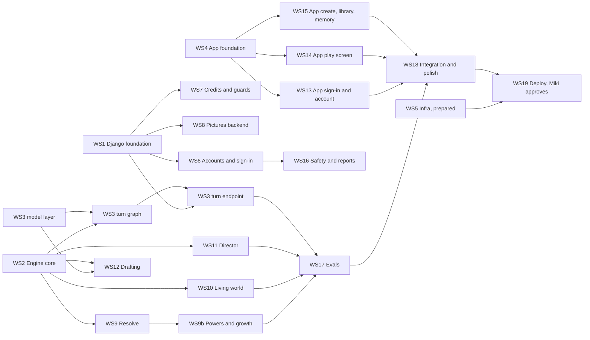

# First version: implementation plan

Written by the orchestrator thread on 2026-11-03, from Miki's request to build a complete first version
of Lucid Saga with a polished app and pictures at key scenes and fights. Every implementing thread
reads this file, [REQUIREMENTS.md](REQUIREMENTS.md) (what to build), [API.md](API.md) (the app to
backend contract) and [ARCHITECTURE.md](ARCHITECTURE.md) before starting.

## What the first version is

A player can sign in, pick or write a premise, review the drafted world and character, and play an
endless story whose outcomes the engine decides in code, whose world reacts and keeps moving on
in-world time, with narration streamed as it is written, pictures at key moments, credits, and a
polished app on Android, iOS and the web build.

**In:** every P0 requirement, plus these P1 items that P0 rules lean on or Miki asked for:

- Pictures, M1 to M8 and S7 (Miki asked for them, including fights).
- Seeded rolls (A3), difficulty (A5), story settings (S6) and content preferences (F7).
- Time stop and the other parts of A9, G22 and W10a that the flagship genre needs, plus growth (A4),
  breakthroughs (G19) and backstory claims (N4).
- Time skips (E7), the code part of the continuity check (C5) and `/status` (S5).
- BYOK turns free (K6).

**Out of the first version, planned next:** store payments and plans (K3 to K5, which need store
accounts), retrieval with pgvector (C4), undo and branching saves (C8, beyond the rewind after a death), editable memory (C7), the model part of
the world tick (W6, P1), NPC agendas (E3), the remaining slash commands, Gemini transcription (V6,
P1), and everything P2. A death the player chooses and `/end` already end a story, and the player can carry it on as a random person of
the world or as one of the player character's heirs, a child too young to act after a time jump to
their sixteenth birthday (N6). Foes and dangers can kill or maim the player character on every
difficulty, logic first and the dice only between (N6), and a death they cause can be rewound up to
5 scenes on Story, 1 on Balanced and none on Brutal (C8).

**Not done without Miki:** any deploy, any production migration that drops data, deleting data, and
anything that adds cost to the GCP or Neon bill (see [What only Miki can do](#what-only-miki-can-do)).

## Target layout

The backend becomes Django with Django Ninja over ASGI. Engine rules are plain Python with no Django
or LangChain imports (B4), and the model calls live in their own package.

```text
backend/
  manage.py
  lucid/        Django project: settings, urls, asgi, Ninja API root, error envelope, JSON logging
  accounts/     custom User model (WS1); sign-in, tokens, owner role, age gate, delete, export (WS6)
  stories/      Story, Scene and PendingEvent models, admin, story API (WS1), turn endpoint (WS3)
  drafts/       Draft model and the drafting API (WS12)
  billing/      credit ledger, prices, quotas and rate limits (WS7)
  media/        pictures: storage, generation, the picture API (WS8)
  moderation/   reports and blocks (WS16)
  speech/       online dictation, POST /v1/transcriptions (V6)
  engine/       pure rules: state, invariants, time, resolve, world, director (WS2, WS9, WS10, WS11)
  graph/        model layer, LangGraph turn graph, drafting chain, prompts (WS3, WS12)
  evals/        scripted scenario harness (WS17)
  tests/<area>/ tests per package
app/lib/
  design/       tokens, theme, typography, motion, components (WS4)
  core/         API client with SSE and typed errors, session hook, config, l10n, fake API (WS4)
  features/
    voice/      dictation button and controller (WS4)
    auth/       sign-in, birth date, onboarding (WS13)
    account/    settings, BYOK, credits, privacy, delete and export (WS13)
    discover/, create/, library/   premises, world and character review, library (WS15)
    story/      play screen, scene details, pictures, memory, status (WS14, WS15 for memory)
infra/          bootstrap scripts and Cloud Run config (WS5)
```

Runtime contract that WS1 provides and WS5 deploys:

- The ASGI app is `lucid.asgi:application`, served by
  `uvicorn lucid.asgi:application --host 0.0.0.0 --port $PORT`.
- Migrations run with `python manage.py migrate`, with `DATABASE_URL` set to the direct (unpooled)
  Neon URL. The service itself gets the pooled URL (B2).
- Settings come from env vars: `DJANGO_SECRET_KEY`, `DATABASE_URL`, `ALLOWED_HOSTS`,
  `CORS_ORIGINS`, `LLM_PROVIDER` (`vertex` or `fake`), `GCP_PROJECT`, `VERTEX_LOCATION`, one model
  name per node (B6), `GOOGLE_OAUTH_CLIENT_IDS`, `OWNER_EMAILS`, `MEDIA_BUCKET`, `LOG_LEVEL`.
  Secrets come from Secret Manager (T11).

## How every thread works

1. **Own your PR end to end** (CLAUDE.md rule 9): branch from `dev`, open the PR against `dev`,
   self-review with the code-review skill, fix, green CI, squash-merge into `dev`. A workstream can
   land several PRs; land a first useful one early when others wait on it. Never open a PR into
   `main` from a feature branch: merging `dev` into `main` deploys, which a thread does itself
   once its work is ready, without asking Miki (2026-11-07), with a merge commit
   ([DEPLOY.md](DEPLOY.md#how-changes-reach-production)). CI
   runs on every PR and on pushes to `dev` and `main`.
2. **Stay inside the paths your workstream owns.** Shared files (`pyproject.toml`, `uv.lock`,
   `lucid/settings.py`, the Ninja router registration, `ci.yml`, `pubspec.yaml`, `router.dart`) get
   small additive edits only. After rebasing, settle a `uv.lock` conflict with `uv lock` and a
   `pubspec.lock` conflict with `flutter pub get`, never by hand. Treat migrations on `main` as
   applied: if your unmerged migration collides with one that landed first, regenerate yours on top
   of `dev` instead of adding a merge migration.
3. **Build to [API.md](API.md).** If you must change the contract, change API.md in the same PR and
   tell the orchestrator thread, which tells the threads on the other side.
4. **Engine rules live in code with unit tests** (CLAUDE.md rule 2). Model nodes propose, code nodes
   decide. Nothing in `engine/` assumes a genre (G5).
5. **Databases:** no thread has Neon or GCP credentials, so test against a throwaway local Postgres
   (`docker run -d -p 5432:5432 -e POSTGRES_PASSWORD=postgres postgres:18`) and CI's service
   container. Never point anything at Neon `production`. If Neon credentials appear in the
   environment, use one Neon branch per feature as CLAUDE.md says.
6. **Models:** tests use fake models. Nobody can call Vertex AI from a thread until Miki provides
   access, so live checks are left to WS18.
7. **Flutter** isn't preinstalled. App threads install Flutter 3.44.5 (the CI version) from
   `storage.googleapis.com/flutter_infra_release` and run format, analyze and test locally before
   pushing.
8. **Report to the orchestrator thread** ("Plan and orchestrate the first version"; its id is in
   your dispatch message) with `message_thread` when a PR merges (name what landed and any interface others use), when you are
   blocked, or when you need another workstream to change something. Product questions for Miki go
   through the orchestrator.
9. **Docs travel with code:** update API.md, ARCHITECTURE.md, the READMEs and, when behavior
   changes, REQUIREMENTS.md, in the same PR. Cite requirement ids and the workstream id in the PR.

## Waves



| Wave | Starts when | Workstreams |
| --- | --- | --- |
| 1 | Now | WS1, WS2, WS3 (model layer first), WS4, WS5 |
| 2a | WS1 merged | WS6, WS7, WS8 |
| 2b | WS2's first PR merged | WS9, WS10, WS11, WS12 (also needs WS3's model layer) |
| 2c | WS4 merged | WS13, WS14, WS15 |
| 3 | Their inputs merged | WS9b, WS16, WS17, then WS18 |
| 4 | Miki approves | WS19 |

## Workstreams

Each brief names the requirements, what the workstream owns, what it must hand to others, and when it
is done. Details not given here are the thread's call, recorded in ARCHITECTURE.md.

### WS1 Django foundation (wave 1, critical path)

**Requirements:** B1, B2, B3, B10, T3, T4, T6, T7 (envelope), T10 (version column), S8 (owner column).

**Owns:** `backend/manage.py`, `backend/lucid/`, `backend/accounts/` (model only), `backend/stories/`,
`backend/legacy/`, `backend/Dockerfile`, the backend job in `ci.yml`, `backend/README.md`.

- Replace FastAPI with Django and Django Ninja over ASGI (uvicorn), psycopg 3, pytest-django.
  Settings per B2: pooled URL with `DISABLE_SERVER_SIDE_CURSORS = True` and `CONN_MAX_AGE = 0`.
- A **custom User model from the very first migration** (email as login, display name, birth date,
  role, Google subject id), because swapping `AUTH_USER_MODEL` later is painful. WS6 adds the flows.
- Models: `Story` (owner, title, genre, rating, settings JSON, world state JSONB, `version` for T10,
  timestamps), `Scene` (story, turn, kind, action, input mode, narration, choices, details, time
  fields, timeline id, image fields), `PendingEvent` (story, timeline id, in-world due time, kind,
  payload, status; B12). Django migrations replace `backend/migrations/*.sql`. Don't drop the old
  `stories` table on Neon: dropping production data needs Miki.
- JSON logging to stdout with a middleware that adds request id, trace id from
  `X-Cloud-Trace-Context`, user id and story id to every line (T4), nothing secret (T6). The error
  envelope and codes from API.md (T7). `/health` never touches the database (T3). Heavy imports stay
  out of module load (B10). Admin on for staff.
- Port today's endpoints (premises, create, list, get, turn, memory) on the same paths, still using
  today's one-call narrator moved unchanged to `backend/legacy/`, so the current app keeps working
  until WS3 replaces it.
- **Done when** the ported tests and new model tests pass on Postgres in CI, the container runs per
  the runtime contract above, and ARCHITECTURE.md and the READMEs describe Django.

### WS2 Engine core: state, invariants and time (wave 1, critical path)

**Requirements:** C1, C2, C6, W10, W10a (data), G6, G7, G13, A1, N1, N2, N3, E2 and W1 to W4 (data),
A8 (axes), A3 (seeded rolls).

**Owns:** `backend/engine/` (except `resolve/`, `world/`, `director/`), `backend/tests/engine/`.

Land **PR 1 fast** (wave 2b waits on it): the models and the pipeline seams. Then PR 2: invariants,
the clock and the visibility filter.

- **PR 1, models (Pydantic, no Django, no LangChain):** `WorldState` holding everything C2 lists;
  `WorldBible` (G6 parts, fixed and open rules G7, physics mode A9, power ladder G18, calendar,
  laws and enforcers W11, major mysteries with answers N7); `CharacterSheet` (every G13 part, the
  A8 power axes, powers with limits, costs, settings such as time-stop hit mode, and settled rulings
  A9); `Character`, `Faction` (parent faction G10, player esteem and fear W3), `Place` (status,
  controller, travel times W7); `Deed`, `Rumor`, `Fact` (truth value, who knows it), `Goal`, `Lead`,
  `Thread`, `Clock`, `PendingEvent`, `RollRecord`; world and personal clocks and timeline ids on
  everything W10a lists.
- **The step contracts:** `Intent` (what the interpret step proposes: verb, targets, method, the
  sheet parts used, beats R2, steps of a chained plan R6, the cause-and-effect chain with the facts
  each link rests on A9, proposed facts per step such as whether the opposition can respond and
  whether the means are enough, the action kind and proposed duration W10, the player's own lines
  R7, backstory claims N4, theories about their powers A9, standing actions); `Resolution` (per step:
  class, reason in the world's words, roll record, result, costs, duration; where a plan stopped;
  proposed deeds; rulings settled; items made canon); `DirectorPlan` (event, callbacks, picture
  decision M1); `StateDelta` (what the narrator proposes, replacing `legacy`'s `StateUpdate`).
- **`engine/pipeline.py`:** the functions the graph calls, with default bodies that WS9, WS10 and
  WS11 replace. `engine/pipeline.py` is the source of truth for the signatures. Every seam takes a
  `TurnContext` (story id, turn, settings, rating, content preferences) and the turn's `SeededRng`
  (A3), keyed by story, timeline and turn, from which each seam derives child streams with stable
  labels:
  - `catch_up(state, until_s, ctx, rng) -> TimePassage` (WS10)
  - `resolve(state, intent, ctx, rng) -> Resolution` (WS9)
  - `play_out(state, resolution, ctx, rng) -> PlayOut` (WS2): the steps happen in order on
    in-world time; the world catches up to each step's end through `catch_up`, and an event that
    needs the player cuts the plan short; each step's `effects` apply as the engine's, then
    `record_consequences` runs
  - `record_consequences(state, resolution, step, ctx, rng) -> WorldState`, once per finished
    step (WS10)
  - `apply_event(state, event, ctx, rng) -> WorldState`, once per pending event that falls due
    (WS10)
  - `direct(state, resolution, ctx, rng) -> DirectorPlan` (WS11)
- **PR 2:** `engine.apply.apply_delta(state, delta, ctx, *, source) -> Applied` with the C1
  invariants (confirmed and presumed deaths, destroyed factions and ruined places change only
  through a recorded cause, bounds, no nameless characters, fixed rules never change), and
  `engine.invariants.check_transition(before, after)` for any two states;
  `engine.timekeeping.advance_clock`, which moves the clock through pending events in time order and
  stops at the first that needs the player (W10); personal clocks (W10a); `engine.labels` for time
  labels ("+8 h", the world's calendar); and `engine.visibility`, the C6 projection behind
  `MemoryView` and `StatusView`.
- **Done when** every invariant and the clock have unit tests, and the models round-trip through
  JSON (Django stores the state as JSONB).

### WS3 Model layer and the turn graph (wave 1, three PRs)

**Requirements:** B5, B6, B7, B8, B9, F4, F5, R1 to R7, V3, C3, C5 (code part), S2, S3, S4, T5,
T7, K6.

**Owns:** `backend/graph/` (except `graph/drafting/`), the turn endpoint in `stories/`, deleting
`backend/legacy/`, `backend/tests/graph/`.

- **PR 1, model layer (start now; needs nothing else):** the model for each node set in config (B6:
  interpret, narrator, checker, summarizer, picture); Vertex AI through `langchain-google-genai`'s
  `ChatGoogleGenerativeAI` (`ChatVertexAI` is deprecated) with Application Default Credentials (B11); a per-request BYOK client that is never stored or
  logged; safety settings per rating at the most permissive level the policy allows (F5);
  structured output and token streaming; one retry and then a typed error (`llm_unavailable`,
  `blocked`, `bad_key`, T7); a telemetry record per call (model, tokens, latency, estimated cost,
  blocks, retries; T5) that WS7 bills from; a scripted fake model for tests. **Landed** as
  `backend/graph/llm/` (see [ARCHITECTURE.md](ARCHITECTURE.md#model-layer)): WS7 charges each
  non-BYOK `CallRecord.cost_usd` in `TurnTelemetry.calls`, the raw cost from
  `graph/llm/pricing.py`, plus its margin; WS8 calls `ModelClient.image()`; WS12 uses the
  `drafter` node.
- **PR 2, the turn graph (after WS2's PR 1):** the seven B5 nodes in LangGraph. Prompts: interpret
  turns typed or dictated text into an `Intent` (V3, R2, A9, W10, N4) and never refuses; narrate
  plays the action, then the outcome, then the world's reaction, from the exact moment the last scene
  ended (R1 to R7), in the world's tone (G5), with 0 to 4 suggestions (S2) and a scene end the
  player can act on (S4). A blocked narration retries as a cut-away and then falls back to a template
  line, and the deed still stands (F4). Context building with chapter summaries every 20 turns (C3)
  and the last scene's ending (R3). Code checks the plan against invariants before narrating (C5).
  Steps 1, 3 and 6 call `engine.pipeline`, so WS9, WS10 and WS11 plug in without touching the graph. **Landed** as
  `backend/graph/turn/` (see [ARCHITECTURE.md](ARCHITECTURE.md#turn-graph)): `run_turn(TurnInput,
  ModelClient)` streams `NarrationDelta` and `NarrationReset` and ends with `TurnCompleted`, whose
  `result` holds the state, the `SceneDraft` and the fired events for PR 3 to save. The seams are
  called in `graph/turn/nodes.py`'s `resolve` node; WS11's `direct(..., intent=)` and
  `record_direction` go there. Step 6 applies the narrator's update with `engine.apply.apply_delta`
  and step 7 runs `engine.invariants.check_transition` on the whole turn.
- **PR 3, the turn endpoint (needs WS1):** `POST /v1/stories/{id}/turns` as server-sent events per
  API.md (B7, S3), the version check (T10), saving state, scene and pending events in one
  transaction, the opening turn, one structured T5 log line per turn with the input mode (V7). Delete
  `backend/legacy/`. **Landed** in `backend/stories/` (see
  [ARCHITECTURE.md](ARCHITECTURE.md#turn-endpoint)) with API.md's whole Stories contract on graph
  stories, Memory and `/status`, the credit meter, picture planning, pending events written back to
  their table, and `manage.py seed_story` for development. `POST /v1/stories` is gone: drafts make
  stories (WS12). `backend/legacy/` is deleted; the starter premises moved to `stories/premises.py`
  until WS12's catalog replaces them.
- **Done when** a turn runs end to end on the fake model with streaming, F4's fallbacks and T7's
  errors are tested, and nothing runs after the response ends (B8).

### WS4 App foundation and design system (wave 1)

**Requirements:** the polished UI Miki asked for, V1, V2, V5, V7 (client side), T7 (client errors),
S10 (strings ready for translation).

**Owns:** `app/lib/design/`, `app/lib/core/`, `app/lib/features/voice/`, `app/lib/app.dart`,
`app/lib/router.dart`, `app/pubspec.yaml`, platform permission files, a restyle of the existing
screens.

- **Visual direction:** a dark-first, cinematic reading experience that feels like a premium story
  app: deep ink backgrounds, comfortable narration in a readable serif with a clean sans for the
  interface (bundled fonts, so nothing loads at runtime), one accent color that each story tints by
  genre, full-bleed pictures with a soft vignette that fade in when ready, and quick, quiet motion
  (150 to 250 ms) that respects reduce-motion. A light theme too. Dynamic type and 4.5:1 contrast.
  Write the direction down in `app/DESIGN.md` so WS8's picture style matches it.
- **Components:** scene card, streaming narration text, choice chips, a composer bar with a mic
  button and slash-command hints, picture slot (shimmer, fade-in, quiet failure), portrait avatar,
  time chip ("+8 h"), event badge, bottom sheets, skeletons, empty and error states. A widget gallery
  route for development.
- **Voice (V1, V2, V5):** a dictation button on top of `speech_to_text`, on-device where available,
  with a live transcript that stays in the box until sent, the iOS and Android permissions and
  usage strings, and the input mode tracked for V7. Shown on the web build only where the browser
  supports it.
- **Core:** an API client with bearer tokens and a refresh hook for WS13, an SSE client for turns,
  the typed errors from API.md, l10n scaffolding with English strings, and a **fake API** behind
  `--dart-define=API_MODE=fake`, one file per feature area so WS13, WS14 and WS15 each extend their
  own, and app work never waits on the backend.
- Routes: signed out (sign-in and onboarding) versus signed in (tabs: Discover, Library, Account),
  the create flow, the play screen and its memory and status pages.
- **Done when** the existing screens use the new design system, widget tests cover the components,
  and screenshots of the gallery are in the PR.

### WS5 Cloud infra and deploy pipeline, prepared but not run (wave 1)

**Requirements:** T1, T2, T9 (budget alert), T11, T13, B11, M4 (bucket).

**Owns:** `infra/`, `.github/workflows/deploy.yml`, `docs/DEPLOY.md`. Never edits backend code.

- A bootstrap script Miki runs once, signed in to `playable-anime`, that is safe to re-run: Artifact
  Registry repository; secrets (`database-url`, `database-url-direct`, `django-secret-key`); a
  private Cloud Storage bucket in `europe-west3` for pictures with the runtime service account's
  access, including what signed URLs need without a key (B11); Workload Identity Federation for this
  GitHub repo so Actions can deploy without a JSON key; a budget alert on the project (T9).
- The deploy workflow: manual dispatch from `main`, green CI required, build, run migrations as a
  Cloud Run job over the direct URL, then deploy the service to `europe-west3` with min instances 0,
  max 3, a 300 s timeout, startup CPU boost and the existing runtime service account (T1, B10).
- `docs/DEPLOY.md`: every command, what each costs, and how to roll back. Fix the Madrid region in
  ARCHITECTURE.md to Frankfurt (T1).
- **Done when** the scripts pass `shellcheck` and a dry run, and the PR lists exactly what Miki has
  to run. Nothing is run against GCP or Neon production.

### WS6 Accounts and sign-in (wave 2a, after WS1)

**Requirements:** T8, S8, K7, F8, T12, T4 (user id in logs).

**Owns:** `backend/accounts/` (beyond the model), auth wiring in `lucid/`, `docs/PRIVACY.md`.

- Google sign-in: verify the ID token once (audience from `GOOGLE_OAUTH_CLIENT_IDS`), then issue our
  own short-lived access token and a rotating refresh token stored hashed and revocable. Email and
  password sign-up and login in Django. No Firebase. Sign in with Apple is left for the store launch,
  with a note in ARCHITECTURE.md.
- Ninja auth on every endpoint except `/health` and `/v1/auth/*`; stories scoped to their owner
  (S8). Login throttling against brute force.
- The owner role from `OWNER_EMAILS`, granted only through a verified Google sign-in, with admin
  access (K7). A birth date at sign-up, and Teen only under 17 (F8).
- `/v1/me`, delete account with everything it owns, including pictures through a signal WS8 hooks
  into, and export (T12). A first draft of the privacy policy, marked for Miki's review, that says
  where speech goes (V5).
- **Done when** every endpoint in API.md's auth section is tested with a mocked Google verifier.

### WS7 Credits, quotas and rate limits (wave 2a, after WS1)

**Requirements:** K1, K2, K6, K7, K8 (cost tests), M7 (interface), T9.

**Owns:** `backend/billing/`.

- An append-only ledger, a balance that can't race (row lock), $0.50 starter credit on account
  creation (K1), a price table per model plus margin in config, a debit per completed turn from WS3's
  telemetry record (K2), and a pre-turn check that returns `out_of_credits` before any streaming.
  The owner is unlimited but still logged (K7). BYOK turns are free (K6).
- `charge_image()` for WS8 that never takes a balance below zero (M7). `GET /v1/me/credits`.
- Per-user rate limits and a daily turn quota on our key, stored in Postgres so they hold across
  Cloud Run instances (T9).
- Cost tests with a normal account showing that a quiet turn, a montage turn and an event turn stay
  within a set multiple of each other (K8).
- The turn endpoint (WS3) calls the pre-turn check and the debit, and the picture endpoint (WS8)
  calls `charge_image()`. Whichever side lands second wires the call.
- **Done when** concurrent debits can't overdraw and the ledger reconciles with the balance.
- **Landed** as `backend/billing/` (see [ARCHITECTURE.md](ARCHITECTURE.md#credits-quotas-and-rate-limits)).
  The price table is the model layer's (`graph/llm/pricing.py`) and billing adds the margin from
  config. WS3's turn endpoint calls `meter.astart(user, meter.TURN, byok=...)` before streaming,
  `meter.charge(ticket, telemetry.calls, story_id=, turn=)` inside its save transaction and
  `meter.arelease(ticket)` in a `finally`; WS12 does the same with `meter.DRAFT`. Already wired:
  WS8's `media/billing.py` (`meter.astart(user, meter.IMAGE)`, `meter.charge_image(...)`,
  `meter.arelease(...)`) and WS6's `User.credits` (`billing.credits.summary(user)`).

### WS8 Pictures backend (wave 2a, after WS1)

**Requirements:** M1 (consumes the decision), M2 to M8, S7, T5 (picture log line).

**Owns:** `backend/media/`.

- An `Image` record keyed by story and subject (portrait, place, scene or cover), with status, model,
  cost and version, reused wherever the subject appears (M4) and redrawn once when a character
  changes for good (M5).
- Generation on Vertex AI with the picture model from config (M8), the house style written to match
  `app/DESIGN.md` and the world's era and look (S7), known characters' portraits passed as reference
  images with their appearance (M5), and prompts that stay mild in every rating (M6).
- Storage behind an interface: a private Cloud Storage bucket with short-lived signed URLs in
  production, the local filesystem in development and tests.
- The idempotent picture endpoints from API.md (M3): one generation and one charge per scene even
  under repeated or concurrent calls, `pending` while running, `skipped` quietly on failure, block
  or no credits. Illustrate for player-paid pictures (M2). Deleted with the account (T12).
- **Done when** idempotency and the never-below-zero rule are tested with a fake picture model.
- **Landed** as `backend/media/` (see [ARCHITECTURE.md](ARCHITECTURE.md#how-pictures-work)). What
  other workstreams call:
  - **WS3 (turn endpoint):** when `DirectorPlan.picture` is set, call
    `media.plans.plan_picture(scene, kind=, subject_id=, trigger=, brief=Brief(description=<the
    narrator's image prompt>, look=WorldLook(<bible genre, era, tone>),
    subject_name=, subject_appearance=, figures=(Figure(id, name, appearance, carries), ...),
    you=, time=, turn=<the scene's turn>, place_id=, place_name=, place_look=),
    version=<PictureDecision.version>)` after saving the scene, in the turn's transaction. Build `Scene.image`,
    `Scene.portraits` and `StorySummary.cover_url` with `media.lookups.scene_images`,
    `portrait_urls` and `cover_urls`, and fill the memory and status views' picture URLs
    (`engine.visibility`) with `portrait_urls(story, character_ids)` and
    `place_urls(story, place_ids)` or `place_url(story, place_id)`.
  - **WS7 (credits):** replace the three bodies in `media/billing.py` (`start`, `charge`,
    `release`) with the meter's `astart`, `charge_image` and `arelease`. Done in WS7's PR.
  - **WS6 (accounts):** deletion needs nothing (files go with the cascade, after the commit); the
    export adds `images` through `accounts.signals.account_exporting`. The picture endpoints use
    `stories.access.owned_story`, so the rating limit (F8) applies to pictures too.
  - **WS11 (director):** the picture decision's `subject_id` is the character or place id, and its
    `version` the look version a portrait or place is drawn at (WS8b below).
  - **WS14 (play screen):** see the Pictures section of [API.md](API.md#pictures-m1-to-m8).
  - The house style in `media/prompts.py` follows the "Pictures" section of `app/DESIGN.md`
    (aligned in WS4's PR); change the two together.

### WS8b Redraw pictures when places and faces change (wave 3, after WS8 and WS11)

**Requirements:** M1, M2, M4, M5, M7, G17, W7.

**Owns:** `backend/engine/looks.py`, and the picture parts of `backend/media/` and
`backend/engine/director/pictures.py`.

- A place that changed for good (ruined, occupied, rebuilt or freed) gets a fresh picture the next
  time the player is there, and returns reuse it after that (M1, M4).
- A character who changed for good (a lost eye, old age, G17) gets their portrait redrawn once from
  the earlier one, and the new one is the reference from then on (M5).
- Both spend the M2 budget and are paid once (M7); the idempotent picture request still holds (M3).
- **Landed** as `engine/looks.py` (look versions), `CharacterChange.look_change` and
  `Character.look_version` (moved on by `apply`), `PictureDecision.version` and the `look_changed`
  trigger, `pipeline.settle_picture` after the narrator's update, and
  `plan_picture(..., version=)`. A place's version comes from its status history, so anything that
  changes a place for good must go through `PlaceChange.status` (WS9b's chains do), not only its
  description. Resolve can record a maiming the same way, with a `look_change` on the engine's
  `CharacterChange`.

### WS9 Resolve: logic first, then dice (wave 2b, after WS2's PR 1)

**Requirements:** A2, A3, A5, A6, A7, A8, R2, R6, G8, G14, G18, G25 (odds within a gap).

**Owns:** `backend/engine/resolve/`, the `resolve` seam in `engine/pipeline.py`.

- From an `Intent` and the state to a `Resolution`, in code: check every beat against the body,
  powers, carried items, the scene and what this turn made canon (R2), deciding whether a missing
  item is plausible (there, and the default), uncertain (rolled) or absent (an empty search); check the world's rules (G8);
  compare the power axes and the ladder gap (A8, G14, G18); check whether the opposition can respond
  at all; then class each step as certain, contested, long shot or ruled out (A2). Code validates
  the facts the model proposed against the state wherever the state can tell.
- Seeded rolls only for contested and long-shot steps, weighted by power against opposition, with
  difficulty shifting only those odds (A3, A5), and close calls rolled only between outcomes the
  facts allow. Chained plans stop at the first step that doesn't cleanly succeed (R6); chains of
  cause and effect settle link by link and stop at the first link that fails (A9). Durations are
  bounded by action kind and rolled when uncertain (W10). Reasons are written in the world's words
  (A8). "I kill him and everyone cheers" resolves as an attempt (A6); injected instructions resolve
  as something the character says (A7).
- **Done when** the "logic over dice", "fair long shots", "power gap", "cause and effect" and
  "workaround" scenarios from T17 pass as unit tests over many seeds.
- **Landed** as `backend/engine/resolve/` (see
  [ARCHITECTURE.md](ARCHITECTURE.md#resolve-logic-first-then-dice)). For WS3's interpret prompt, the
  contract gained `IntentStep.aim` (what success does to the targets: kill, wound, subdue, or none),
  `ChainLink.answers` (what would let a target escape a link, in plain words), and
  `StepResolution.beats` (R2's beat checks, for the scene details). WS10's `record_consequences`
  receives one proposed deed per step against someone, with a first-guess severity to weigh by the
  world's norms. WS9b plugs time stop's own rules into `engine/resolve/powers/`. WS3's PR4 asks
  the interpret prompt for `aim` and `answers`, forces the player as the actor (A6), and sends the
  beat checks to the narrator's OUTCOME and the scene's `details.steps[].beats`.

### WS9b Powers, theories and growth (wave 3, after WS9)

**Requirements:** A9 (theories and rulings, refuse nonsense never power), G22, W10a (time stop, haste
and slow, local reversal), A4, G19, G20, N4.

**Owns:** `backend/engine/resolve/powers/` and growth rules, coordinating with WS9's owner.

- Time stop with its three conventions and three hit modes (normal force, relative speed,
  untouchable): the world clock stands still while the user's runs, no pending event fires, frozen
  targets can't respond, deeds are secret but leave traces, and relative-speed hits land with the
  force the requirements describe, including on the thrower when close.
- Player theories ruled on once and recorded on the sheet, never flipped, refused only for nonsense,
  and earnable later as growth (A9). Growth with traits, effort, teachers and the world's ceilings
  (A4); breakthroughs as events (G19); sensing and hiding power (G20); backstory claims (N4).
- **Done when** the T17 time-stop, stopped-time throw, light-speed throw, unrivalled, controlled
  throw, earned technique, nonsense-not-power, player theory and stopped-time rescue scenarios pass
  as unit tests over many seeds.
- **Landed** as `backend/engine/resolve/powers/` (see
  [ARCHITECTURE.md](ARCHITECTURE.md#powers-theories-and-growth)), with W10a's decided figures in
  REQUIREMENTS.md. For WS3's interpret prompt, `IntentStep` gained `contact`, `mass_kg`,
  `range_m`, `full_force`, `training` and `show_strength`, `PowerTheory` gained the fields the
  engine rules on, `Intent.backstory` holds `PastClaim`s, and `ChainLink` gained `place_id` and
  `place_harm` for links that burn or bring down a place. `StepResolution` gained `training`, so
  training cut short by an event keeps its effort. `Resolution` gained `claims` (N4's verdicts)
  and `effects` (settled details of powers and accepted backstory, applied by
  `play_out`). `CharacterChange` gained engine-only `powers`, `techniques`, `ladders`, `practice`
  and `skills`, and `StateDelta` gained `time_effects`, so stops and hastes persist across turns.
  For WS10, `answers` measures might with `might_with_powers` (a light-speed thrower is measured by
  the force of their throw once the world could know of it), `attribution_odds` takes `stopped=`
  so plain-sight traces of a stopped-time deed never point at the doer, and a user's death ends
  their time effects. Local reversal (W10a) is deferred.

### WS10 Living world: deeds, rumors, reputation and the world tick (wave 2b, after WS2's PR 1)

**Requirements:** W1 to W8, W11, W12, W13, W15, W15a, E2 (advancing), E5, K8 (bounded tick).

**Owns:** `backend/engine/world/`, the `catch_up`, `record_consequences` and `apply_event` seams.

- Deeds from resolutions with severity by the world's norms and witnesses from who could perceive
  them (W1, W11, W12); rumors that spread over in-world time along travel times and lose accuracy
  (W2); esteem and fear per faction and region that change slowly (W3, W9); attitudes, grudges and
  hostile relatives (W4); threat tiers that feed each faction's own answer, scheduled as pending
  events at in-world times worked out from distance and gathering (W5, W10); discovery rolls from
  traces, with rumors that can be wrong (W13); emerging characters and factions with a recorded
  origin, an active cast capped at 8 NPCs and 4 factions, and revivals only with survivors (W15,
  W15a); clocks that advance with time and deeds (E2).
- `catch_up` applies due pending events in time order and stops at the first that needs the player,
  in a fixed number of steps (K8, E7).
- **Done when** the "fleeing witness", "interrupted sleep", "phone witness", "idle world" and
  "ignored hook" scenarios pass as unit tests.
- **For other workstreams:** the event kinds the world schedules are `engine.world.Kind`, and
  events of any other kind (`director.*` for WS11) are only marked applied, keeping the
  `needs_player` they were scheduled with. The graph (WS3) saves the world's events like any other
  pending row. The tick leaves agenda facts (origin `agenda`, the latest three per faction or NPC)
  for the director (W16) and for the model part of the tick (W6, P1) to tell.

### WS11 Director, threads and the picture decision (wave 2b, after WS2's PR 1)

**Requirements:** W16, E4 (one table per size), E6, E7, N1, N2, S2 (suggestion rules), S4, M1, M2.

**Owns:** `backend/engine/director/`, the `direct` seam.

- Stall pressure in code (turns without stakes, repeated low-stakes actions, clocks near their end;
  encounter turns don't count) with thresholds 10, 5 and 3 for calm, normal and dramatic. Event
  sources in W16's order, then a seeded deck per size, filtered by rating and content preferences
  (F7) and tagged so the narrator dresses them in the world's form (G9). Ignored events play out.
  One or two dormant threads pulled in for callbacks. Thread lifecycle (N1); goals change only with
  the player's input and leads expire (N2). Time skips that stop early when an event needs a decision
  (E7). Rules for the 0 to 4 suggestions, at least one away from the current thread (S2).
- **The picture decision (M1, M2):** the triggers M1 lists, plus fights as Miki asked: the start of
  a fight with a key NPC or a strong monster, and its decisive blow, all within the per-story budget
  and the story's picture setting.
- **Done when** the "quiet life", "long fight", "ignored event", "themes off", "time skip" and
  "goal ownership" scenarios pass as unit tests.
- **Landed** as `backend/engine/director/` (see
  [ARCHITECTURE.md](ARCHITECTURE.md#the-story-director)), with the six scenarios in
  `tests/engine/director/test_scenarios.py`. It added `Intent.responds_to`, the
  `record_direction` seam and the `schedule_stretch` hook in `play_out`, and wired them into the
  turn graph's resolve node. What other workstreams need to know:
  - **WS10 (living world):** `apply_event` marks `director.event` and `director.plays_out`
    events applied and does nothing else with them; keep it that way. A world event that needs the
    player can carry `payload["event"]` with a size, kind, brief and themes for the director, which
    otherwise tells it as a personal arrival from its title.
  - **WS3 and WS8 (pictures):** `PictureDecision.subject_id` is a character, place, deed or thread
    id (see ARCHITECTURE.md). WS8b keyed portraits and places by `PictureDecision.version`, so a
    place that changed for good (`place_changed`) and a face that did (`look_changed`, M5) are
    drawn once more and reused after that.

### WS12 Drafting a world and a character (wave 2b, after WS2's PR 1 and WS3's PR 1)

**Requirements:** G1, G2, S1, A1, G6, G7, N7 (major mysteries), E2 (first clocks), G12, G16.

**Owns:** `backend/graph/drafting/`, `backend/drafts/` (the `Draft` model and `/v1/drafts`), the
starter premises.

- Premise to world bible and player sheet, with factions, key NPCs, the first clocks and the answer
  to any major mystery, shown as a one-screen summary in plain words and a character in the world's
  words; plain-words revisions and direct edits; advanced fields hidden by default; start creates the
  story and its state (API.md). Fictional people and organisations only (G12).
- A starter catalog that leads with the flagship genres (cultivation, knights and aura, many races
  and monsters, reincarnation with an optional gift up to time stop) and covers grounded modern
  (the Naples vendetta), science fiction and a hidden supernatural city (S1).
- **Done when** drafting runs on the fake model in tests, hidden parts never leak into the response,
  and each starter premise drafts into a bible that respects its genre's fixed rules.
- **Landed.** `graph.drafting` (`chain.create`, `chain.revise`, `chain.plan_edit` and
  `chain.finish_edit`, `assemble`, `view`, the starter `catalog`) and the `drafts` app. Start saves a
  graph story at turn 0 and version 1 with no scenes, `scene.ended_on` holding the opening moment,
  and clocks with `next_step_s` but no pending events. `/v1/premises` moved from `stories` to
  `drafts`, and drafting is metered with `meter.DRAFT`.

### WS13 App: sign-in, onboarding and account (wave 2c, after WS4)

**Requirements:** S8, T8 (client), F8, T12, K1, K2 (balance and upsell), S9 (BYOK), F7.

**Owns:** `app/lib/features/auth/`, `app/lib/features/account/`.

- Google sign-in on Android, iOS and web, and email sign-up and login; the birth-date step for new
  accounts; secure token storage and refresh through WS4's hook; sign out.
- Account: profile, credits balance and history, an out-of-credits sheet ("top-ups coming soon"
  until K4 and K5), BYOK key, content preferences (F7), privacy policy, export, and delete account
  with a clear confirmation.
- **Done when** the flows work against the fake API, with widget tests.

### WS14 App: the play screen (wave 2c, after WS4)

**Requirements:** S2, S3, R1 (display), A8, W10, W10a (time display), M3, V1, V2, V7, S5 (`/status`),
S6, F4 (client), F6 (report button), T10 (client).

**Owns:** `app/lib/features/story/` (except the memory page).

- Streamed narration over SSE with a calm reveal, the scene feed with scrollback, choices and the
  standing actions, the composer with dictation and slash-command hints, the scene details sheet
  (steps, classes, rolls, reasons, chains), the time chip with both clocks when they differ, event
  badges, portraits, and the picture slot that asks for the picture after the scene completes,
  retries, and stays quietly empty on `skipped`.
- Error handling from API.md: version conflicts refetch, out of credits opens WS13's sheet,
  unreadable actions offer rephrase or retry, `llm_unavailable` offers a retry and discards the
  partial scene. Report and block on every scene. Story settings sheet (S6). The `/status` page.
- **Done when** a scripted story plays through the fake API with streaming and pictures, with widget
  tests and screenshots in the PR.

### WS15 App: create, discover, library and memory (wave 2c, after WS4)

**Requirements:** G1, G2, S1, F2, F8 (client), C6, G16, N1 (display).

**Owns:** `app/lib/features/discover/`, `app/lib/features/create/`, `app/lib/features/library/`, the
memory page in `app/lib/features/story/`.

- Discover with premise cards, flagship first, with covers when they exist. The create flow:
  premise box with dictation, drafting progress, the world review (edit any line, ask for something
  different in plain words, advanced fields including strict physics), the character review, the
  rating choice limited by age, start, then the play screen streams the opening.
- The library with covers, turn and in-world time, and delete. The memory screen showing only what
  the character knows, in the world's words (C6, G16).
- **Done when** the flows work against the fake API, with widget tests and screenshots in the PR.
- **Landed.** `discover/premises.dart`; `create/` with the draft model and `redraftFor` (what a
  change costs, by `chain.plan_edit`'s rules), `DraftRepository`, `CreateFlow`, the premise step,
  drafting view, review and its sheets; `library/library.dart`; and `story/memory.dart` with
  `memory_screen.dart`. Start only navigates: the play screen asks for the opening (WS14). An
  `out_of_credits` error while drafting or changing a draft opens WS13's `showOutOfCreditsSheet`
  through `offerOwnKey`, and once the player adds their own key the same request runs again on it
  (K6). Each paid drafting call refreshes `meProvider`'s balance, and the rating choice follows
  `meProvider`'s limit (F8).

### WS16 Safety, ratings and reports (wave 3, after WS6 and WS3's PR 2)

**Requirements:** F1 to F6, F8 (enforcement), G12, T16, M6 (with WS8).

**Owns:** `backend/moderation/`, rating checks in `engine/` coordinated with their owners.

- Ratings per story, enforced against the account's age (F2, F8). The F3 hard limits in code:
  every character in a romance scene has an adult age recorded, and no real people. Safety settings
  per rating checked against Gemini's options (F5). Every block logged with its category (F4).
- Reports and blocks per scene with a review queue in the Django admin, readable only by staff
  handling reports (F6, T16).
- **Done when** the hard limits have unit tests and a report reaches the admin queue.

### WS17 Evals (wave 3, after WS9b, WS10, WS11 and WS3's PR 3)

**Requirements:** T15, T17, T18.

**Owns:** `backend/evals/`, a nightly workflow file.

- A scripted scenario runner over the real turn pipeline. Deterministic mode feeds scripted
  interpretations, needs no model and runs in CI on every PR. Live mode runs the real models and a
  model judge with a written rubric and records results over time. It needs Vertex access, so the
  nightly workflow is ready but switched on only after Miki sets up access.
- **Done when** every T17 scenario that the engine alone decides runs in CI, and the live T15 and T18
  cases are written and runnable.
- **Built.** Every T15, T17 and T18 scenario runs, except two that wait for other work: the time
  loop (local reversal and world rewinds, W10a) and name accuracy (recorded clips, V6). The engine
  gaps the evals found are listed in ARCHITECTURE.md, "Story evals", as known gaps; whoever fixes
  one removes its marker in the same PR.

### WS18 Integration, end to end and polish (wave 3, last)

- Run the whole stack locally: Django on Postgres, the Flutter web build, a full story from sign-in
  to a picture, with Playwright screenshots on phone and desktop sizes. Fix the seams between
  workstreams, tighten the UI with those screenshots, check T3's cold start and S3's first words in
  under 2 s, and make sure the docs match the code.
- With Vertex access, if Miki has provided it by then: a live smoke run of drafting, a few turns and
  a picture, and the first live eval numbers for T14.

### WS19 Deploy from GitHub Actions (wave 4, Miki's go-ahead given 2026-11-04)

**Requirements:** T13, T8, T9, B11, S1, M4.

- Every PR goes into `dev`; merging `dev` into `main` is the deploy. The push to `main` runs
  `deploy.yml`, which waits for CI on that commit, then deploys the whole backend (image,
  migrations, service, `/health` with rollback), makes the API reachable by the app (T8 and T9 are
  merged), draws the starter covers that are missing, and publishes the Android APK as the latest
  GitHub release's `lucid-saga.apk`, which the README links at the top.
- The bootstrap admits `push` and `workflow_dispatch` runs of `deploy.yml` on `main`, and gives the
  deployer a custom role with only the permissions to read and set Cloud Run IAM policies, which
  the deploy uses to let anyone call the API. The APK is signed with the
  release keystore from four `ANDROID_*` secrets, or the debug key without them. The Google Web
  client id is plain config in `infra/config.sh`. Package and bundle id: `com.lucid.saga`.
- CI checks that the migrations leave the old FastAPI app's `stories` and `schema_migrations`
  tables alone, builds the release APK, and refuses a PR into `main` from any branch but `dev`.
- **Done when** that is merged into `dev`. Miki's one-time setup (DEPLOY.md) comes before the first
  `dev` to `main` merge, which the orchestrator starts.

## What only Miki can do

These don't block the code. They block real sign-in, live model checks and the deploy.

1. **Google OAuth clients** in the `playable-anime` project (consent screen, then a Web, an Android
   and an iOS client). The client ids go into config; they aren't secrets.
2. **The one-time setup in [DEPLOY.md](DEPLOY.md#one-time-setup-miki)**: the bootstrap (bucket,
   secrets, Workload Identity Federation, budget alert), the app's signing key and its four GitHub
   secrets, the Android OAuth client. Then approve each deploy, which is a `dev` to `main` merge.
3. **Optional, for live testing before deploy:** a Gemini API key in the cloud environment's
   secrets, used only as a BYOK key in tests, and a Neon API key so threads can use one Neon branch
   per feature instead of a local Postgres.
4. **Later:** an email provider for password reset and verification, an Apple developer account for
   Sign in with Apple and the App Store, Play Console, and a lawyer's review of the privacy policy.

## Risks

- **Merge conflicts in shared files.** Ownership above, small additive edits, and frequent rebases.
- **The engine seams change.** WS2 owns `engine/pipeline.py` and its contracts; a change goes through
  the orchestrator so WS3, WS9, WS10 and WS11 move together.
- **No live model in the threads.** Prompts are only tested with fakes until Miki provides access, so
  WS18 and WS17's live mode carry the prompt-quality risk.
- **Gemini content filters** may block more than the ratings table allows. WS16 and WS17 test the
  content-line cases as soon as live access exists (T15).
