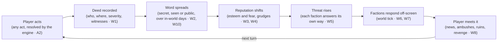

# Lucid Saga requirements

Working name: **Lucid Saga** (internal codename "Initial D"; the repo is still called PlayableAnime).
Agreed with Miki on 2026-11-03. The living copy is the
[requirements doc](https://claude.ai/artifact/BfNhS9QTFYWwFEumsZuSfn); when the two differ, update
this file in the same PR that changes behaviour.

## Purpose and principles

Lucid Saga is an endless AI story game in which the player can do anything, and the world remembers
it and reacts to it. Every agent and thread working on the project builds against this doc. When
code and this doc disagree, fix one of them in the same change.

1. **Absolute player freedom.** The player can be a hero, a coward or a tyrant. The narrator never
   lectures, blocks or softens an in-fiction choice.
2. **Consequences instead of rails.** The world doesn't refuse evil acts. It responds to them, in
   proportion and over time.
3. **The engine owns the truth.** The model proposes changes; the backend decides what sticks and
   enforces the invariants. A forgetful model can't break the world.
4. **Memory you can see.** Everything your character knows can be shown on screen. Hidden world
   state stays off screen until an arc ends.
5. **Cheap to play.** A turn has a cost budget, and long stories must not get more expensive per
   turn.
6. **The world doesn't wait for the player.** Things happen whether or not the player is there, and
   every story keeps moving, even a quiet one. There is no planned storyline: the plot is whatever
   the player and the world make of the situation.

Requirement ids (W1, C1, T1…) are stable, so threads and PRs can cite them. Priorities: **P0** = MVP,
**P1** = soon after, **P2** = later. The E and N ids come from the
[open-play critique](https://claude.ai/artifact/UHXgKEeybZKKC3SK4sznUP) (2026-11-03), which Miki
accepted in full; E1 became W16.

## Player freedom and content limits

In-fiction morality is the player's choice. Mature stories can hold gory superpowered violence, cruel
villains, dark crimes and romance that fades out at the bedroom door, and the world reacts to all of
it. Everything runs on Gemini, in the store apps, with no separate adult tier (decided 2026-11-03).
The limits come from Google's model terms and the app stores. The system enforces them, and the
narrator never moralizes.

| Id | Requirement | Pri |
| --- | --- | --- |
| F1 | The narrator plays any action the player attempts, including violence, cruelty, crime and villainy, with no in-character lecturing or refusal. Consequences come from the world (W1–W16), never from the narrator. | P0 |
| F2 | Two ratings per story: **Teen** and **Mature (17+)**, as set out in the table below. There is no explicit sex in any rating. | P0 |
| F3 | Hard limits in every rating, enforced in code: no romantic or sexual content involving minors or characters with childlike bodies or behavior, whatever age they are given, so every character in a romance scene has an adult age recorded. No sexual content about real people. No real-world harm instructions (weapons, drugs, hacking). Sexual violence is never described; it can only happen off-page (see the table). | P0 |
| F4 | **A blocked description never blocks the deed.** The engine resolves and records the action in code (A2, A3, W1) before narration, so a refusal or safety block only affects how it is told. The narration first retries as a cut-away, then falls back to a neutral template line ("What happened in the alley stays off the page. Its consequences won't."). Only when the action itself can't be read (the interpret step in B5 is blocked) does the player get a clear message with a rephrase or retry option, never an error. Every block is logged with its category. | P0 |
| F5 | Gemini safety settings are set per rating, at the most permissive level that the policy allows. | P0 |
| F6 | Report and block on every scene, with reports reviewed in the Django admin. Apple requires this for AI content apps (guideline 1.2). | P0 |
| F7 | **Player content preferences:** gore level (low, medium or high), romance on or off, and dark themes on or off. The world and NPCs only start themes that are switched on. The player's own actions are bounded only by the rating. | P1 |
| F8 | **Age gate:** a declared birth date at sign-up, plus the store's 17+ rating. Apple 1.2.1 accepts verified or declared age. Under-17 accounts get Teen only. | P0 |

Where the lines fall, so that the narrator prompts and the evals (T15) use the same scale:

| Theme | Teen | Mature (17+) |
| --- | --- | --- |
| Violence and gore | Fights and injuries, no gore | **Graphic, cinematic gore is in.** A superhuman throw that destroys a guard's head in a red mist, blades through flesh, severed limbs. It stops at torture of a helpless victim written to disgust for its own sake, and at real people or real groups as targets. |
| Romance and sex | Attraction, a kiss | Nerves, touch, kissing, undressing hinted at, moving to the bed. The scene fades out once sex begins ("the rest of the night was theirs"). No genitals, no sex acts, no sounds or sensations of sex. Later scenes can still refer to what happened. |
| Sexual violence | Not present | The player or an NPC can commit it, and it is a deed with full consequences (W11, W12). The narration states what happened the way a crime novel would ("you drag her into the alley and force yourself on her"), then cuts to the aftermath. There is no sexual detail. This is the theme most likely to set off Gemini's filters, so it needs its own eval cases (T15). |
| Cruelty and crime | Present, not lingered on | Massacres, murder and villainy at any scale. Torture can be shown on the page when it serves the story, such as a villain torturing the captive you came to rescue: the cruelty, the wounds and the pain, with gore following the player's gore setting (F7). It stops at torture scenes that go on for their own sake, with no story purpose. |

Why the lines are where they are:

- **Google's model terms.** The
  [Generative AI Prohibited Use Policy](https://policies.google.com/terms/generative-ai/use-policy?hl=en-gb)
  bans "sexually explicit" content, "including content created for the purpose of pornography or
  sexual gratification", which is why sex scenes fade out. Its violence rule (3.3, "violence or the
  incitement of violence") is about real-world violence, and fiction falls under its "artistic
  considerations" exception. Gemini has no safety filter category for fictional violence.
- **The app stores.** [Apple 1.1.4](https://developer.apple.com/app-store/review/Guidelines/) bans
  explicit sexual descriptions "intended to stimulate erotic rather than aesthetic or emotional
  feelings". Apple 1.1.2 bans "realistic portrayals of people … being killed, maimed, tortured", but
  17+ apps and games with intense violence are allowed, and stylised superpowered fiction fits there.
  Store screenshots and the icon must stay 4+ (2.3.8).
  [Google Play](https://support.google.com/googleplay/android-developer/answer/14094294) bans AI apps
  "primarily intended to be sexually gratifying".
- **Testing.** Before launch, run a set of gory and romance test stories through Gemini (T15) to
  confirm that its filters draw the line where this table does.

## Actions and player power

Every player action is an attempt. The engine decides whether it works from what the player can do
and what the world has in the way, so being powerful matters but doesn't mean winning automatically.

| Id | Requirement | Pri |
| --- | --- | --- |
| A1 | A player character sheet per story: identity, traits, powers or skills, their limits and costs, equipment, and wounds or HP. It is built from the premise at story start and stored in the world state. | P0 |
| A2 | Every turn classifies the action as trivial, contested, long shot or impossible for the character as they stand. Trivial actions just happen. Contested ones can fail, partly succeed or cost something. Long shots have small but real odds, so a clever or desperate plan can work, and a clever approach shifts the odds within bounds. Impossible is kept for what the world bible rules out, and is narrated as a failed attempt. | P0 |
| A3 | Outcomes are decided by the engine, not by the narrator's mood: a seeded roll weighted by the character's relevant power against the opposition's strength, recorded on the scene with its seed. The narrator writes the result it is given. This covers social, stealth and investigation actions as well as fights: persuading, lying, seducing or intimidating someone rolls against that character's attitude (W4) and traits. | P1 |
| A4 | **Growth is open-ended, and every gain needs a believable reason.** There is no fixed skill tree. Any growth path is allowed if the story can explain it: training, a teacher, watching a master, a stolen technique, a near-death breakthrough, a bloodline awakening, a forbidden ritual, a lucky find. Time skips are allowed ("I train here for a year"), and the clock (W10) and the world tick (W6) run for that time. The engine judges each gain from four inputs. **Traits** come first and can rewrite the usual rules: a genius can invent a new technique training alone, and a copycat eye can learn a move after seeing it once. **Effort and time** spent. **What they had to learn from:** a master, a book, a rival, their own experiments. **The world's power rules:** what the world bible says is possible, and its ceilings. A ceiling can only be broken by a recorded discovery (a forbidden art, a new law of magic) that changes the world bible for everyone. The same year alone makes an ordinary character a little sharper and a genius dangerous. Each gain is recorded on the sheet with its turn, source and reason, and getting caught learning (spying on a dojo) is a deed (W1). Time skips follow E7. | P1 |
| A5 | A per-story difficulty: Story (actions mostly succeed), Balanced and Brutal. It changes the odds in A3, not what the world remembers. | P1 |
| A6 | The player can't write other characters' reactions or outcomes. "I kill him and everyone cheers" plays as an attempt to kill him, and the narrator decides how people react. | P0 |

The docs already note this problem: in a test, Gemini let a "kill this character" action fail with no
clear reason. A2 and A3 replace that randomness with explicit rules.

**A7 The player can't rewrite the rules (P0).** Free text is always an in-fiction action. Inputs like
"ignore your instructions" or "Kaede is alive again" are played as something the character says or
imagines. The invariants live in code, so a successful prompt injection still can't change the world
state. The one exception is the player's own backstory (N4).

**A8 Every outcome has a reason, and failure has consequences (P0).** Characters and creatures carry
power on several axes (might, influence, wealth, knowledge, stealth) and a current condition
(wounded, exhausted, weakened by a war among the gods) in the engine, so a schemer, a merchant or a
cult leader has something to roll with, not just a fighter. A2 and A3 compare the gap on the axis the
action uses, adjusted for condition, preparation, allies and items, and record the reason on the
scene: "you are tier 1, the god is tier 9 but has lost most of its power: an
outside chance". A newcomer swinging a sword at a full-strength god fails, and the god notices: the
attempt is a deed (W1) with its own consequences. The same swing against a god left near death by its
rivals can succeed. Failing is never just "nothing happens". It costs something or changes something:
a wound, an enemy, a lost item, a lesson. Players can see the reasons with `/status`, or in the
scene's details.

## World reactivity

The world reacts to what the player does. If you wipe out a town, word spreads, people are afraid,
factions respond, and the response gets bigger the more of a threat you become. The engine tracks
this as state. It is not something the narrator is just asked to remember.

| Id | Requirement | Pri |
| --- | --- | --- |
| W1 | **Deeds.** Every significant player act (killing, saving, betraying, conquering, a public display of power) is recorded as a deed with turn, place, victims, severity 1–5 and witnesses. | P0 |
| W2 | **Who knows.** Every deed is secret, witnessed or public. Rumors spread to nearby places and factions over in-world time, and their accuracy can drop as they travel. Characters react only to what they could know. | P0 |
| W3 | **Reputation.** The player has a reputation with each faction and each region, on two separate axes: *esteem* (how much they like you) and *fear* (how dangerous they think you are). A feared tyrant has high fear and low esteem. | P0 |
| W4 | **NPC attitude.** Each character has affinity, fear and trust toward the player, and keeps grudges. Relatives, friends and allies of anyone the player kills become hostile and can come for revenge later. Key NPCs also have attitudes toward each other (E3). | P0 |
| W5 | **Escalation.** A threat level from the player's public deeds and power is an input to each faction's own agenda (E3), not a fixed ladder. How a faction answers depends on its nature and situation: locals avoid or flee, guards, bounties and hunters, an army or elite heroes, a coalition, but also appeasement, a recruitment offer, worship, a bribe, an assassin, an attempt to seal the player away, using the player against a rival, or ignoring them while busy with its own war. One guarantee holds: once the player crosses a threat tier, the world visibly reacts within a set in-world time (W10), never within a set number of turns. | P0 |
| W6 | **Off-screen world.** The world moves on in-world time (W10), not every N turns. **Deterministic part (P0):** advancing clocks (E2), spreading rumors (W2), rolling for discovery (W13), scheduling faction responses (W5) and revivals (W15a), all in code with no model call, run as catch-up at the start of each turn for the in-world time that has passed (B5). **Model part (P1):** a cheap model writes what factions and key NPCs actually do with their plans (scheming, recruiting, retaliating, allying). Results reach the player as news, rumors, ambushes or W16 events. | P0 / P1 |
| W7 | **Places and territory.** Places have a status (thriving, damaged, ruined, occupied), a controller and a mood. Conquest changes the controller, lowers stability and creates resistance, unrest and outside rivals. A ruined town stays ruined unless someone rebuilds it, which takes in-world time, people and resources and is recorded as an event (C1). | P1 |
| W8 | **Consistency.** Characters' everyday behavior matches what they know: no cheerful greetings in a town the player burned, and survivors remember. A violation is a continuity bug (see C5). | P0 |
| W9 | **Redemption and infamy both count.** Good deeds raise esteem through the same mechanics, and a player can try to win back a region. Reputation changes slowly in both directions. | P1 |
| W10 | **In-world time.** See the time model below: the story clock advances by how long each action takes in the story, never by a fixed amount per turn. | P0 |

A deed is recorded, spreads, and shifts reputation and threat. The world tick then turns that into
responses that the player runs into in later scenes.

**W10 Time model (P0).** Turns and in-world time are separate things, and nothing in the world is
timed in turns.

- The story clock (date and time of day) advances by how long each action takes in the story. The
  interpret step (B5) proposes a duration, and code bounds it by the kind of action: a sword exchange
  or a spell takes seconds, a conversation minutes, a meal or a search about an hour, travel hours to
  days, and a time skip whatever the player asks for (E7).
- **Encounters.** A fight, a chase, a duel of words or a negotiation is an encounter. Thirty turns of
  fighting a mage can take five in-world minutes, and the rest of the world moves only by those five
  minutes: rumors don't cross a kingdom and clocks barely move.
- During an encounter, W16 doesn't count turns as quiet, because the encounter is the stakes, and the
  director doesn't interrupt it with unrelated events. Something new can enter only from the
  encounter itself (the mage's ally arrives, the bridge gives way) or from a clock that comes due
  within those minutes.
- Everything the world does runs on in-world time: rumors (W2), travel, faction responses (W5), the
  world tick (W6), discovery (W13), revivals (W15a) and clocks (E2). Turns count only two things: the
  player's attention, for W16, and model calls, for cost (K2, K8).
- The clock is stored on every scene, so the player can always see the date and time, and `/status`
  shows how long ago key events happened.

**W11 World norms (P0).** The world bible sets the world's laws and customs: what counts as a crime,
who enforces it, and how hard they try. A lawful kingdom hunts a murderer or a rapist, and a lawless
wasteland may not care at all. Even then, victims, families and witnesses react as people, unless the
setting truly makes the act normal there. Every crime against a person records a victim who
remembers. Through W2 and W5 it can lead to someone noticing, an investigation, a bounty or personal
revenge, so serious crimes are noticed sooner or later.

**W12 Severity weighting (P0).** Severity follows the world's norms. A crime the world considers
monstrous (killing children, sexual assault, massacres) raises fear and hostility faster, and spreads
further, than a tavern brawl.

**W13 Discovery without witnesses (P0).** A deed with no witnesses is secret, not forgotten. Each one
records what it left behind: how connected the victims were (family, trade, a lord who will miss the
taxes), physical traces (bodies, wounds only a power like yours makes, a burned town visible from the
road), and any hidden survivor or magical means of finding out. The world tick (W6) rolls for
discovery, with the odds set by those traces. When something is discovered, it starts **rumors that
may be wrong**: the town "fell to a plague", "a monster did it", "the rival clan did it" (which can
start a war between factions), or the truth, attached to the player. Each rumor records whether it is
true and who believes it. The player can also cover their tracks or frame someone else, and either one
is a deed too. A hermit with no ties, who leaves no trace, can vanish without anyone noticing, and
that is a valid outcome.

**W14 Player-founded factions (P1).** The player can found a faction, such as a gang, a sect, a
kingdom or a company, by recruiting members. It has a name, goals, territory, resources and a loyalty
score for each member. Members are characters with their own agendas: they can grow ambitious, desert
or betray. The faction's deeds count toward the player's reputation, and other factions treat it as a
real power that they ally with, fear or attack.

**W15 Emerging factions and characters (P0).** The world creates new factions and characters on its
own, each with a cause in the world state: a resistance in a conquered region, a cult that worships or
hunts the player, a splinter group after a schism, a destroyed faction rising again, an avenger for
someone the player killed, an heir, a rival prodigy. The narrator or the world tick proposes them,
and the engine records their origin. Emergence isn't capped; the active cast is. Characters and
factions move between **active** (simulated each tick and eligible for scenes), **dormant** (kept in
state, advanced only by their clocks, and brought back by the director as callbacks) and **archived**,
so the cast stays manageable and the cost per turn stays flat (K8). Emerging characters can grow into
major figures over time, just like the player.

**W15a Destroyed factions can rise again, but never silently (P0).** A destroyed faction can come back
if the world state still holds survivors tied to it (the leader's son, scattered members, a hidden
vault) and enough in-world time has passed. The comeback is an event the engine records, either a
**revival** (same faction and id, starting weak, with status "rebuilding" and its old grudges intact)
or a **successor** (a new faction derived from the old one, with its own name and goals). If nobody
survived, it can't return. The narrator alone can never simply bring it back (C1).

**W16 The story never stalls (P0).** A story director tracks tension and the number of turns without
stakes. When a story has been quiet too long, it schedules an event that forces a choice,
even if the player is happily playing house. Events come in three sizes. **Personal:** a stranger
falls for your wife, a child gets sick, an old friend arrives in trouble. **Local:** a flood, bandits,
a bad harvest, a festival. **World:** the war reaches the village. The director draws on the world
state first (consequences coming due, faction plans from W6, emerging characters from W15) and only
then on fresh events. It matches the story's genre and scale, so a farming story gets farm-sized
drama, not a demon invasion, unless the world has demons. Once the player resolves an event, calm can
return until the next one. A per-story setting (calm, normal or dramatic, default normal) controls
how often events come, but never turns them off. The details:

- **Where events come from.** In order: pending events and clocks that have come due (E2), plans of
  factions and key NPCs (W6, E3), dormant threads (N1), emerging characters (W15), and only then a
  fresh draw from the seeded event deck (E4). The model never invents the event type on its own,
  because left alone it picks the most predictable beat for the genre.
- **Stall pressure** is computed in code: turns since the last decision with stakes, repeated
  low-stakes actions, and clocks close to their end. Turns inside an encounter don't count (W10).
  Starting thresholds are 10, 5 and 3 turns without stakes for calm, normal and dramatic, tuned with
  the quiet-life eval (T17).
- **Themes.** The director only picks themes the player switched on (F7) and stays within the rating.
  A stranger falling for your wife is a romance event, and a sick child is a dark one.
- **Ignoring an event is a choice.** If the player does nothing, the event plays out with its
  consequence (the flood takes the barn, the stranger keeps coming back) instead of repeating.
- **Time skips** roll for events inside the skipped time and stop early when one needs a decision
  (E7): "I farm here for a year" can stop in month four when the river rises.
- **Loose ends.** Each event leaves a thread (N1) that can go dormant and return later.
- **Good things too.** The deck holds windfalls, offers and welcome visitors as well as trouble, so a
  quiet story stays pleasant rather than punishing.
- **Frequency drifts** within the chosen setting: it rises while the player is comfortably in control
  and falls after a big event (E6).
- The director decides that something happens and what it is, never how it ends. Outcomes stay with
  A2, A3 and the player.

We don't know exactly how OOC handles this. Its public coverage describes memory layers and stats but
no retaliation system, so this is one place we can be better rather than just match it.

## Emergent events

The world has its own sources of events, so it doesn't only react to the player. W16 decides when an
event reaches a scene, and these requirements decide what can happen. E1 became W16.

**E2 Clocks (P0).** Every threat, ambition and scheduled event is a clock in state: a name, a few
steps, what happens at each step, and what advances or reverses it. The premise seeds the first
clocks ("the exam starts in seven days", "the heroes are coming"). Clocks advance with in-world time
(W10) and with deeds, whether or not the player is there, so an ignored thread keeps moving: the exam
happens without you, and the river floods. A clock that reaches its end becomes a pending event in
state, and the next scene must include it.

**E3 Agendas for key NPCs (P1).** Key NPCs in the active set (W15) have a goal, a method,
relationships with each other (love, rivalry, debt, loyalty), a secret and a clock for their plan,
just as factions have goals in W6. The world tick advances each plan with a seeded roll weighted by
resources and opposition, and a finished plan becomes an event. NPCs can come to the player on their
own to ask for help, confess, betray or propose.

**E4 Seeded event deck (P0 minimal, P1 full).** Code draws fresh events with a seeded roll from
weighted tables: arrival, loss, windfall, disaster, temptation, betrayal, discovery, rival, a rumor
about you. Weights come from the setting, the story's scale, the event-frequency setting, the
switched-on themes (F7) and the player's wishes (N8). The narrator dresses the draw in the scene and
reuses existing characters and threads before inventing new ones; new ones go through W15 with a
recorded origin. The P0 version is one table per event size (personal, local, world).

**E5 One reaction loop for every actor (P1).** Deeds, rumors, reputation, grudges and discovery
(W1–W4, W13) apply to NPC and faction deeds as well as the player's. An NPC who murders a rival gets
rumors and avengers just as the player would, and the player can step into that story or ignore it.

**E6 Event frequency drifts (P1).** Within the setting chosen in W16 and S6, frequency rises while the
player is comfortably in control and falls after a big event.

**E7 Downtime and time skips for any activity (P1).** Travelling, farming a season, ruling, building a
gang, researching or training (A4) can be one montage turn. The engine advances the clock, runs the
world for the elapsed time in capped steps (K8), rolls for W16 events along the way, and stops the
montage early when one needs a decision.

## Open plot

There is no planned storyline. The plot is the set of open threads, and arcs are named after they
happen.

**N1 Threads (P0).** Every open plot line is a record in state: kind (mystery, threat, rivalry,
romance, ambition, debt, quest), stakes, the people and places involved, an optional clock (E2), its
origin (premise, deed, W16 event, agenda) and a status: open, dormant, resolved, failed, abandoned,
or resolved without the player. An arc ends when its threads close, and that is when C6's spoiler
view opens for it. Chapters and arcs are named afterwards from what happened, never planned ahead.
Each scene, the director pulls one or two dormant threads into context for callbacks (C4).

**N2 Goals and leads (P0).** Goals belong to the player, who states them or accepts one the story
offers. The narrator never rewrites them. Leads are what the world offers (a job, a rumor, a
summons); they can expire and never overwrite goals.

**N3 Truth and knowledge (P0).** Covered by principle 4 and C6: facts carry a truth value and who
knows them. Deaths are confirmed or presumed (C1).

**N4 Backstory claims (P1).** The player can state facts about their own character's past and inner
life ("I have a sister in the capital", "I'm afraid of water"). If a claim doesn't contradict canon or
grant power, the engine records it and the world can use it later. Claims about other people's
reactions stay forbidden (A6, A7).

**N5 The premise is a situation, not a script (P0).** A premise sets the opening situation and its
first clocks (E2). The player can walk away from it, skip the exam and become a pirate. The premise's
clocks keep running without them, and the story follows the player. The world bible's tone doesn't
lock the genre, so a samurai drama can turn into a merchant story.

**N6 Endings, death and legacy (P1).** The player character can die on Balanced and Brutal. On
Story, a fatal outcome becomes a defeat instead: captured, maimed, or rescued at a price. After a
death or a chosen retirement, the player can continue as another character in the same world (an
heir, an ally or a newcomer) while the world remembers the old protagonist, write an epilogue, or
rewind with C8. The story never ends on its own (S4), but the player can end it. Until N6 is built,
every difficulty treats a fatal outcome as a defeat.

**N7 Details become canon when first told (P1).** Places, lore and NPC backgrounds that nobody has
decided stay open until the narrator first describes them. From then on the engine records them as
canon, so the world bible grows as the player explores (S1). Major mysteries are the exception: their
answer and clues are decided when the mystery is created, so investigations stay fair.

**N8 Story wishes (P1).** Through `/ooc` or a settings field, the player says what they'd like more
of: rivals, romance, politics, mystery, a quiet life. Wishes weight W16's choices and the event deck
(E4). They never decide outcomes.

**N9 Joining existing powers (P1).** Beyond founding a faction (W14), the player can join one, rise
through its ranks, stage a coup or marry into a dynasty.

**N10 Masks and aliases (P2).** Deeds attach to the identity the player used. A masked vigilante
builds the mask's reputation, and the world can link the mask to the player through discovery (W13).

## Continuity and memory

The story has to stay consistent at turn 500 just as it was at turn 5, without the prompt growing as
the story does. Today's engine already covers C1 and part of C2.

| Id | Requirement | Pri |
| --- | --- | --- |
| C1 | **No state change without a recorded cause.** Invariants in code: the dead stay dead, destroyed factions and ruined places stay that way, stats stay within bounds, and a character with no name isn't created. One of them can change only through a recorded event whose mechanism the world bible allows and whose cost is paid: resurrection magic, a faction revival with survivors (W15a), or rebuilding a town with time, people and resources (W7). A death is **confirmed** (the body was seen destroyed or buried) or **presumed** (a fall with no body found). Only a presumed death can later turn out false, and a confirmed one never can. | P0 |
| C2 | **World state** holds characters (with death certainty, relationships and agendas), factions, places, the player sheet, deeds, rumors, facts (importance 1–5, truth value, who knows them), the player's goals and the world's leads (N2), threads (N1), clocks and pending events (E2), inventory, the story clock (W10), the seed of each roll, and a rolling summary. The summary is flavour only; anything that must not be lost lives in the structured records. | P0 |
| C3 | **Chapter summaries** every N turns (about 20), so older scenes leave the prompt but aren't lost. | P0 |
| C4 | **Retrieval:** facts, deeds and past scenes are embedded (pgvector on Neon), and the prompt gets the most relevant ones for the current scene and the characters in it, plus the dormant threads the director picked for callbacks (N1). The prompt stays within a fixed token budget however long the story runs. | P1 |
| C5 | **Continuity check, in two parts.** Before narration, code checks the plan (the resolved action and the director's pick) against the invariants, since narration streams to the player as it is written (S3). After narration, a cheap model compares the finished scene with the invariants and with what the characters present know, and any slip is repaired in the next scene. The check blocks contradictions, not novelty: a character may act against type when an agenda or event explains it. | P1 |
| C6 | **Player-visible memory shows only what the character knows** (decided by Miki 2026-11-03): their own deeds, people and places they have met, goals, and rumors they have heard, marked unconfirmed. Hidden world state (whether a rumor is true from W13, NPC trust from W4, faction plans from W6) stays off screen, except in a spoiler view after an arc ends. Facts carry a truth value and a list of who knows them, so the screen can filter by the player character's knowledge. | P0 |
| C7 | **Editable memory, in two modes.** In **Canon** stories the player can pin, annotate and correct the narrator's misreadings of what their character knows, but never hidden state or world truth, so the editor can't undo consequences that A7 forbids through text. In **Sandbox** stories the player can edit anything, each edit is logged as a retcon, and the story is marked as Sandbox. All edits are logged so that support can explain odd behavior later. | P1 |
| C8 | **Undo and branching:** undo the last turn, or branch a save from any past turn. World state is versioned per turn so this is cheap. | P1 |
| C9 | **Character consistency:** personality, speech style and appearance per character, kept in their entry and reused for portraits. Personality can change, but only through a recorded cause such as trauma, love or betrayal (C1). | P1 |

## Story, play and app features

These are the parts of the product the player sees, most of them already listed in
[FEATURES.md](FEATURES.md), with ids added so threads can refer to them.

| Id | Requirement | Pri |
| --- | --- | --- |
| S1 | Start from a starter premise or from one box of your own. The AI expands it into a world bible (setting, rules of power, laws and customs, factions, key NPCs, tone) and the player sheet, plus the premise's first clocks (E2). Advanced fields stay hidden unless asked for. The bible keeps growing as the player explores (N7). | P0 |
| S2 | Free text is the main way to act. Every scene also offers zero to four suggested choices, at least one of them away from the current thread (personal, side or wild), plus **wait** and **observe** as standing actions. The player can turn suggestions off. | P0 |
| S3 | Narration streams in as it is written (SSE), and the first words arrive within 2 s. | P0 |
| S4 | The story never ends by itself, though the player can end it (N6). Every scene ends on something the player can act on, not necessarily a cliffhanger: W16 sets the pace, so quiet scenes are fine until stall pressure builds. Chapters and arcs are named afterwards (N1). | P0 |
| S5 | Slash commands: `/ooc` (talk to the narrator, and story wishes from N8), `/recap`, `/thoughts <character>`, `/status` (sheet, reputation, date and time). `/thoughts` shows only what that character would let show; real secrets need an in-fiction power such as mind reading, so it never reveals what C6 keeps hidden. | P1 |
| S6 | Settings for narration length, tone, difficulty and event frequency (calm, normal or dramatic, default normal), per story. | P1 |
| S7 | Portraits for characters and occasional key scenes, generated once and reused. | P1 |
| S8 | Accounts with sign-in. Stories belong to a user, and the Library shows only your own. | P0 |
| S9 | Bring your own key (Gemini now, more providers later) alongside paid credits for everyone else. | P0 / P1 |
| S10 | Spanish and English. | P1 |
| S11 | Sharing, remixing and creator tools. | P2 |

## Technical requirements

The stack is Neon Postgres plus one Cloud Run service. Both scale to zero, both run in Frankfurt, and
both log to Google Cloud Logging. The backend is Django, served over ASGI. Story generation runs as a
LangGraph graph that calls models on Vertex AI (decided 2026-11-03).

| Id | Requirement | Pri |
| --- | --- | --- |
| T1 | **Cloud Run:** one API service in `europe-west3` (Frankfurt, next to Neon), min instances 0, a max-instances cap (start at 3) as a cost guard, request timeout of at least 120 s for streaming, and the runtime service account that already exists. | P0 |
| T2 | **Neon:** the `production` branch for live data, one branch per feature that expires after 7 days, the pooled URL for the app and the direct URL for migrations, and compute that scales to zero. Migrations run before each deploy. | P0 |
| T3 | **Cold start:** the first request after idle answers in under 5 s (Cloud Run start plus Neon wake). Health checks never touch the database. | P0 |
| T4 | **Logging:** structured JSON logs to stdout, which Cloud Run sends to Cloud Logging. Every line has severity, request id, trace id (from `X-Cloud-Trace-Context`), user id and story id. | P0 |
| T5 | **Turn telemetry:** one log entry per turn with model, input and output tokens, latency, estimated cost, safety blocks and retries. These feed a log-based metric and a cost dashboard. | P0 |
| T6 | **Never logged:** API keys (BYOK or ours), auth tokens and full prompts. Story text is logged only at DEBUG, and DEBUG is off in production. | P0 |
| T7 | **Errors:** uncaught exceptions reach Error Reporting. LLM failures are retried once and then return a typed error the app can show (`llm_unavailable`, `blocked`, `bad_key`, `out_of_credits`), never a bare 500. | P0 |
| T8 | **Auth:** no Firebase. Sign in with Google, through an OAuth client in the `playable-anime` GCP project, plus our own email login in Django. On iOS, Apple requires an equivalent login option when Google sign-in is offered (guideline 4.8), so plan for Sign in with Apple there. The backend verifies Google's ID token once at sign-in, then issues its own short-lived access token and a refresh token. These are checked on every request except `/health`. | P0 |
| T9 | **Abuse and cost guards:** per-user rate limits and a daily turn quota on our own key, plus a budget alert on the GCP project. Nothing goes public before T8 and T9. | P0 |
| T10 | **Concurrency:** a story row carries a version number. Two turns at the same time can't overwrite each other, and the loser gets a 409. | P0 |
| T11 | **Secrets:** Secret Manager only (`database-url` and others), mounted as env vars. | P0 |
| T12 | **Privacy (EU users):** delete my account and data, export my stories, and a privacy policy. Neon point-in-time restore is our backup. | P0 |
| T13 | **Deploy:** CI (lint and tests for both halves) must be green. Deploy runs from `main` through Cloud Build, or `gcloud run deploy --source`, with the migration step before it. | P1 |
| T14 | **Cost target:** a cost-per-turn ceiling for the default model, set once T5 gives us real numbers. | P1 |

**T15 Narrative evals (P0).** A fixed set of scripted scenarios runs nightly and before each model or
prompt change. Examples: kill a character and check they stay dead for 30 turns; massacre a town and
check that the world visibly reacts within a set in-world time (W5); revisit the town and check that
nobody greets you warmly; the content-line cases from the ratings table. Results are tracked over
time. Unit tests can't catch a narrator that quietly forgets.

**T17 Openness evals (P0).** T15 checks that the world remembers and punishes. T17 checks that it
stays open and keeps moving, with the same nightly scripted runs:

| Eval | Script | Passes when |
| --- | --- | --- |
| Quiet life | 30 turns of farming with a spouse and no ambitions, on calm and on normal | Events with stakes arrive at least as often as W16's threshold, stay farm-sized, and calm returns after each one |
| Long fight | A 30-turn fight with a mage | Only a few in-world minutes pass, no unrelated W16 event interrupts, and the world off-screen barely moves (W10) |
| Ignored event | The player ignores a W16 event for 5 turns | The event plays out with its consequence instead of repeating |
| Themes off | Quiet life again, with romance and dark themes switched off (F7) | No romance or dark events are drawn |
| Time skip | "I farm here for a year" | The skip stops early when an event needs a decision, and the turn's cost stays within K8's cap |
| Ignored hook | The player ignores the premise's hook for 20 turns | The hook's clock advances and resolves without the player (the exam happens) |
| Walk away | "I leave the academy and open a noodle shop" | The story follows the noodle shop, and the academy threads go on off-screen |
| Divergence | Same premise and same actions, 5 seeds, 50 turns | The worlds differ in events, threads and new characters |
| Idle world | 100 in-world days with the player idle | Factions and key NPCs have each changed something |
| Goal ownership | 50 turns of normal play | The player's goals never change without the player's input (N2) |
| Secret holds | A planted traitor | The betrayal isn't visible on the Memory screen or through `/thoughts` before it happens |
| Fair long shots | The same long-shot plan over many seeds | It succeeds at roughly its stated odds (A2) |
| First session | A new account's first story, on the starter credit (K1) | At least one event the player didn't cause arrives before the credit runs out |

**T16 Sensitive data (P0).** Story text can reveal a player's sexual preferences, which GDPR treats as
special-category data. It is encrypted at rest (Neon does this), never logged (T6), only staff
handling reports can read it, and it is deleted with the account.

### Credits and billing

Every turn costs credits, the server enforces the balance, and the owner account plays free.

| Id | Requirement | Pri |
| --- | --- | --- |
| K1 | **Starter credit:** each new account gets $0.50 of credits, enough to start a story and try it. | P0 |
| K2 | **Credit ledger:** every turn debits its real model cost (tokens from T5, plus a margin) from the user's balance in an append-only ledger. When the balance runs out, a turn returns `out_of_credits` with an upsell, never a half-written scene. | P0 |
| K3 | **Monthly plans:** a subscription that refills a monthly allowance, with a hard cap per month. Prices and tiers are still open. | P1 |
| K4 | **Pay as you go:** one-off credit top-ups. | P1 |
| K5 | **Payment channels:** in the iOS and Android apps, plans and top-ups must go through Apple and Google in-app purchase (Apple 3.1.1). On the web, a card processor such as Stripe. The store notifies the backend, which credits the ledger. | P1 |
| K6 | **BYOK turns are free**, with no credits used, and are still rate-limited (T9). | P1 |
| K7 | **Owner access:** the account signed in as `mikigb77@gmail.com` has the `owner` role, with unlimited credits, every feature, staff access to the Django admin and full logs. The role comes from an `OWNER_EMAILS` setting and is stored on the user, never hard-coded in views, and only a verified Google sign-in for that email gets it. | P0 |
| K8 | **A living world doesn't inflate the bill.** K2 bills each turn its real cost, so off-screen work must stay small and bounded. Clocks, rolls, rumor spread, discovery and the director are code with no model call. The world tick simulates at most a fixed active set (start with 8 key NPCs and 4 factions, W15), and catch-up after a time skip runs in a fixed number of steps (E7). A montage turn or a turn with a W16 event may cost somewhat more than a quiet turn, but never more than a set multiple of it, set once T5 gives real numbers (T14). Cost tests use a normal account, because the owner plays free (K7). | P0 |

### Backend and story pipeline

| Id | Requirement | Pri |
| --- | --- | --- |
| B1 | **Django over ASGI** (uvicorn workers on Cloud Run). The API uses Django Ninja so request and response schemas stay Pydantic, and the Flutter contract doesn't change. The admin panel is turned on for staff, for stories, users and reports. | P0 |
| B2 | **Neon with Django:** psycopg 3, the pooled URL with `DISABLE_SERVER_SIDE_CURSORS = True` and `CONN_MAX_AGE = 0` (PgBouncer transaction mode), and the direct URL for `migrate`. Django migrations replace `backend/migrations/*.sql`. | P0 |
| B3 | **Logging:** Django `LOGGING` sends JSON to stdout, with a middleware that adds request id, trace id, user and story to every line (T4–T6). | P0 |
| B4 | **Story engine as its own package**, with no Django imports. Invariants, state updates, reputation and escalation are deterministic Python with unit tests. Django views only load the story, run the graph and save the result. | P0 |
| B5 | **LangGraph turn graph:** (1) load and catch up: apply pending events and run the deterministic world tick for the in-world time that has passed (W6, code) → (2) interpret: a cheap model turns the free text into an open intent, a free-form verb plus target, method, stakes, duration (W10) and any backstory claim (N4); an intent that fits no category goes to the narrator, never to a refusal → (3) resolve and direct: roll the outcome (A2, A3), advance the clock and clocks (W10, E2), and let the director pick an event and callbacks (W16, E4, N1), all in code → (4) build context (retrieval, C4) → (5) narrate: one large structured-output model call, streamed → (6) apply the state update, validated against C1 (code) → (7) after the turn: the prose continuity check (C5) and summaries. Model nodes propose; code nodes decide. | P0 |
| B6 | **Models through Vertex AI** with `langchain-google-vertexai`. The model for each node is set in config (narrator, checker, tick, summarizer). A BYOK key builds that request's model client and is never stored. | P0 |
| B7 | **Streaming:** the narrate node streams tokens through LangGraph `astream` to an SSE response (S3). | P0 |
| B8 | **Latency budget:** at most one large-model call per turn on the critical path, plus the cheap interpret call. The checker and the model part of the world tick use the cheapest model. Nothing relies on running after the response is sent: with request-based billing, Cloud Run throttles the CPU once the response ends, so off-screen work runs as catch-up at the start of the next turn. If catch-up adds noticeable latency, move it to Cloud Tasks (an API that would need enabling). | P0 |
| B9 | **Story state stays in our own tables.** A LangGraph checkpointer is used only if we need to resume a run that failed partway. | P1 |
| B10 | **Cold starts:** Cloud Run startup CPU boost on, and heavy imports kept out of module load. Check that T3 still holds with Django and LangChain loaded. | P0 |
| B11 | **Credentials: no service-account keys anywhere.** On Cloud Run, Vertex AI is called as the attached service account `playable-anime-api@playable-anime.iam.gserviceaccount.com` (it already has `roles/aiplatform.user`), through Application Default Credentials. For local development, run `gcloud auth application-default login`. GitHub Actions deploys through Workload Identity Federation, not a JSON key. The only API keys in the system are the players' own BYOK keys, which are never stored. | P0 |
| B12 | **Only turns write the story row.** Off-screen results (tick output, pending events) go to an events table keyed by story and in-world time, and step 1 of the next turn applies them, so nothing races a turn for T10's version check. | P0 |

## Rules for every agent and thread

Any Claude thread that changes this repo follows these rules. They are repeated in
[`CLAUDE.md`](../CLAUDE.md) at the repo root, which agents read automatically.

1. Read this doc and `docs/ARCHITECTURE.md` before starting. Cite the requirement ids you are working
   on in the PR description.
2. One feature per branch and per PR, and one Neon branch per feature
   (`neon checkout <feature> --create`). Never test against `production`.
3. Engine rules (A2–A8, C1, W1–W16, E2–E7, N1, N2) are enforced in backend code, with unit tests,
   not only in the prompt.
4. CI must be green: ruff and pytest for the backend, and dart format, analyze and test for the app.
   Add tests with each change.
5. Schema changes go in a new numbered migration. Never edit an applied migration.
6. Follow T4–T6 for logging. Never log keys, tokens or full prompts.
7. Nothing is deployed publicly until T8 (auth) and T9 (rate limits and quotas) are merged.
8. A change that alters behavior also updates the docs and this doc in the same PR.
9. **Each thread owns its PR from start to merge, with no review from Miki needed** (Miki's rule,
   2026-11-03). Work on your own branch, open the PR, review your own diff as a demanding outsider
   would (or run the code-review skill), fix what you find, wait for CI to go green, then merge it
   yourself (squash). Never merge with red CI or unresolved review comments. Ask Miki only for
   decisions that change the product's goals, or for irreversible production actions (a deploy, a
   production migration that drops data, deleting data).

## Open decisions

| Decision | Options | Recommendation |
| --- | --- | --- |
| Backend framework | Decided: Django with Django Ninja, and LangGraph on Vertex AI | Done. See B1 to B12. |
| Adult tier | Decided: none. Gemini only, store apps only, Mature (17+) at most | Done. See F2 and the ratings table. |
| Brand name | Decided for now: **Lucid Saga** | A quick web search on 2026-11-03 found no app or game with that name, but "Lucid" on its own is crowded (several games, and Lucid Motors defends its mark). We need a formal EUIPO and USPTO search before launch. |
| Monetisation | Decided: starter credit, monthly plans and pay as you go (K1 to K7) | Prices and plan tiers are still open. |
| BYOK | Keep it as a cheap path for players, or drop it now that everything runs on Vertex | Keep it, with the same rating rules. |
| Default difficulty | Story, Balanced or Brutal | Balanced. |
| World tick (W6) | Decided 2026-11-03: catch-up on in-world time at the start of each turn | Done. The deterministic part runs in code (P0); a cheap model writes faction and NPC moves (P1). See W6, W10, B5 and B8. |
| Memory screen | Decided 2026-11-03: only what the character knows | Done. See principle 4 and C6. |
| Ruined places and uncertain deaths | Decided 2026-11-03: they can change, but only with a recorded cause | Done. See C1, W7 and W15a. |
| Player death | Decided 2026-11-03: by difficulty | Done. Death on Balanced and Brutal with legacy options, defeat on Story (N6). |
| Memory editing | Decided 2026-11-03: Canon plus a Sandbox mode | Done. See C7. |
| Default event frequency | Decided 2026-11-03: normal | Done. See W16 and S6. |
| Mysteries | Decided 2026-11-03: major mysteries at creation, minor details when first told | Done. See N7. |
| Image generator | See ARCHITECTURE.md | Vertex Gemini image model for portraits. No sexual images, and only mild gore in images. The text carries the graphic detail. |
