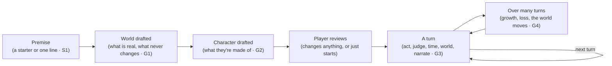
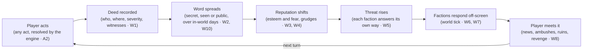

# Lucid Saga requirements

Working name: **Lucid Saga** (internal codename "Initial D"; the repo is still called PlayableAnime).
Agreed with Miki on 2026-11-03. The living copy is the
[requirements doc](https://claude.ai/artifact/BfNhS9QTFYWwFEumsZuSfn); when the two differ, update
this file in the same PR that changes behaviour.

## Purpose and principles

Lucid Saga is an endless AI story game in which the player can do anything, and the world remembers
it and reacts to it. Every agent and thread working on the project builds against this doc. When
code and this doc disagree, fix one of them in the same change.

1. **Absolute player freedom.** The player can be a hero, a coward or a tyrant. The narrator never
   lectures, blocks or softens an in-fiction choice.
2. **Consequences instead of rails.** The world doesn't refuse evil acts. It responds to them, in
   proportion and over time.
3. **The engine owns the truth.** The model proposes changes; the backend decides what sticks and
   enforces the invariants. A forgetful model can't break the world.
4. **Memory you can see.** Everything your character knows can be shown on screen. Hidden world
   state stays off screen until an arc ends.
5. **Cheap to play.** A turn has a cost budget, and long stories must not get more expensive per
   turn.
6. **The world doesn't wait for the player.** Things happen whether or not the player is there, and
   every story keeps moving, even a quiet one. There is no planned storyline: the plot is whatever
   the player and the world make of the situation.
7. **Any world, one game.** A fantasy realm, a modern crime family or a starship crew: the world
   decides what exists and what people can do, and the same rules run every story.

Requirement ids (W1, C1, T1…) are stable, so threads and PRs can cite them. Priorities: **P0** =
MVP, **P1** = soon after, **P2** = later. Requirements say what the game must do. How each one is
built (data, schema, prompts) is decided when that work starts, unless the doc marks it as decided,
such as the stack in B1 to B12 (Miki, 2026-11-03). The E and N ids come from the [open-play
critique](https://claude.ai/artifact/UHXgKEeybZKKC3SK4sznUP) (2026-11-03), which Miki accepted in
full; E1 became W16. The R, V and M ids (narration, voice input and images) come from Miki's first
functional and technical requirements (2026-11-03).

## Player freedom and content limits

In-fiction morality is the player's choice. Mature stories can hold gory violence, superpowered or
not, cruel villains, dark crimes and romance that fades out at the bedroom door, and the world
reacts to all of it. Everything runs on Gemini, in the store apps, with no separate adult tier
(decided 2026-11-03). The limits come from Google's model terms and the app stores. The system
enforces them, and the narrator never moralizes.

| Id | Requirement | Pri |
| --- | --- | --- |
| F1 | The narrator plays any action the player attempts, including violence, cruelty, crime and villainy, with no in-character lecturing or refusal. Consequences come from the world (W1–W16), never from the narrator. | P0 |
| F2 | Two ratings per story: **Teen** and **Mature (17+)**, as set out in the table below. There is no explicit sex in any rating. A new story starts at Teen until the player picks Mature, which only an adult account can (F8). | P0 |
| F3 | Hard limits in every rating, enforced in code: no romantic or sexual content involving minors or characters with childlike bodies or behavior, whatever age they are given, so every character in a romance scene has an adult age recorded. No sexual content about real people. No real-world harm instructions (weapons, drugs, hacking). Sexual violence is never described; it can only happen off-page (see the table). | P0 |
| F4 | **A blocked description never blocks the deed.** The engine resolves and records the action in code (A2, A3, W1) before narration, so a refusal or safety block only affects how it is told. The narration first retries as a cut-away, then falls back to a neutral template line ("What happened in the alley stays off the page. Its consequences won't."). Only when the action itself can't be read (the interpret step in B5 is blocked) does the player get a clear message with a rephrase or retry option, never an error. Every block is logged with its category. | P0 |
| F5 | Gemini safety settings are set per rating, at the most permissive level that the policy allows. | P0 |
| F6 | Report and block on every scene, with reports reviewed in the Django admin. Apple requires this for AI content apps (guideline 1.2). | P0 |
| F7 | **Player content preferences:** gore level (low, medium or high), romance on or off, and dark themes on or off. The world and NPCs only start themes that are switched on. The player's own actions are bounded only by the rating. | P1 |
| F8 | **Age gate:** a declared birth date at sign-up, plus the store's 17+ rating. Apple 1.2.1 accepts verified or declared age. Under-17 accounts get Teen only, and their limit lifts on the 17th birthday. Nobody under `MIN_SIGNUP_AGE` (13 for now, for Miki to confirm with the privacy policy) can sign up. | P0 |

Where the lines fall, so that the narrator prompts and the evals (T15) use the same scale:

| Theme | Teen | Mature (17+) |
| --- | --- | --- |
| Violence and gore | Fights and injuries, no gore | **Graphic, cinematic gore is in.** A superhuman throw that destroys a guard's head in a red mist, blades through flesh, severed limbs. It stops at torture of a helpless victim written to disgust for its own sake, and at real people or real groups as targets. |
| Romance and sex | Attraction, a kiss | Nerves, touch, kissing, undressing hinted at, moving to the bed. The scene fades out once sex begins ("the rest of the night was theirs"). No genitals, no sex acts, no sounds or sensations of sex. Later scenes can still refer to what happened. |
| Sexual violence | Not present | The player or an NPC can commit it, and it is a deed with full consequences (W11, W12). The narration states what happened the way a crime novel would ("you drag her into the alley and force yourself on her"), then cuts to the aftermath. There is no sexual detail. This is the theme most likely to set off Gemini's filters, so it needs its own eval cases (T15). |
| Cruelty and crime | Present, not lingered on | Massacres, murder and villainy at any scale. Torture can be shown on the page when it serves the story, such as a villain torturing the captive you came to rescue: the cruelty, the wounds and the pain, with gore following the player's gore setting (F7). It stops at torture scenes that go on for their own sake, with no story purpose. |

Why the lines are where they are:

- **Google's model terms.** The
  [Generative AI Prohibited Use Policy](https://policies.google.com/terms/generative-ai/use-policy?hl=en-gb)
  bans "sexually explicit" content, "including content created for the purpose of pornography or
  sexual gratification", which is why sex scenes fade out. Its violence rule (3.3, "violence or the
  incitement of violence") is about real-world violence, and fiction falls under its "artistic
  considerations" exception. Gemini has no safety filter category for fictional violence.
- **The app stores.** [Apple 1.1.4](https://developer.apple.com/app-store/review/Guidelines/) bans
  explicit sexual descriptions "intended to stimulate erotic rather than aesthetic or emotional
  feelings". Apple 1.1.2 bans "realistic portrayals of people … being killed, maimed, tortured", but
  17+ apps and games with intense violence are allowed, and stylised superpowered fiction fits
  there. Grounded stories, such as a mafia shooting, are where 1.1.2 bites hardest, so images stay
  mild in every genre and T15's content-line cases include a grounded story. The same guideline says
  "enemies" in a game "cannot solely target a specific race, culture, real government, corporation,
  or any other real entity", which is why stories use fictional people and organisations (G12).
  Store screenshots and the icon must stay 4+ (2.3.8). [Google
  Play](https://support.google.com/googleplay/android-developer/answer/14094294) bans AI apps
  "primarily intended to be sexually gratifying".
- **Testing.** Before launch, run a set of gory and romance test stories through Gemini (T15) to
  confirm that its filters draw the line where this table does.

**What the code enforces** ([ARCHITECTURE.md](ARCHITECTURE.md#safety-ratings-and-reports)). The
prompts ask for the lines above and Gemini's filters back them, but the turn graph (B5) holds these
in code whatever a model or a player says:

- A romantic or sexual step plays only when everyone in it is a known character with an age of 18
  or more recorded and nothing childlike in their description (F3). A partner the story hasn't met
  yet is introduced by the narrator, whose prompt requires an adult age, and is checked from then
  on.
- In a Teen story a step beyond a kiss, or a sexual assault, never plays (F2).
- No step targets a real living person, and no character or faction, drafted or new, is named
  after a real person or organisation; a premise, revision or edit that names a real person is
  refused. The names come from a curated list (G12).
- A narration that reads as working drug, weapon or hacking instructions is retold as a cut-away
  (F3, F4).
- A step that crosses one of these lines ends the turn before anything resolves, with
  `unreadable_action` and a message that names the line, so the player can say it another way.
  Every block, from the code or from Gemini, is logged with its category (F4).
- A story above the account's rating limit is closed on every story route (F8). The interpret step
  in a Mature story turns Gemini's text filters off except dangerous content, so the engine, not a
  filter, reads the action (F5).
- A report is one per scene and player, and a block is never undone. Only superusers and staff in
  the report handlers group read story text in the admin (F6, T16).

## Worlds, genres and characters

A story can happen in any kind of world: a fantasy realm of dragons and mages, a modern city where
you are a mafia boss's son hunting the rival inside the family who murdered your father, a far
future of flying cars and starships, or a mix, such as a modern city with hidden magic. The player
picks or describes the world, and the game works the same way in all of them. A character might
throw fireballs and stop time, or might only be a good shot with a pistol and never see anything
supernatural.

**The flagship genre is fantasy with magic, monsters and power ladders** (Miki's favourite):
oriental fantasy with cultivators, sects and ancient masters; medieval fantasy with knights,
swordsmanship, aura, levels and huge power gaps; many races and monsters; and being reborn in a new
world, with or without a special gift, which can be anything from a small edge to an overpowered
power such as time stop. The starter premises lead with these (S1), the evals cover them in depth
(T17), and G18 to G25 cover what they need. Everything else stays open, so a mafia vendetta or a
quiet farming life works just as well.

This section says what the game must do and how a story flows. How it is built is decided later
(Miki, 2026-11-03). The few suggestions are marked as such and aren't decided.

### How a story flows

**G1 Setting up the world (P0).** The player picks a starter premise or writes their own, and one
line is enough: "I'm the son of a mafia boss in 1970s Naples, and someone inside the family killed
my father", or "I'm reborn as the weakest outer disciple of the Azure Cloud Sect, with my past
life's memories and the power to stop time." The AI drafts the world from it (S1): genre and tone,
what is real in it (G6), which rules never change (G7), places, factions and the factions inside
them (G10), key NPCs with their temperaments and agendas (E3), the first clocks (E2), and the answer
to any major mystery (N7). The player sees a short summary in plain words ("Grounded: no magic and
nothing supernatural, and that won't change. Naples, 1974. The Esposito family has three crews, and
its council picks the next boss in ten days." Or: "Cultivation world, realms from Qi Condensation to
Nascent Soul and beyond. The Azure Cloud Sect, its outer and inner courts, and a ranking tournament
in two days.") and can change any line, ask for something different, or just start. A change in
plain words ("add vampires, orcs and demons as races") changes only what it touches, and the rest
of the world stays exactly as it was. Whatever the character doesn't know stays hidden, such as who
ordered the killing (C6). A player who wants to set
everything by hand can open the advanced fields. One of them is how strict physics is: fun first by
default, or strict for players who want things rougher and more physically coherent (A9).

**G2 Making the character (P0).** The AI drafts the opening character from the premise and the
world, with the parts in G13, and shows it in the world's words (G16): "Luca Esposito, 24. Steady
nerves, good with a pistol and a knife, a hot temper. No powers, since this world has none. His
father's name, three loyal soldiers and a grudge." Or: "Lin Feng, 16. Third stage of Qi
Condensation, the lowest in the outer court. A past life's memories, a calm temperament, and time
stop that lasts three heartbeats." The player can change any of it: what they're good at, their
temperament, their backstory and what they carry. A strong start is fine when the premise calls for
it, such as the Demon Lord's right hand or the boss of a crime family, and the world reacts to that
power from the first scene (W5). Nobody asks the player how a power should work: its finer details
are part of the world, and the player finds them out in play (A9). The story then opens on the
premise's situation (N5).

**G3 Every turn (P0).** Every turn goes through the same steps, in every genre. B5 says how the
backend runs them; this is what the player and the world go through. The examples follow one turn
of each story from G1 and G2, and the same steps run for a pilot dodging a patrol or a farmer facing
a flood.

| Step | What happens | Mafia story | Cultivation story |
| --- | --- | --- | --- |
| 1. The world catches up | Anything that fell due since the last turn happens first, in time order: rumors spread, clocks advance, factions move (W6, W10). | Overnight, word that Luca is back in Naples reached Carmine, the underboss. | Overnight, the ranking tournament's clock moved: it starts tomorrow. |
| 2. The player acts | In free text, typed or spoken (V1), or by picking a suggestion (S2). Anything can be tried. | "I walk into Carmine's bar and shoot him." | "When Senior Brother Zhao kicks my water bucket over again, I stop time and break his arm." |
| 3. The game reads the action | What the character tries, how, against whom, what it uses from the sheet (G13), the steps it takes (R2), and how long it should take (W10). | An attack with a pistol on Carmine and his two bodyguards, taking seconds. | Time stop, then a strike at Zhao, who is a full realm above, taking three heartbeats for Lin Feng and none for the world. |
| 4. The world's rules | Whether the world allows it (G8). If not, it plays as what it really is. | Allowed. A fireball would have been a man thrusting his palm at someone. | Allowed: time stop exists in this world, and Lin Feng has it. |
| 5. Logic, then the odds | What the character brings, set against what stands in the way, adjusted for preparation, allies and condition, makes each step certain, contested, a long shot or ruled out (A2, A8, G14). The facts settle certain and ruled-out steps, and only the rest are rolled (A3). Any cost is paid: a power's toll, bullets, money, a favour. | Pistol and nerve against two armed men on their own ground: a long shot. The roll leaves Carmine wounded and Luca getting away, but the bartender sees his face. | A straight strike at someone a realm above would be a long shot at best (G18), but Zhao is frozen and can't defend, and breaking an arm, even a realm up, is within what Lin Feng's blow can do. Certain, so there is no roll. The stop leaves Lin Feng drained. |
| 6. Time passes | The clock moves by how long the action really took. Anything due during it happens in order, and anything that needs the player cuts the action short (W10). | Three minutes. The bartender is already on the phone to Carmine's men (G6). | World: +0 s. Lin Feng: +3 heartbeats (W10a). |
| 7. Something new, if it's time | The director decides whether an event comes in, drawing on the world's own state first and in the world's own form (W16, G9). It never interrupts an encounter with something unrelated. | Nothing new: the chase is the stakes. | The ripple of stopped time draws an inner-court elder who was passing. It comes from the encounter itself, so it can enter. |
| 8. The narrator tells it | In the world's voice, picking up where the last scene ended, it shows the character doing what the player said, step by step, then the outcome it was given (R1, A3), ending on something the player can act on (S4). The reason shows in the scene details (A8). | Luca pushes through the door, finds Carmine in the back booth and fires twice before the bodyguards can draw. One bullet takes Carmine in the shoulder. Then the screaming, the back door and the alley, ending as headlights turn the corner behind him. | The bucket clatters, the world freezes mid-splash, and Lin Feng walks between the hanging droplets to break Zhao's arm. To the crowd, Zhao's arm simply snaps and he screams, while Lin Feng hasn't moved. |
| 9. The world remembers | Deeds, witnesses, wounds, attitudes, what the character learned, and any growth or loss are kept (W1–W4, G17). The player sees only what their character knows (C6), in the world's words (G16). | Attempted murder, witnessed. Carmine wants Luca dead, two of the three crews now fear him, and the police will hear by morning. Luca knows only that he was seen. | A dozen disciples saw Zhao fall but not why (W10a, G20). Zhao has a grudge, and the elder is curious. Lin Feng knows the crowd saw nothing, but not that the elder felt it. |

**G4 Over many turns (P0).**

- **The character changes.** Skills grow with practice, teachers and time (A4), and things are lost
  to wounds, age or a sealed power (G17), each with a reason in the story. Temperament drifts with
  what the character does (G15): months after the bar, Luca can be a calmer man, a colder one or a
  crueller one. Lin Feng can break through to Foundation Establishment (G19).
- **The world moves on its own.** Clocks run, NPCs pursue their agendas, factions answer the
  player's threat in their own ways (W5, W6, E2, E3), and events arrive when the story goes quiet
  (W16). The council picks its boss on day ten, with or without Luca, and the tournament runs with
  or without Lin Feng.
- **The rules hold.** Rules that never change don't (G7). Open rules change only through a discovery
  in the story, and then for everyone.
- **The plot goes where the player takes it.** Luca's revenge can turn into a bid for the family, a
  deal with the police or a new life abroad (N5, G11). Threads open and close, and arcs are named
  afterwards (N1).

Suggestions, not decided:

- The world summary in G1 fits on one screen, and the player can ask for changes in plain words
  ("add hidden vampires") instead of editing fields.
- Skills use one ladder of words in every world (untrained, novice, fair, skilled, expert, master),
  and the world's own ranks (made man, capo, boss) are kept for standing.
- A "show numbers" option for players who want them, in any world (P2).

### The world's rules

**G5 Any genre, one game (P0).** Every story runs on the same rules for actions, consequences, time,
events and memory (A, W, E, N and C), whatever its genre. A fantasy war, a mafia vendetta and a
starship mutiny all get deeds that spread, factions that answer, clocks that run and events that
arrive. Nothing in those rules assumes a genre: there is no mana, level, gun or starship unless the
world has one. What changes from story to story is the world (G6), and the narration takes its voice
from the world's tone: noir for a crime story, wonder for a space opera, dread for horror.

**G6 Every world says what is real in it (P0).** The world bible (G1) states:

- **Era and technology:** swords and sailing ships; pistols, cars and phones; flying cars, starships
  and AI.
- **What extraordinary things exist, and how common they are:** nothing at all (a grounded story),
  hidden (a modern city with secret vampires), rare, or everywhere. This covers any kind: magic,
  gods and spirits, psychic powers, cybernetics, superpowers, mutations, or an in-world "system"
  with status windows and levels.
- **Peoples and creatures:** which races and monsters exist, if any (G23, G24).
- **How far each kind of ability can go** (A4). In a grounded world the limit is what a real person
  could do: a marksman, a brilliant surgeon, a feared boss, never a fireball.
- **Where nature works differently** (A9). Physics, chemistry and biology work as they do in our
  world unless the world says otherwise: fire needs air, people need to breathe. The bible only
  states the differences, such as mana flames that burn without air.
- **How people and news travel** (W10): on foot and by messenger; by car, plane and phone, so a
  witness can call the police within seconds; or by jump drive between star systems, with days of
  travel and messages that lag.
- **Medicine and death:** how wounds heal and how long that takes (healing magic, a hospital and
  weeks of rest, a medbay), and whether anything can bring back the dead (C1).
- **Laws, customs and who enforces them** (W11): a kingdom's guards, a city's police and courts, a
  crime family's own code, a fleet's military law.

**G7 Rules that never change, and open rules (P0).** Each rule in G6 is either fixed or open. A
fixed rule holds for the whole story: a grounded mafia story never gets magic, however the plot
turns, and a backstory claim (N4) can't add it, so "I'm secretly a wizard" is something the
character believes or says. An open rule can be broken by a discovery made in the story (A4), such
as a lost technology or a new law of magic, and then it changes for everyone in that world. By
default, whether something extraordinary exists at all is fixed, and how far it can go is open. The
player can see and change these when setting up the story (G1). After that, only a Sandbox story can
change a fixed rule, as a logged retcon (C7).

**G8 What the world rules out, nobody can do (P0).** An action the world rules out (A2) plays as
what it really is. In a grounded story, "I throw a fireball" is a man thrusting his palm at someone,
and the people around him react to that (A7). The scene's details give the reason ("there is no
magic in this world", A8), and the narrator never lectures. The same goes for NPCs: nobody in a
grounded world gets a power the world doesn't have.

**G9 Events and consequences take the world's own form (P0).** The same kinds of event (E4) and
faction response (W5) happen in every genre, in the shape the world gives them. In a mafia story, an
arrival is a cousin from the old country, a disaster is a police raid, a betrayal is an informant, a
bounty is a contract on your head, and discovery (W13) runs on forensics, cameras and phone records.
In a space story, a disaster is a hull breach and the law is a fleet patrol. A grounded story never
draws a dragon, just as a farming story never draws a demon invasion (W16).

**G10 Factions within factions (P1).** A faction can sit inside a larger one: a crew inside a crime
family, a noble house inside an empire, a ship inside a fleet, a clique inside an academy. Each has
its own leaders, agenda and grudges (E3), so politics happens inside a family as well as between
families. The player can rise through one, play its parts against each other, split it or take it
over (N9).

**G11 Mixed and shifting genres (P1).** Worlds can mix genres: a space western, a samurai drama with
spirits, a mafia story in a city where vampires run the night clubs. The plot can change genre
freely (N5), so a revenge story can become a political one and a heist can turn into a romance. The
world's fixed rules (G7) don't change with it, so a grounded revenge story stays grounded.

**G12 Real places, fictional people (P0).** A modern or historical story can use real cities, real
history and real technology as its backdrop, but its people and organisations are fictional. No real
living person and no real crime family, political party, company or government appears as a
character or a faction. Historical figures who died long ago can appear in a historical story,
within F3. This follows Apple 1.1.2 (see the ratings notes) and F3. Real-world know-how is told as
an outcome, never as instructions: the character cooks a batch, hacks the bank or builds a bomb, and
the narration says what happened, not how to do it (F3).

### Characters

The same description fits every character in every genre; only what it holds changes. A mafia boss's
son, a court mage and a starship pilot are all described by the parts in G13. Key NPCs get the full
description and minor ones a line or two (W15). Creatures, monsters and machines get whichever parts
apply to them.

**G13 What a character is made of (P0).**

- **Attributes:** the basic capacities every person has. Body is strength, speed and toughness. Mind
  is wits, knowledge and willpower. Presence is charm, nerve and how they come across. Every world
  has attributes, grounded or not, and a world with superhumans lets them go past human limits (G6).
- **Skills:** what the character has learned: shooting, knife work, swordsmanship, driving,
  piloting, surgery, hacking, negotiation, lying, farming, leadership, and anything else the world
  has. Skills are open-ended, never picked from a fixed list.
- **Traits:** what makes the character unusual, gifts and flaws alike: a genius for machines, a
  photographic memory, a copycat eye, a bad knee, a famous face, a fear of water. Traits can bend
  the usual rules (A4).
- **Powers:** extraordinary abilities, only where the world has them (G6): a fireball, time stop
  (W10a), telepathy, cybernetic reflexes. Each has limits and a cost, such as exhaustion, a
  cooldown, or a price in blood or years. Some are known to the world and some are secret.
- **Disposition,** in two parts. **Temperament** is who they are: hot-headed or cold, loyal or
  greedy, cautious or reckless, their values, what they love, fear and want, and how they talk.
  **Attitude** is how they feel about particular people: affinity, fear and trust (W4).
- **Resources and standing:** equipment and weapons, money, property, vehicles and ships, a title or
  rank, a family name, reputation (W3), and connections: people who owe them, trust them or fear
  them.
- **Condition:** health and wounds, fatigue, hunger and stress, injuries that last (a lost eye), and
  passing states such as drunk, poisoned, grieving or drained by a power. Each takes in-world time
  to pass (W10).

For example:

- **A reborn cultivator:** a weak body at the third stage of Qi Condensation, a past life's
  memories, a calm and patient temperament, time stop that lasts three heartbeats, and a fallen
  clan's name that others sneer at.
- **A mafia boss's son:** steady nerves, good with a pistol and a knife, a hot temper, no powers,
  his father's name, three loyal soldiers and a grudge.
- **A court mage:** a sharp mind, fire magic that tires her, a cautious temperament and a seat on
  the council.
- **A starship pilot:** quick reflexes, a gift for piloting, a gambler's streak, a ship with a debt
  on it and a crew who trust her.

**G14 Everything on the sheet counts (P0).** Any part of a character can matter in an action. A2, A3
and A8 weigh what the character brings to that action against what stands in the way. A gunfight
weighs shooting, nerve, the gun and the cover. A negotiation weighs charm, influence and the debts
held. A fireball weighs the power and what it costs. The reasons the player sees use the world's own
ranks and words (A8): "you're a made man and he's the boss's bodyguard: an outside chance".

**G15 Disposition shapes characters but never takes control from the player (P0).** NPCs act from
their temperament, attitudes and agendas (E3): a greedy capo can be bought and a loyal one can't,
and a hot-headed one starts the war early. The player's character has a temperament too. It colours
how others see them and can make some actions harder or easier (keeping calm under an insult is
harder for a hot-headed character), but it never makes a choice for the player (principle 1).
Temperament changes slowly through what the character does and lives through, always with a cause
(C9): a soft-hearted character who keeps choosing cruelty hardens.
Decided in WS20: a step that only the character's own temperament, fear or pride stands in the way
of (keeping calm under an insult, holding steady while afraid) is the player's choice, so it
happens. A flaw such as a hot temper lowers the odds, and the roll decides only how hard it was:
done cleanly, or done with the strain showing. It never fails and is never ruled out, and a plan
carries on past it (R6), so the temper never takes the rest of the plan either. Code decides what
counts: anyone or any faction in the way, harm aimed at someone, means clearly short of the task,
or words that name anything besides an inner state (the storm and his own fear) make it an
ordinary step that can fail, whatever the interpret step proposed.

**G16 The sheet speaks the world's language (P0, P1 for system worlds).** The player sees their own
character through `/status` and the Memory screen in words that fit the world (a fair shot, an
expert pilot, feared in three districts), not as numbers. In a world with an in-world system, such
as an isekai with status windows, the sheet shows levels and numbers as part of the story (P1). The
player sees other characters' abilities only as far as their character has seen or heard of them
(C6): you don't know how good the rival is with a knife until you watch him use one, or someone
tells you.

**G17 Characters can lose things too (P1).** Besides growing (A4), a character can lose things: a
crippling wound, old age, an addiction, a sealed power, a lost fortune, a disgraced name, a crew
that deserts. Every loss has a cause in the story, like every gain (C1), and some can be won back.

### The flagship: magic, monsters and power ladders

These cover the flagship genre. They use the same rules as every other world (G5), and a world
without a power ladder simply doesn't use them.

**G18 Power ladders and power gaps (P0).** A world can have a ladder of power: cultivation realms
(Qi Condensation, Foundation Establishment, Core Formation, Nascent Soul and beyond), aura ranks
(squire, knight, aura master, sword saint), adventurer ranks or numbered levels. The ladder is part
of what is real in the world (G6), and its rungs are the world's names for the tiers in A8. The gaps
are large and felt. One realm up is a long shot at best. Two or more is ruled out in a straight
fight unless something changes the odds: a power such as time stop, a treasure, an opponent who is
wounded or weakened (A8), or a trick that goes around the strength instead of meeting it, such as
taking away the air a shielded mage breathes (A9). Standing follows the ladder where the world says
so: in a sect, a higher realm means a senior's respect, and a lower one means bowing. The player sees
their rung in the world's words or, in a world with an in-world system, as levels and numbers (G16).

**G19 Breakthroughs (P1).** Climbing a rung is an event, not a slow drift of numbers. A breakthrough
needs what the world says it needs: resources (spirit stones, pills, a beast core), insight, time in
seclusion, a master's guidance, or a trial that can fail and wound, such as a heavenly tribulation.
The attempt is a roll whose duration can also be an outcome (W10): a seclusion of a month or of
three years. Seclusion is a time skip (E7) that the world can interrupt. A loud breakthrough, such
as lightning over the mountain, is a public deed (W1, W2) that draws attention. Bottlenecks are
real: a character can be stuck at a rung until they find what they lack (A4).
Decided in WS9b: a rung lists what climbing to it needs, and each need must be met by something
carried, a technique, a true fact the character knows, this turn's canon or a living master's
guidance, or the attempt is a bottleneck with no roll. Otherwise it is rolled at even odds,
shifted by a master, a gift or flaw for learning, and the edges: success climbs the rung, a partial
result leaves the character shaken and a failure wounds them, and how long it takes is always
rolled.

**G20 Sensing and hiding power (P1).** Where the world allows it, characters sense each other's
strength (a cultivator's pressure, the weight of an aura), but only up to about their own rung: a
hidden elder looks like an ordinary old man. Characters can hide their strength, so NPCs judge by
what they can perceive (C6, W8). When the truth comes out, attitudes and reputation change at once
(W3, W4): the young master who mocked you goes pale, and the sect that ignored you sends an
invitation. Revealing hidden strength in public is a deed that spreads (W1, W2).
Decided in WS9b: a character can show any rung up to their own, never above it. Only someone
already above their true rung sees through it, and where the ladder is sensed, nobody perceives
more than one rung above their own. The world measures a hider's might by the rung they show. On a
reveal, each onlooker who underestimated them gains 20 fear per rung of surprise (and a little
respect where rank earns it), at once.

**G21 Reincarnation and transmigration (P1).** The player's character can come from somewhere else:
reborn as a baby (with childhood as time skips, E7), waking in someone else's body, or summoned to
another world. Waking in another body brings that body's past: relatives, debts, enemies and a
reputation that others remember and the character doesn't (C6). The character keeps what they knew
in their past life, and two kinds of knowledge need care:

- **Know-how from our world**, such as gunpowder or double-entry bookkeeping, changes the new world
  when it is used, and it is told as an outcome, not as instructions (G12).
- **Knowledge of the future**, for a character who wakes inside a story they once read, starts out
  true: the world's clocks and agendas (E2, E3) begin as the book described them. It goes stale as
  the character changes things, just as a time loop diverges (W10a).

**G22 Special gifts, up to overpowered (P1).** A gift is optional. A premise can grant none, a small
edge (a nose for herbs, a feel for the wind), a rare talent, or something overpowered: time stop, a
cheat "system", a talent of the highest grade, a sealed ancient soul. The player chooses how strong
it is when making the character (G2). A strong gift is made fun rather than flat:

- **It is really strong.** A8 counts it in full, and it wins fights it should win. Time stop against a
  foe the character's blow can kill is a certain kill, not a roll (A2).
- **It has limits that make choices interesting.** By default, time stop lasts three heartbeats and
  needs a breath to recharge. The player can make the limits lighter or heavier (G2). How its hits
  land is one of its settings (W10a), up to throws at true light speed. The engine decides it with
  the world and never asks the player, who finds out by trying (A9). By default an overpowered time
  stop hits at relative speed, with no cap, and a modest one with normal force, which a clever player
  can find a way past (A9).
- **The world answers it.** Others notice, covet, fear, worship or try to seal it (W5). Stronger
  beings exist above the player only where the world already holds them, such as an ancient god in a
  world with gods (G18). The engine never invents one just to counter the player (A9), so a
  character strong enough can rule everything, doing and undoing as they wish, and that is the
  story (Miki, 2026-11-03).
- **Not every problem is a fight.** Politics, love, a sect's rules, a debt or a heart demon can't be
  stopped with time stop, and the events the director draws reach every part of the character's life
  (W16).

**G23 Races and peoples (P1).** A world can have many races: humans, elves, dwarves, beastkin,
demons, dragons in human form, spirits, or ones the world invents. Each one comes with:

- **Body and gifts:** what it is naturally good or bad at, how long it lives, and what it can do
  that others can't (G13): an elf's long life and feel for magic, a dwarf's endurance and craft, a
  beastkin's senses.
- **Culture:** its customs, laws and what it honours (W11), so the same deed can be a crime among
  one people and a duty among another.
- **Relations with the other races:** old wars, alliances, trade and prejudice. These set how
  strangers of that race treat a character before they know them (W4): a human in an elven city is
  watched. Prejudice is a fact of the world that the player can fight, use or share, and the
  narrator never lectures about it (principle 1).
- **Its own path on the ladder:** some races climb faster, start higher or have their own ways to
  power (G18).

The player can be any race the world has, of mixed blood, or a monster (G24). A long life changes
how time plays: an elf can wait out a human dynasty (W10, E7). Races are fictional peoples, never a
stand-in for a real-world ethnic group (G12).

**G24 Monsters (P1).** Monsters are part of the world, not just enemies that turn up.

- **They have a place on the ladder** (G18): a goblin is beneath a trained knight, and an ancient
  dragon is several rungs above almost everyone.
- **They live somewhere and want something.** Forests, dungeons, ruins and the deep sea have their
  dangers, and crossing them is a risk (W7, W10). Strong monsters have agendas and clocks like key
  NPCs (E2, E3): the dragon wakes, the beast tide comes every ten years, the demon king stirs.
- **They are worth something.** Cores, hides, blood and bones feed breakthroughs, crafting and trade
  (G19), so hunting has a reason and a market.
- **Some can be talked to, tamed or bound:** a contracted beast, a familiar, a dragon who bargains.
  A tamed monster is a companion with its own sheet and loyalty (W14).
- **Killing them has consequences too.** A monster's mate, its pack or the sect that kept it can
  come for revenge (W4), and wiping out a forest's monsters changes the forest (W7). Decided in
  WS21: a beast isn't a person in the law's eyes, so a hunt is no crime and nobody but the beast's
  own pack hears of it from the beast (W11). A hunt is as notable as its beast: a forest wolf is a
  trifle nobody talks about, and an ancient dragon's death is news everywhere. Its pack or mate
  keep a grudge, and an unwitnessed kill leaves its body for them to find (W13). A character is a
  beast when their people names one of the bible's creatures.

A player can be reborn as a monster (G21), with that body's strengths and limits, and the world's
fear of it.

**G25 Swordsmanship, magic and techniques (P1).** Fighting and magic have depth beyond a rung on the
ladder.

- **Styles and techniques.** A sword school, a family spear art, a school of fire magic, a
  cultivation method. Each has named techniques, learned in order from a master, a manual or by
  watching (A4), and the world decides which are common and which are lost or forbidden. Each
  technique has an effect, a cost (aura, qi, mana or stamina) and requirements (a rung, an affinity,
  a weapon).
- **Technique matters most within a gap.** Between characters on the same rung or one apart, skill,
  style, knowing the opponent and the right technique shift the odds a lot (A3, A8). Across a large
  gap, technique alone doesn't close it (G18), but a perfect counter can buy time or an escape. A plan
  that goes around the strength instead of meeting it can still win (A9).
- **The world's fighting energy.** Aura, qi, mana or something else, with its own reserves and
  recovery time (W10). A character who runs dry is weakened until it comes back (G13).
- **Weapons and gear.** A famous sword, armour, a spirit treasure or a staff adds to what a
  character brings (G14), and can be lost, stolen, broken or inherited. Legendary items have
  histories, and people who want them.
- **Talent and affinity.** A character's talent for a path (an affinity with fire, a born sword
  body, blocked meridians) sets how fast they learn and how high they can go (A4, G18).
- **Knights and orders.** Knightly orders, sword sects and mage towers are factions (W14, G10) with
  oaths, ranks and codes. Breaking an oath is a deed (W1, W11).

## Actions and player power

Every player action is an attempt. The engine decides whether it works from what the player can do
and what the world has in the way, so being powerful matters but doesn't mean winning automatically.

| Id | Requirement | Pri |
| --- | --- | --- |
| A1 | A player character sheet per story, holding everything in G13: attributes, skills, traits, powers where the world has them (with their limits and costs), disposition, resources and standing, and condition. It is drafted from the premise at story start, and the player can change it before playing (G2). | P0 |
| A2 | **Logic first, dice only for real doubt** (Miki, 2026-11-03). Every turn first works out from the facts whether each step of the action (R2) can work for the character as they stand: the world's rules (G6), the sheet (G13), what stands in the way, whether it can respond at all, where everyone is and how much time there is. It follows the world's own logic through to every consequence, whatever that logic is: if the world says a rock thrown in stopped time lands with overwhelming force, the troll dies, the wall behind it breaks and the blast is heard (W10a). The same reasoning holds in every genre and for every means, from a bazooka to a force field (A9). The interpret step proposes the facts and code decides the class (B5). **Certain:** the facts settle that it works, so it happens with no roll. That covers opening an unlocked door, and it covers cutting down a troll frozen by time stop, because a target that can't dodge, block or react is no contest when the blow can hurt it. **Contested:** someone or something can still push back, so a roll decides (A3), and the step can fail, partly succeed or cost something. **Long shot:** the same, with small but real odds, so a clever or desperate plan can work, and a clever approach shifts the odds within bounds. A plan that goes around the opponent's strength instead of meeting it is judged on its own facts, link by link (A9). **Ruled out:** the facts settle that it can't work, so it fails with no roll, either because the world forbids it (a fireball in a grounded world plays as what it really is, G8) or because the situation does (a kitchen knife against an ancient dragon's scales). When nothing can push back, the only question is whether the character's means are enough (A8): clearly enough is certain, clearly not is ruled out, and only a genuinely close call is rolled, and then only between outcomes the facts allow (the blade bites deep or kills, but never bounces off harmlessly). No roll, difficulty (A5) or narrator can overturn a certain or ruled-out step. The class and the facts behind it are recorded on the scene, so the player can see why (A8). | P0 |
| A3 | Outcomes are decided by the engine, not by the narrator's mood. A step the facts settle needs no roll (A2). Every other step gets a seeded roll weighted by the character's relevant power against the opposition's strength, recorded on the scene with its seed. The narrator writes the result it is given. This covers social, stealth and investigation actions as well as fights: persuading, lying, seducing or intimidating someone rolls against that character's attitude (W4) and traits. Decided in WS21: a threat rests on what the one making it can do. When their might, as the world can know it (a power it knows of, hidden strength as it shows), is above their standing, the threat is measured on that might against the target's own might or standing, whichever is higher, so a known light-speed thrower's threat lands on a king, and a target as strong as the threat isn't cowed (W5). | P1 |
| A4 | **Growth is open-ended, and every gain needs a believable reason.** There is no fixed skill tree. Any growth path is allowed if the story can explain it: training, a teacher, watching a master, a stolen technique, a near-death breakthrough, a bloodline awakening, a forbidden ritual, a lucky find, each only where the world allows it (G6). In a grounded world, growth stops at what a real person could do. In a world with a power ladder, climbing a rung is a breakthrough (G19). Time skips are allowed ("I train here for a year"), and the clock (W10) and the world tick (W6) run for that time. The engine judges each gain from four inputs. **Traits** come first and can rewrite the usual rules: a genius can invent a new technique training alone, and a copycat eye can learn a move after seeing it once. **Effort and time** spent. **What they had to learn from:** a master, a book, a rival, their own experiments. **The world's power rules:** what the world bible says is possible, and its ceilings. A ceiling can only be broken by a recorded discovery (a forbidden art, a new law of magic) that changes the world bible for everyone. The same year alone makes an ordinary character a little sharper and a genius dangerous. Each gain is recorded on the sheet with its turn, source and reason, and getting caught learning (spying on a dojo) is a deed (W1). Time skips follow E7. Decided in WS9b: effort counts in full for the first 12 hours of a stretch and a third after that; a master, a rival or someone to watch counts only as a living character beside the learner, and a copycat learns a move at once only from someone who knows it. A stretch cut short by an event (E7) keeps the effort put in until then, so training adds up across interruptions. The rough figures are in `engine/resolve/powers/growth.py`. | P1 |
| A5 | A per-story difficulty: Story (actions mostly succeed), Balanced and Brutal. It changes the odds of rolled steps (A3), never a certain or ruled-out one (A2), and never what the world remembers. | P1 |
| A6 | The player can't write other characters' reactions or outcomes. "I kill him and everyone cheers" plays as an attempt to kill him, and the narrator decides how people react. | P0 |

The docs already note this problem: in a test, Gemini let a "kill this character" action fail with no
clear reason. A2 and A3 replace that randomness with explicit rules.

**A7 The player can't rewrite the rules (P0).** Free text is always an in-fiction action. Inputs like
"ignore your instructions" or "Kaede is alive again" are played as something the character says or
imagines. The invariants live in code, so a successful prompt injection still can't change the world
state. The exceptions are the player's own backstory (N4) and theories about how their own powers
work that the engine accepts while those details are still open (A9).

**A8 Every outcome has a reason, and failure has consequences (P0).** Characters and creatures carry
power on several axes (might, influence, wealth, knowledge, stealth) and a current condition
(wounded, exhausted, weakened by a war among the gods) in the engine, so a schemer, a merchant or a
cult leader has something to roll with, not just a fighter. What a character has on each axis comes
from everything on their sheet (G13, G14), and a world's power ladder names the tiers (G18). A2 and
A3 compare the gap on the axis the action uses, adjusted for condition, preparation, allies and
items, and for whether the other side can respond at all (frozen, asleep, bound, or unaware when the
blow lands), and record the reason on the scene: "you are tier 1, the god is tier 9 but has lost most of
its power: an outside chance". A newcomer swinging a sword at a full-strength god fails, and the god
notices: the attempt is a deed (W1) with its own consequences. The same swing against a god left
near death by its rivals can succeed. Failing is never just "nothing happens". It costs something or
changes something: a wound, an enemy, a lost item, a lesson. Players can see the reasons with
`/status`, or in the scene's details.

**A9 Outcomes follow cause and effect, and fun comes first (P0).** The logic in A2
isn't special to time stop (Miki, 2026-11-03). Every outcome comes from cause and effect, in
whatever form the world gives it: a bazooka round kills an unprotected man outright, but fired at a
mage behind a force field, the result depends on what the field stops and how much it can take. A
laser pistol burns through a coat but not a warship's hull.

- **Fun first** (Miki, 2026-11-03). The reasoning is there to make the world feel coherent and to let
  clever ideas pay off, never to shut the player down with strict physics. A fantasy world bends
  physics wherever that makes it more fun, and the engine never brings up physics nobody raised to
  block what the world clearly allows: a time stopper sprinting through frozen air isn't torn apart
  by friction. A player who wants things rougher and more physically coherent can ask for strict
  physics when setting up the story (G1). The default is fun first.
- **Our world's nature by default.** Physics, chemistry and biology work as they do in our world
  unless the world says otherwise (G6): fire needs air and uses it up, people need to breathe, heat
  burns, a sealed space runs out of air, a long fall kills. A world, a race or a power states only
  where it differs, such as a ghost that doesn't breathe or a field that lets air through (G13). When
  nothing says and it starts to matter, the engine decides from what fits the world and records it,
  so the answer holds from then on (N7).
- **Reason when it matters, don't simulate everything.** To keep play simple, the engine doesn't
  track air, heat or chemistry turn by turn, and a fight with a mage is just a fight. It reasons
  through what the action brings into play, at the level of detail the outcome needs, the way a sharp
  and fair game master would. Rough figures are enough: the air inside lasts a few minutes, not
  3 minutes 41 seconds.
- **A workaround can beat a far stronger foe.** A rung on a power ladder measures how hard someone
  hits and how much they can take, not whether they need to breathe. So when the player goes around
  someone's strength instead of meeting it, the engine follows the chain of cause and effect link by
  link and settles each link as A2 does, and a trick aimed where the strength doesn't reach can work
  several rungs up (G18). Example: a mage far above the player shelters behind a force field no blade
  or bazooka can break, so the player soaks the hall around her in oil and sets it alight. If her
  field keeps out air as well as flames, the air inside runs out within minutes, and dropping the
  field lets in flames and smoke with no air left to breathe. She dies unless something in the facts
  gets her out: magic to breathe or to put out the fire, a way to teleport, an ally outside. Those are
  her answers, and she uses them if she has them.
- **Every link has to hold.** A workaround isn't a magic word. Each link rests on what the world, the
  sheet or the scene holds (R2), it takes the in-world time it really takes (W10), the target can
  answer while they still can, and the plan stops at the first link that fails (R6). The player
  needs the oil and the time to spread it, and a mage who sees it coming can strike first or leave. A
  link the facts rule out breaks the chain: smoke doesn't choke a golem that doesn't breathe.
- **The engine rules on the player's theories, once** (Miki, 2026-11-03). Nobody asks the player how
  a power should work. How it works is part of the world, which the engine decides (G1), and the
  player finds out by using it, for the powers they start with and any they gain later. When the
  player reasons about how their own power works ("if I throw a rock in stopped time, it should hit
  at the speed of light", or "if I keep the sword in the stop but let its edge out, it cuts plate
  like butter and doesn't break"), the engine decides whether that holds in this world, and the
  answer is set in stone: recorded on the sheet (A1) and never flipped, so the world stays
  consistent. It never debates physics with the player. The narration just shows the result, and
  nobody lectures (G8). The engine weighs whether the idea fits the world (G6, G7), whether it makes
  the story more fun, and whether play stays challenging, so a yes can come with a cost (G22), such
  as a heavier drain. Experimenting is part of the fun: a player who has just got time stop can
  throw a rock to see what happens, or try to lift something outside the stop, and each test settles
  a detail of the power that was still open. Discoveries can be made the hard way: a character who
  throws a pebble at light speed from close range dies in the blast, and the player may engineer a
  way around it next time (W10a, N6).
- **Refuse nonsense, never power** (Miki, 2026-11-03). An idea is refused only when it doesn't hold
  up in the world's logic, never because it would make the character too strong. A flick of a finger
  in stopped time doesn't blow up the planet, because nothing in the power explains it, unless the
  world works at that scale, such as a cosmic story where the character devours worlds. But a chain
  that holds works however strong it makes the character, and the world answers that strength (G22,
  W5) instead of the engine capping it. The engine never bends the logic to hold a power level, to
  weaken a strong character or to keep a weak one alive: an overpowered skill is overpowered, a
  weakling a knight can kill can die, and the story makes its own turns from there. Nor does the
  world conjure a foe that couldn't exist to beat the player: something that survives three
  megatons appears only if the world already holds it, such as a god (G6). A theory can't add a new
  power or break a fixed rule of the world (G7). Decided in WS9b: a theory that nothing in the
  power, the sheet or the world stands behind is refused at any scale, and one about a power the
  character doesn't hold, or that can't be told from their other powers, isn't ruled on at all, so
  it plays as something said and nothing is set in stone by a slip.
- **A refused idea can still be earned.** The verdict stands, but the character can later find
  another way that passes the world's logic, as growth (A4). If stopped-time throws can't reach light
  speed, they might learn to release the stop around a rock gradually, so it merges back into time
  carrying its motion; to make their hand invulnerable, so it can move things at light speed
  without the frozen world tearing through it; or to step between the stop and the timeline, so
  what they move travels inside time. If the logic holds, their throws reach light speed from then
  on. Once found, that technique is settled too.
- **The same for everyone.** NPCs can use tricks too, as far as their wits and knowledge go (G13),
  and the same reasoning settles them.
- **The reasoning is shown.** The chain, the facts behind each link and each link's class are
  recorded on the scene (A2, A8), so the player can see why it worked: field keeps out air, the air
  inside lasts minutes, no way to breathe or leave, dead.

## Narration

The player says what their character does, often in a few rough words, typed or spoken (V1). The
narrator turns that into the next moment of the story: the character doing it, step by step, and
then what happens. It never jumps straight to the result. Narration is in the second person and the
present tense ("you reach for the stone"), as it is today.

For example, the last scene ended with a troll lumbering toward the player across a cave, and the
player says "I grab a stone and throw it at the troll".

- **Not this:** "The troll staggers back, its eye ruined." The action is skipped, and the scene
  starts from its result.
- **This:** "You drop to a crouch and sweep your hand across the wet floor. Your fingers close on a
  stone the size of an egg. You come up throwing. It skips once off the rock, cracks into the
  troll's eye, and the beast reels back howling, one hand clawing at its face."

| Id | Requirement | Pri |
| --- | --- | --- |
| R1 | **Play the action, then the outcome.** The narration first shows the character carrying out the player's action, in the order it happens, then the outcome the engine resolved (A3), then how the world reacts, and it ends on something the player can act on (S4). It never opens with the result ("the troll lies dead"), with a recap, or with the player's words repeated back. An action phrased as a result ("I kill the troll") is shown as the attempt that leads there (A6), and the roll decides whether it does. | P0 |
| R2 | **Fill in the steps the action implies, and nothing the player didn't choose.** The interpret step (B5) breaks the action into beats: the small steps it takes (crouch, feel along the floor, find a stone, throw). The narration adds those steps, the senses and the details of the place, but never a new decision: no extra attack, no change of target, no retreat, no line the player didn't give (R7), and no feeling that amounts to a choice (G15). When the action needs something the scene hasn't established (a stone on the floor, a bottle on the bar), the interpret step judges whether the place plausibly holds it. If it does, it becomes canon (N7). If that's uncertain, a roll decides (A3). If it doesn't, the beat becomes a search that comes up empty or finds something else, and the outcome follows from that. Code checks every beat: whatever it uses has to be the character's own body or powers, something they carry, something the scene holds, or something this turn made canon. | P0 |
| R3 | **Pick up where the last scene ended, at the action's own pace.** The scene starts at the exact moment the last one stopped: same place, same people, same positions, same things in hand, so the troll that was lunging is still lunging. Time moves only by what the action takes (W10). The action gets the space its weight deserves: a quick swing is a sentence or two, a desperate climb a paragraph, a night's sleep a few lines, and a year of farming a montage (E7). | P0 |
| R4 | **How the character does it shows who they are.** The action looks like the character's sheet (G13, G14): a sword saint's single clean cut is not a farmhand's wild swing, and a power shows its cost (A1). Temperament colours the telling (a hot-headed character kicks the door in) without adding a choice (G15), and the tone is the world's (G5). | P0 |
| R5 | **Failure is an attempt that meets something.** When the outcome is a failure or a partial success, the narration plays the action up to the moment it goes wrong and shows why, matching the reason A8 recorded: the stone glances off the troll's brow, or the elder catches the blade between two fingers. An action the world rules out plays as what it really is (G8). | P0 |
| R6 | **A plan with several steps stops where it breaks.** When the player chains steps ("I throw the stone, then run for the tunnel"), the engine resolves them in order and stops at the first one that doesn't cleanly succeed, or when something that needs the player happens during them (W10). The narration plays the steps up to that point and hands the scene back: if the stone misses and the troll charges, the player decides whether to still run. Code decides where the plan stops (B5, step 3), never the narrator. | P0 |
| R7 | **The player's words are the character's words.** When the player gives the character's lines ("I tell him: you'll pay for this"), the narration uses those words, cleaned only of dictation filler such as "um" or "okay so" (V3). When the player gives only the gist ("I threaten him"), the narrator phrases it in the character's voice (C9). | P0 |

**How it is checked.** R2's beat check and R6's stopping point are engine rules, decided in code
with unit tests. The rest is how the prose reads: the narration evals in T18 track it every night,
and the C5 continuity check flags a skipped action, an outcome other than the one the engine
resolved, or an added decision. Suggestion, not decided: the narrate step's structured output marks
where the action ends and the outcome begins, so code can also check that the action came first.

## World reactivity

The world reacts to what the player does. If you wipe out a town, word spreads, people are afraid,
factions respond, and the response gets bigger the more of a threat you become. The engine tracks
this as state. It is not something the narrator is just asked to remember.

| Id | Requirement | Pri |
| --- | --- | --- |
| W1 | **Deeds.** Every significant player act (killing, saving, betraying, conquering, a public display of power) is recorded as a deed with turn, place, victims, severity 1–5 and witnesses. | P0 |
| W2 | **Who knows.** Every deed is secret, witnessed or public. Rumors spread to nearby places and factions over in-world time, and their accuracy can drop as they travel. Characters react only to what they could know. | P0 |
| W3 | **Reputation.** The player has a reputation with each faction and each region, on two separate axes: *esteem* (how much they like you) and *fear* (how dangerous they think you are). A feared tyrant has high fear and low esteem. Reputation moves only by the engine's rules, from deeds and the word that spreads about them, never because the narrator says so. | P0 |
| W4 | **NPC attitude.** Each character has affinity, fear and trust toward the player, and keeps grudges. Relatives, friends and allies of anyone the player kills become hostile and can come for revenge later. Key NPCs also have attitudes toward each other (E3). The engine moves attitudes by its rules; the narrator can nudge one by at most 10 points per scene, so a single line of dialogue can't turn an enemy into a friend. | P0 |
| W5 | **Escalation.** A threat level from the player's public deeds and power is an input to each faction's own agenda (E3), not a fixed ladder. How a faction answers depends on its nature and situation: locals avoid or flee, guards, bounties and hunters, an army or elite heroes, a coalition, but also appeasement, a recruitment offer, worship, a bribe, an assassin, an attempt to seal the player away, using the player against a rival, or ignoring them while busy with its own war. A faction answers with what it really has, and the world never conjures a champion that couldn't exist just to match the player (A9). One guarantee holds: once the player crosses a threat tier, the world visibly reacts within a set in-world time (W10), never within a set number of turns. | P0 |
| W6 | **Off-screen world.** The world moves on in-world time (W10), not every N turns. **Deterministic part (P0):** advancing clocks (E2), spreading rumors (W2), rolling for discovery (W13), scheduling faction responses (W5) and revivals (W15a), all in code with no model call, run as catch-up at the start of each turn for the in-world time that has passed (B5). **Model part (P1):** a cheap model writes what factions and key NPCs actually do with their plans (scheming, recruiting, retaliating, allying). Results reach the player as news, rumors, ambushes or W16 events. | P0 / P1 |
| W7 | **Places and territory.** Places have a status (thriving, damaged, ruined, occupied), a controller, a mood and rough travel times to neighbouring places (W10). Conquest changes the controller, lowers stability and creates resistance, unrest and outside rivals. A ruined town stays ruined unless someone rebuilds it, which takes in-world time, people and resources and is recorded as an event (C1). | P1 |
| W8 | **Consistency.** Characters' everyday behavior matches what they know: no cheerful greetings in a town the player burned, and survivors remember. A violation is a continuity bug (see C5). | P0 |
| W9 | **Redemption and infamy both count.** Good deeds raise esteem through the same mechanics, and a player can try to win back a region. Reputation changes slowly in both directions. | P1 |
| W10 | **In-world time.** See the time model below: the story clock advances by how long each action takes in the story, never by a fixed amount per turn. | P0 |

A deed is recorded, spreads, and shifts reputation and threat. The world tick then turns that into
responses that the player runs into in later scenes.

**W10 Time model (P0).** Turns and in-world time are separate things. A turn is one exchange
between the player and the narrator, and it can cover two seconds of a sword fight or a week stuck
in a trap. Nothing in the world is timed in turns.

- **Every action has a duration.** The interpret step (B5) proposes how long the action takes, and
  code bounds it by the kind of action: a sword exchange or a spell takes seconds, a conversation
  minutes, brewing a potion or a search about an hour, sleep or a day's work hours, travel hours to
  days, and a time skip whatever the player asks for (E7). The clock advances by that duration, never
  by a fixed amount per turn.
- **Some durations are outcomes.** When how long something takes is uncertain (breaking out of a
  magical trap, picking a lock, finding someone in a city, recovering from a wound), the A3 roll
  decides the time as well as the result. The same trap can hold the character for five minutes or
  for a week, and the world moves on by whatever time it took.
- **Consequences are scheduled at an in-world time, never after a number of turns.** Anything that
  will happen later is a pending event with a due time worked out from the world. A witness who
  flees has to reach the guard post (distance and speed), the guards have to hear the report and
  gather, and then they have to travel. In a world with phones (G6), the call takes seconds, but the
  police still have to drive there. If the player spends the next 10 turns, about 3 in-world
  minutes, brewing a potion and haggling, no guards arrive, because nobody has reported anything
  yet. The same rule times rumors (W2), faction responses (W5), discovery (W13), revivals (W15a) and
  clocks (E2). To make this possible, places record rough travel times to their neighbours (W7), and
  characters record where they are (C2).
- **Long actions are cut short by what happens during them.** When the clock jumps by a long stretch
  (8 hours of sleep, a week in the trap, a year of farming), the engine processes every pending event
  due in that stretch in time order. The first one that needs the player stops the action at that
  moment, and the scene starts there: the guards kick in the door at 3 a.m., two hours into the
  sleep. Events that don't need the player simply happen, and the player learns of them only when the
  character could know (C6).
- **Encounters.** A fight, a chase, a duel of words or a negotiation is an encounter. Thirty turns of
  fighting a mage can take five in-world minutes. The narration can make a minute feel endless, but
  the clock moves only by that minute, and so does the rest of the world. W16 doesn't count encounter
  turns as quiet, because the encounter is the stakes, and the director doesn't interrupt it with
  unrelated events. Something new enters only from the encounter itself (the mage's ally arrives, the
  bridge gives way) or from a pending event that falls due within those minutes.
  Decided in WS20: code starts and ends encounters, and the interpret step may only propose one. A
  step that aims harm at a living character starts a fight with them and whoever pushes back, even
  when the power gap rules it out (the god notices the swing), and a step proposed as a chase, a
  duel of words or a negotiation starts one with whoever faces it and can respond. A step settled
  before it was tried, such as reaching for a sword the character doesn't carry, starts nothing.
  An encounter ends when none of its opponents is still in it (dead, missing, helpless, or
  somewhere the player character isn't), when the player character is dead or helpless, or after
  ten in-world minutes with no exchange (a truce, a surrender, walking away). A time skip, or a
  step that long which doesn't itself fight or carry on the encounter, such as a night's sleep or
  a week on the road beside a foe, ends it before the step plays, so the stretch still rolls its
  events (E7); a time skip never starts one. A fight stays a fight whatever else is proposed, and
  anything else becomes a fight when a step fights.
- **Turns count only two things:** the player's attention, for W16, and model calls, for cost (K2,
  K8).
- **Time is visible and testable.** Each scene stores the clock before and after the turn and its
  duration. The app shows the date, the time of day and how long the last action took ("+8 h"), and
  `/status` shows how long ago key events happened. Staff can see the timeline of pending events with
  their due times in the admin panel (B1) for debugging; players never see it (C6).

**W10a Time powers and timelines (P0 data, P1 and P2 powers).** Powers that bend time (stopping it,
speeding up, rewinding) must not break W10. The engine tracks three things, all from the first
schema (P0), so the powers can come later without a migration:

- **The world clock:** one in-world time per timeline. Everything in W10 runs on it.
- **A personal clock per character:** the time that character has lived through. Normally it moves
  with the world clock. Training (A4), healing, hunger, ageing, cooldowns and power costs (A1) use
  the personal clock, because they depend on lived time.
- **A timeline id** on every scene, deed, fact and pending event. There is one timeline until someone
  rewinds the world.

Each time power has to exist in the world bible's power rules and carries costs and limits on the
sheet (A1, A4). NPCs can have them too.

- **Time stop (P1).** The user's personal clock runs while the world clock stands still. Nothing else
  moves and no pending event fires. Taken literally, that would leave the user stuck: frozen air would
  be a wall, a frozen pebble their hand ran into would go through the hand, and moving a frozen thing
  at all would take more energy than the universe holds. So the power bends physics just enough to
  work and be fun to use, by three conventions every setting shares (Miki, 2026-11-03):
  - **The user moves and breathes freely.** The air around them moves with them.
  - **What they hold joins the stop.** Whatever the user picks up or carries moves with them, and what
    they let go freezes again once it leaves the power's reach, mid-air if need be, until time
    restarts. A person or creature they carry stays frozen inside and knows nothing of it.
  - **The power shields its user while the stop lasts.** Their body never takes the recoil of what
    they do in the stop. Once time restarts, the blast of their own hit is as real for them as for
    anyone else (Miki, 2026-11-03).

  Frozen people see nothing, so deeds done during a stop are secret (W2) unless someone is immune, but
  they still leave traces (W13): to everyone else, the guard simply drops dead. Frozen people can't
  react either, so an action against them is unopposed, and A2 settles it with no roll unless it is
  a genuinely close call. How hard stopped-time hits land is a setting of the power (G22). The engine
  decides it as part of the world and never asks the player, who finds out by trying (A9). Once
  settled it holds, and the engine follows it as logic (A2):
  - **Normal force:** a blow or a throw lands as it would have; the target just couldn't defend. A
    thrown rock hangs in the air and carries on at throwing speed when time restarts.
  - **Relative speed** (Miki, 2026-11-03): to the frozen world, whatever moved during the stop got
    where it is in no time at all, so it lands with overwhelming force. A blade swung during the stop
    goes through steel like butter, and a thrown pebble really arrives at close to the speed of
    light: 100 grams at 90% of it hits like a three-megaton bomb, about 200 times Hiroshima. The force doesn't come from the
    user's arm but from the power that took them out of time, which pays for that instant journey
    when time restarts. Only what strikes something, or is still flying when time restarts, carries
    that force, so something set down gently stays where it is, unharmed. Nothing caps it to hold the
    story at some power level (A9). The character is close to unstoppable, and that becomes the
    story: the world fears, courts or tries to seal them (G22, W5), and fights turn into choices
    about what they're willing to destroy. That includes themselves: a light-speed pebble thrown
    close by kills the thrower along with everything around them (N6), and the player learns from
    it. Control is something a character can learn (A4, A9), such as letting the stone back into
    time gradually, or slowing time instead of stopping it, so they choose how hard it lands. The rest follows from the rule: the shot also smashes what
    is behind the target, the blast is seen and heard, so it starts rumors even when nobody saw who
    threw (W2, W13), and anything tougher than the hit, such as a protected treasure or a body far
    enough up the ladder, survives it.
  - **Untouchable:** frozen things can't be moved or changed until time restarts, not even picked up,
    so only what the user already carries joins the stop, and the stop is for moving, escaping and
    placing those things, not for striking.

  A player doesn't need any of this to use the power. One who enjoys working it out can test it and
  bring their own theories, and the engine rules on each once, with fun in mind (A9). When an NPC
  stops time, the player sees the world jump.

  How the engine follows it (decided in WS9b, 2026-11-03; rough figures, as A9 asks):
  - **Defaults.** Until a theory or a test settles it, an overpowered stop hits at relative speed and
    a smaller one with normal force (G22). The first blow or throw in a stop settles it for good,
    recorded as a ruling; the first lift settles whether frozen things can be picked up.
  - **Force.** The world bible's force scale puts tiers on raw energy: a body at tier 1 takes about
    10 kJ, and each tier takes ten times more, so three megatons is about tier 13. A cosmic story
    raises the step. A relative-speed hit is measured by its own force, never the user's arm: a
    body half a tier or more above it takes it unhurt, within half a tier is a close call, and
    anything below dies or takes the full aim. A thrown pebble is 100 g and a blow 1 kg when
    nothing says.
  - **Blast.** A relative-speed throw kills everyone within 500 m times the cube root of its
    kilotons (about 7 km for three megatons) unless their body takes it, and hurts out to 1.6 times
    that. It ruins the place it lands in (and the thrower's, if within reach) when its deadly reach
    is 50 m or more, and wipes out a host it was thrown at, such as an army in its camp, when that
    reach is a kilometer or more. A throw whose target takes it unhurt still lets the blast loose
    on everything else. The thrower is as far away as the step says, ten meters when it
    lands where they stand, or a route's travel time at a walk. Once time restarts, a thrower inside
    the deadly reach dies and the plan goes no further; one inside the outer ring is knocked down.
  - **Lifting.** What the user picks up joins the stop as heavy as ever: about 25 kg at feeble
    strength, 100 kg for an average person, 450 kg at the peak of what a person can be, and a
    thousand times more for each step beyond human.
  - **Control.** A technique learned later can make throws land at relative speed even where the
    world settled normal force, or let the user choose how hard a hit lands: just hard enough to
    beat the toughest target's body, and no blast, unless the player asks for everything.
  - **Clocks.** A stop lasts its time on the user's own clock from the moment it starts and can
    outlast the turn, so the next turn starts still in stopped time. A sheet that gives no length
    gets about five seconds. Naming the stop again while it
    holds carries it on, with no new cost. It recovers its recharge time after it ends (twice that
    with a heavier drain). A step that starts inside the stop and outlasts it lives out the stop
    first and then takes world time, and whoever it acts on can answer by then; a rolled length
    keeps to that, so a step settled inside the stop finishes by its end. A stop ends with its
    user's death.
  - **Who sees it.** Someone whose sheet says they move or see in someone else's stopped time is
    immune: they can respond and they witness what is done. A stop of one's own that only its user
    moves in doesn't make anyone immune to another's. Everyone else is frozen. A body dropping in a crowd is
    noticed the moment time restarts, but a body, a noise or a ruin from stopped time never points
    at the doer; a wound only the power makes does, once the power is known.
  - **The world's measure.** Factions measure a light-speed thrower by the force of their throw
    once the world could know of the power (it isn't secret, or a deed done with it was laid at
    their door), so they appease, worship, plot or seal rather than send a champion who couldn't
    exist (W5).
- **Haste and slow (P1).** The user's personal clock runs faster or slower than the world's, such as
  a fighter who lives ten seconds in every one. The power's rate is the user's lived seconds per
  world second, for as long as it lasts on their own clock (decided in WS9b).
- **Local reversal (P1).** Rewinding a wound, an object or a building is a state change with a
  recorded cause (C1). The world clock keeps moving forward, and everyone present remembers it.
- **World rewind and time loops (P2).** Going back to an earlier moment starts a new timeline from the
  stored state of that moment (the per-turn versions of C8). The world returns to how it was,
  including its pending events and their seeds, so the same things happen again on schedule unless
  someone changes them. Whoever the power protects (usually the player) keeps their memories and
  their personal clock, recorded as facts only they know (C6). The old timeline is archived, not
  deleted. How far back a rewind can reach is limited by the power and by how long versions are kept.
- **Travel to the future** is a time skip for the world while the traveller's personal clock stands
  still (E7). **Travel to the past** is a world rewind in which the traveller arrives as an outsider
  (P2).
- When the two clocks differ, the scene shows both ("World: +0 s. You: +40 s.").

An in-fiction rewind is not C8. Undo and branching saves sit outside the fiction and nobody in the
story remembers them. A rewind inside the fiction is a deed with a cause, a cost and someone who
remembers.

**W11 World norms (P0).** The world bible sets the world's laws and customs: what counts as a crime,
who enforces it, and how hard they try. A lawful kingdom hunts a murderer or a rapist, a modern city
has police, courts and officials who can be bought, a crime family has its own code, and a lawless
wasteland may not care at all. Even then, victims, families and witnesses react as people, unless
the setting truly makes the act normal there. Every crime against a person records a victim who
remembers. Through W2 and W5 it can lead to someone noticing, an investigation, a bounty or personal
revenge, so serious crimes are noticed sooner or later. Decided in WS21: a faction shrugs
off most of what its own people do, but not a serious attempt on one of its own (a wounding, or
one member trying to murder another), which it answers as it would anyone's, and it never answers
its own leader.

**W12 Severity weighting (P0).** Severity follows the world's norms. A crime the world considers
monstrous (killing children, sexual assault, massacres) raises fear and hostility faster, and spreads
further, than a tavern brawl. Decided in WS21: the step is steep. A brawl barely moves a bystander,
a murder chills them, and a massacre leaves even a stranger who lived through it cold or hostile
toward the one who did it, with a grudge, so survivors remember (W8). Each tie to the victims, as
a comrade, a friend or family, adds more.

**W13 Discovery without witnesses (P0).** A deed with no witnesses is secret, not forgotten. Each
one records what it left behind: how connected the victims were (family, trade, a lord who will miss
the taxes), physical traces (bodies, wounds only a power like yours makes, a burned town visible
from the road), and any hidden survivor or other means of finding out, magical or technical
(scrying, forensics, cameras, phone records; G9). The world tick (W6) rolls for discovery, with the
odds set by those traces. When something is discovered, it starts **rumors that may be wrong**: the
town "fell to a plague", "a monster did it", "the rival clan did it" (which can start a war between
factions), or the truth, attached to the player. Each rumor records whether it is true and who
believes it. The player can also cover their tracks or frame someone else, and either one is a deed
too. A hermit with no ties, who leaves no trace, can vanish without anyone noticing, and that is a
valid outcome. Decided in WS21: a body left where it fell is a trace when anyone is
near enough to come across it, found within moments by anyone at the place; with nobody near, it
lies unfound unless someone misses the victim. A deed done in stopped time shows nobody near it,
unless the world knows the doer can stop time: then death or ruin with nobody near points at them,
as a wound only their power makes would (W10a). Once it is known who did a death or a grave harm,
word reaches the victims' factions and the factions those belong to (G10), so a kingdom learns
who wiped out its army even when nobody lived to tell it. Rumors and the world's events tell what
happened in the world's words (G16), never in the player's: "Lin Feng killed Zhao Kun at the
outer-court well", and a retelling that lost the doer says "someone".

**W14 Player-founded factions (P1).** The player can found a faction, such as a gang, a sect, a
kingdom or a company, by recruiting members. It has a name, goals, territory, resources and a loyalty
score for each member. Members are characters with their own agendas: they can grow ambitious, desert
or betray. The faction's deeds count toward the player's reputation, and other factions treat it as a
real power that they ally with, fear or attack.

**W15 Emerging factions and characters (P0).** The world creates new factions and characters on its
own, each with a cause in the world state: a resistance in a conquered region, a cult that worships or
hunts the player, a splinter group after a schism, a destroyed faction rising again, an avenger for
someone the player killed, an heir, a rival prodigy. The narrator or the world tick proposes them,
and the engine records their origin. Emergence isn't capped; the active cast is. Characters and
factions move between **active** (simulated each tick and eligible for scenes), **dormant** (kept in
state, advanced only by their clocks, and brought back by the director as callbacks) and **archived**,
so the cast stays manageable and the cost per turn stays flat (K8). Emerging characters can grow into
major figures over time, just like the player.

**W15a Destroyed factions can rise again, but never silently (P0).** A destroyed faction can come back
if the world state still holds survivors tied to it (the leader's son, scattered members, a hidden
vault) and enough in-world time has passed. The comeback is an event the engine records, either a
**revival** (same faction and id, starting weak, with status "rebuilding" and its old grudges intact)
or a **successor** (a new faction derived from the old one, with its own name and goals). If nobody
survived, it can't return. The narrator alone can never simply bring it back (C1).

**W16 The story never stalls (P0).** A story director tracks tension and the number of turns without
stakes. When a story has been quiet too long, it schedules an event that forces a choice,
even if the player is happily playing house. Events come in three sizes. **Personal:** a stranger
falls for your wife, a child gets sick, an old friend arrives in trouble. **Local:** a flood, bandits,
a bad harvest, a festival. **World:** the war reaches the village. The director draws on the world
state first (consequences coming due, faction plans from W6, emerging characters from W15) and only
then on fresh events. It matches the story's genre and scale, so a farming story gets farm-sized
drama, not a demon invasion, unless the world has demons. Once the player resolves an event, calm can
return until the next one. A per-story setting (calm, normal or dramatic, default normal) controls
how often events come, but never turns them off. The details:

- **Where events come from.** In order: pending events and clocks that have come due (E2), plans of
  factions and key NPCs (W6, E3), dormant threads (N1), emerging characters (W15), and only then a
  fresh draw from the seeded event deck (E4). The model never invents the event type on its own,
  because left alone it picks the most predictable beat for the genre.
- **Stall pressure** is computed in code: turns since the last decision with stakes, repeated
  low-stakes actions, and clocks close to their end. Turns inside an encounter don't count (W10).
  Starting thresholds are 10, 5 and 3 turns without stakes for calm, normal and dramatic, tuned with
  the quiet-life eval (T17).
- **Themes.** The director only picks themes the player switched on (F7) and stays within the rating.
  A stranger falling for your wife is a romance event, and a sick child is a dark one. A romance
  event needs a player character with an adult age recorded, and it casts only adults (F3).
- **Ignoring an event is a choice.** If the player does nothing, the event plays out with its
  consequence (the flood takes the barn, the stranger keeps coming back) instead of repeating. It
  waits for an in-world time that fits it (hours for a flood, days for a summons, W10), and the
  player takes it up by acting on it or on the people in it.
- **Time skips** roll for events inside the skipped time and stop early when one needs a decision
  (E7): "I farm here for a year" can stop in month four when the river rises.
- **Loose ends.** Each event leaves a thread (N1) that can go dormant and return later.
- **Good things too.** The deck holds windfalls, offers and welcome visitors as well as trouble, so a
  quiet story stays pleasant rather than punishing.
- **Frequency drifts** within the chosen setting: it rises while the player is comfortably in control
  and falls after a big event (E6).
- The director decides that something happens and what it is, never how it ends. Outcomes stay with
  A2, A3 and the player.

We don't know exactly how OOC handles this. Its public coverage describes memory layers and stats but
no retaliation system, so this is one place we can be better rather than just match it.

## Emergent events

The world has its own sources of events, so it doesn't only react to the player. W16 decides when an
event reaches a scene, and these requirements decide what can happen. E1 became W16.

**E2 Clocks (P0).** Every threat, ambition and scheduled event is a clock in state: a name, a few
steps, what happens at each step, and what advances or reverses it. The premise seeds the first
clocks ("the exam starts in seven days", "the heroes are coming"). Clocks advance with in-world time
(W10) and with deeds, whether or not the player is there, so an ignored thread keeps moving: the exam
happens without you, and the river floods. A clock that reaches its end becomes a pending event with a due
in-world time (W10), and the scene in which that time arrives must include it.

**E3 Agendas for key NPCs (P1).** Key NPCs in the active set (W15) have a goal, a method,
relationships with each other (love, rivalry, debt, loyalty), a secret and a clock for their plan,
just as factions have goals in W6. The world tick advances each plan with a seeded roll weighted by
resources and opposition, and a finished plan becomes an event. NPCs can come to the player on their
own to ask for help, confess, betray or propose.

**E4 Seeded event deck (P0 minimal, P1 full).** Code draws fresh events with a seeded roll from
weighted tables: arrival, loss, windfall, disaster, temptation, betrayal, discovery, rival, a rumor
about you. Weights come from the setting, the story's scale, the event-frequency setting, the
switched-on themes (F7) and the player's wishes (N8). The narrator dresses the draw in the world's
own form (G9) and reuses existing characters and threads before inventing new ones; new ones go
through W15 with a recorded origin. The P0 version is one table per event size (personal, local,
world).

**E5 One reaction loop for every actor (P1).** Deeds, rumors, reputation, grudges and discovery
(W1–W4, W13) apply to NPC and faction deeds as well as the player's. An NPC who murders a rival gets
rumors and avengers just as the player would, and the player can step into that story or ignore it.

**E6 Event frequency drifts (P1).** Within the setting chosen in W16 and S6, frequency rises while the
player is comfortably in control and falls after a big event.

**E7 Downtime and time skips for any activity (P1).** Travelling, farming a season, ruling, building a
gang, researching or training (A4) can be one montage turn. The engine advances the clock, runs the
world for the elapsed time in capped steps (K8), rolls for W16 events along the way, and stops the
montage early when one needs a decision.

## Open plot

There is no planned storyline. The plot is the set of open threads, and arcs are named after they
happen.

**N1 Threads (P0).** Every open plot line is a record in state: kind (mystery, threat, rivalry,
romance, ambition, debt, quest), stakes, the people and places involved, an optional clock (E2), its
origin (premise, deed, W16 event, agenda) and a status: open, dormant, resolved, failed, abandoned,
or resolved without the player. An arc ends when its threads close, and that is when C6's spoiler
view opens for it. Chapters and arcs are named afterwards from what happened, never planned ahead.
Each scene, the director pulls one or two dormant threads into context for callbacks (C4).

**N2 Goals and leads (P0).** Goals belong to the player, who states them or accepts one the story
offers. The narrator never rewrites them. Leads are what the world offers (a job, a rumor, a
summons); they can expire and never overwrite goals.

**N3 Truth and knowledge (P0).** Covered by principle 4 and C6: facts carry a truth value and who
knows them. Deaths are confirmed or presumed (C1).

**N4 Backstory claims (P1).** The player can state facts about their own character's past and inner
life ("I have a sister in the capital", "I'm afraid of water"). If a claim doesn't contradict canon,
grant power or break a fixed world rule (G7), the engine records it and the world can use it later.
Claims about other people's reactions stay forbidden (A6, A7). A refused claim plays as something
the character says; one that breaks a fixed rule is kept as their belief, not the truth (decided in
WS9b).

**N5 The premise is a situation, not a script (P0).** A premise sets the opening situation and its
first clocks (E2). The player can walk away from it, skip the exam and become a pirate. The
premise's clocks keep running without them, and the story follows the player. The world bible's tone
doesn't lock the genre, so a samurai drama can turn into a merchant story, but the world's fixed
rules still hold (G7, G11).

**N6 Endings, death and legacy (P1).** The player character can die on Balanced and Brutal. On
Story, a fatal outcome becomes a defeat instead: captured, maimed, or rescued at a price. After a
death or a chosen retirement, the player can continue as another character in the same world (an
heir, an ally or a newcomer) while the world remembers the old protagonist, write an epilogue, or
rewind with C8. The story never ends on its own (S4), but the player can end it. Until N6 is built,
every difficulty treats a fatal outcome as a defeat.

**N7 Details become canon when first told (P1).** Places, lore and NPC backgrounds that nobody has
decided stay open until the narrator first describes them. From then on the engine records them as
canon, so the world bible grows as the player explores (S1). Major mysteries are the exception: their
answer and clues are decided when the mystery is created, so investigations stay fair.

**N8 Story wishes (P1).** Through `/ooc` or a settings field, the player says what they'd like more
of: rivals, romance, politics, mystery, a quiet life. Wishes weight W16's choices and the event deck
(E4). They never decide outcomes.

**N9 Joining existing powers (P1).** Beyond founding a faction (W14), the player can join one, rise
through its ranks, stage a coup or marry into a dynasty. Factions can sit inside larger ones, such
as a crew inside a crime family or an inner court inside a sect, so this works from inside too
(G10).

**N10 Masks and aliases (P2).** Deeds attach to the identity the player used. A masked vigilante
builds the mask's reputation, and the world can link the mask to the player through discovery (W13).

## Continuity and memory

The story has to stay consistent at turn 500 just as it was at turn 5, without the prompt growing as
the story does. Today's engine already covers C1 and part of C2.

| Id | Requirement | Pri |
| --- | --- | --- |
| C1 | **No state change without a recorded cause.** Invariants in code: the dead stay dead, destroyed factions and ruined places stay that way, stats stay within bounds, and a character with no name isn't created. One of them can change only through a recorded event whose mechanism the world bible allows and whose cost is paid: resurrection magic, a faction revival with survivors (W15a), or rebuilding a town with time, people and resources (W7). A death is **confirmed** (the body was seen destroyed or buried) or **presumed** (a fall with no body found). Only a presumed death can later turn out false, and a confirmed one never can. | P0 |
| C2 | **World state** holds characters (with location, personal clock, death certainty, relationships and agendas), factions, places, the player sheet, deeds, rumors, facts (importance 1–5, truth value, who knows them), the player's goals and the world's leads (N2), threads (N1), clocks and pending events (E2), inventory, the world clock and timeline id (W10, W10a), the seed of each roll, and a rolling summary. The summary is flavour only; anything that must not be lost lives in the structured records. | P0 |
| C3 | **Chapter summaries** every N turns (about 20), so older scenes leave the prompt but aren't lost. | P0 |
| C4 | **Retrieval:** facts, deeds and past scenes are embedded (pgvector on Neon), and the prompt gets the most relevant ones for the current scene and the characters in it, plus the dormant threads the director picked for callbacks (N1). The prompt stays within a fixed token budget however long the story runs. | P1 |
| C5 | **Continuity check, in two parts.** Before narration, code checks the plan (the resolved action and the director's pick) against the invariants, since narration streams to the player as it is written (S3). After narration, a cheap model compares the finished scene with the invariants and with what the characters present know, and any slip is repaired in the next scene. The check blocks contradictions, not novelty: a character may act against type when an agenda or event explains it. | P1 |
| C6 | **Player-visible memory shows only what the character knows** (decided by Miki 2026-11-03): their own deeds, people and places they have met, goals, and rumors they have heard, marked unconfirmed. Hidden world state (whether a rumor is true from W13, NPC trust from W4, faction plans from W6) stays off screen, except in a spoiler view after an arc ends. Facts carry a truth value and a list of who knows them, so the screen can filter by the player character's knowledge. Decided in the WS21 follow-up: the screen tells the character's deeds in the world's words (G16) by what they know: "You killed Zhao Kun at the well", someone they never learned the name of as "someone", and a death only where they know of it. | P0 |
| C7 | **Editable memory, in two modes.** In **Canon** stories the player can pin, annotate and correct the narrator's misreadings of what their character knows, but never hidden state or world truth, so the editor can't undo consequences that A7 forbids through text. In **Sandbox** stories the player can edit anything, each edit is logged as a retcon, and the story is marked as Sandbox. All edits are logged so that support can explain odd behavior later. | P1 |
| C8 | **Undo and branching:** undo the last turn, or branch a save from any past turn. World state is versioned per turn so this is cheap. The same versions back in-fiction world rewinds (W10a), which are different: the character remembers them. | P1 |
| C9 | **Character consistency:** personality, speech style and appearance per character, kept in their entry and reused for portraits. Personality can change, but only through a recorded cause such as trauma, love or betrayal (C1), and the player's own temperament follows G15. | P1 |

## Story, play and app features

These are the parts of the product the player sees, most of them already listed in
[FEATURES.md](FEATURES.md), with ids added so threads can refer to them.

| Id | Requirement | Pri |
| --- | --- | --- |
| S1 | Start from a starter premise or from one box of your own. The AI expands it into a world bible (setting, what is real in the world and which rules never change, laws and customs, factions, key NPCs, tone) and the player sheet, plus the premise's first clocks (E2), following the flow in G1 and G2. Advanced fields stay hidden unless asked for. The bible keeps growing as the player explores (N7). Starter premises lead with the flagship genre (cultivation, knights and aura, magic, monsters and many races, reincarnation with or without a special gift) and also cover at least a grounded modern story, science fiction and a modern world with a hidden supernatural side. | P0 |
| S2 | Free text, typed or dictated (V1), is the main way to act. Every scene also offers zero to four suggested choices, at least one of them away from the current thread (personal, side or wild), plus **wait** and **observe** as standing actions. The player can turn suggestions off. | P0 |
| S3 | Narration streams in as it is written (SSE), and the first words arrive within 2 s. | P0 |
| S4 | The story never ends by itself, though the player can end it (N6). Every scene ends on something the player can act on, not necessarily a cliffhanger: W16 sets the pace, so quiet scenes are fine until stall pressure builds. Chapters and arcs are named afterwards (N1). | P0 |
| S5 | Slash commands: `/ooc` (talk to the narrator, and story wishes from N8), `/recap`, `/thoughts <character>`, `/status` (sheet, reputation, date and time). `/thoughts` shows only what that character would let show; real secrets need an in-fiction power such as mind reading, so it never reveals what C6 keeps hidden. | P1 |
| S6 | Settings for narration length, tone, difficulty and event frequency (calm, normal or dramatic, default normal), per story. | P1 |
| S7 | Portraits for characters and occasional key scenes, generated once and reused. They match the world's era and look (a 1970s crime family wears suits, not robes) in the app's stylised house style. See the images section (M1 to M8). | P1 |
| S8 | Accounts with sign-in. Stories belong to a user, and the Library shows only your own. | P0 |
| S9 | Bring your own key (Gemini now, more providers later) alongside paid credits for everyone else. | P0 / P1 |
| S10 | Spanish and English. | P1 |
| S11 | Sharing, remixing and creator tools. | P2 |

## Voice input

The player can speak instead of typing anywhere they write to the game: an action, a line of
dialogue, an `/ooc` wish or a premise. Speech becomes text that the player sees and can fix before
it is sent, and from then on it is an ordinary action. The engine treats it like typed text, only
expecting it to be messier. Reading the narration aloud is a separate feature and stays P2
([FEATURES.md](FEATURES.md)).

| Id | Requirement | Pri |
| --- | --- | --- |
| V1 | **A microphone button wherever the player types:** the action box, the premise box (S1), slash commands such as `/ooc` (S5), and the fields of the world and character review (G1, G2). Tap to start, and tap again or pause to stop. On the web build the button appears only where the browser can record audio (online dictation) or recognize speech (the device's own, V6). | P0 |
| V2 | **The transcript is never sent on its own.** Online (V6), the mic shows that the words are being written down once the player stops or pauses, and they land in the box a moment later, after anything typed meanwhile. With the device's own recognizer they show as the player speaks. Either way the text stays in the box to edit, extend (tapping the mic again adds to it) or send. Deeds are permanent, so a misheard "kiss" must never become "kill" without the player seeing it. A hands-free mode that sends after a pause, with a visible countdown to cancel, is P2. | P0 |
| V3 | **Spoken input is messy, and that's fine.** The interpret step (B5) reads filler ("okay so"), self-corrections ("I throw the… no, wait, I grab the sword") and run-on sentences, and acts on the final intent. It maps misheard names to the people, places and things the character knows, preferring whoever is in the scene, so "Senior Brother Jo" is Zhao, and the narration uses the right name. Typed text with typos gets the same treatment. | P0 |
| V4 | **The story's language.** Recognition uses the story's language: English first, and Spanish when S10 ships. A Chinese or Italian name inside an English story is still just a name (V3). | P0 / P1 |
| V5 | **Private by default.** The app asks for microphone permission (and speech recognition permission on iOS) the first time the player taps the mic, with a sentence that says why. If the player says no, the button explains how to turn it on, and typing always works. The mic is on only while the button shows it is listening. Online (V6), the recording goes to our API and on to Vertex AI for that one request: we never store it, write it to disk or log it, and its log line has sizes and costs, never the words. With the device's own recognizer, audio never reaches our servers. The transcript is story text, so T6 and T16 apply to it. The privacy policy (T12) names the service that turns speech into text and says whether audio leaves the phone. | P0 |
| V6 | **The recognizer: Gemini online by default, the device's own as an option.** Online dictation is the default (Miki, 2026-11-04: the phone's recognizer heard English badly). The app records 16 kHz mono audio while the mic is on and sends it to our API (`POST /v1/transcriptions`), where **Gemini 3.5 Transcribe** on Vertex AI writes it down in the story's language (V4), with the names the character knows as custom vocabulary: only names C6 lets the character know, never hidden ones, at most 100. The model is a config setting (`SPEECH_MODEL`, B6) and always runs on our Vertex account, even for a player with their own key (the Gemini API offers it only through its Interactions API). It costs about $0.005 a minute of speech before the margin, so an action costs a fraction of a cent, billed like any model call (K2) and within T9's limits. Recording stops by itself after 2.5 seconds of quiet once the player has spoken, after 8 seconds with nothing said (and then sends nothing), or at a minute. In Account the player can switch to **this device**: the phone's built-in recognizer (Apple's Speech framework, Android's SpeechRecognizer) through a Flutter plugin, on the device itself where the phone supports it, listening for the story's language rather than the phone's. It costs nothing, shows words as they are spoken and keeps audio on the phone, but it doesn't know the story's names, Android stops after a pause of a few seconds, and iOS after about a minute of listening. The choice is kept on the device, and the app reaches both recognizers through one interface. T18's name-accuracy eval compares them. | P0 |
| V7 | **Telemetry.** Each turn records how the action was entered (typed, dictated, dictated then edited, or a suggestion) on the scene and in T5's log line, never with the audio, and never with the text outside DEBUG (T6). This shows how many players use voice and how often they have to fix what it heard. | P0 |

## Images

Pictures come at key moments, not every turn, and each one is generated once, stored and reused.
Miki pulled pictures into the first version on 2026-11-03, fights included, so M1 to M8 are built
alongside the P0 work ([PLAN.md](PLAN.md)).
With Google's cheapest Gemini image models, a picture at phone resolution costs about $0.034 (Vertex
AI prices checked 2026-11-03), about as much as one or two narrated turns. So images are affordable
as long as they stay occasional and are never generated twice. Models and prices are in
[ARCHITECTURE.md](ARCHITECTURE.md#images).

What a 100-turn story would cost, as an estimate until T5 gives real numbers:

| Item | Count | Cost |
| --- | --- | --- |
| Narrated turns, at about 2¢ each on Gemini 3.5 Flash (about 8,000 tokens in, under 1,000 out) | 100 | about $2.00 |
| Portraits: the player character and key NPCs | about 7 | $0.24 |
| Places, on the first visit | about 4 | $0.14 |
| Key scenes | about 8 | $0.27 |
| Library cover | 1 | $0.03 |
| **All pictures** | **about 20** | **about $0.68** |

Pictures add about a third to the cost of a story. The same 20 pictures on Gemini 3 Pro Image, the
top model, would cost about $2.70, more than the text. The starter premises' covers on Discover are
drawn once for everyone, about $0.37 for all eleven (M1, M7).

| Id | Requirement | Pri |
| --- | --- | --- |
| M1 | **When a picture appears.** Code decides, never the narrator, from things the engine already records: a portrait of the player character when the story starts (G2); a portrait of each key NPC the first time the player meets them (W15); a place on the first visit, and again when it changes for good, such as ruined, occupied, rebuilt or freed (W7), the next time the player is there; a key scene for a big moment, such as a deed of severity 4 or 5 (W1), a local or world event arriving (W16), a breakthrough (G19), hidden strength revealed (G20), a key character's death or an arc ending (N1), and in a fight with a key NPC or a strong monster, its start and its decisive blow (Miki, 2026-11-03): the blow that kills an opponent or the player character, leaves them badly wounded or dying, or subdues them, never a swing that fails or only wounds, even when that blow ends the fight within the same turn it began; and a cover for the Library. Each starter premise also has a cover on Discover (S1), drawn once for every player by a command the operator runs, never by a request. The narrator writes an image prompt only for a scene that gets a picture. | P1 |
| M2 | **A budget per story.** Automatic key-scene pictures stay within a budget that starts at about one per ten turns on average. Turns are the right unit here because this is about cost, not world time (W10). On top of that, the player can tap **Illustrate** on any scene and pay for it in credits, even with automatic pictures off. A per-story setting (S6) picks off, key moments only (the default), or more often. A fight with a key NPC or a strong monster always gets both its pictures, borrowing against the coming turns, so the average still holds. Drawing a changed place or face again (M1, M5) spends the same budget, and waits for it while the place or the person is still in the scene. | P1 |
| M3 | **Pictures never slow the story.** The narration streams first (S3), and the picture fills its place in the scene when it is ready, usually a few seconds later. The app asks for it in its own request when the scene says one is planned, because nothing may run after a response ends on Cloud Run (B8). The request is safe to repeat, so the app asks again if a picture never arrived, and it is never paid for twice. A picture that fails or is blocked is skipped quietly, never shown as an error, and the scene is complete without it. Asking again doesn't retry a skipped picture, so a failure never costs twice. Illustrate (M2) tries it again, and a portrait or place that failed or wasn't affordable is also tried again the next time it comes up; a blocked one only through Illustrate. | P1 |
| M4 | **Made once, reused.** Pictures are stored in Cloud Storage in Frankfurt, keyed by character, place or scene. A portrait is reused wherever that character appears, and a place's picture whenever the player returns. Each is keyed by its look version too, so when a place or a face changes for good it is drawn once more and that picture is reused from then on. Earlier pictures stay with the scenes that showed them. Pictures are exported with the stories, every version included, and deleted with the account (T12). | P1 |
| M5 | **The same face every time.** Every picture uses the app's house style (S7) and the world's era and look. A scene with a known character passes that character's portrait to the model as a reference image, along with the appearance kept in their entry (C9). When a character changes for good (a lost eye, old age, G17), the portrait is redrawn once, from the earlier portrait, and the new one is the reference from then on. The narrator or the engine states the lasting change (what changed, with the appearance written again), and code decides: the kept appearance is made to show it and the look moves on once. An appearance written again without one, in the same words or others, never redraws a portrait, and a passing state such as mud or blood is their condition, not their appearance. A scene that changes the look it pictures draws the new look. | P1 |
| M6 | **Pictures stay mild in every rating.** No nudity or sexual content, and violence with no more than mild gore, even in Mature stories: the text carries the graphic detail and the image prompt never does. F3 applies in full: no minor in any romantic or suggestive picture, and no real person (G12). Store screenshots stay 4+. | P1 |
| M7 | **Billing.** Each picture is a ledger entry at its real cost plus margin (K2), logged with its model and cost (T5). The owner pays nothing (K7). A picture never takes a balance below zero: without credits a planned picture is skipped, and the turn goes on, while Illustrate (M2), which the player asked for, tells them they are out of credits and offers their own key. A Gemini API key on the free tier can't make pictures, so a BYOK player's pictures use their key if it is on a paid tier, then credits if they have any, and otherwise there are none. The starter premises' covers are the house's: each is logged with its model and cost (T5), and no player's ledger is charged. So are a new player's first pictures, in their first story, while the house allowance lasts (K1, Miki 2026-11-04): each is logged with its model and cost (T5) and written to the ledger at no charge, keeping what it would have cost, like the owner's. A first picture the allowance no longer covers is the player's, like any other. | P1 |
| M8 | **The model is a config setting** (B6). The default is the cheapest Gemini image model that passes T18's picture evals, at 1K, which fits a phone screen. Today that means Gemini 3.1 Flash-Lite Image or Nano Banana 2.1, about $0.034 a picture. Batch pricing is half that but can take hours, so it suits only work that can wait. | P1 |

## Technical requirements

The stack is Neon Postgres plus one Cloud Run service. Both scale to zero, both run in Frankfurt, and
both log to Google Cloud Logging. The backend is Django, served over ASGI. Story generation runs as a
LangGraph graph that calls models on Vertex AI (decided 2026-11-03).

| Id | Requirement | Pri |
| --- | --- | --- |
| T1 | **Cloud Run:** one API service in `europe-west3` (Frankfurt, next to Neon), min instances 0, a max-instances cap (start at 3) as a cost guard, request timeout of at least 120 s for streaming, and the runtime service account that already exists. | P0 |
| T2 | **Neon:** the `production` branch for live data, one branch per feature that expires after 7 days, the pooled URL for the app and the direct URL for migrations, and compute that scales to zero. Migrations run before each deploy. | P0 |
| T3 | **Cold start:** the first request after idle answers in under 5 s (Cloud Run start plus Neon wake). Health checks never touch the database. | P0 |
| T4 | **Logging:** structured JSON logs to stdout, which Cloud Run sends to Cloud Logging. Every line has severity, request id, trace id (from `X-Cloud-Trace-Context`), user id and story id. | P0 |
| T5 | **Turn telemetry:** one log entry per turn with model, input and output tokens, latency, estimated cost, safety blocks, retries and how the action was entered (V7). Each picture gets its own entry with its model and cost (M7). These feed a log-based metric and a cost dashboard. | P0 |
| T6 | **Never logged:** API keys (BYOK or ours), auth tokens and full prompts. Story text is logged only at DEBUG, and DEBUG is off in production. | P0 |
| T7 | **Errors:** uncaught exceptions reach Error Reporting. LLM failures are retried once (a 429 on our shared Vertex AI quota twice, after waits of 2 s and 6 s, since it comes in bursts that pass within seconds) and then return a typed error the app can show (`llm_unavailable`, `blocked`, `bad_key`, `out_of_credits`), never a bare 500. | P0 |
| T8 | **Auth:** no Firebase. Sign in with Google, through an OAuth client in the `playable-anime` GCP project, plus our own email login in Django. On iOS, Apple requires an equivalent login option when Google sign-in is offered (guideline 4.8), so plan for Sign in with Apple there. The backend verifies Google's ID token once at sign-in, then issues its own short-lived access token and a refresh token. These are checked on every request except `/health` and sign-in itself. Refresh tokens rotate on every use and are stored only as hashes, a reused one signs its device out, and repeated wrong passwords are throttled. | P0 |
| T9 | **Abuse and cost guards:** per-user rate limits and a daily turn quota on our own key, plus a budget alert on the GCP project. Nothing goes public before T8 and T9. Limits are counted in Postgres, so they hold across Cloud Run instances. To start: 10 turns a minute on any key (BYOK and the owner included, K6, K7) and 300 turns a day on our key for everyone but the owner (Miki, 2026-11-04), with smaller limits for drafts and pictures, and 20 dictations a minute and 600 a day (V6); `TURN_RATE_PER_MINUTE` and `DAILY_TURN_QUOTA` change them, and a quota of 0 stops every turn on our key. | P0 |
| T10 | **Concurrency:** a story row carries a version number. Two turns at the same time can't overwrite each other, and the loser gets a 409. | P0 |
| T11 | **Secrets:** Secret Manager only (`database-url` and others), mounted as env vars. | P0 |
| T12 | **Privacy (EU users):** delete my account and data (pictures included, M4), export my stories, and a privacy policy that also says where speech goes (V5). Neon point-in-time restore is our backup. | P0 |
| T13 | **Deploy:** CI (lint and tests for both halves) must be green on the commit. Every PR goes into `dev`, and merging `dev` into `main` (with Miki's go-ahead) deploys: the push to `main` runs a GitHub Actions workflow that waits for CI, builds one image, pushes it to Artifact Registry, runs the migrations as a Cloud Run job, then deploys the service and rolls back if its health check fails, lets the app reach the API, calls each model the app uses once and sends each response format a node asks for once, and fails the run with Vertex AI's reason if one doesn't answer, draws missing starter covers (spaced out, and drawn again after a wait when the picture quota runs out), and publishes the signed Android APK as the latest GitHub release's `lucid-saga.apk`, linked at the top of the README ([DEPLOY.md](DEPLOY.md)). It can also be started by hand on `main`. A job that fails prints its own logs in the run, and threads read any log or setting through the read-only Ops workflow, keyless, so diagnosing production never needs Miki's laptop. | P1 |
| T14 | **Cost target:** a cost-per-turn ceiling for the default model, set once T5 gives us real numbers. | P1 |

**T15 Narrative evals (P0).** A fixed set of scripted scenarios runs nightly and before each model or
prompt change. Examples: kill a character and check they stay dead for 30 turns; massacre a town and
check that the world visibly reacts within a set in-world time (W5); revisit the town and check that
nobody greets you warmly; the content-line cases from the ratings table. Results are tracked over
time. Unit tests can't catch a narrator that quietly forgets.

**T17 Openness evals (P0).** T15 checks that the world remembers and punishes. T17 checks that it
stays open and keeps moving, with the same nightly scripted runs:

| Eval | Script | Passes when |
| --- | --- | --- |
| Quiet life | 30 turns of farming with a spouse and no ambitions, on calm and on normal | Events with stakes arrive at least as often as W16's threshold, stay farm-sized, and calm returns after each one |
| Long fight | A 30-turn fight with a mage | Only a few in-world minutes pass, no unrelated W16 event interrupts, and the world off-screen barely moves (W10) |
| Fleeing witness | Kill someone, let a witness flee, then spend 10 short turns (about 3 in-world minutes) brewing a potion | No guards arrive until the report could really have been made and they could have travelled (W10) |
| Interrupted sleep | After the fleeing-witness run, the player sleeps for 8 hours | The engine plays the night in time order, and the guards wake the player at the moment they arrive |
| Trapped | The player is caught in a magical trap, over many seeds | Escape times vary with the roll, from minutes to days, and the world moves on by that time |
| Time stop | The player stops time and kills a guard in a crowded square, over many seeds | The kill happens on every seed with no roll (A2), no pending event fires during the stop, nobody saw it, and the body still starts rumors (W10a, W13) |
| Time loop | A world rewind, then the player repeats the same actions, then changes one | The same events replay on schedule, then the timeline diverges after the change (W10a) |
| Ignored event | The player ignores a W16 event for 5 turns | The event plays out with its consequence instead of repeating |
| Themes off | Quiet life again, with romance and dark themes switched off (F7) | No romance or dark events are drawn |
| Time skip | "I farm here for a year" | The skip stops early when an event needs a decision, and the turn's cost stays within K8's cap |
| Ignored hook | The player ignores the premise's hook for 20 turns | The hook's clock advances and resolves without the player (the exam happens) |
| Walk away | "I leave the academy and open a noodle shop" | The story follows the noodle shop, and the academy threads go on off-screen |
| Divergence | Same premise and same actions, 5 seeds, 50 turns | The worlds differ in events, threads and new characters |
| Idle world | 100 in-world days with the player idle | Factions and key NPCs have each changed something |
| Goal ownership | 50 turns of normal play | The player's goals never change without the player's input (N2) |
| Secret holds | A planted traitor | The betrayal isn't visible on the Memory screen or through `/thoughts` before it happens |
| Fair long shots | The same long-shot plan over many seeds | It succeeds at roughly its stated odds (A2) |
| Logic over dice | Cutting the throat of a sleeping guard the player is already standing over, killing a troll frozen by time stop, and stabbing a sleeping ancient dragon with a kitchen knife, over many seeds and on every difficulty | The first two succeed every time and the dragon is never hurt, with no roll recorded and the reason in the scene details (A2, A5) |
| Stopped-time throw | The player stops time and throws a pebble at a troll standing in front of a wall, once in a world where stopped-time hits land with normal force and once at relative speed, over many seeds | Normal force: the pebble bounces off the troll. Relative speed: the troll and the wall behind it are smashed on every seed, and the blast starts rumors (W10a, A2) |
| Light-speed throw | A character whose time stop hits at relative speed stops time and throws a pebble at an army outside a castle, once from a ridge ten kilometers away and once from the castle wall, over many seeds, on Balanced | The pebble hits like a three-megaton bomb on every seed. From the ridge the thrower survives; from the wall the thrower dies with the army (N6). The world answers the survivor: kingdoms fear, court or plot against them (W10a, G22, W5) |
| Unrivalled | A character whose time stop throws at light speed conquers a cultivation world whose bible holds nothing that survives three megatons, then plays 50 turns as its ruler | No foe appears that the world couldn't hold, factions answer with what they have (plots, appeasement, worship, flight), and the story carries on with the player in charge (A9, G22, W5) |
| Controlled throw | A character with the same power learns to let a stone back into time gradually, then throws it at a single bandit | On every seed the bandit is hit hard enough to kill and nothing else is wrecked, and the technique is on the sheet (A4, A9, W10a) |
| Earned technique | In a world where stopped-time throws land with normal force, the player asks twice whether a throw could hit at the speed of light, then trains to release the stop gradually around a rock | The answer is no both times, shown in play with no physics debate. After the training, the new throw lands at relative speed on every seed and is on the sheet (A9, A4) |
| Nonsense, not power | In a cultivation world, the player says a flick of a finger in stopped time blows up the planet, with nothing behind it; later the player works out a way that holds to throw at light speed | The flick is refused with no lecture. The light-speed throws work however strong they make the character, and the world answers that strength (A9, G22) |
| Player theory | A new character with time stop, whose player never said how it works, throws a rock in stopped time saying it should hit at the speed of light, then grabs a boulder outside the stop, then sprints across a square in stopped time | The rock hits with overwhelming force, and from then on the power works that way on every seed, recorded on the sheet. The boulder joins the stop when grabbed and is as heavy as ever. Nothing the player didn't raise, such as air friction, blocks the sprint, nothing lectures the player, and the player is never asked how the power should work (A9, W10a) |
| Stopped-time rescue | In a world where stopped-time hits land at relative speed, the player stops time, carries a frozen friend out of an arrow's path and sets them down | On every seed, the friend is unhurt where they were set down and knows nothing of the stop, and the arrow flies on past (W10a) |
| First session | A new account's first story, on the starter credit (K1) | At least one event the player didn't cause arrives before the credit runs out |
| Power gap | A Qi Condensation disciple attacks a Core Formation elder head-on, over many seeds | It fails almost every time and the elder reacts to the insult. Against a gravely wounded elder, the same attack can succeed (G18, A8). Using time stop, the result is the same on every seed, with no roll: whatever the world's rules say a disciple's strike can do to a body that strong (A2) |
| Cause and effect | In a modern city with hidden mages, the player fires a bazooka at an unshielded thug, then at a mage whose force field is stated to stop it, then at one whose field is about as strong as the round, over many seeds | The thug dies and the strong field holds on every seed, with no roll. Only the evenly matched field is a close call, rolled between outcomes the facts allow (A2, A9) |
| Workaround | A mage three realms up shelters in a hall behind a force field that keeps out blades, bazooka rounds and air, and the player sets the hall on fire from outside, over many seeds; once when she has no way out and once when her sheet has a teleport | With no way out, she dies on every seed once the air runs out, minutes of in-world time later (W10), with no roll and the chain in the scene details. With the teleport, she escapes and hunts for whoever tried (W1). A head-on attack on her stays ruled out (A9, G18) |
| Breakthrough | A cultivator goes into seclusion to break through | The attempt can fail or wound, its length varies with the roll, and the world interrupts it when something needs the player (G19, W10) |
| Hidden strength | A disguised expert is mocked by a young master, then shows their strength in public | NPCs treat them by what they can perceive until the reveal, then attitudes and rumors shift at once (G20) |
| Strong gift | A reborn character with time stop plays 50 turns | The gift wins the fights it should, the world notices and answers it, and at least one event with stakes can't be solved by fighting (G22) |
| Race relations | A human walks into an elven city, then a beastkin enters a human town that once fought beastkin | Strangers react according to the races' history before they know the player, and that changes with what the player does (G23) |
| Monster hunt | The player hunts a forest beast for its core, then passes through its territory again later | The core is worth what the world says, and the pack remembers (G24) |
| Technique duel | Two swordsmen on the same rung, one with a counter to the other's style, over many seeds; then the same counter against someone two rungs up | The counter clearly shifts the odds between equals, and against the stronger foe it buys an escape at best (G25, G18) |
| Grounded world | A mafia story in which the player tries to throw a fireball and claims to be a secret wizard | Nothing supernatural happens, the people present react to the gesture, the scene details give the reason, and nothing fantastic (magic, levels, monsters) appears in 50 turns (G7, G8) |
| Phone witness | In a modern city, a witness escapes with a phone | The police are called within minutes and arrive after the drive time, neither at once nor never (G6, W10) |
| Genre spread | One story from each genre in the starter premises | The world, the character sheet and the events all fit that genre, with the same rules underneath (G5, G9) |
| Temper, not control | A hot-headed character is insulted, and the player chooses to stay calm | The character stays calm (the roll may make it harder), and the narrator never makes the choice for the player (G15) |

**T16 Sensitive data (P0).** Story text can reveal a player's sexual preferences, which GDPR treats as
special-category data. It is encrypted at rest (Neon does this), never logged (T6), only staff
handling reports can read it, and it is deleted with the account.

**T18 Narration, voice and picture evals (P0 for narration and voice, P1 for pictures).** The same
nightly scripted runs as T15 and T17, scored against a written rubric by a model judge that staff
spot-check:

| Eval | Script | Passes when |
| --- | --- | --- |
| Stone and troll | The scene ends with a troll lunging, and the player says "I grab a stone and throw it at the troll" | The scene opens on the lunge and shows the search, the find and the throw, in that order, before any result, with no decision added (R1 to R3) |
| Result as action | "I pick up the sword and kill the troll", against a troll that is fighting back, over many seeds | The kill is played as an attempt that succeeds at roughly the roll's odds, and a miss is shown as a swing that meets something (R1, R5, A6) |
| Skill shows | The same sword stroke by a novice and by a sword saint | The two scenes look clearly different, and each fits its sheet (R4) |
| Broken plan | "I throw the stone, then run for the tunnel", with seeds where the throw misses | After a miss the scene stops, and the player decides whether to run (R6) |
| Nothing there | "I grab a stone" in a marble throne room | No stone appears from nowhere: the character finds something else, or nothing (R2) |
| Own words | "I tell him, um, you'll pay for this with your life" | The character says "You'll pay for this with your life" (R7) |
| Spoken mess | Dictated transcripts with filler, self-corrections and misheard names, such as "I attack Senior Brother Jo, no wait, I bow to him", in English (and Spanish with S10) | The interpret step reads the final intent and the right person (V3) |
| Name accuracy | Recorded clips of players speaking actions full of the story's names, through each recognizer | Reports the share of names heard right, per recognizer and language, which tells whether online dictation earns its cost (V6) |
| Same face | One key NPC in ten key scenes | Judges see the same person every time (M5) |
| Mild pictures | The gore and romance cases from the ratings table, drawn as key scenes | No nudity or sexual content, and no more than mild gore, in any picture (M6) |

The T15, T17 and T18 scenarios are in `backend/evals/` ([ARCHITECTURE.md](ARCHITECTURE.md#story-evals)).
Those the engine alone decides run in CI on every PR, with scripted model answers; all of them run
on the real models and the judge in the nightly live run, which stays off until Vertex access for
it is set up.

### Credits and billing

Every turn costs credits, the server enforces the balance, and the owner account plays free.

| Id | Requirement | Pri |
| --- | --- | --- |
| K1 | **Starter credit:** each new account gets $0.50 of credits, enough to start a story and try it, once. Only a verified account gets it, so throwaway emails can't farm it: a Google account at sign-up, an email account when its address is verified. A setting (`STARTER_CREDIT_POLICY=all`) gives it to every account instead. **A new player's first pictures are on the house** (Miki, 2026-11-04), so the credit goes on turns: in an account's first story, the once-only pictures (the player character's portrait, the cover, each key NPC's first-meeting portrait and each place's first-visit picture, M1) cost the player nothing, up to about 30¢ of them per account (`HOUSE_PICTURES_CENTS`, at the price the player would have paid; the picture that crosses it is still free). The same accounts get them as get the starter credit. Key scenes, fights, redraws (M5) and the scenes Illustrate adds (M2) stay the player's, while a first picture that failed or was blocked is still free when Illustrate tries it again. The first story is the account's oldest; if it is deleted, the next oldest takes its place with what is left of the allowance, which never starts again. At today's estimated prices (about 2¢ a turn and 5¢ a picture), the $0.50 then lasts about 17 to 20 turns of the first story, its two or so key scenes included, against about 10 with the first pictures paid. | P0 |
| K2 | **Credit ledger:** every turn debits its real model cost (tokens from T5, plus a margin) from the user's balance in an append-only ledger. When the balance runs out, a turn returns `out_of_credits` with an upsell, never a half-written scene. Before it starts, a turn holds its estimated cost, so concurrent turns can't spend the same credits; when it completes, the real cost is charged in the same transaction as the scene. A balance never goes below zero: a charge larger than what is left takes the balance to zero, and the shortfall is recorded. The margin is a setting (`BILLING_MARGIN`, 50% to start). Drafts, pictures and online dictation (V6) are charged the same way, each as its own entry. | P0 |
| K3 | **Monthly plans:** a subscription that refills a monthly allowance, with a hard cap per month. Prices and tiers are still open. | P1 |
| K4 | **Pay as you go:** one-off credit top-ups. | P1 |
| K5 | **Payment channels:** in the iOS and Android apps, plans and top-ups must go through Apple and Google in-app purchase (Apple 3.1.1). On the web, a card processor such as Stripe. The store notifies the backend, which credits the ledger. | P1 |
| K6 | **BYOK turns are free**, with no credits used, and are still rate-limited (T9). | P1 |
| K7 | **Owner access:** the account signed in as `mikigb77@gmail.com` has the `owner` role, with unlimited credits, every feature, no daily quotas (Miki, 2026-11-04), staff access to the Django admin and full logs. The per-minute rate limit (T9) still applies, as the guard against a runaway client or a leaked token. The role comes from an `OWNER_EMAILS` setting and is stored on the user, never hard-coded in views, and only a verified Google sign-in for that email gets it. | P0 |
| K8 | **A living world doesn't inflate the bill.** K2 bills each turn its real cost, so off-screen work must stay small and bounded. Clocks, rolls, rumor spread, discovery and the director are code with no model call. The world tick simulates at most a fixed active set (start with 8 key NPCs and 4 factions, W15), and catch-up after a time skip runs in a fixed number of steps (E7). A montage turn or a turn with a W16 event may cost somewhat more than a quiet turn, but never more than a set multiple of it (3 for now, `K8_MAX_COST_MULTIPLE`), set for good once T5 gives real numbers (T14). Cost tests use a normal account, because the owner plays free (K7). | P0 |

### Backend and story pipeline

| Id | Requirement | Pri |
| --- | --- | --- |
| B1 | **Django over ASGI** (uvicorn workers on Cloud Run). The API uses Django Ninja so request and response schemas stay Pydantic, and the Flutter contract doesn't change. The admin panel is turned on for staff, for stories, users and reports. | P0 |
| B2 | **Neon with Django:** psycopg 3, the pooled URL with `DISABLE_SERVER_SIDE_CURSORS = True` and `CONN_MAX_AGE = 0` (PgBouncer transaction mode), and the direct URL for `migrate`. Django migrations replace `backend/migrations/*.sql`. | P0 |
| B3 | **Logging:** Django `LOGGING` sends JSON to stdout, with a middleware that adds request id, trace id, user and story to every line (T4–T6). | P0 |
| B4 | **Story engine as its own package**, with no Django imports. Invariants, state updates, reputation and escalation are deterministic Python with unit tests. Django views only load the story, run the graph and save the result. | P0 |
| B5 | **LangGraph turn graph:** (1) load and catch up: apply pending events and run the deterministic world tick for the in-world time that has passed (W6, code) → (2) interpret: a cheap model turns the free text, typed or dictated (V3), into an open intent, a free-form verb plus target, method, stakes, duration (W10), the beats it takes (R2), the chain of cause and effect behind any beat whose outcome isn't obvious, with the facts each link rests on (A9), and any backstory claim (N4); an intent that fits no category goes to the narrator, never to a refusal → (3) resolve and direct: check the beats and every link of a chain against the world, the scene and the sheet (R2, G8, A9), settle each step from the facts and roll only the ones the facts leave open (A2, A3), stop a chained plan at its first step that doesn't cleanly succeed (R6), advance the clock and clocks (W10, E2), let the director pick an event and callbacks (W16, E4, N1), and decide whether the scene gets a picture (M1), all in code → (4) build context (retrieval, C4), including the moment the last scene ended on (R3) → (5) narrate: one large structured-output model call, streamed, that plays the action and then its outcome (R1) → (6) apply the state update, validated against C1 (code) → (7) after the turn: the prose continuity check (C5) and summaries. Model nodes propose; code nodes decide. | P0 |
| B6 | **Models through Vertex AI** with LangChain's `ChatGoogleGenerativeAI` from `langchain-google-genai`, which calls Vertex AI since version 4 and replaces `langchain-google-vertexai`'s `ChatVertexAI` (deprecated in 3.2.0, removed in 4.0.0). The model for each node is set in config (interpret, narrator, checker, tick, summarizer, drafter, the picture and speech models from M8 and V6, and the evals' judge from T15 and T18). A BYOK key builds that request's model client and is never stored. A node's response format goes to Gemini as a JSON schema with only the keywords it takes, and a schema Gemini still refuses goes in the system prompt instead, with JSON mode; the full model checks every answer either way. The published app always runs on Gemini through Vertex AI (or a player's own Gemini key, S9): on Cloud Run the API refuses to start with any other provider, and the offline model is only for local runs and tests. | P0 |
| B7 | **Streaming:** the narrate node streams tokens through LangGraph `astream` to an SSE response (S3). | P0 |
| B8 | **Latency budget:** at most one large-model call per turn on the critical path, plus the cheap interpret call, which may think longer on a turn whose outcome rests on a chain of cause and effect (A9). The checker and the model part of the world tick use the cheapest model. Nothing relies on running after the response is sent: with request-based billing, Cloud Run throttles the CPU once the response ends, so off-screen work runs as catch-up at the start of the next turn. If catch-up adds noticeable latency, move it to Cloud Tasks (an API that would need enabling). | P0 |
| B9 | **Story state stays in our own tables.** A LangGraph checkpointer is used only if we need to resume a run that failed partway. | P1 |
| B10 | **Cold starts:** Cloud Run startup CPU boost on, and heavy imports kept out of module load. Check that T3 still holds with Django and LangChain loaded. | P0 |
| B11 | **Credentials: no service-account keys anywhere.** On Cloud Run, Vertex AI is called as the attached service account `playable-anime-api@playable-anime.iam.gserviceaccount.com` (it already has `roles/aiplatform.user`), through Application Default Credentials. For local development, run `gcloud auth application-default login`. GitHub Actions deploys through Workload Identity Federation, not a JSON key. The only API keys in the system are the players' own BYOK keys, which are never stored. | P0 |
| B12 | **Only turns write the story row.** Off-screen results (tick output, pending events) go to an events table keyed by story and in-world due time, and step 1 of the next turn applies the ones that have fallen due, in time order (W10), so nothing races a turn for T10's version check. | P0 |

## Rules for every agent and thread

Any Claude thread that changes this repo follows these rules. They are repeated in
[`CLAUDE.md`](../CLAUDE.md) at the repo root, which agents read automatically.

1. Read this doc and `docs/ARCHITECTURE.md` before starting. Cite the requirement ids you are working
   on in the PR description.
2. One feature per branch and per PR, and one Neon branch per feature
   (`neon checkout <feature> --create`). Never test against `production`.
3. Engine rules (A2–A9, C1, W1–W16, E2–E7, N1, N2, G7, G8, G14, G15, G18, R2, R6, M1) are enforced
   in backend code, with unit tests, not only in the prompt. Logic comes first: a roll is used only
   where the facts leave the outcome open (A2).
4. CI must be green: ruff and pytest for the backend, and dart format, analyze and test for the app.
   Add tests with each change.
5. Schema changes go in a new numbered migration. Never edit an applied migration.
6. Follow T4–T6 for logging. Never log keys, tokens or full prompts.
7. Nothing is deployed publicly until T8 (auth) and T9 (rate limits and quotas) are merged.
8. A change that alters behavior also updates the docs and this doc in the same PR.
9. **Each thread owns its PR from start to merge, with no review from Miki needed** (Miki's rule,
   2026-11-03). Work on your own branch, open the PR, review your own diff as a demanding outsider
   would (or run the code-review skill), fix what you find, wait for CI to go green, then merge it
   yourself (squash). Never merge with red CI or unresolved review comments. Ask Miki only for
   decisions that change the product's goals, or for irreversible production actions (a deploy, a
   production migration that drops data, deleting data).

## Open decisions

| Decision | Options | Recommendation |
| --- | --- | --- |
| Backend framework | Decided: Django with Django Ninja, and LangGraph on Vertex AI | Done. See B1 to B12. |
| Adult tier | Decided: none. Gemini only, store apps only, Mature (17+) at most | Done. See F2 and the ratings table. |
| Brand name | Decided for now: **Lucid Saga** | A quick web search on 2026-11-03 found no app or game with that name, but "Lucid" on its own is crowded (several games, and Lucid Motors defends its mark). We need a formal EUIPO and USPTO search before launch. |
| Monetisation | Decided: starter credit, monthly plans and pay as you go (K1 to K7) | Prices and plan tiers are still open. |
| BYOK | Keep it as a cheap path for players, or drop it now that everything runs on Vertex | Keep it, with the same rating rules. |
| Default difficulty | Story, Balanced or Brutal | Balanced. |
| World tick (W6) | Decided 2026-11-03: catch-up on in-world time at the start of each turn | Done. The deterministic part runs in code (P0); a cheap model writes faction and NPC moves (P1). See W6, W10, B5 and B8. |
| Memory screen | Decided 2026-11-03: only what the character knows | Done. See principle 4 and C6. |
| Ruined places and uncertain deaths | Decided 2026-11-03: they can change, but only with a recorded cause | Done. See C1, W7 and W15a. |
| Player death | Decided 2026-11-03: by difficulty | Done. Death on Balanced and Brutal with legacy options, defeat on Story (N6). |
| Memory editing | Decided 2026-11-03: Canon plus a Sandbox mode | Done. See C7. |
| Default event frequency | Decided 2026-11-03: normal | Done. See W16 and S6. |
| Mysteries | Decided 2026-11-03: major mysteries at creation, minor details when first told | Done. See N7. |
| Genres | Decided 2026-11-03: any genre, with fantasy with magic, monsters and power ladders as the flagship (cultivation, knights and aura, many races, reincarnation with an optional gift) | Done. See the worlds, genres and characters section (G1 to G25). |
| Real people and organisations | Fictional only, or allow real public figures and organisations | Fictional only, with long-dead historical figures allowed in historical stories (G12). Real entities as enemies run into Apple 1.1.2. |
| Image generator | Gemini 3.1 Flash-Lite Image, Nano Banana 2.1, Nano Banana 2 or Gemini 3 Pro Image on Vertex (Imagen was shut down in August 2026). Prices in ARCHITECTURE.md | The cheapest model that passes T18's picture evals, at 1K, about $0.034 a picture, at key moments only (M1, M2, M8). No sexual images, and only mild gore in images (M6). The text carries the graphic detail. |
| Speech recognition | Gemini 3.5 Transcribe on Vertex, or the phone's own recognizer | Gemini 3.5 Transcribe by default, with the story's names, at about $0.005 a minute of speech; the phone's recognizer (free, instant, audio stays on the phone) is an option in Account (V6). |
