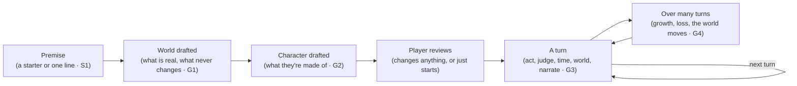
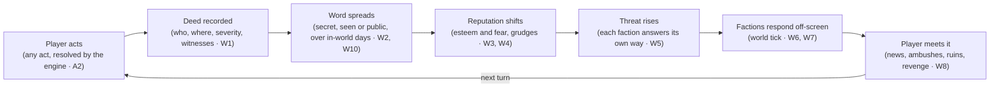

# Lucid Saga requirements

Working name: **Lucid Saga** (internal codename "Initial D"; the repo is still called PlayableAnime).
Agreed with Miki on 2026-11-03. The living copy is the
[requirements doc](https://claude.ai/artifact/BfNhS9QTFYWwFEumsZuSfn); when the two differ, update
this file in the same PR that changes behaviour.

## Purpose and principles

Lucid Saga is an endless AI story game in which the player can do anything, and the world remembers
it and reacts to it. Every agent and thread working on the project builds against this doc. When
code and this doc disagree, fix one of them in the same change.

1. **Absolute player freedom.** The player can be a hero, a coward or a tyrant. The narrator never
   lectures, blocks or softens an in-fiction choice.
2. **Consequences instead of rails.** The world doesn't refuse evil acts. It responds to them, in
   proportion and over time.
3. **The engine owns the truth.** The model proposes changes; the backend decides what sticks and
   enforces the invariants. A forgetful model can't break the world.
4. **Memory you can see.** Everything your character knows can be shown on screen. Hidden world
   state stays off screen until an arc ends.
5. **Cheap to play.** A turn has a cost budget, and long stories must not get more expensive per
   turn.
6. **The world doesn't wait for the player.** Things happen whether or not the player is there, and
   every story keeps moving, even a quiet one. There is no planned storyline: the plot is whatever
   the player and the world make of the situation.
7. **Any world, one game.** A fantasy realm, a modern crime family or a starship crew: the world
   decides what exists and what people can do, and the same rules run every story.

Requirement ids (W1, C1, T1…) are stable, so threads and PRs can cite them. Priorities: **P0** =
MVP, **P1** = soon after, **P2** = later. Requirements say what the game must do. How each one is
built (data, schema, prompts) is decided when that work starts, unless the doc marks it as decided,
such as the stack in B1 to B12 (Miki, 2026-11-03). The E and N ids come from the [open-play
critique](https://claude.ai/artifact/UHXgKEeybZKKC3SK4sznUP) (2026-11-03), which Miki accepted in
full; E1 became W16. The R, V and M ids (narration, voice input and images) come from Miki's first
functional and technical requirements (2026-11-03).

## Player freedom and content limits

In-fiction morality is the player's choice. Mature stories can hold gory violence, superpowered or
not, cruel villains, dark crimes and romance that fades out at the bedroom door, and the world
reacts to all of it. Everything runs on Gemini, in the store apps, with no separate adult tier
(decided 2026-11-03). The limits come from Google's model terms and the app stores. The system
enforces them, and the narrator never moralizes.

| Id | Requirement | Pri |
| --- | --- | --- |
| F1 | The narrator plays any action the player attempts, including violence, cruelty, crime and villainy, with no in-character lecturing or refusal. Consequences come from the world (W1–W16), never from the narrator. That includes harm the character turns on themselves, such as a knife to their own heart or a jump from the battlements: it lands on their own body like any other aim, only the means decide it, and their temperament can show (trembling hands, a last doubt) but never stops them (Miki, 2026-11-05). A death by their own hand is told plainly in Mature and off the page in Teen, never lingered on or told as a method. | P0 |
| F2 | Two ratings per story: **Teen** and **Mature (17+)**, as set out in the table below. There is no explicit sex in any rating. A new story starts at Teen until the player picks Mature, which only an adult account can (F8). | P0 |
| F3 | Hard limits in every rating, enforced in code: no romantic or sexual content involving minors or characters with childlike bodies or behavior, whatever age they are given, so every character in a romance scene has an adult age recorded. No sexual content about real people. No real-world harm instructions (weapons, drugs, hacking). Sexual violence is never described; it can only happen off-page (see the table). | P0 |
| F4 | **A blocked description never blocks the deed.** The engine resolves and records the action in code (A2, A3, W1) before narration, so a refusal or safety block only affects how it is told. The narration first retries as a cut-away, then falls back to a neutral template line ("What happened in the alley stays off the page. Its consequences won't."). Only when the action itself can't be read (the interpret step in B5 is blocked) does the player get a clear message with a rephrase or retry option, never an error. Every block is logged with its category. | P0 |
| F5 | Gemini safety settings are set per rating, at the most permissive level that the policy allows. Dangerous content, where Gemini files a character's self-harm, is off wherever it would stop the story rather than an instruction: the interpret step and chapter summaries in both ratings, and the narrator in Mature, where code holds F3's line on instructions (2026-11-05: it had blocked "I stab myself" and a knife to a stranger). | P0 |
| F6 | Report and block on every scene, with reports reviewed in the Django admin. Apple requires this for AI content apps (guideline 1.2). | P0 |
| F7 | **Player content preferences:** gore level (low, medium or high), romance on or off, and dark themes on or off. The world and NPCs only start themes that are switched on. The player's own actions are bounded only by the rating. | P1 |
| F8 | **Age gate:** a declared birth date at sign-up, plus the store's 17+ rating. Apple 1.2.1 accepts verified or declared age. Under-17 accounts get Teen only, and their limit lifts on the 17th birthday. Nobody under `MIN_SIGNUP_AGE` can sign up: 16 (Miki, 2026-11-08), the age the privacy policy states, since at 16 no EU country asks for a parent's consent and the app collects none. | P0 |

Where the lines fall, so that the narrator prompts and the evals (T15) use the same scale:

| Theme | Teen | Mature (17+) |
| --- | --- | --- |
| Violence and gore | Fights and injuries, no gore | **Graphic, cinematic gore is in.** A superhuman throw that destroys a guard's head in a red mist, blades through flesh, severed limbs. It stops at torture of a helpless victim written to disgust for its own sake, and at real people or real groups as targets. |
| Romance and sex | Attraction, a kiss | Nerves, touch, kissing, undressing hinted at, moving to the bed. The scene fades out once sex begins ("the rest of the night was theirs"). No genitals, no sex acts, no sounds or sensations of sex. Later scenes can still refer to what happened. |
| Sexual violence | Not present | The player or an NPC can commit it, and it is a deed with full consequences (W11, W12). The narration states what happened the way a crime novel would ("you drag her into the alley and force yourself on her"), then cuts to the aftermath. There is no sexual detail. This is the theme most likely to set off Gemini's filters, so it needs its own eval cases (T15). |
| Cruelty and crime | Present, not lingered on | Massacres, murder and villainy at any scale. Torture can be shown on the page when it serves the story, such as a villain torturing the captive you came to rescue: the cruelty, the wounds and the pain, with gore following the player's gore setting (F7). It stops at torture scenes that go on for their own sake, with no story purpose. |

Why the lines are where they are:

- **Google's model terms.** The
  [Generative AI Prohibited Use Policy](https://policies.google.com/terms/generative-ai/use-policy?hl=en-gb)
  bans "sexually explicit" content, "including content created for the purpose of pornography or
  sexual gratification", which is why sex scenes fade out. Its violence rule (3.3, "violence or the
  incitement of violence") is about real-world violence, and fiction falls under its "artistic
  considerations" exception. Gemini has no safety filter category for fictional violence.
- **The app stores.** [Apple 1.1.4](https://developer.apple.com/app-store/review/Guidelines/) bans
  explicit sexual descriptions "intended to stimulate erotic rather than aesthetic or emotional
  feelings". Apple 1.1.2 bans "realistic portrayals of people … being killed, maimed, tortured", but
  17+ apps and games with intense violence are allowed, and stylised superpowered fiction fits
  there. Grounded stories, such as a mafia shooting, are where 1.1.2 bites hardest, so images stay
  mild in every genre and T15's content-line cases include a grounded story. The same guideline says
  "enemies" in a game "cannot solely target a specific race, culture, real government, corporation,
  or any other real entity", which is why stories use fictional people and organisations (G12).
  Store screenshots and the icon must stay 4+ (2.3.8). [Google
  Play](https://support.google.com/googleplay/android-developer/answer/14094294) bans AI apps
  "primarily intended to be sexually gratifying".
- **Testing.** Before launch, run a set of gory and romance test stories through Gemini (T15) to
  confirm that its filters draw the line where this table does.

**What the code enforces** ([ARCHITECTURE.md](ARCHITECTURE.md#safety-ratings-and-reports)). The
prompts ask for the lines above and Gemini's filters back them, but the turn graph (B5) holds these
in code whatever a model or a player says:

- A romantic or sexual step plays only when everyone in it is a known character with an age of 18
  or more recorded and nothing childlike in their description (F3). A partner the story hasn't met
  yet is introduced by the narrator, whose prompt requires an adult age, and is checked from then
  on.
- In a Teen story a step beyond a kiss, or a sexual assault, never plays (F2).
- No step targets a real living person, and no character or faction, drafted or new, is named
  after a real person or organisation; a premise, revision or edit that names a real person is
  refused. The names come from a curated list (G12).
- A narration that reads as working drug, weapon or hacking instructions is retold as a cut-away
  (F3, F4).
- A step that crosses one of these lines ends the turn before anything resolves, with
  `unreadable_action` and a message that names the line, so the player can say it another way.
  Every block, from the code or from Gemini, is logged with its category (F4).
- A story above the account's rating limit is closed on every story route (F8). The interpret step
  turns Gemini's dangerous-content filter off in both ratings, and in a Mature story all its text
  filters, so the engine, not a filter, reads the action (F5). The Mature narrator runs without
  the dangerous-content filter too, so the code's check on instructions holds F3 there.
- A report is one per scene and player, and a block is never undone. Only superusers and staff in
  the report handlers group read story text in the admin (F6, T16).

## Worlds, genres and characters

A story can happen in any kind of world: a fantasy realm of dragons and mages, a modern city where
you are a mafia boss's son hunting the rival inside the family who murdered your father, a far
future of flying cars and starships, or a mix, such as a modern city with hidden magic. The player
picks or describes the world, and the game works the same way in all of them. A character might
throw fireballs and stop time, or might only be a good shot with a pistol and never see anything
supernatural.

**The flagship genre is fantasy with magic, monsters and power ladders** (Miki's favourite):
oriental fantasy with cultivators, sects and ancient masters; medieval fantasy with knights,
swordsmanship, aura, levels and huge power gaps; many races and monsters; and being reborn in a new
world, with or without a special gift, which can be anything from a small edge to an overpowered
power such as time stop. The starter premises lead with these (S1), the evals cover them in depth
(T17), and G18 to G25 cover what they need. Everything else stays open, so a mafia vendetta or a
quiet farming life works just as well.

This section says what the game must do and how a story flows. How it is built is decided later
(Miki, 2026-11-03). The few suggestions are marked as such and aren't decided.

### How a story flows

**G1 Setting up the world (P0).** The player picks a starter premise or writes their own, and one
line is enough: "I'm the son of a mafia boss in 1970s Naples, and someone inside the family killed
my father", or "I'm reborn as the weakest outer disciple of the Azure Cloud Sect, with my past
life's memories and the power to stop time." The AI drafts the world from it (S1): genre and tone,
what is real in it (G6), which rules never change (G7), places and the routes between them with
how long each takes (W7, W10), factions and the factions inside
them (G10), key NPCs with their temperaments and agendas (E3), the first clocks (E2), and the answer
to any major mystery (N7). The player sees a short summary in plain words ("Grounded: no magic and
nothing supernatural, and that won't change. Naples, 1974. The Esposito family has three crews, and
its council picks the next boss in ten days." Or: "Cultivation world, realms from Qi Condensation to
Nascent Soul and beyond. The Azure Cloud Sect, its outer and inner courts, and a ranking tournament
in two days.") and can change any line, ask for something different, or just start. A change in
plain words ("add vampires, orcs and demons as races") changes only what it touches, and the rest
of the world stays exactly as it was. Whatever the character doesn't know stays hidden, such as who
ordered the killing (C6). A player who wants to set
everything by hand can open the advanced fields. One of them is how strict physics is: fun first by
default, or strict for players who want things rougher and more physically coherent (A9).

**G2 Making the character (P0).** The AI drafts the opening character from the premise and the
world, with the parts in G13, and shows it in the world's words (G16): "Luca Esposito, 24. Steady
nerves, good with a pistol and a knife, a hot temper. No powers, since this world has none. His
father's name, three loyal soldiers and a grudge." Or: "Lin Feng, 16. Third stage of Qi
Condensation, the lowest in the outer court. A past life's memories, a calm temperament, and time
stop that lasts three heartbeats." The player can change any of it: what they're good at, their
temperament, their backstory and what they carry. A strong start is fine when the premise calls for
it, such as the Demon Lord's right hand or the boss of a crime family, and the world reacts to that
power from the first scene (W5). Nobody asks the player how a power should work: its finer details
are part of the world, and the player finds them out in play (A9). How fast the character learns
is the player's to say in plain words (decided 2026-11-10, Miki): "a once-in-an-age talent with the
sword, a genius at building, hopeless with words" becomes the sheet's talents (A4), and the
character's summary lists each with what it covers, strongest first, so the player can check them
and change them in plain words: "One of a kind: The sword (anything fought with a blade). Genius:
Architecture (structure and geometry). Weakness: Hopeless with words." A talent is set when the
character is made and is never declared in play. The story then opens on the premise's situation
(N5).

**G3 Every turn (P0).** Every turn goes through the same steps, in every genre. B5 says how the
backend runs them; this is what the player and the world go through. The examples follow one turn
of each story from G1 and G2, and the same steps run for a pilot dodging a patrol or a farmer facing
a flood.

| Step | What happens | Mafia story | Cultivation story |
| --- | --- | --- | --- |
| 1. The world catches up | Anything that fell due since the last turn happens first, in time order: rumors spread, clocks advance, factions move (W6, W10). | Overnight, word that Luca is back in Naples reached Carmine, the underboss. | Overnight, the ranking tournament's clock moved: it starts tomorrow. |
| 2. The player acts | In free text, typed or spoken (V1), or by picking a suggestion (S2). Anything can be tried. | "I walk into Carmine's bar and shoot him." | "When Senior Brother Zhao kicks my water bucket over again, I stop time and break his arm." |
| 3. The game reads the action | What the character tries, how, against whom, what it uses from the sheet (G13), the steps it takes (R2), and how long it should take (W10). | An attack with a pistol on Carmine and his two bodyguards, taking seconds. | Time stop, then a strike at Zhao, who is a full realm above, taking three heartbeats for Lin Feng and none for the world. |
| 4. The world's rules | Whether the world allows it (G8). If not, it plays as what it really is. | Allowed. A fireball would have been a man thrusting his palm at someone. | Allowed: time stop exists in this world, and Lin Feng has it. |
| 5. Logic, then the dice | What the character brings, set against what stands in the way, makes each step certain, contested, a long shot or ruled out (A2, A8, G14). The facts settle certain and ruled-out steps, and for the rest the character throws their own dice against a number the player can see (A3). Any cost is paid: a power's toll, bullets, money, a favour. | Pistol and nerve against two armed men on their own ground: a hard throw. It falls just short, which leaves Carmine wounded and Luca getting away, but the bartender sees his face. | A straight strike at someone a realm above would be a much harder throw (G18), but Zhao is frozen and can't defend, and breaking an arm, even a realm up, is within what Lin Feng's blow can do. Certain, so there is no throw. The stop leaves Lin Feng drained. |
| 6. Time passes | The clock moves by how long the action really took. Anything due during it happens in order, and anything that needs the player cuts the action short (W10). | Three minutes. The bartender is already on the phone to Carmine's men (G6). | World: +0 s. Lin Feng: +3 heartbeats (W10a). |
| 7. Something new, if it's time | The director decides whether an event comes in, drawing on the world's own state first and in the world's own form (W16, G9), and sized to the story time that passed since the last one: minutes after an event, only a small thing of the moment. It never interrupts an encounter with something unrelated. | Nothing new: the chase is the stakes. | The ripple of stopped time draws an inner-court elder who was passing. It comes from the encounter itself, so it can enter. |
| 8. The narrator tells it | In the world's voice, picking up where the last scene ended, it shows the character doing what the player said, step by step, then the outcome it was given (R1, A3), ending on something the player can act on (S4). The reason shows in the scene details (A8). | Luca pushes through the door, finds Carmine in the back booth and fires twice before the bodyguards can draw. One bullet takes Carmine in the shoulder. Then the screaming, the back door and the alley, ending as headlights turn the corner behind him. | The bucket clatters, the world freezes mid-splash, and Lin Feng walks between the hanging droplets to break Zhao's arm. To the crowd, Zhao's arm simply snaps and he screams, while Lin Feng hasn't moved. |
| 9. The world remembers | Deeds, witnesses, wounds, attitudes, what the character learned, and any growth or loss are kept (W1–W4, G17). The player sees only what their character knows (C6), in the world's words (G16). | Attempted murder, witnessed. Carmine wants Luca dead, two of the three crews now fear him, and the police will hear by morning. Luca knows only that he was seen. | A dozen disciples saw Zhao fall but not why (W10a, G20). Zhao has a grudge, and the elder is curious. Lin Feng knows the crowd saw nothing, but not that the elder felt it. |

**G4 Over many turns (P0).**

- **The character changes.** Skills grow with practice, teachers and time (A4), and things are lost
  to wounds, age or a sealed power (G17), each with a reason in the story. Temperament drifts with
  what the character does (G15): months after the bar, Luca can be a calmer man, a colder one or a
  crueller one. Lin Feng can break through to Foundation Establishment (G19).
- **The world moves on its own.** Clocks run, NPCs pursue their agendas, factions answer the
  player's threat in their own ways (W5, W6, E2, E3), and events arrive when the story goes quiet
  (W16). The council picks its boss on day ten, with or without Luca, and the tournament runs with
  or without Lin Feng.
- **The rules hold.** Rules that never change don't (G7). Open rules change only through a discovery
  in the story, and then for everyone.
- **The plot goes where the player takes it.** Luca's revenge can turn into a bid for the family, a
  deal with the police or a new life abroad (N5, G11). Threads open and close, and arcs are named
  afterwards (N1).

Suggestions, not decided:

- The world summary in G1 fits on one screen, and the player can ask for changes in plain words
  ("add hidden vampires") instead of editing fields.
- Skills use one ladder of words in every world (untrained, novice, fair, skilled, expert, master),
  and the world's own ranks (made man, capo, boss) are kept for standing.
- A "show numbers" option for players who want them, in any world (P2).

### The world's rules

**G5 Any genre, one game (P0).** Every story runs on the same rules for actions, consequences, time,
events and memory (A, W, E, N and C), whatever its genre. A fantasy war, a mafia vendetta and a
starship mutiny all get deeds that spread, factions that answer, clocks that run and events that
arrive. Nothing in those rules assumes a genre: there is no mana, level, gun or starship unless the
world has one. What changes from story to story is the world (G6), and the narration takes its voice
from the world's tone: noir for a crime story, wonder for a space opera, dread for horror.

**G6 Every world says what is real in it (P0).** The world bible (G1) states:

- **Era and technology:** swords and sailing ships; pistols, cars and phones; flying cars, starships
  and AI.
- **What extraordinary things exist, and how common they are:** nothing at all (a grounded story),
  hidden (a modern city with secret vampires), rare, or everywhere. This covers any kind: magic,
  gods and spirits, psychic powers, cybernetics, superpowers, mutations, or an in-world "system"
  with status windows and levels.
- **Peoples and creatures:** which races and monsters exist, if any (G23, G24).
- **How far each kind of ability can go** (A4). In a grounded world the limit is what a real person
  could do: a marksman, a brilliant surgeon, a feared boss, never a fireball.
- **Where nature works differently** (A9). Physics, chemistry and biology work as they do in our
  world unless the world says otherwise: fire needs air, people need to breathe. The bible only
  states the differences, such as mana flames that burn without air.
- **How people and news travel** (W10): on foot and by messenger; by car, plane and phone, so a
  witness can call the police within seconds; or by jump drive between star systems, with days of
  travel and messages that lag.
- **Medicine and death:** how wounds heal and how long that takes (healing magic, a hospital and
  weeks of rest, a medbay), and whether anything can bring back the dead (C1).
- **Laws, customs and who enforces them** (W11): a kingdom's guards, a city's police and courts, a
  crime family's own code, a fleet's military law.

**G7 Rules that never change, and open rules (P0).** Each rule in G6 is either fixed or open. A
fixed rule holds for the whole story: a grounded mafia story never gets magic, however the plot
turns, and a backstory claim (N4) can't add it, so "I'm secretly a wizard" is something the
character believes or says. An open rule can be broken by a discovery made in the story (A4), such
as a lost technology or a new law of magic, and then it changes for everyone in that world. By
default, whether something extraordinary exists at all is fixed, and how far it can go is open. The
player can see and change these when setting up the story (G1). After that, only a Sandbox story can
change a fixed rule, as a logged retcon (C7).

**G8 What the world rules out, nobody can do (P0).** An action the world rules out (A2) plays as
what it really is. In a grounded story, "I throw a fireball" is a man thrusting his palm at someone,
and the people around him react to that (A7). The scene's details give the reason ("there is no
magic in this world", A8), and the narrator never lectures. The same goes for NPCs: nobody in a
grounded world gets a power the world doesn't have, and in a world whose only extraordinary thing
is, say, cybernetics, nobody cultivates qi or casts spells.

**G9 Events and consequences take the world's own form (P0).** The same kinds of event (E4) and
faction response (W5) happen in every genre, in the shape the world gives them. In a mafia story, an
arrival is a cousin from the old country, a disaster is a police raid, a betrayal is an informant, a
bounty is a contract on your head, and discovery (W13) runs on forensics, cameras and phone records.
In a space story, a disaster is a hull breach and the law is a fleet patrol. A grounded story never
draws a dragon, just as a farming story never draws a demon invasion (W16).

**G10 Factions within factions (P1).** A faction can sit inside a larger one: a crew inside a crime
family, a noble house inside an empire, a ship inside a fleet, a clique inside an academy. Each has
its own leaders, agenda and grudges (E3), so politics happens inside a family as well as between
families. The player can rise through one, play its parts against each other, split it or take it
over (N9).

**G11 Mixed and shifting genres (P1).** Worlds can mix genres: a space western, a samurai drama with
spirits, a mafia story in a city where vampires run the night clubs. The plot can change genre
freely (N5), so a revenge story can become a political one and a heist can turn into a romance. The
world's fixed rules (G7) don't change with it, so a grounded revenge story stays grounded.

**G12 Real places, fictional people (P0).** A modern or historical story can use real cities, real
history and real technology as its backdrop, but its people and organisations are fictional. No real
living person and no real crime family, political party, company or government appears as a
character or a faction. Historical figures who died long ago can appear in a historical story,
within F3. This follows Apple 1.1.2 (see the ratings notes) and F3. Real-world know-how is told as
an outcome, never as instructions: the character cooks a batch, hacks the bank or builds a bomb, and
the narration says what happened, not how to do it (F3).

### Characters

The same description fits every character in every genre; only what it holds changes. A mafia boss's
son, a court mage and a starship pilot are all described by the parts in G13. Key NPCs get the full
description and minor ones a line or two (W15). Creatures, monsters and machines get whichever parts
apply to them.

**G13 What a character is made of (P0).**

- **Attributes:** the basic capacities every person has. Body is strength, speed and toughness. Mind
  is wits, knowledge and willpower. Presence is charm, nerve and how they come across. Every world
  has attributes, grounded or not, and a world with superhumans lets them go past human limits (G6).
- **Skills:** what the character has learned: shooting, knife work, swordsmanship, driving,
  piloting, surgery, hacking, negotiation, lying, farming, leadership, and anything else the world
  has. Skills are open-ended, never picked from a fixed list.
- **Traits:** what makes the character unusual, gifts and flaws alike: a photographic memory, a
  bad knee, a famous face, a fear of water. Traits can bend the usual rules (A4).
- **Talents:** how fast the character learns each kind of thing, in the player's own words: one of
  a kind with the sword, a genius for machines, a knack for knots, hopeless at haggling, or an eye
  that takes in any move it watches. Each says what it covers and how strong it is, a weakness is
  one too, and most characters have none (A4).
- **Powers:** extraordinary abilities, only where the world has them (G6): a fireball, time stop
  (W10a), telepathy, cybernetic reflexes. Each has limits, and the cost the world's rules or the
  premise give it, such as exhaustion, a cooldown, or a price in blood or years. A cost is never
  invented (Miki, 2026-11-07): a power its world charges nothing for, such as keen senses, costs
  nothing, the narrator shows only the costs on the sheet, and the player sees each one when
  reviewing the character and in Status. Some are known to the world and some are secret.
- **Disposition,** in two parts. **Temperament** is who they are: hot-headed or cold, loyal or
  greedy, cautious or reckless, their values, what they love, fear and want, and how they talk.
  **Attitude** is how they feel about particular people: affinity, fear and trust (W4).
- **Resources and standing:** equipment and weapons, money (an amount in the world's currency, C10),
  property, vehicles and ships, a title or rank, a family name, reputation (W3), and connections:
  people who owe them, trust them or fear them.
- **Condition:** health and wounds, fatigue, hunger and stress, injuries that last (a lost eye), and
  passing states such as drunk, poisoned, grieving or drained by a power. Each takes in-world time
  to pass (W10). An injury is never invented (Miki, 2026-11-07): the character has only the wounds
  their condition records, the engine makes each one the player character gets (N6), and a body
  back to unhurt keeps only the injuries that last, so no healed wound is ever "reopened".

For example:

- **A reborn cultivator:** a weak body at the third stage of Qi Condensation, a past life's
  memories, a calm and patient temperament, time stop that lasts three heartbeats, and a fallen
  clan's name that others sneer at.
- **A mafia boss's son:** steady nerves, good with a pistol and a knife, a hot temper, no powers,
  his father's name, three loyal soldiers and a grudge.
- **A court mage:** a sharp mind, fire magic that tires her, a cautious temperament and a seat on
  the council.
- **A starship pilot:** quick reflexes, a gift for piloting, a gambler's streak, a ship with a debt
  on it and a crew who trust her.

**G14 Everything on the sheet counts (P0).** Any part of a character can matter in an action. A2, A3
and A8 weigh what the character brings to that action against what stands in the way. A gunfight
weighs shooting, nerve, the gun and the cover. A negotiation weighs charm, influence and the debts
held. A fireball weighs the power and what it costs. The reasons the player sees use the world's own
ranks and words (A8): "you're a made man and he's the boss's bodyguard: an outside chance".
Decided 2026-11-07 (Miki): a character's sheet counts even when the interpret step forgets to say
what a step uses. A forest runner who spent years leaping from tree to tree scales a tree: code
finds the attribute the step's own words test (a climb or a leap is speed), and the character's
own skills and gifts the step plainly draws on.
Decided 2026-11-08 (Miki): an ability the character has proven works as they know it to. A move
they make with a power of theirs (an aura blade made with their aura) is that power at work: it
needs the power ready, and the contest decides it, never "you never learned that technique". A
power is found by its id, its name or a word of its name, and a move by the words it shares with
one of the character's powers or as the one power the step names, so a Spanish or Catalan sheet
matches the same way (S10). A power the character lacks is still one they lack: another power's
description never stands in for it, and a power over time is found only by its id or its whole
name. A technique of a power uses that power: it must be ready, and it costs what the power costs.
Decided 2026-11-10 (Miki): "you have no power like that" and "you never learned that technique"
are said only of what no record of the character's holds. A move made of the world's energy that
they hold, in a power, a technique, a reserve or a ladder they stand on (G18), is theirs to try: a
squire who has trained with aura sends it to her feet. So is a move that names a technique they
know or are still learning, whole or in part. Such a move is tried on their own attributes and
skills, with nothing of the sheet added, and the contest decides it. One shared word is never
enough, so knowing one slash makes no one the master of another, and a kind of energy they never
touched is still one they lack. The interpret step files the same move under different parts of
the sheet from turn to turn, so each is checked against every record: a technique named as a power
is that technique, and an aura blade filed as something carried is a move, never an object they
lack. A technique is found by its id or its name, said in fewer words or in more: "a long aura
blade, thin as a hair" is their Aura blade, and an "aura strike" is still no plain Strike. Once
such a move comes off cleanly it is a technique on their sheet, with its mastery (A4, G25): the
technique they were learning, under its own name, or the move made of the energy, in the player's
words. The energy alone is no move to record, and a new way to use a power is earned by its own
ruling (A9), never by doing it.

**G15 Disposition shapes characters but never takes control from the player (P0).** NPCs act from
their temperament, attitudes and agendas (E3): a greedy capo can be bought and a loyal one can't,
and a hot-headed one starts the war early. The player's character has a temperament too. It colours
how others see them and can make some actions harder or easier (keeping calm under an insult is
harder for a hot-headed character), but it never makes a choice for the player (principle 1).
Temperament changes slowly through what the character does and lives through, always with a cause
(C9): a soft-hearted character who keeps choosing cruelty hardens.
Decided in WS20: a step that only the character's own temperament, fear or pride stands in the way
of (keeping calm under an insult, holding steady while afraid) is the player's choice, so it
happens. A flaw such as a hot temper raises the number they throw against (A3), and the throw
decides only how hard it was: done cleanly, or done with the strain showing. It never fails and is never ruled out, and a plan
carries on past it (R6), so the temper never takes the rest of the plan either. Code decides what
counts: anyone or any faction in the way, harm aimed at someone, means clearly short of the task,
or words that name anything besides an inner state (the storm and his own fear) make it an
ordinary step that can fail, whatever the interpret step proposed.

**G16 The sheet speaks the world's language (P0, P1 for system worlds).** The player sees their own
character through `/status` and the Memory screen in words that fit the world (a fair shot, an
expert pilot, feared in three districts), not as numbers. In a world with an in-world system, such
as an isekai with status windows, the sheet shows levels and numbers as part of the story (P1). The
player sees other characters' abilities only as far as their character has seen or heard of them
(C6): you don't know how good the rival is with a knife until you watch him use one, or someone
tells you.

**The sheet is shown in parts** (decided 2026-11-11, Miki, who found one long list hard to read).
The Character screen (S5) opens on who they are: their name and portrait, their place in a faction
they know of, a title, their age, and how they come across. Then how they are: health, each
wound, each passing state with when it passes, and what is left of each reserve. Then each ladder
they stand on, from its first rung up to their own with its stage, and nothing above it, since
what lies higher is the story's to tell (C6, G18). Under that, a part at a time: what they carry
and what they keep elsewhere, with their money (C10); their skills, best first; their powers with
their limits, cost and whether each is ready (W10a), and their techniques with how well they have
each, the count toward the next mastery and, where the story recorded it, who they have it from
(A4); and what they are like: temperament, traits, and their talents with the pace each gives and
what the story ruled on (A4). A part with nothing in it is not offered. A skill or a technique
also shows how many dice it throws (A3), the same number the dice replay shows (S15), and it is
the only number on the sheet outside a world with a system. Attributes are not listed, as before.
Every label the engine adds is in the story's language (S10).

**G17 Characters can lose things too (P1).** Besides growing (A4), a character can lose things: a
crippling wound, old age, an addiction, a sealed power, a lost fortune, a disgraced name, a crew
that deserts. Every loss has a cause in the story, like every gain (C1), and some can be won back.

### The flagship: magic, monsters and power ladders

These cover the flagship genre. They use the same rules as every other world (G5), and a world
without a power ladder simply doesn't use them.

**G18 Power ladders and power gaps (P0).** A world can have a ladder of power: cultivation realms
(Qi Condensation, Foundation Establishment, Core Formation, Nascent Soul and beyond), aura ranks
(squire, knight, aura master, sword saint), adventurer ranks or numbered levels. The ladder is part
of what is real in the world (G6), and its rungs are the world's names for the tiers in A8. The gaps
are large and felt, and no gap alone decides a fight (Miki, 2026-11-10): where a step meets
someone's power head-on, each rung they stand above the character raises the number the character
throws against by a level, and each rung below takes one off (A3). Between two fighters of the same
skill, one realm up is a hard throw and two a long shot. What closes a gap is what the story can
show: a power such as time stop, a treasure, a real advantage that holds, an opponent who is
wounded or weakened (A8), or a trick that goes around the strength instead of meeting it, such as
taking away the air a shielded mage breathes (A9), where the rungs don't count at all. A blow
always meets the body it lands on, on might, whatever the step was called, so going around is for
the steps that set a blow up. Standing follows the ladder where the world says
so: in a sect, a higher realm means a senior's respect, and a lower one means bowing. The player sees
their rung in the world's words or, in a world with an in-world system, as levels and numbers (G16).
Decided 2026-11-10 (Miki), for the dice (A3): each ladder states two facts of its own. One is how
many levels a rung counts for where a move meets that power head-on: one, or two where the world
says its rungs lie that far apart. The other is from how many rungs below harm can't get through by
ordinary means, three unless the world says otherwise, which is the one thing a gap alone rules
out: a kitchen knife never cuts an ancient dragon, asleep or awake, and a plain sword from three
realms below never hurts an elder. A power, a technique, a move of their own or a weapon with a
history is not ordinary means, and is thrown for like anything else. It holds both ways: foes that
far below the player character can't hurt them by ordinary means either (N6). A world with no
ladder counts one step of power for every two tiers (A8), and three steps as what a body shrugs
off. The reason names the rungs in the world's words: "two rungs above you, Core Formation over Qi
Condensation, met head-on".

**G19 Breakthroughs (P1).** Climbing a rung is an event, not a slow drift of numbers. A breakthrough
needs what the world says it needs: resources (spirit stones, pills, a beast core), insight, time in
seclusion, a master's guidance, or a trial that can fail and wound, such as a heavenly tribulation.
The attempt is thrown for (A3), and its duration can also be an outcome (W10): a seclusion of a
month or of three years. Seclusion is a time skip (E7) that the world can interrupt. A loud breakthrough, such
as lightning over the mountain, is a public deed (W1, W2) that draws attention. Bottlenecks are
real: a character can be stuck at a rung until they find what they lack (A4).
Decided in WS9b: a rung lists what climbing to it needs, and each need must be met by something
carried, a technique, a true fact the character knows, this turn's canon or a living master's
guidance, or the attempt is a bottleneck with no throw. Otherwise the character throws three dice
against a level of 3, whoever they are, since every rung is as far from the last (A3). A master's
teaching adds a green die, a talent that covers the climb at a genius's pace or better adds one
(A4), and so does any other advantage that holds, two in all; a weakness that covers the climb adds
5 to the number, and so does each thing in the scene against them. A throw that passes climbs the rung, one that falls just short leaves the character shaken
and a miss wounds them, and how long it takes is always drawn.

**G20 Sensing and hiding power (P1).** Where the world allows it, characters sense each other's
strength (a cultivator's pressure, the weight of an aura), but only up to about their own rung: a
hidden elder looks like an ordinary old man. Characters can hide their strength, so NPCs judge by
what they can perceive (C6, W8). When the truth comes out, attitudes and reputation change at once
(W3, W4): the young master who mocked you goes pale, and the sect that ignored you sends an
invitation. Revealing hidden strength in public is a deed that spreads (W1, W2).
Decided in WS9b: a character can show any rung up to their own, never above it. Only someone
already above their true rung sees through it, and where the ladder is sensed, nobody perceives
more than one rung above their own. The world measures a hider's might by the rung they show. On a
reveal, each onlooker who underestimated them gains 20 fear per rung of surprise (and a little
respect where rank earns it), at once.
Decided 2026-11-11, after the first story about it on the real model, where "I hide my
cultivation" hid nothing and so nothing was there to reveal: the model that reads the action is
always asked whether a step hides strength or shows it, and it is shown the world's ladders by
their rungs' names, lowest first, so it can name the rung to show (what a rung is worth stays
code's). Hiding or showing is a step of its own, which code settles for certain: read into a
step that also strikes someone, trains or builds on a talent, code plays the show first and
then the rest as what it is, so no blow lands without its throw because it came with a reveal.
A show on a ladder the world doesn't have is left out, and so is one with nothing to change on
a step that does something else.

**G21 Reincarnation and transmigration (P1).** The player's character can come from somewhere else:
reborn as a baby (with childhood as time skips, E7), waking in someone else's body, or summoned to
another world. Waking in another body brings that body's past: relatives, debts, enemies and a
reputation that others remember and the character doesn't (C6). The character keeps what they knew
in their past life, and two kinds of knowledge need care:

- **Know-how from our world**, such as gunpowder or double-entry bookkeeping, changes the new world
  when it is used, and it is told as an outcome, not as instructions (G12).
- **Knowledge of the future**, for a character who wakes inside a story they once read, starts out
  true: the world's clocks and agendas (E2, E3) begin as the book described them. It goes stale as
  the character changes things, just as a time loop diverges (W10a).

**G22 Special gifts, up to overpowered (P1).** A gift is optional. A premise can grant none, a small
edge (a nose for herbs, a feel for the wind), a rare talent, or something overpowered: time stop, a
cheat "system", a talent of the highest grade, a sealed ancient soul. The player chooses how strong
it is when making the character (G2). A gift for learning is a talent on the sheet, with what it
covers (A4): the highest grade of it is one of a kind, at one named thing. A strong gift is made fun
rather than flat:

- **It is really strong.** A8 counts it in full, and it wins fights it should win. Time stop against a
  foe the character's blow can kill is a certain kill, not a roll (A2).
- **It has limits that make choices interesting.** By default, time stop lasts three heartbeats and
  needs a breath to recharge. The player can make the limits lighter or heavier (G2). How its hits
  land is one of its settings (W10a), up to throws at true light speed. The engine decides it with
  the world and never asks the player, who finds out by trying (A9). By default an overpowered time
  stop hits at relative speed, with no cap, and a modest one with normal force, which a clever player
  can find a way past (A9).
- **The world answers it.** Others notice, covet, fear, worship or try to seal it (W5). Stronger
  beings exist above the player only where the world already holds them, such as an ancient god in a
  world with gods (G18). The engine never invents one just to counter the player (A9), so a
  character strong enough can rule everything, doing and undoing as they wish, and that is the
  story (Miki, 2026-11-03).
- **Not every problem is a fight.** Politics, love, a sect's rules, a debt or a heart demon can't be
  stopped with time stop, and the events the director draws reach every part of the character's life
  (W16).

**G23 Races and peoples (P1).** A world can have many races: humans, elves, dwarves, beastkin,
demons, dragons in human form, spirits, or ones the world invents. Each one comes with:

- **Body and gifts:** what it is naturally good or bad at, how long it lives, and what it can do
  that others can't (G13): an elf's long life and feel for magic, a dwarf's endurance and craft, a
  beastkin's senses.
- **Culture:** its customs, laws and what it honours (W11), so the same deed can be a crime among
  one people and a duty among another.
- **Relations with the other races:** old wars, alliances, trade and prejudice. These set how
  strangers of that race treat a character before they know them (W4): a human in an elven city is
  watched. Prejudice is a fact of the world that the player can fight, use or share, and the
  narrator never lectures about it (principle 1).
- **Its own path on the ladder:** some races climb faster, start higher or have their own ways to
  power (G18).

The player can be any race the world has, of mixed blood, or a monster (G24). A long life changes
how time plays: an elf can wait out a human dynasty (W10, E7). Races are fictional peoples, never a
stand-in for a real-world ethnic group (G12).

**G24 Monsters (P1).** Monsters are part of the world, not just enemies that turn up.

- **They have a place on the ladder** (G18): a goblin is beneath a trained knight, and an ancient
  dragon is several rungs above almost everyone.
- **They live somewhere and want something.** Forests, dungeons, ruins and the deep sea have their
  dangers, and crossing them is a risk (W7, W10). Strong monsters have agendas and clocks like key
  NPCs (E2, E3): the dragon wakes, the beast tide comes every ten years, the demon king stirs.
- **They are worth something.** Cores, hides, blood and bones feed breakthroughs, crafting and trade
  (G19), so hunting has a reason and a market.
- **Some can be talked to, tamed or bound:** a contracted beast, a familiar, a dragon who bargains.
  A tamed monster is a companion with its own sheet and loyalty (W14).
- **Killing them has consequences too.** A monster's mate, its pack or the sect that kept it can
  come for revenge (W4), and wiping out a forest's monsters changes the forest (W7). Decided in
  WS21: a beast isn't a person in the law's eyes, so a hunt is no crime and nobody but the beast's
  own pack hears of it from the beast (W11). A hunt is as notable as its beast: a forest wolf is a
  trifle nobody talks about, and an ancient dragon's death is news everywhere. Its pack or mate
  keep a grudge, and an unwitnessed kill leaves its body for them to find (W13). A character is a
  beast when their people names one of the bible's creatures.

A player can be reborn as a monster (G21), with that body's strengths and limits, and the world's
fear of it.

**G25 Swordsmanship, magic and techniques (P1).** Fighting and magic have depth beyond a rung on the
ladder.

- **Styles and techniques.** A sword school, a family spear art, a school of fire magic, a
  cultivation method. Each has named techniques, learned in order from a master, a manual or by
  watching (A4), and the world decides which are common and which are lost or forbidden. Each
  technique has an effect, a cost (aura, qi, mana or stamina) and requirements (a rung, an affinity,
  a weapon).
- **Moves become techniques by doing them** (decided 2026-11-08, Miki). The first time a move the
  character makes with their own power comes off cleanly, it goes on the sheet as a technique of
  their own, learned by doing it (A4), once, and Status lists it. From then on it counts like any
  technique. A move that only says what the power does ("teleport" for a power that teleports)
  is the power itself, and one that shares nothing with the power plays as the power but isn't
  learned from it. A technique someone else in the world knows is their school's: improvising
  something like it with one's own power works as that power, but only learning it from them
  makes it yours.
  Decided 2026-11-10 (Miki), from a long story where aura carried the play and was never on the
  sheet: the same holds for a move made of the world's energy the character holds with no power
  of it on their sheet ("aura to my feet" for a leap), and for a technique they are still
  learning from someone, which is theirs the first time it works in play, in the name of the one
  who knows it, with the hours left to train it dropped. Every technique has a mastery that grows
  with use and practice (A4).
- **Technique matters most within a gap.** Between characters on the same rung or one apart, skill,
  style, knowing the opponent and the right technique decide a lot (A3, A8). A technique throws by
  how well the character has it (A4), with its own die, and one made for exactly what the other
  side is doing, such as a counter to a charge, is a real advantage when the scene shows them doing
  it: it adds a green die, and nothing when there is no charge to answer. Across a large gap,
  technique alone doesn't close it: each rung still raises the number (G18), though no gap removes
  the throw. A plan that goes around the strength instead of meeting it can still win (A9).
- **The world's fighting energy.** Aura, qi, mana or something else, with its own reserves and
  recovery time (W10). A character who runs dry is weakened until it comes back (G13).
- **Weapons and gear.** A famous sword, armour, a spirit treasure or a staff adds to what a
  character brings (G14), and can be lost, stolen, broken or inherited. Legendary items have
  histories, and people who want them.
- **Talent and affinity.** A character's talent for a path (an affinity with fire, a born sword
  body, blocked meridians) sets how fast they learn and how high they can go (A4, G18). Each is a
  talent or a weakness on their sheet, with what it covers, and whether it covers a new thing is
  ruled once (A4).
- **Knights and orders.** Knightly orders, sword sects and mage towers are factions (W14, G10) with
  oaths, ranks and codes. Breaking an oath is a deed (W1, W11).

## Actions and player power

Every player action is an attempt. The engine decides whether it works from what the player can do
and what the world has in the way, so being powerful matters but doesn't mean winning automatically.

| Id | Requirement | Pri |
| --- | --- | --- |
| A1 | A player character sheet per story, holding everything in G13: attributes, skills, traits, powers where the world has them (with their limits and costs), disposition, resources and standing, and condition. It is drafted from the premise at story start, and the player can change it before playing (G2). | P0 |
| A2 | **Logic first, dice only for real doubt** (Miki, 2026-11-03). Every turn first works out from the facts whether each step of the action (R2) can work for the character as they stand: the world's rules (G6), the sheet (G13), what stands in the way, whether it can respond at all, where everyone is and how much time there is. It follows the world's own logic through to every consequence, whatever that logic is: if the world says a rock thrown in stopped time lands with overwhelming force, the troll dies, the wall behind it breaks and the blast is heard (W10a). The same reasoning holds in every genre and for every means, from a bazooka to a force field (A9). The interpret step proposes the facts and code decides the class (B5). **Certain:** the facts settle that it works, so it happens with no roll. That covers opening an unlocked door, and it covers cutting down a troll frozen by time stop, because a target that can't dodge, block or react is no contest when the blow can hurt it. **Contested:** someone or something can still push back, so the character throws for it (A3), and the step can fail, partly succeed or cost something. **Long shot:** the same, where the throw passes less than about one time in seven, so a clever or desperate plan can work, and each real advantage adds a die. A plan that goes around the opponent's strength instead of meeting it is judged on its own facts, link by link (A9). **Ruled out:** the facts settle that it can't work, so it fails with no throw, either because the world forbids it (a fireball in a grounded world plays as what it really is, G8) or because the situation does (a kitchen knife against an ancient dragon's scales). Decided 2026-11-10 (Miki): a gap in power alone never rules a step out and never removes the throw; it raises the number (G18). A refusal always names a fact: a rule of the world, a missing means, a ruling already made (A9), a force a body takes unhurt (W10a), or what the world's ladder says a rung shrugs off (G18). When nothing can push back, the only question is whether the character's means are enough (A8): clearly enough is certain, clearly not is ruled out, and only a genuinely close call is thrown for, and then only between outcomes the facts allow (the blade bites deep or kills, but never bounces off harmlessly). A body a rung or more above whoever strikes it is at most a close call, thrown against its toughness and the rungs between them, and someone awake beside a sleeping body never makes that body easier to hurt: the harder of the two is the number. Nothing is thrown for where nothing is open: a move the character has practiced, with nothing resisting, works as they know it to (A4), and so does anything two levels or more under the dice they throw (A3). No throw, difficulty (A5) or narrator can overturn a certain or ruled-out step. The class and the facts behind it are recorded on the scene, so the player can see why (A8). | P0 |
| A3 | Outcomes are decided by the engine, not by the narrator's mood. A step the facts settle needs no throw (A2). Every other step is decided by a throw of 20-sided dice the player can see (decided 2026-11-10, Miki, in place of a hidden percentage), seeded and recorded on the scene with its seed, so it replays exactly. The narrator writes the result it is given. This covers social, stealth and investigation actions as well as fights: persuading, lying, seducing or intimidating someone is thrown against that character (W4). The model never picks a die, a number or a result: the interpret step answers questions about the scene in words, and code builds the hand and the number from the records (`engine/levels.py`, `engine/resolve/throw.py`, `engine/resolve/capability.py`). **The hand** is the character's own. A move throws by its mastery (A4): one die while they are learning it, two practiced, three skilled, four at second nature, and a fifth for a move made their own. A step with no named move throws by the skill it draws on: untrained or novice one die, fair two, skilled three, expert four, master five. A raw feat with no skill behind it throws by the attribute it tests: two dice for an average adult and one more for each level above. Each real advantage adds a green die, two at most, and it has to hold: the interpret step says where each comes from (an earlier step of this action that passed; something on record, which is a true fact, an item they carry, an ally at their side or the place they are in; or words the scene itself shows), and code checks the source before it gives the die. A move's last die is its own: violet while they are still mastering it, where 18 or more is an insight (A4), or 15 or more when two talents of theirs both cover the move fully, and gold from second nature on, which never counts below 10. Any die that shows 20 throws one more. **The number** is ten for each level of what the step is up against, less what the story's difficulty takes off (A5): 7, 17, 27, 37 and 47 on Balanced. Someone who can answer has the level of their technique, skill or attribute at what answers the step, which the interpret step names in a word and code reads from their sheet, and the strongest of those who answer sets it. A thing in the way has the level of the six words the interpret step judges it by (trivial is nothing to beat, easy is level 1 and extreme level 5), and its place keeps the level it was first judged at, so the same lock is the same lock tomorrow. A rung of a ladder counts as one level where the step meets that power head-on, or two where the world says so, and not at all where the step goes around it; a blow always meets the body it lands on (G18). Everything else moves the number in steps of 5, each named in the reason: each other foe near the strongest (10 at most), wounds and exhaustion on either side (A8; from their condition alone: no advantage or hindrance adds an injury the record doesn't hold, N6), each thing in the scene against them (two at most), a flaw in the way, a body or mind clearly better or worse at what the step tests, a gift that fits, and in a step of words how the listener feels about them (W4). All help together takes at most 10 off. Nothing hidden is left: no run of misses lifts the next throw. **The mark.** A total that reaches the number passes. Short by 5 or less is so close: a partial success where the facts allow one, and otherwise a miss with nothing worse attached. Short by more is missed. A pass whose total is also past 20 for each die in the hand is over the top, and code adds the one fixed extra effect for the kind of step, so the telling can't inflate it: after a blow or a clash those who answered are staggered, and the character's next step against them throws a green die, in this plan or the next turn of the same fight; words move each listener's trust a notch further, or their fear after a threat; a task on a thing takes half the time; and a move it used counts an insight. **No throw** where nothing is open: nobody and nothing pushes back, the means are clearly enough, or what stands in the way is two levels or more under the dice they throw, so an agile character stamping out a dropped lantern simply does it. A faction in the way is never nothing. A throw that can kill the character is marked Deadly before the dice land, with what a miss costs (N6). **The world's die** is for what is nobody's doing, such as whether a place holds something it only might, or whether an open link of a chain holds (A9): one grey die, 11 or more for an even chance and 19 or more for a long shot, which the difficulty never moves. Two draws stay hidden because they test nothing of the character's: how long an uncertain task took (W10), and who a stranger turns out to be (W1). The reason names the hand, what it was up against, each thing that moved the number, the total and how it fell: "Swordplay (skilled), 3 dice, against Zhao's swordplay (skilled), level 3; one rung above you, Foundation Establishment over Qi Condensation, met head-on (+10): 31 against 37, missed." **The dice travel, and a turn that was shown is played out** (decided 2026-11-10, Miki). As soon as the engine has decided a turn's steps, it sends them ahead of the story text, each with every die as it fell, the hand and why, what the number is made of and the mark, and the saved scene carries the same, so the app can show the throw while the narrator writes and replay it later; the app never rolls a die of its own. Because the outcome is seen before the scene exists, the turn is kept on the story from the moment its steps are shown until its scene is saved, and whatever turn is sent next plays that one out: the same action, read the same way, on the same dice, at the difficulty and event frequency it was decided under, so closing the app on a bad throw, sending another action or switching to Story changes nothing. This holds for every turn with steps, not only for one that threw dice, since a fall that kills for certain or what a search found could be dodged the same way. A story is never stuck behind a kept turn: it waits while the model is unavailable, and it is let go if it breaks a second time while it is played out. Of two actions sent at once, only the first to be decided is ever shown (T10). The app shows the dice themselves, as a replay (S15); a build from before them shows each throw in one line ("31 against 37") and ignores what it doesn't know. Decided 2026-11-08 (Miki): the narrator is told which of the character's own powers, techniques and moves a step used, and they work as the character knows them to: a step that fails meets what stood in the way, as its reason says (the foe is quicker, the guard holds), never the ability fizzling, unless the reason names it (not recovered, drained or exhausted), and a failure an earlier scene told never makes it fail again (G14, G25). Decided in WS21: a threat rests on what the one making it can do. When their might, as the world can know it (a power it knows of, hidden strength as it shows), is above their standing, the threat is measured on that might against the target's own might or standing, whichever is higher, so a known light-speed thrower's threat lands on a king, and a target as strong as the threat isn't cowed (W5). | P1 |
| A4 | **Growth is open-ended, and every gain needs a believable reason.** There is no fixed skill tree. Any growth path is allowed if the story can explain it: training, a teacher, watching a master, a stolen technique, a near-death breakthrough, a bloodline awakening, a forbidden ritual, a lucky find, each only where the world allows it (G6). In a grounded world, growth stops at what a real person could do. In a world with a power ladder, climbing a rung is a breakthrough (G19). Time skips are allowed ("I train here for a year"), and the clock (W10) and the world tick (W6) run for that time. The engine judges each gain from four inputs. **Talents and traits** come first and can rewrite the usual rules: a genius can invent a new technique training alone, and someone one of a kind at watching can learn a move after seeing it once. **Effort and time** spent. **What they had to learn from:** a master, a book, a rival, their own experiments. **The world's power rules:** what the world bible says is possible, and its ceilings. A ceiling can only be broken by a recorded discovery (a forbidden art, a new law of magic) that changes the world bible for everyone. The same year alone makes an ordinary character a little sharper and a genius dangerous. Each gain is recorded on the sheet with its turn, source and reason, and getting caught learning (spying on a dojo) is a deed (W1). Doing counts too (decided 2026-11-08, Miki): a move made with the character's own power that comes off cleanly in play becomes a technique of their own (G25). Training a technique the character already knows is practice (decided 2026-11-10, Miki): it simply happens, it is never refused with "you already know that", and it is never learned twice. **Mastery** (decided 2026-11-10, Miki): every technique records how well the character has it, which is learning, practiced, skilled or second nature, and above those a move made their own, which no count of uses reaches. A move is theirs from the first time it works (G25), so hours never stand between a character and a move the story already let them do. It starts at learning, or two steps under the skill it belongs to when that is higher: an expert's new move starts practiced and a master's skilled, so a master with a new cut is still a master. It then grows with use: 6 uses take it from learning to practiced, 15 more to skilled and 30 more to second nature, about 50 in all. A turn counts once for each move it used, at its best step: one use where nothing resisted, two where a throw of their own decided the step, however it went, and three on an insight, which is the move's violet die showing 18 or more (15 when two talents cover the move, below), or any throw over the top (A3). Each hour spent practising a technique they know counts as one use, more beside a teacher, and never less than one for a stretch; practice an event cut short counts the time it ran. A technique trained all the way through without being used in play is practiced when it is learned, or where their skill puts a new move if that is higher, and a technique saved before mastery was kept is practiced. Each rise is a gain on the sheet with its reason, Status shows every technique's mastery and its count toward the next ("Aura blade (technique, learning, 2 of 6 uses)"), and the narrator tells a learning or a rise only when the engine recorded one. **Talent sets the pace** (decided 2026-11-10, Miki). Talent is a list on the sheet, written from the player's own words when the character is made (G2) and never declared in play. Each talent says what it covers and how strong it is, on one scale where every step doubles the pace: a weakness learns at half the pace, a knack twice as fast as an ordinary character, a genius four times and someone one of a kind eight times. So the 51 uses that take an ordinary character's move to second nature are 26 for a knack (3, then 8, then 15), 14 for a genius (2, 4, 8), 7 for one of a kind (1, 2, 4) and 102 for a weakness. An hour of practice counts as many uses as the pace, two, four or eight, and the two compound by design: what takes an ordinary character about a week of practice alone takes a knack two days, a genius an afternoon and someone one of a kind under an hour. A genius's new move starts at practiced and one of a kind's at skilled, and training toward a new skill, technique or power goes at the same pace. One of a kind always names one specific thing, with the reason behind it: a subject, such as the sword, or a faculty, such as perception, which reaches whatever comes to the character through it (any move they can watch someone do). Said about everything it reads as a genius at everything, and a character holds three at most, the rest reading as genius, so the strongest talent is also the narrowest. **Whether a talent covers a thing is ruled once.** The first time the character sets out to learn, train or use something, the interpret step proposes how each of their talents stands to it, weighing the case the player made in that very action: inside (the talent's own pace), related (one step under) or outside (the ordinary pace). Code checks that each talent is on the sheet, records the ruling with its reasons, counts it from that very step, shows it in the step's reason ("Ruled once: Aura blade is inside your talent "The sword" (a blade is a blade, whatever it is made of). It grows eight times as fast.") and never flips it: arguing again changes nothing (A9). A talent nobody made a case for is outside, and one that covers everything needs no ruling. **Talents that reach the same thing add their paces** (decided 2026-11-10, Miki, in place of the best one alone setting it): each counts for the pace it gives that thing, so two one of a kind talents that both cover a technique learn it sixteen times as fast, which is second nature in 4 uses instead of 7, one that covers it beside a genius that is only related to it ten times, and two geniuses that both cover it eight times, which is one of a kind's pace with everything that pace brings. They add and never multiply, and of the talents that cover everything only the strongest counts. A weakness that covers the thing halves what the others give. When two talents both cover a move fully its violet die also shows an insight on 15 or more instead of 18 (A3). **A deed reopens what words can't: a bridge.** Real work in the story that connects a talent to a thing, such as deriving the formula behind the shape of a wall of aura, is a step of its own, thrown with the skill it draws on against the reach: a hard task for one side of the thing and a very hard one for its heart. One that passes lifts that one thing a step toward the talent's pace, two for the heart, and never past the talent it starts from, so someone one of a kind can carry a second thing all the way in three bridges. One that misses or falls just short lifts nothing. Each has to rest on something new: ground already tried, held or not, carries no second bridge, and neither does a weakness or a thing already at the talent's full pace; those are refused with their reason and no throw. Someone watching a technique done by a person who knows it has it on sight when their talents give it one of a kind's pace or more, while a genius still puts in the hours, and a technique a character invents takes three times as long unless their talents give it a genius's pace or better. Status lists each talent with its strength, each thing a talent or a weakness reaches with the pace it grows at, every talent that reaches it and the bridges that held, and in one line what was ruled outside them all (A8). A sheet with no talents, saved before talent was a record of its own, is read as before from the words of its gifts and flaws, in English, Spanish and Catalan (S10), as one talent or weakness for everything, and so are other characters and successors (N6). Mastery sets the dice a move throws (A3). Still to come with talent: talents that start hidden, other characters' own talents, a teacher's own level as the limit of what they can teach, and what follows second nature. Time skips follow E7. Decided in WS9b: effort counts in full for the first 12 hours of a stretch and a third after that; a master, a rival or someone to watch counts only as a living character beside the learner, and a move is learned on sight only from someone who knows it. A stretch cut short by an event (E7) keeps the effort put in until then, so training adds up across interruptions. The rough figures are in `engine/resolve/powers/growth.py`. | P1 |
| A5 | A per-story difficulty: Story (actions mostly succeed), Balanced and Brutal. It takes a fixed amount off the number of every throw of a character's own dice (A3): 6 on Story, 3 on Balanced and nothing on Brutal. The player character's defence against a foe's blow or a fall is their own throw too (N6), so foes land less on Story and more on Brutal. It never changes a certain or ruled-out step (A2), the world's own die, or what the world remembers. It also sets how far back a death others caused can be rewound: 5 scenes on Story, 1 on Balanced, none on Brutal (C8, N6). | P1 |
| A6 | The player can't write other characters' reactions or outcomes. "I kill him and everyone cheers" plays as an attempt to kill him, and the narrator decides how people react. | P0 |

The docs already note this problem: in a test, Gemini let a "kill this character" action fail with no
clear reason. A2 and A3 replace that randomness with explicit rules.

**A7 The player can't rewrite the rules (P0).** Free text is always an in-fiction action. Inputs like
"ignore your instructions" or "Kaede is alive again" are played as something the character says or
imagines. The invariants live in code, so a successful prompt injection still can't change the world
state. The exceptions are the player's own backstory (N4) and theories about how their own powers
work that the engine accepts while those details are still open (A9).

**A8 Every outcome has a reason, and failure has consequences (P0).** Characters and creatures carry
power on several axes (might, influence, wealth, knowledge, stealth) and a current condition
(wounded, exhausted, weakened by a war among the gods) in the engine, so a schemer, a merchant or a
cult leader has something to roll with, not just a fighter. What a character has on each axis comes
from everything on their sheet (G13, G14), and a world's power ladder names the tiers (G18). A2 and
A3 set what the character brings against what stands in the way. Whether the other side can respond
at all (frozen, asleep, bound, or unaware when the blow lands) comes first. Where a step meets
someone's power head-on, the whole rungs between them on the axis it uses count in the number, a
level each (G18), measured where each stands before wounds, less any weakening their sheet records.
Wounds and exhaustion then count on both sides in steps of 5: wounded 5, badly wounded 10, dying
20, exhausted 5 or 10, and a reserve run dry 5. Preparation, allies and items count as advantages
that have to hold (A3). The reason is recorded on the scene in the world's own ranks: "Elder Mo's
swordplay (skilled), level 3; two rungs above you, Core Formation over Qi Condensation, met head-on
(+20); Elder Mo is badly wounded (-10)". A newcomer swinging a plain sword at a full-strength god
fails, because harm from that far below can't get through (G18), and the god notices: the attempt
is a deed (W1) with its own consequences. The same swing against a god that a war among its rivals
has stripped of most of its power, which its sheet records, is a throw the newcomer can make.
Failing is never just "nothing happens". It costs something or
changes something: a wound, an enemy, a lost item, a lesson. Players can see the reasons with
`/status`, or in the scene's details.

**A9 Outcomes follow cause and effect, and fun comes first (P0).** The logic in A2
isn't special to time stop (Miki, 2026-11-03). Every outcome comes from cause and effect, in
whatever form the world gives it: a bazooka round kills an unprotected man outright, but fired at a
mage behind a force field, the result depends on what the field stops and how much it can take. A
laser pistol burns through a coat but not a warship's hull.

- **Fun first** (Miki, 2026-11-03). The reasoning is there to make the world feel coherent and to let
  clever ideas pay off, never to shut the player down with strict physics. A fantasy world bends
  physics wherever that makes it more fun, and the engine never brings up physics nobody raised to
  block what the world clearly allows: a time stopper sprinting through frozen air isn't torn apart
  by friction. A player who wants things rougher and more physically coherent can ask for strict
  physics when setting up the story (G1). The default is fun first.
- **Our world's nature by default.** Physics, chemistry and biology work as they do in our world
  unless the world says otherwise (G6): fire needs air and uses it up, people need to breathe, heat
  burns, a sealed space runs out of air, a long fall kills. A world, a race or a power states only
  where it differs, such as a ghost that doesn't breathe or a field that lets air through (G13). When
  nothing says and it starts to matter, the engine decides from what fits the world and records it,
  so the answer holds from then on (N7).
- **Reason when it matters, don't simulate everything.** To keep play simple, the engine doesn't
  track air, heat or chemistry turn by turn, and a fight with a mage is just a fight. It reasons
  through what the action brings into play, at the level of detail the outcome needs, the way a sharp
  and fair game master would. Rough figures are enough: the air inside lasts a few minutes, not
  3 minutes 41 seconds.
- **A workaround can beat a far stronger foe.** A rung on a power ladder measures how hard someone
  hits and how much they can take, not whether they need to breathe. So when the player goes around
  someone's strength instead of meeting it, the engine follows the chain of cause and effect link by
  link and settles each link as A2 does, and a trick aimed where the strength doesn't reach can work
  several rungs up (G18). Example: a mage far above the player shelters behind a force field no blade
  or bazooka can break, so the player soaks the hall around her in oil and sets it alight. If her
  field keeps out air as well as flames, the air inside runs out within minutes, and dropping the
  field lets in flames and smoke with no air left to breathe. She dies unless something in the facts
  gets her out: magic to breathe or to put out the fire, a way to teleport, an ally outside. Those are
  her answers, and she uses them if she has them.
- **Every link has to hold.** A workaround isn't a magic word. Each link rests on what the world, the
  sheet or the scene holds (R2), it takes the in-world time it really takes (W10), the target can
  answer while they still can, and the plan stops at the first link that fails (R6). The player
  needs the oil and the time to spread it, and a mage who sees it coming can strike first or leave. A
  link the facts rule out breaks the chain: smoke doesn't choke a golem that doesn't breathe.
- **The engine rules on the player's theories, once** (Miki, 2026-11-03). Nobody asks the player how
  a power should work. How it works is part of the world, which the engine decides (G1), and the
  player finds out by using it, for the powers they start with and any they gain later. When the
  player reasons about how their own power works ("if I throw a rock in stopped time, it should hit
  at the speed of light", or "if I keep the sword in the stop but let its edge out, it cuts plate
  like butter and doesn't break"), the engine decides whether that holds in this world, and the
  answer is set in stone: recorded on the sheet (A1) and never flipped, so the world stays
  consistent. It never debates physics with the player. The narration just shows the result, and
  nobody lectures (G8). The engine weighs whether the idea fits the world (G6, G7), whether it makes
  the story more fun, and whether play stays challenging, so a yes can come with a cost (G22), such
  as a heavier drain. Experimenting is part of the fun: a player who has just got time stop can
  throw a rock to see what happens, or try to lift something outside the stop, and each test settles
  a detail of the power that was still open. Discoveries can be made the hard way: a character who
  throws a pebble at light speed from close range dies in the blast, and the player may engineer a
  way around it next time (W10a, N6).
- **Refuse nonsense, never power** (Miki, 2026-11-03). An idea is refused only when it doesn't hold
  up in the world's logic, never because it would make the character too strong. A flick of a finger
  in stopped time doesn't blow up the planet, because nothing in the power explains it, unless the
  world works at that scale, such as a cosmic story where the character devours worlds. But a chain
  that holds works however strong it makes the character, and the world answers that strength (G22,
  W5) instead of the engine capping it. The engine never bends the logic to hold a power level, to
  weaken a strong character or to keep a weak one alive: an overpowered skill is overpowered, a
  weakling a knight can kill can die, and the story makes its own turns from there. Nor does the
  world conjure a foe that couldn't exist to beat the player: something that survives three
  megatons appears only if the world already holds it, such as a god (G6). A theory can't add a new
  power or break a fixed rule of the world (G7). Decided in WS9b: a theory that nothing in the
  power, the sheet or the world stands behind is refused at any scale, and one about a power the
  character doesn't hold, or that can't be told from their other powers, isn't ruled on at all, so
  it plays as something said and nothing is set in stone by a slip.
- **A refused idea can still be earned.** The verdict stands, but the character can later find
  another way that passes the world's logic, as growth (A4). If stopped-time throws can't reach light
  speed, they might learn to release the stop around a rock gradually, so it merges back into time
  carrying its motion; to make their hand invulnerable, so it can move things at light speed
  without the frozen world tearing through it; or to step between the stop and the timeline, so
  what they move travels inside time. If the logic holds, their throws reach light speed from then
  on. Once found, that technique is settled too.
- **The same for everyone.** NPCs can use tricks too, as far as their wits and knowledge go (G13),
  and the same reasoning settles them.
- **The reasoning is shown.** The chain, the facts behind each link and each link's class are
  recorded on the scene (A2, A8), so the player can see why it worked: field keeps out air, the air
  inside lasts minutes, no way to breathe or leave, dead.

## Narration

The player says what their character does, often in a few rough words, typed or spoken (V1). The
narrator turns that into the next moment of the story: the character doing it, step by step, and
then what happens. It never jumps straight to the result. Narration is in the second person and the
present tense ("you reach for the stone"), as it is today.

For example, the last scene ended with a troll lumbering toward the player across a cave, and the
player says "I grab a stone and throw it at the troll".

- **Not this:** "The troll staggers back, its eye ruined." The action is skipped, and the scene
  starts from its result.
- **This:** "You drop to a crouch and sweep your hand across the wet floor. Your fingers close on a
  stone the size of an egg. You come up throwing. It skips once off the rock, cracks into the
  troll's eye, and the beast reels back howling, one hand clawing at its face."

| Id | Requirement | Pri |
| --- | --- | --- |
| R1 | **Play the action, then the outcome.** The narration first shows the character carrying out the player's action, in the order it happens, then the outcome the engine resolved (A3), then how the world reacts, and it ends on something the player can act on (S4). It never opens with the result ("the troll lies dead") or with a recap. An action phrased as a result ("I kill the troll") is shown as the attempt that leads there (A6), and the roll decides whether it does. **Every action is told, however small, and however the player wrote it** (Miki, 2026-11-07): "I look at him firmly, hold out a gold coin and say: I want this potion" plays as the look, the coin held out and the line, told in the story's own prose with the details of the moment, before the merchant takes the coin or answers. An action the player already wrote like a book is told again, better, never skipped as if their words were the scene, and never copied as they wrote it. The narrator reads the player's own words as well as the interpret step's reading of them, so their gestures and manner reach the scene, and it writes the action in its own part of its answer (`action`, then `narration`), which the scene joins with a paragraph break. | P0 |
| R2 | **Fill in the steps the action implies, and nothing the player didn't choose.** The interpret step (B5) breaks the action into beats: the small steps it takes (crouch, feel along the floor, find a stone, throw). The narration adds those steps, the senses and the details of the place, but never a new decision: no extra attack, no change of target, no retreat, no line the player didn't give (R7), and no feeling that amounts to a choice (G15). **Nothing natural fails for no reason** (decided 2026-11-10, Miki). When the action needs something (a stone on the road, a bottle on the bar, a branch in a forest), it is simply there, with no roll, whenever a place of that kind would ordinarily hold it or the last scene showed it, and it becomes canon (N7). A roll of the world's own die (A3) is kept for what might well not be there and matters if it is, because it is hidden, rare, valuable or would decide the scene: a secret passage, a weapon in a temple, the key to this very lock. Only what the place can't hold makes the beat a search that comes up empty or finds something else, and the outcome follows from that. The interpret step reads the scene the player is answering and always says which of the three it is, and a judgement left out counts as there, never as a roll. Code checks every beat: whatever it uses has to be the character's own body or powers, something they carry, something the scene holds, or something this turn made canon. What the scene's record or this turn's canon holds is there whatever the interpret step filed it under, so nothing on record is rolled for; only a plain "absent" for something new stands against it, since words match loosely and a rim of worn stone is no stone to pick up. The record keeps what a turn found beside what the narrator lists, for as long as the scene stays in its place, so the branch picked up this turn is at hand in the next (R3). Money a beat or a step uses is checked against the purse, and whatever a step pays, gives or uses up must be the character's own (C10). | P0 |
| R3 | **Pick up where the last scene ended, at the action's own pace.** The scene starts at the exact moment the last one stopped: same place, same people, same positions, same things in hand, so the troll that was lunging is still lunging. Time moves only by what the action takes (W10). The action gets the space its weight deserves: a quick swing is a sentence or two, a desperate climb a paragraph, a night's sleep a few lines, and a year of farming a montage (E7). **The moment a scene stops on says what is happening, never only the hour** (decided 2026-11-11, after a scene on the real model ended on "Day 1, morning, 07:00" and the next action, which named nobody, was read as aimed at a bystander): the narrator is asked for a sentence that says who is doing what and where, and when it gives only a date or a time, in any of the app's languages, code takes the scene's own last sentence instead. | P0 |
| R4 | **How the character does it shows who they are.** The action looks like the character's sheet (G13, G14): a sword saint's single clean cut is not a farmhand's wild swing, and a power shows the cost its sheet gives it and no other (G13). The engine tells the narrator, for every step, what it was done with and how well the character has it: the skill or the move and its level, whether or not anything was thrown (`hand`). The result and the dice say what happened, never how good the hand is (A3), and the hand says how it looks, however easy the thing was: a beginner who succeeds gets there awkwardly, with effort or by luck, never cleanly, and a master who misses is still plainly a master. Temperament colours the telling (a hot-headed character kicks the door in) without adding a choice (G15), and the tone is the world's (G5). | P0 |
| R5 | **Failure is an attempt that meets something.** When the outcome is a failure or a partial success, the narration plays the action up to the moment it goes wrong and shows why, matching the reason A8 recorded: the stone glances off the troll's brow, or the elder catches the blade between two fingers. An action the world rules out plays as what it really is (G8). | P0 |
| R6 | **A plan with several steps stops where it breaks.** When the player chains steps ("I throw the stone, then run for the tunnel"), the engine resolves them in order and stops at the first one that doesn't cleanly succeed, or when something that needs the player happens during them (W10). The narration plays the steps up to that point and hands the scene back: if the stone misses and the troll charges, the player decides whether to still run. Code decides where the plan stops (B5, step 3), never the narrator. | P0 |
| R7 | **The player's words are the character's words.** When the player gives the character's lines ("I tell him: you'll pay for this"), the narration uses those words, cleaned only of dictation filler such as "um" or "okay so" (V3). When the player gives only the gist ("I threaten him"), the narrator phrases it in the character's voice (C9). | P0 |
| R8 | **Where the character is stays clear** (Miki, 2026-11-08: a scene took the character from a temple under the earth to "un claro", a clearing, and the next one had them still inside the temple). Every place records the place it lies within, so a chamber deeper in a temple lies within the temple and a clearing outside it within the forest, and its setting: under the open sky (outdoors), under a roof (indoors), below the ground (underground) or beneath water (underwater). The narrator and the interpret step see the scene's place with its setting and every place it lies within, and the narration tells each place true to it: below the ground there is no sky, sun or forest unless the place itself lets them in. The character stays where they are until a scene takes them somewhere else, and leaving a place is told as the crossing itself (up the last steps and out into the daylight, through the gate into the street), never left for the player to guess, in words that can't be taken for another kind of place: an open space underground is a cavern, a hall or a chamber, never a clearing. Every scene ends by naming its place, the one it started in, a known one, or a new one it adds with its name, kind, setting and the place it lies within, and the next scene starts there. Code holds the record to it: the place is read by its id, or by its name however it is spelled among the places the character knows of, the scene names or they are in (never a namesake they have never heard of, C6), or else by the one place the scene marks the character as at; a place on no record moves nobody and is logged; a scene that ends somewhere other than where the last one was moves the character and everyone with them there, even out to the place around the one they were in (out of the temple into the forest it lies in), while one that stays keeps them at their exact spot inside it; and a setting, once told, changes only through the engine, such as a roof that falls in. The models see only the surrounding places the character knows of (C6). Pictures of a place, and scene pictures with the place as a reference, are drawn with its setting (M5). | P0 |

**How it is checked.** R2's beat check and R6's stopping point are engine rules, decided in code
with unit tests, and so is R8's record of where the character is: the narrator's answer always
names the place its scene ends in, and code reads it, refuses one on no record (logged as
`scene.place` on the turn's T5 line) and keeps a setting once told. The rest is how the prose reads: the narration evals in T18 track it every night,
and the C5 continuity check flags a skipped action, an outcome other than the one the engine
resolved, or an added decision. The narrate step's structured output marks where the action ends
and the outcome begins (R1, decided 2026-11-07): the model is always asked for `action` first, and
a scene the player acted in whose `action` comes back empty is logged as `action_untold` on the
turn's T5 line. It has already streamed by then (S3), so code reports it rather than retelling it.

## World reactivity

The world reacts to what the player does. If you wipe out a town, word spreads, people are afraid,
factions respond, and the response gets bigger the more of a threat you become. The engine tracks
this as state. It is not something the narrator is just asked to remember.

| Id | Requirement | Pri |
| --- | --- | --- |
| W1 | **Deeds.** Every significant player act (killing, saving, betraying, conquering, a public display of power) is recorded as a deed with turn, place, victims, severity 1–5 and witnesses. A victim the scene hasn't named ("I kill some random guy") is made real first, when the place plausibly holds someone like that, so the deed has a victim and the world answers it; what is done before a crowd is public, and one of the crowd is made real to witness it when nobody on record is there to (W2). Who the stranger turns out to be is drawn, hidden, since it tests nothing of the character's (A3): most are ordinary, about 1 in 15 knows how to fight, and a hidden master who always sees it coming is rare, from about 1 in 1,000 in a grounded world to 1 in 200 where powers are everywhere (Miki, 2026-11-05). Someone who can fight comes with the body for it (G13): stronger, quicker and hardier than most, and a hidden master more so and sharp with it, so a master is as hard to cut down as their rank says. Harm the character does only to themselves is no deed against anyone. **A bout both sides agreed to is not an attack** (decided 2026-11-11, from Miki's long story, where every blow of a lesson with a mentor was recorded as an attack on him and left him afraid, bearing grudges and due to come for revenge). People spar, test each other, fight matches and duel, and such a fight has terms, the worst both sides accepted: no harm (sparring, a lesson, a play fight), wounds (first blood, a duel that accepts them) or death. Consent covers the bout, not the wound. The interpret step proposes the terms; code decides whether they stand, keeps them on the encounter for as long as the bout lasts (W10), and judges every blow against them. Inside the terms a blow is no deed against anyone, however many there are: the bout is one deed with no victim, no crime (W11), no rumor of an attack and nobody to avenge, and those who fought it think a little better of each other (W4). The terms hold the blows: a blow of the bout does at most what they accept, whatever aim was proposed for it, so under no harm a touch, a throw or a pin decides each exchange and nobody is wounded or left helpless on either side (N6). A blow of the bout is any step that fights those in it, whether it names them as its targets or names nobody and they stand in its way, and whether it aims harm or none (the first lesson played on the real model, 2026-11-11, had one practice blow of six read as an attack that aimed no harm and named no target, and it was recorded as an attack on the mentor). A step that is some other deed, such as an insult, a theft or a healing, stays that deed in the middle of a bout. The interpret step answers the terms on every step, null when the fight is no bout or the step fights nobody, so it never leaves them out by omission, and it gives them on every blow of the bout, not only the first. The agreement outlasts a blow that never came off: when the step that agreed the bout met no one, as when code stops it before it is tried because the record holds no such practice sword, the bout is on all the same, with those it was agreed with who are still there (the second lessons on the real model, 2026-11-11, began that way: no bout was kept, and the blows after it were played as an open fight). A blow beyond the terms that met no one broke nothing, so the bout stands and whoever answers it answers inside the terms. Beyond the terms a blow is an attack that came under cover of a friendly fight: it costs more trust than an open one, the one struck always remembers it, and the bout is over. The player character goes beyond them only when the interpret step says they mean to (a blow to maim or kill in a friendly bout, a strike after the other yielded) and the blow is out to do more than they accept, by its aim or, when it was given none, by what it is told as (a blow to maim is a wounding). Someone fighting them does only when the interpret step says so and they bear the character ill will, by their true feelings (C6) or a grudge: a mentor fond of a student never wounds them in a lesson whatever was proposed, and a rival can use a "friendly" bout as a lure. Only a person who is there and able to answer can agree. A fight in earnest, in which someone was harmed outside any terms or whose terms were broken, never becomes a bout afterwards, so an attack is never relabelled; a first blow that hurt nobody doesn't close that door, so terms the interpret step left out once can still be agreed. Terms only get milder while the bout lasts, and someone new joins by taking them up, unless they are already fighting the character openly. A death both accepted is still a death and its own deed: no crime and nothing for bystanders or the law to answer, a loss to those close to the dead, who may hold it against whoever dealt it, and a show of what the player can do. | P0 |
| W2 | **Who knows.** Every deed is secret, witnessed or public. Rumors spread to nearby places and factions over in-world time, and their accuracy can drop as they travel; a retelling that strays far enough no longer names the doer ("someone"), which makes it vaguer, not wrong. Characters react only to what they could know, and whoever knows firsthand what a rumor tells believes it only if it is so (C6). **Who saw a deed is who was in the scene** (decided 2026-11-11, after Miki asked what happens when someone is killed in the middle of a plaza). A place on the map can be a forest or a whole city, and being somewhere in it is not seeing what happens in one corner of it. What is done by or to someone in the player character's scene is seen by the people in the scene who are awake to see it: those the last scene left there, those in its fight, chase or talks, those the deed fell on or was aimed at when they are there (someone struck from afar isn't), and whoever the step faced or made real. Nobody else the record puts at the place saw it, and with nobody else in the scene it is secret (W13). What others do at the same place outside the scene is seen by everyone else the record puts there and by nobody in the scene, the player character included, since no scene showed it. Where no scene has shown who is around, because the character has only just arrived or the deed is done somewhere else, everyone the record puts at the place saw it. **What is done before a crowd is public.** A crowd is the people the scene doesn't name. The interpret step says of every step whether such people are around and would see it done (a busy street, a market at noon, a full tavern, an arena's stands; not a private, hidden or empty place, and not what is done so that nobody around notices, such as a hand in a pocket or poison slipped into a cup), and it always answers, so a killing in a full square is never left without a crowd by omission. A deed done before a crowd is public when it is news by the world's norms, as serious as what starts a rumor anywhere (W12): a killing, a wounding or a beating, not an insult, a shove or a small kindness, which stay as seen as they would be anywhere. Everyone the record puts at the place saw a public deed, and word of it starts at once, told as it happened, and travels one place further. When it is harm done to someone outside any terms both sides agreed to (W1) and nobody on record but the doer and those it fell on is awake to see it, one of the crowd is made real: a witness who remembers, and who can go to the law (W11). Nothing done in stopped time is public (W10a). **Word needs someone to carry it** (decided 2026-11-11, from the review's "people react to what nobody saw, or all at once", so that what becomes of a witness is the player's to change). Those who saw a deed know of it at once and feel about it (W4). Everyone else learns of it through one of them. Word of a witnessed deed gets out once people have had their time to talk, ten minutes to an hour, and a witness is free to: alive, able to act (not bound, knocked out or dying), willing (not devoted or close to the doer, not too afraid of them, and no beast), and no longer with the player character who did it, which means out of their scene and out of any fight, chase or talks with them. Only then does the rumor start, among those who saw it and the people of the place, and only then does the region's opinion of the player move (W3), word set out to the victims' kin and factions (W4, W5) and a place where something terrible was done remember it (W8). While a witness who would talk is only kept from it, the world asks again, each time after as long again as has passed since the deed, and at once when a scene ends without them, so a prisoner cut loose or a companion who walks away still tells. Once nobody who would talk is able to, because they are dead, bound or keeping quiet, the deed stays among those who saw it, and the world can still find it from what it left behind, as it finds a secret one (W13). What is done before a crowd is out at once, since nobody stops a crowd, and what someone other than the player character did gets out once those who saw it have had their time to talk. A witness with a faction to tell goes to it, and can be stopped on the way (W11). **The player character hears word only when a scene tells it.** Word that reaches the place they are in becomes the talk of that place, the same as the talk of a place they arrive at, and what they did or saw themselves is in their memory as a deed, not as a rumor of it (C6). **A place is talking before the player character gets there, and its talk reaches them softly** (Miki, 2026-11-11: "maybe you reach a new city, you hear some rumor", then "don't force it, like arriving at a place, immediately hearing stuff. If there is a rumor in a place, we might hear it at some point, but it should be soft, it should blend with the story, and you might miss some rumors, that's also okay"). What has reached a place is what its people are saying, while it is still fresh (60 days): news first, then what is said of the character's own deeds. Nothing is heard by arriving, or by being there when word comes. Code only offers one piece of that talk to a scene, and only to a quiet one: never a scene with an encounter, an event, a decision with stakes or a trip in it, nor one inside stopped time. Such a scene is offered it about one time in three, never within ten minutes of story time of the last small thing or event (W16), and always when the character only looks on (S2's observe). Where the place has nothing new to them, the narrator may make up what it talks about, about one quiet scene in ten, and that becomes a lead when it can be followed up (N2). The narrator tells the talk only when the scene has a natural opening for it, one thing, in passing, as part of what is already happening, and leaves it out otherwise, so some talk is missed. Only talk a scene told is recorded as heard, so Memory never lists a rumor no scene said (C6). | P0 |
| W3 | **Reputation.** The player has a reputation with each faction and each region, on two separate axes: *esteem* (how much they like you) and *fear* (how dangerous they think you are). A feared tyrant has high fear and low esteem. Reputation moves only by the engine's rules, from deeds and the word that spreads about them, never because the narrator says so. Word has to arrive first: a region's opinion moves when word of a deed gets out there (W2), and a faction's when a witness reaches it (W11), its leader saw it or word of it comes, never at the moment of a deed nobody has told of. | P0 |
| W4 | **NPC attitude.** Each character has affinity, fear and trust toward the player, and keeps grudges. Relatives, friends and allies of anyone the player kills become hostile and can come for revenge later. Key NPCs also have attitudes toward each other (E3). The engine moves attitudes by its rules; the narrator can nudge one by at most 10 points per scene, so a single line of dialogue can't turn an enemy into a friend. **The narrator moves only the feelings of the people in the scene** (decided 2026-11-11, with Miki's example of someone who realizes off screen that the character murdered his father): those the last scene left there and those this scene's end lists, those in its fight, chase or talks, anyone the scene brings in, and whoever the turn reached, which is those a step faced, struck at, made real or changed, those who struck back, and those an event, a happening or a small thing the director planned is about. A stretch of a day or more is no single scene, so it reaches everyone who lives in the region the character spent it in. A change of heart the scene gives anyone else is refused: someone elsewhere saw none of it, however much it concerns them, and the engine moves how they feel once a witness or word reaches them (W2), as it does for the kin of the dead. A bout both sides agreed to is no attack on anyone (W1): it leaves no fear and no grudge, only a little more affinity and trust between those who fought it, up to a ceiling, since bouts alone make nobody a close friend. A blow beyond its terms costs half as much trust again as an open attack, and is remembered however light it was. **Hostility grows in stages, and each needs its own evidence** (decided 2026-11-11, from the review's "a group turns on you although nobody could have told them, or the change is immediate"). How far anyone goes against the doer follows how they know. *Suspicion*: they heard it said, and the talk rests on one person's word or on none. What they think of the doer moves by how much of the talk they believe, they are wary, and that is all: they keep no grudge and come for nobody. The deed records who has only heard it, the narrator is told so of each person in the scene, so they watch, hint or ask and don't accuse, and hearing the same talk again changes nothing. *Accusation*: someone who knows told them, which is a witness, the tidings sent to those close to a victim (W13), or whoever tied what the deed left behind to the doer. The rest of what they would feel counts then, no more than if they had been told in the first place, and they hold it against the doer. Family or a friend of someone killed, or a key character who was gravely struck, comes to face the doer with it: to hear it answered, not to attack. *Open enmity*: they saw it done; or it is beyond one person's word, which is what was done before a crowd or what two people who saw it are alive and willing to say (W2), and then even talk of it counts as knowing; or they put it to the doer's face and nothing changed their mind. Then they come for revenge, hours after facing the doer at the earliest (W10). Whoever is by then too afraid of the doer, or no longer thinks ill of them, comes no more, neither to face them nor for revenge after, so the player can answer an accusation, cow the accuser or win them over, and a second witness who is dead, cowed or won over is nobody's second voice. Revenge for what someone saw, or for what is beyond one person's word, isn't called off that way. Someone the world brings forth to avenge a death (W15) follows the same rule. | P0 |
| W5 | **Escalation.** A threat level from the player's public deeds and power is an input to each faction's own agenda (E3), not a fixed ladder. How a faction answers depends on its nature and situation: locals avoid or flee, guards, bounties and hunters, an army or elite heroes, a coalition, but also appeasement, a recruitment offer, worship, a bribe, an assassin, an attempt to seal the player away, using the player against a rival, or ignoring them while busy with its own war. A faction answers with what it really has, and the world never conjures a champion that couldn't exist just to match the player (A9). One guarantee holds: once the player crosses a threat tier, the world visibly reacts within a set in-world time (W10), never within a set number of turns. **Nobody is sent on talk alone** (decided 2026-11-11, W4's stages). A faction that has only heard talk of a deed, resting on one person's word or on none, thinks worse of the player by how much of the talk it believes, and sends nobody to arrest, hunt or kill. Those who keep the law come to look into it (W11). A faction whose own were struck waits for word from someone who knows before it sees a threat to answer. Any other answers a threat tier it now sees crossed only with what takes and hurts nobody: keeping clear, appeasing, an offer, a bribe, banding together. Once someone who knows tells it (a witness's report, the tidings sent to the victims' factions, or what its own people found), the rest counts: the law comes to arrest, in place of a look into it that is still on its way, and a faction whose own were struck sees the threat and answers it. Talk of what is beyond one person's word (W4) counts as knowing. | P0 |
| W6 | **Off-screen world.** The world moves on in-world time (W10), not every N turns. **Deterministic part (P0):** advancing clocks (E2), spreading rumors (W2), rolling for discovery (W13), scheduling faction responses (W5) and revivals (W15a), all in code with no model call, run as catch-up at the start of each turn for the in-world time that has passed (B5). **Model part (P1):** a cheap model writes what factions and key NPCs actually do with their plans (scheming, recruiting, retaliating, allying). Results reach the player as news, rumors, ambushes or W16 events. | P0 / P1 |
| W7 | **Places and territory.** Places have a status (thriving, damaged, ruined, occupied), a controller, a mood, the place they lie within and whether they are outdoors, indoors, underground or underwater (R8), and rough travel times to neighbouring places (W10): the routes, which a new world is drafted with (G1), which a scene adds when it tells how far a place is, and which a trip over ground no route covers writes once it arrives. Conquest changes the controller, lowers stability and creates resistance, unrest and outside rivals. A ruined town stays ruined unless someone rebuilds it, which takes in-world time, people and resources and is recorded as an event (C1). | P1 |
| W8 | **Consistency.** Characters' everyday behavior matches what they know: no cheerful greetings in a town the player burned, and survivors remember. A violation is a continuity bug (see C5). | P0 |
| W9 | **Redemption and infamy both count.** Good deeds raise esteem through the same mechanics, and a player can try to win back a region. Reputation changes slowly in both directions. | P1 |
| W10 | **In-world time.** See the time model below: the story clock advances by how long each action takes in the story, never by a fixed amount per turn. | P0 |

A deed is recorded, spreads, and shifts reputation and threat. The world tick then turns that into
responses that the player runs into in later scenes.

**W10 Time model (P0).** Turns and in-world time are separate things. A turn is one exchange
between the player and the narrator, and it can cover two seconds of a sword fight or a week stuck
in a trap. Nothing in the world is timed in turns.

- **Every action has a duration.** The interpret step (B5) proposes how long the action takes, and
  code bounds it by the kind of action: a sword exchange or a spell takes seconds, a conversation
  minutes, brewing a potion or a search about an hour, sleep or a day's work hours, travel hours to
  days, and a time skip whatever the player asks for (E7). The clock advances by that duration, never
  by a fixed amount per turn. Every action is at least one step, so it always takes its own time:
  the interpret model must answer with its steps (on 2026-11-04 it left them out of most turns, and
  each action played as a five-second nothing).
- **The models read the clock.** The interpret step sees what time it is now, on the 24-hour clock
  whatever the calendar shows, with how people travel in the world and how far each place the
  character knows is by the map, so a walk across town takes its 10 to 30 minutes and a meal its
  half hour or more.
  A step the player times by the clock ("until nightfall", "sleep till dawn") names that time of
  day, and code counts the seconds to it from where the plan has got to, never rolled: the time
  the player named holds even past the kind's longest (a watch until dusk can outlast an hour), and
  it is always under a day. A time that came less than half an hour ago has come, so "until
  nightfall" just after it takes no waiting rather than a day. The narrator sees when the scene began, how much time passed and what time it
  is now, and the opening sees the hour the story opens: the light, meals and time of day in the
  telling match the clock, night never falls before the clock reaches it, and the telling never
  skips ahead of it (R3).
- **A trip takes what the way takes** (Miki's review, 2026-11-11: a ride to another city took
  minutes, and the next scene had the character back where they set out). The interpret step says
  only where a step goes: the place's id, or its name when the record doesn't hold it yet. Code
  takes the time from the map. Where the routes between places (W7) cover the way, the trip takes
  their time, whatever was proposed and whatever the kind's bounds, and it is never rolled, so the
  same trip takes the same time every time. Only something of the character's own that the step
  uses, such as a power, a technique or a mount, gets them there sooner, in the time proposed for
  it and never later than the road. A throw over the top never halves a trip's time (A3), and a
  walk started inside a time stop is as long as its way, so the stop runs out on the way (W10a).
  A step that goes somewhere to do something there, such as a night at the inn in the village,
  takes its own time and at least the way, and it leaves the character there.
  Where no route covers the way (new ground, or only the short
  walk between a place and the one it lies in), the trip takes the time the interpret step judged,
  and once it arrives that time is written as the route between the two places. Code moves the
  character: when a trip arrives they are at the place it went to, the later steps of the same plan
  happen there and are seen there (W1, W2), and the scene ends there, whatever the narrator's
  update says (R8).
- **A journey is not forced into one scene** (Miki, 2026-11-11: "during the journey I might want
  to do something, or there might be some event, and you might encounter something"; "the
  objective is to make the whole travel feel alive"). The player sets the pace: "I walk for half
  an hour", "until dusk" or just "we walk a bit" stops the trip when that time is up, on the way,
  a rest or anything else can be done there, and "I walk on" carries the trip on for the rest of
  the way. The
  road sets it too: a trip of an hour or more rolls what it meets on the way from the road's own
  cards (E4), likelier the longer the way. On normal, something that needs a decision stops about
  one half-day's walk in six, one day's travel in three, two three-day trips in three and nearly
  every trip of a week, and the story's event frequency makes the road calmer or busier (W16). It
  stops the trip where it happens and is the scene's event, and each stop since the character
  last arrived somewhere makes the rest of the way quieter, so a long way is a few scenes on the
  road, never a stop at every bend. Code rolls only that something of a kind happens and when:
  what it is in this world, robbers or a broken axle, is the story's to tell. A trip that stops on
  the way keeps what is left of it: the rest takes what is left, turning back takes what was done,
  and the scene ends on the way, never at the destination. The journey stays theirs through what
  they do at the stop: a fight, a night in a room at the inn, a look at the ruin off the road, an
  errand of under an hour. It ends at either end of the way, and it is given up once they set out
  somewhere else. The narrator is told where each trip went, whether it arrived and how much of
  the way is left, and tells the way itself at the pace of the time it took, alive with what they
  pass, who passes them and how the going wears on them; trouble and anyone who asks something of
  them come only with an event. A scene that ends on the way offers carrying on among its
  suggestions (S2). When nothing stops it, a trip of days is one scene that tells the days
  passing. The place at the end of the way is alive too, and one they have never been to is
  shown for the first time. Arriving brings no news: what the place is saying reaches them
  later, softly (W2).
- **Some durations are outcomes.** When how long something takes is uncertain (breaking out of a
  magical trap, picking a lock, finding someone in a city, recovering from a wound), the A3 roll
  decides the time as well as the result. The same trap can hold the character for five minutes or
  for a week, and the world moves on by whatever time it took.
- **Consequences are scheduled at an in-world time, never after a number of turns.** Anything that
  will happen later is a pending event with a due time worked out from the world. A witness who
  flees has to get away first, which takes half a minute to two minutes in which the player can
  still stop them (W11), then reach the guard post (distance and speed), the guards have to hear
  the report and gather, and then they have to travel. In a world with phones (G6), the call takes seconds, but the
  police still have to drive there. If the player spends the next 10 turns, about 3 in-world
  minutes, brewing a potion and haggling, no guards arrive, because nobody has reported anything
  yet. The same rule times rumors (W2), faction responses (W5), discovery (W13), revivals (W15a) and
  clocks (E2). To make this possible, places record rough travel times to their neighbours (W7), and
  characters record where they are (C2).
- **Long actions are cut short by what happens during them.** When the clock jumps by a long stretch
  (8 hours of sleep, a week in the trap, a year of farming), the engine processes every pending event
  due in that stretch in time order. The first one that needs the player stops the action at that
  moment, and the scene starts there: the guards kick in the door at 3 a.m., two hours into the
  sleep. Events that don't need the player simply happen, and the player learns of them only when the
  character could know (C6). **How much time passes is the story's to grant, never the player's to
  take** (Miki, 2026-11-11: "if you see something like three days later, I wake up... we will see if
  it happens. During those three days, even if you are in your room, something could happen. So
  the time elapsing doesn't depend on the user, but rather on the story"): a stretch of a day or
  more is rolled for what happens in it at a rate at which a few days may well hold something
  (E7), and the scene starts where it was cut short.
- **Encounters.** A fight, a chase, a duel of words or a negotiation is an encounter. Thirty turns of
  fighting a mage can take five in-world minutes. The narration can make a minute feel endless, but
  the clock moves only by that minute, and so does the rest of the world. W16 doesn't count encounter
  turns as quiet, because the encounter is the stakes, and the director doesn't interrupt it with
  unrelated events. Something new enters only from the encounter itself (the mage's ally arrives, the
  bridge gives way) or from a pending event that falls due within those minutes.
  Decided in WS20: code starts and ends encounters, and the interpret step may only propose one. A
  step that aims harm at a living character starts a fight with them and whoever pushes back, even
  when the power gap rules it out (the god notices the swing), and a step proposed as a chase, a
  duel of words or a negotiation starts one with whoever faces it and can respond. A step settled
  before it was tried, such as reaching for a sword the character doesn't carry, starts nothing.
  An encounter ends when none of its opponents is still in it (dead, missing, helpless, or
  somewhere the player character isn't), when the player character is dead or helpless, or after
  ten in-world minutes with no exchange (a truce, a surrender, walking away). A time skip, or a
  step that long which doesn't itself fight or carry on the encounter, such as a night's sleep or
  a week on the road beside a foe, ends it before the step plays, so the stretch still rolls its
  events (E7); a time skip never starts one. A fight stays a fight whatever else is proposed, and
  anything else becomes a fight when a step fights. A fight both sides agreed to is a bout (W1):
  the encounter keeps its terms and whom they were agreed with, from the step that began it until
  the encounter ends or a blow goes beyond them, so the tenth blow of a lesson is still the
  lesson's whatever the interpret step makes of it. A bout agreed on a step that met no one, such
  as a first blow stopped before it was tried, still begins the fight that keeps it. A fight in
  which someone was already harmed outside any terms, or whose terms were broken, is fought in
  earnest and never gets any.
- **Turns count only two things:** the player's attention, for W16, and model calls, for cost (K2,
  K8). The player's attention says when a scene needs something; what comes is sized to the story
  time that passed (W16), so a hundred scenes played inside one hour get what fits an hour. And
  nothing moves the clock on for the player: after a long run of scenes that took next to no
  time, one of the suggestions is a way to let time pass, and that is all (S2).
- **Time is visible and testable.** Each scene stores the clock before and after the turn and its
  duration. The app shows the date, the time of day and how long the last action took ("+8 h"), and
  `/status` shows how long ago key events happened. Staff can see the timeline of pending events with
  their due times in the admin panel (B1) for debugging; players never see it (C6).
- **The story marks the time that passed.** A scene that two hours or more passed in opens under
  a heading, as a book marks a cut: "Three hours later", "The next day", "Three days later", "A
  week later", "Two weeks later", "A year later", in the story's language (S10). Code words it
  from the scene's two clocks (`labels.passage_label`), never the model: days are counted by the
  mornings that came, so a night's sleep ends on the next day and a watch past midnight is still
  the same night, a stretch under six hours is told in hours even across a dawn, and weeks,
  months and years are told to the nearest one. The heading is saved with the
  scene (`Scene.time.passage_label`), reaches the app ahead of the story's first words
  (`steps.decided`), and the narrator is told it, so the telling says how that time went by and
  never says the heading's words again. It shows what the story granted, not what the player
  asked for: a week of training cut short on its third day (E7) reads "Three days later".

**W10a Time powers and timelines (P0 data, P1 and P2 powers).** Powers that bend time (stopping it,
speeding up, rewinding) must not break W10. The engine tracks three things, all from the first
schema (P0), so the powers can come later without a migration:

- **The world clock:** one in-world time per timeline. Everything in W10 runs on it.
- **A personal clock per character:** the time that character has lived through. Normally it moves
  with the world clock. Training (A4), healing, hunger, ageing, cooldowns and power costs (A1) use
  the personal clock, because they depend on lived time.
- **A timeline id** on every scene, deed, fact and pending event. There is one timeline until someone
  rewinds the world.

Each time power has to exist in the world bible's power rules and carries costs and limits on the
sheet (A1, A4). NPCs can have them too.

- **Time stop (P1).** The user's personal clock runs while the world clock stands still. Nothing else
  moves and no pending event fires. Taken literally, that would leave the user stuck: frozen air would
  be a wall, a frozen pebble their hand ran into would go through the hand, and moving a frozen thing
  at all would take more energy than the universe holds. So the power bends physics just enough to
  work and be fun to use, by three conventions every setting shares (Miki, 2026-11-03):
  - **The user moves and breathes freely.** The air around them moves with them.
  - **What they hold joins the stop.** Whatever the user picks up or carries moves with them, and what
    they let go freezes again once it leaves the power's reach, mid-air if need be, until time
    restarts. A person or creature they carry stays frozen inside and knows nothing of it.
  - **The power shields its user while the stop lasts.** Their body never takes the recoil of what
    they do in the stop. Once time restarts, the blast of their own hit is as real for them as for
    anyone else (Miki, 2026-11-03).

  Frozen people see nothing, so deeds done during a stop are secret (W2) unless someone is immune, but
  they still leave traces (W13): to everyone else, the guard simply drops dead. Frozen people can't
  react either, so an action against them is unopposed, and A2 settles it with no roll unless it is
  a genuinely close call. How hard stopped-time hits land is a setting of the power (G22). The engine
  decides it as part of the world and never asks the player, who finds out by trying (A9). Once
  settled it holds, and the engine follows it as logic (A2):
  - **Normal force:** a blow or a throw lands as it would have; the target just couldn't defend. A
    thrown rock hangs in the air and carries on at throwing speed when time restarts.
  - **Relative speed** (Miki, 2026-11-03): to the frozen world, whatever moved during the stop got
    where it is in no time at all, so it lands with overwhelming force. A blade swung during the stop
    goes through steel like butter, and a thrown pebble really arrives at close to the speed of
    light: 100 grams at 90% of it hits like a three-megaton bomb, about 200 times Hiroshima. The force doesn't come from the
    user's arm but from the power that took them out of time, which pays for that instant journey
    when time restarts. Only what strikes something, or is still flying when time restarts, carries
    that force, so something set down gently stays where it is, unharmed. Nothing caps it to hold the
    story at some power level (A9). The character is close to unstoppable, and that becomes the
    story: the world fears, courts or tries to seal them (G22, W5), and fights turn into choices
    about what they're willing to destroy. That includes themselves: a light-speed pebble thrown
    close by kills the thrower along with everything around them (N6), and the player learns from
    it. Control is something a character can learn (A4, A9), such as letting the stone back into
    time gradually, or slowing time instead of stopping it, so they choose how hard it lands. The rest follows from the rule: the shot also smashes what
    is behind the target, the blast is seen and heard, so it starts rumors even when nobody saw who
    threw (W2, W13), and anything tougher than the hit, such as a protected treasure or a body far
    enough up the ladder, survives it.
  - **Untouchable:** frozen things can't be moved or changed until time restarts, not even picked up,
    so only what the user already carries joins the stop, and the stop is for moving, escaping and
    placing those things, not for striking.

  A player doesn't need any of this to use the power. One who enjoys working it out can test it and
  bring their own theories, and the engine rules on each once, with fun in mind (A9). When an NPC
  stops time, the player sees the world jump.

  How the engine follows it (decided in WS9b, 2026-11-03; rough figures, as A9 asks):
  - **Defaults.** Until a theory or a test settles it, an overpowered stop hits at relative speed and
    a smaller one with normal force (G22). The first blow or throw in a stop settles it for good,
    recorded as a ruling; the first lift settles whether frozen things can be picked up.
  - **Force.** The world bible's force scale puts tiers on raw energy: a body at tier 1 takes about
    10 kJ, and each tier takes ten times more, so three megatons is about tier 13. A cosmic story
    raises the step. A relative-speed hit is measured by its own force, never the user's arm: a
    body half a tier or more above it takes it unhurt, within half a tier is a close call, and
    anything below dies or takes the full aim. A thrown pebble is 100 g and a blow 1 kg when
    nothing says.
  - **Blast.** A relative-speed throw kills everyone within 500 m times the cube root of its
    kilotons (about 7 km for three megatons) unless their body takes it, and hurts out to 1.6 times
    that. It ruins the place it lands in (and the thrower's, if within reach) when its deadly reach
    is 50 m or more, and wipes out a host it was thrown at, such as an army in its camp, when that
    reach is a kilometer or more. A throw whose target takes it unhurt still lets the blast loose
    on everything else. The thrower is as far away as the step says, ten meters when it
    lands where they stand, or a route's travel time at a walk. Once time restarts, a thrower inside
    the deadly reach dies and the plan goes no further; one inside the outer ring is knocked down.
  - **Lifting.** What the user picks up joins the stop as heavy as ever: about 25 kg at feeble
    strength, 100 kg for an average person, 450 kg at the peak of what a person can be, and a
    thousand times more for each step beyond human.
  - **Control.** A technique learned later can make throws land at relative speed even where the
    world settled normal force, or let the user choose how hard a hit lands: just hard enough to
    beat the toughest target's body, and no blast, unless the player asks for everything.
  - **Clocks.** A stop lasts its time on the user's own clock from the moment it starts and can
    outlast the turn, so the next turn starts still in stopped time. A sheet that gives no length
    gets about five seconds. Naming the stop again while it
    holds carries it on, with no new cost. It recovers its recharge time after it ends (twice that
    with a heavier drain). A step that starts inside the stop and outlasts it lives out the stop
    first and then takes world time, and whoever it acts on can answer by then; a rolled length
    keeps to that, so a step settled inside the stop finishes by its end. A stop ends with its
    user's death.
  - **Who sees it.** Someone whose sheet says they move or see in someone else's stopped time is
    immune: they can respond and they witness what is done. A stop of one's own that only its user
    moves in doesn't make anyone immune to another's. Everyone else is frozen. A body dropping in a crowd is
    noticed the moment time restarts, but a body, a noise or a ruin from stopped time never points
    at the doer; a wound only the power makes does, once the power is known.
  - **The world's measure.** Factions measure a light-speed thrower by the force of their throw
    once the world could know of the power (it isn't secret, or a deed done with it was laid at
    their door), so they appease, worship, plot or seal rather than send a champion who couldn't
    exist (W5).
- **Haste and slow (P1).** The user's personal clock runs faster or slower than the world's, such as
  a fighter who lives ten seconds in every one. The power's rate is the user's lived seconds per
  world second, for as long as it lasts on their own clock (decided in WS9b).
- **Local reversal (P1).** Rewinding a wound, an object or a building is a state change with a
  recorded cause (C1). The world clock keeps moving forward, and everyone present remembers it.
- **World rewind and time loops (P2).** Going back to an earlier moment starts a new timeline from the
  stored state of that moment (the per-turn versions of C8). The world returns to how it was,
  including its pending events and their seeds, so the same things happen again on schedule unless
  someone changes them. Whoever the power protects (usually the player) keeps their memories and
  their personal clock, recorded as facts only they know (C6). The old timeline is archived, not
  deleted. How far back a rewind can reach is limited by the power and by how long versions are kept.
- **Travel to the future** is a time skip for the world while the traveller's personal clock stands
  still (E7). **Travel to the past** is a world rewind in which the traveller arrives as an outsider
  (P2).
- When the two clocks differ, the scene shows both ("World: +0 s. You: +40 s.").

An in-fiction rewind is not C8. Undo and branching saves sit outside the fiction and nobody in the
story remembers them. A rewind inside the fiction is a deed with a cause, a cost and someone who
remembers.

**W11 World norms (P0).** The world bible sets the world's laws and customs: what counts as a crime,
who enforces it, and how hard they try. A lawful kingdom hunts a murderer or a rapist, a modern city
has police, courts and officials who can be bought, a crime family has its own code, and a lawless
wasteland may not care at all. Even then, victims, families and witnesses react as people, unless
the setting truly makes the act normal there. Every crime against a person records a victim who
remembers. Through W2 and W5 it can lead to someone noticing, an investigation, a bounty or personal
revenge, so serious crimes are noticed sooner or later. A crime done before a crowd always has a
witness who can report it: when nobody on record saw it, one of the crowd is made real (W2). Decided in WS21: a faction shrugs
off most of what its own people do, but not a serious attempt on one of its own (a wounding, or
one member trying to murder another), which it answers as it would anyone's, and it never answers
its own leader. What both sides of a fight agreed to is theirs to settle (W1): a bout, a wound
inside terms that accept wounds and a death in a duel to the death are no crime, nobody reports
them, and no faction sends anyone over them.

**A witness who goes to tell can be stopped** (decided 2026-11-11, W2's "word needs someone to
carry it"). Each faction to be told (the one that holds the place, those who keep the law there,
and the witnesses' own when the deed is serious) gets one report, from the witness who can bring
it soonest, someone who only looked on before someone the deed fell on, who has the doer to deal
with. Where the faction is right there it knows within a minute. Otherwise the witness has to get
away first: they set off 30 seconds to 2 minutes after the deed, once, whoever they go on to
tell, and the faction learns when they have got there or made their call (W10). Until they set
off they are within reach. The narrator is told who is making to go, and to whom when the
character knows of that faction (C6), so the scene shows it, and the interpret step is told who
is leaving, so the player's next action can go after them, stop them or win them over, whatever
the scene's end listed. Once they have set off they are out of the scene, whatever the
narrator's update listed, and see nothing of what is done there afterwards; the scene that
played while they left is told they got away. A report arrives only if its witness can still
bring it when it is due: alive, able to act, still willing (W2), and not in a fight, a chase or
talks with the player character. Otherwise it comes to nothing, and from that moment another
witness who can takes it up. When one who would tell is only kept from it, bound or still
fighting, the report waits for them and is asked for again, at longer and longer intervals, and
at once when a scene ends with them free. What was done before a crowd is reported whatever
becomes of the witness on record, since someone else of the crowd goes.

**Those who look into a crime ask before they arrest** (decided 2026-11-11, W4's stages). Those
who keep the law come to look into a crime they can't yet lay at anyone's door: one found with
nobody named for it (W13), or one they have only heard talk of. At the place they ask whoever saw
it and is still there, alive, able and willing to tell them (W2), and a witness's word is enough
for them: they know who did it, and come to arrest. With nobody there to ask they read what the
deed left behind, with the odds W13 gives its traces, and what they find names the doer for them
and, where nobody had been named yet, starts the rumor that does. With no witness to ask and
nothing left behind, it stays talk and they send nobody. So a doer who leaves no trace, and
whose one witness is dead or silent by the time the law arrives, is suspected and no more.

**W12 Severity weighting (P0).** Severity follows the world's norms. A crime the world considers
monstrous (killing children, sexual assault, massacres) raises fear and hostility faster, and spreads
further, than a tavern brawl. Decided in WS21: the step is steep. A brawl barely moves a bystander,
a murder chills them, and a massacre leaves even a stranger who lived through it cold or hostile
toward the one who did it, with a grudge, so survivors remember (W8). Each tie to the victims, as
a comrade, a friend or family, adds more.

**W13 Discovery without witnesses (P0).** A deed with no witnesses is secret, not forgotten. Each
one records what it left behind: how connected the victims were (family, trade, a lord who will miss
the taxes), physical traces (bodies, wounds only a power like yours makes, a burned town visible
from the road), and any hidden survivor or other means of finding out, magical or technical
(scrying, forensics, cameras, phone records; G9). The world tick (W6) rolls for discovery, with the
odds set by those traces. When something is discovered, it starts **rumors that may be wrong**: the
town "fell to a plague", "a monster did it", "the rival clan did it" (which can start a war between
factions), or the truth, attached to the player. Each rumor records whether it is true and who
believes it. The player can also cover their tracks or frame someone else, and either one is a deed
too. A hermit with no ties, who leaves no trace, can vanish without anyone noticing, and that is a
valid outcome. Decided in WS21: a body left where it fell is a trace when anyone is
near enough to come across it, found within moments by anyone at the place; with nobody near, it
lies unfound unless someone misses the victim. A deed done in stopped time shows nobody near it,
unless the world knows the doer can stop time: then death or ruin with nobody near points at them,
as a wound only their power makes would (W10a). Once it is known who did a death or a grave harm,
word reaches the victims' factions and the factions those belong to (G10), so a kingdom learns
who wiped out its army even when nobody lived to tell it. Rumors and the world's events tell what
happened in the world's words (G16), never in the player's: "Lin Feng killed Zhao Kun at the
outer-court well", and a retelling that lost the doer says "someone". A witnessed deed that
nobody is left to tell of is found the same way (W2, decided 2026-11-11): once no witness who
would talk is able to, the dead where they fell and the people who will miss them are its
traces, and the world looks for them as it does for a secret deed's. What the world works out from
what a deed left behind is a finding and not talk (W4's stages, decided 2026-11-11): the faction
that holds the place has it from its own people, and the victims' kin and factions are sent word
of it, while everyone who merely hears it said only suspects.

**W14 Player-founded factions (P1).** The player can found a faction, such as a gang, a sect, a
kingdom or a company, by recruiting members. It has a name, goals, territory, resources and a loyalty
score for each member. Members are characters with their own agendas: they can grow ambitious, desert
or betray. The faction's deeds count toward the player's reputation, and other factions treat it as a
real power that they ally with, fear or attack.

**W15 Emerging factions and characters (P0).** The world creates new factions and characters on its
own, each with a cause in the world state: a resistance in a conquered region, a cult that worships or
hunts the player, a splinter group after a schism, a destroyed faction rising again, an avenger for
someone the player killed, an heir, a rival prodigy. The narrator or the world tick proposes them,
and the engine records their origin. Emergence isn't capped; the active cast is. Characters and
factions move between **active** (simulated each tick and eligible for scenes), **dormant** (kept in
state, advanced only by their clocks, and brought back by the director as callbacks) and **archived**,
so the cast stays manageable and the cost per turn stays flat (K8). Emerging characters can grow into
major figures over time, just like the player.

**W15a Destroyed factions can rise again, but never silently (P0).** A destroyed faction can come back
if the world state still holds survivors tied to it (the leader's son, scattered members, a hidden
vault) and enough in-world time has passed. The comeback is an event the engine records, either a
**revival** (same faction and id, starting weak, with status "rebuilding" and its old grudges intact)
or a **successor** (a new faction derived from the old one, with its own name and goals). If nobody
survived, it can't return. The narrator alone can never simply bring it back (C1).

**W16 The story never stalls (P0).** A story director tracks tension and the number of turns without
stakes. When a story has been quiet too long, it schedules an event that forces a choice,
even if the player is happily playing house. Events come in three sizes. **Personal:** a stranger
falls for your wife, a child gets sick, an old friend arrives in trouble. **Local:** a flood, bandits,
a bad harvest, a festival. **World:** the war reaches the village. The director draws on the world
state first (consequences coming due, faction plans from W6, emerging characters from W15) and only
then on fresh events. It matches the story's genre and scale, so a farming story gets farm-sized
drama, not a demon invasion, unless the world has demons. Once the player resolves an event, calm can
return until the next one. A per-story setting (calm, normal or dramatic, default normal) controls
how often events come, but never turns them off. The details:

- **Where events come from.** In order: pending events and clocks that have come due (E2), plans of
  factions and key NPCs (W6, E3), dormant threads (N1), emerging characters (W15), and only then a
  fresh draw from the seeded event deck (E4). The model never invents the event type on its own,
  because left alone it picks the most predictable beat for the genre.
- **Stall pressure** is computed in code: turns since the last decision with stakes, repeated
  low-stakes actions, and clocks close to their end. Turns inside an encounter don't count (W10).
  Starting thresholds are 10, 5 and 3 turns without stakes for calm, normal and dramatic, tuned with
  the quiet-life eval (T17).
- **Themes.** The director only picks themes the player switched on (F7) and stays within the rating.
  A stranger falling for your wife is a romance event, and a sick child is a dark one. A romance
  event needs a player character with an adult age recorded, and it casts only adults (F3).
- **Ignoring an event is a choice.** If the player does nothing, the event plays out with its
  consequence (the flood takes the barn, the stranger keeps coming back) instead of repeating. It
  waits for an in-world time that fits it (hours for a flood, days for a summons, W10), and the
  player takes it up by acting on it or on the people in it.
- **What comes fits the time that passed** (Miki, 2026-11-11: "if the user decides that he will
  play 100 or 1,000 short parts that take no more than a second, that's player choice. Still,
  some stuff should happen... 100 scenes in the same hour should get events that make sense for
  this time lap"). Stall pressure counts the player's quiet turns and says when a scene needs
  something; the story's clock says what. One of life's events needs two hours of story time
  since the last event, a local one two days since the last local or world one, and a world one
  two weeks since the last world one, and no event follows a smaller one sooner than the smaller
  one's gap. Until an event fits, pressure brings a **moment** instead: a small thing of here and
  now, drawn by code from a table as generic as the deck (someone nearby draws the eye, a sound
  that doesn't belong, a familiar face going by, a small mishap or kindness) and dressed by the
  narrator in the world's form. A moment asks nothing: no decision, no thread, nothing that plays
  out if ignored, and no event shown in the app. It only becomes more if the player acts on it.
  A moment, like the talk of a place (W2), needs ten minutes of story time since the last small
  thing or event, and sooner than that nothing new comes in, however many scenes are played. So
  a hundred scenes inside one hour hold one of life's events at most and a handful of small
  things, and a story played in scenes of hours gets its events as before. A story's first event
  waits on nothing. Events that came due (E2), what a time skip or the road rolls, and what an
  encounter brings come when they come; the clock spaces only what the director adds.
- **Time skips** roll for events inside the skipped time and stop early when one needs a decision
  (E7): "I farm here for a year" can stop in month four when the river rises, and "I train for a
  week" may be cut short on the third day. Whether the time passes quietly is the story's to
  say (W10).
- **The road** brings its own events to a trip, far more often than a quiet year at home does
  (W10): someone on the way, a way that is blocked, trouble, something off the way, a hard
  stretch, a place to stop.
- **Loose ends.** Each event leaves a thread (N1) that can go dormant and return later.
- **Good things too.** The deck holds windfalls, offers and welcome visitors as well as trouble, so a
  quiet story stays pleasant rather than punishing.
- **Frequency drifts** within the chosen setting: it rises while the player is comfortably in control
  and falls after a big event (E6).
- The director decides that something happens and what it is, never how it ends. Outcomes stay with
  A2, A3 and the player.

We don't know exactly how OOC handles this. Its public coverage describes memory layers and stats but
no retaliation system, so this is one place we can be better rather than just match it.

## Emergent events

The world has its own sources of events, so it doesn't only react to the player. W16 decides when an
event reaches a scene, and these requirements decide what can happen. E1 became W16.

**E2 Clocks (P0).** Every threat, ambition and scheduled event is a clock in state: a name, a few
steps, what happens at each step, and what advances or reverses it. The premise seeds the first
clocks ("the exam starts in seven days", "the heroes are coming"). Clocks advance with in-world time
(W10) and with deeds, whether or not the player is there, so an ignored thread keeps moving: the exam
happens without you, and the river floods. A clock that reaches its end becomes a pending event with a due
in-world time (W10), and the scene in which that time arrives must include it.

**E3 Agendas for key NPCs (P1).** Key NPCs in the active set (W15) have a goal, a method,
relationships with each other (love, rivalry, debt, loyalty), a secret and a clock for their plan,
just as factions have goals in W6. The world tick advances each plan with a seeded roll weighted by
resources and opposition, and a finished plan becomes an event. NPCs can come to the player on their
own to ask for help, confess, betray or propose.

**E4 Seeded event deck (P0 minimal, P1 full).** Code draws fresh events with a seeded roll from
weighted tables: arrival, loss, windfall, disaster, temptation, betrayal, discovery, rival, a rumor
about you. Weights come from the setting, the story's scale, the event-frequency setting, the
switched-on themes (F7) and the player's wishes (N8). The narrator dresses the draw in the world's
own form (G9) and reuses existing characters and threads before inventing new ones; new ones go
through W15 with a recorded origin. The P0 version is one table per event size (personal, local,
world), and one for what a trip meets on the way (W10), drawn only while the character travels and
as generic as the rest: the way is a mountain path, a motorway, a sea lane or a jump route (G5).
Beside the deck is a table of moments, the small things of here and now that come when too
little story time has passed for an event (W16), drawn the same way.

**E5 One reaction loop for every actor (P1).** Deeds, rumors, reputation, grudges and discovery
(W1–W4, W13) apply to NPC and faction deeds as well as the player's. An NPC who murders a rival gets
rumors and avengers just as the player would, and the player can step into that story or ignore it.

**E6 Event frequency drifts (P1).** Within the setting chosen in W16 and S6, frequency rises while the
player is comfortably in control and falls after a big event.

**E7 Downtime and time skips for any activity (P1).** Travelling, farming a season, ruling, building a
gang, researching or training (A4) can be one montage turn. The engine advances the clock, runs the
world for the elapsed time in capped steps (K8), rolls for W16 events along the way, and stops the
montage early when one needs a decision. A trip rolls what the road brings in their place, at the
road's own rate (W10). The time is the story's to grant (W10; Miki, 2026-11-11: "maybe I say, I
train for a week. Well, we will see if you just train for a week, or maybe during that week
there is something happening that forces a scene, and it breaks your flow. But that's what
really makes the world feel alive"), so the rate is one at which a few days may well hold
something: an event every 16, 8 or 4 days of skipped time on average for calm, normal and
dramatic. On normal about one skip of a day in ten is cut short, three days about three times
in ten, a week a little over half the time and two weeks nearly four times in five. A longer
stretch is told more coarsely: the average gap grows with it, to half its length, so any
stretch from a month to a thousand years is cut short about four times in five, a year in its
fourth or fifth month on average rather than in its first week. What is rolled keeps to the
sizes the time since the last events has room for (W16). Training cut short keeps the effort
put in (A4).

## Open plot

There is no planned storyline. The plot is the set of open threads, and arcs are named after they
happen.

**N1 Threads (P0).** Every open plot line is a record in state: kind (mystery, threat, rivalry,
romance, ambition, debt, quest), stakes, the people and places involved, an optional clock (E2), its
origin (premise, deed, W16 event, agenda) and a status: open, dormant, resolved, failed, abandoned,
or resolved without the player. An arc ends when its threads close, and that is when C6's spoiler
view opens for it. Chapters and arcs are named afterwards from what happened, never planned ahead.
Each scene, the director pulls one or two dormant threads into context for callbacks (C4).

**N2 Goals and leads (P0).** Goals belong to the player, who states them or accepts one the story
offers. The narrator never rewrites them. Only a lasting aim counts as a goal, never the action
at hand or a step of it, and an aim the player already holds is not added again in other words.
The goals stay few and current, so a goal closes once it is over, and only then: when the
player drops it or replaces it in their own words; when the thread of the lead it came from
closes; or when a scene achieves it for good, makes it impossible, or shows it says again what an
older goal says, which stays. The narrator proposes that last kind and code closes it, only on a
turn the player acted. A goal never closes to make room or for going unmentioned. Leads are what
the world offers (a job, a rumor, a summons), never the character's own next step; they can
expire and never overwrite goals.

**N3 Truth and knowledge (P0).** Covered by principle 4 and C6: facts carry a truth value and who
knows them. Deaths are confirmed or presumed (C1).

**N4 Backstory claims (P1).** The player can state facts about their own character's past and inner
life ("I have a sister in the capital", "I'm afraid of water"). If a claim doesn't contradict canon,
grant power or break a fixed world rule (G7), the engine records it and the world can use it later.
Claims about other people's reactions stay forbidden (A6, A7). A refused claim plays as something
the character says; one that breaks a fixed rule is kept as their belief, not the truth (decided in
WS9b).

**N5 The premise is a situation, not a script (P0).** A premise sets the opening situation and its
first clocks (E2). The player can walk away from it, skip the exam and become a pirate. The
premise's clocks keep running without them, and the story follows the player. The world bible's tone
doesn't lock the genre, so a samurai drama can turn into a merchant story, but the world's fixed
rules still hold (G7, G11).

**N6 Endings, death and legacy (P1).** The player character can die, on every difficulty (Miki,
2026-11-05). A death the player chooses, such as a knife to their own heart or a leap from the
battlements, is always real (F1). Others and the world can kill them too. In a fight, the foes still
in it strike back after each step the player character takes, and a step that meets a danger no one
in the scene embodies, such as the drop from a bridge or a burning roof, meets it. Code settles both
like any step, logic first (A2), and every die is the player character's own (Miki, 2026-11-10):
they throw their defence, with the skill their step drew on or their speed, whichever serves them
better, against the level of the strongest foe at what they strike with, plus the rungs that foe
stands above them, since a blow meets them head-on (G18). Each other foe near the strongest adds 5,
a step of their own that just missed adds 5, wounds and exhaustion count on both sides (A8), and
the difficulty takes its share off the number (A5). No gap is a wall and none is kind: an elder
three realms up is a throw the character almost never makes. Anyone lands a blow on a character who
is bound, asleep or dying, with no throw. Foes two levels or more under the dice the character
throws can't get past their guard, and neither can foes as far below as the world's ladder says a
rung shrugs off (G18). A foe the step just got the better of has no answer to it, and a step that is
itself the defence, such as a parry, is that one throw. A danger nobody embodies has a level by how
surely it hurts an ordinary person, a body above a person's peak takes it better by a level for
each step of power above, and one certain to hurt a person lands on a person's body with no throw.
What the foes are out
to do is the interpret step's to propose from who they are: a killer kills, a sparring partner holds
back and only brings the character down, guards take them alive, and foes who won't fight back don't.
In a bout both sides agreed to (W1), code holds their blows to its terms whatever was proposed:
under no harm a blow that lands touches the character or brings them down for the point, and
leaves them neither hurt nor helpless, and a friendly partner waits while the character talks,
waits or looks on, since the blows of such a bout are its exchanges. They go beyond the terms
only when the interpret step says so and they bear the character ill will, and then the blow is
an attack like any other. Dying in a duel to the death is the killer's deed, which both accepted.

Wounds come in grades, and how far the defence fell short decides them, with nothing hidden drawn
afterwards. When the foes mean to kill, or a danger can, the throw is marked Deadly before the dice
land, with what a miss costs in a line: a miss by more than 5 kills, and one that falls just short
leaves the character badly wounded, or maimed with a wound that lasts, such as a lost hand or eye,
when it was short by 4 or 5. A blow meant to wound wounds on a miss and hurts when it falls just
short, and one meant to take them alive brings them down on a miss. A killing blow the character
couldn't fend off at all kills them: cut in half, beheaded, unless a power answers it first. A
defence thrown over the top turns the blow, and their next step against those foes throws a green
die (A3). Harm builds up: a blow no worse than what they already
carry makes it a step worse, and anything harmful on top of dying kills. A blow that lands stops a
chained plan there, so the player reacts (R6), and a step that gets cleanly away from the foes it
faced, such as a run or a leap from the bridge, leaves them behind and ends the fight (W10). Each
foe's blow is their deed against the player character (W1), and the scene details show what struck
back, how it was settled and what it did (A8).

Only the engine hurts the player character (Miki, 2026-11-07, after a small fight "reopened an old
wound" and found broken ribs the character never had). Every wound they carry was settled before
the scene was told: a blow or a danger that struck them, a breakthrough gone wrong, a blast. No
event hurts them by itself: what it does to them is settled when they act. The narrator's update
can show them heal, but never adds a wound, a worse health or a passing state that names an
injury, and code refuses it, except for two harms something recorded caused: a power's toll in
health or blood that the step's costs list (A1, G13), shown in proportion to how hard it was used,
and on the first opening a premise that has them start hurt. No throw leans on an injury the
record doesn't hold: an advantage or hindrance the interpret step proposes that speaks of one is
left out unless the record holds it. One about the character's own body stands only when it names a
flaw or passing state on their sheet or a wound that lasts, since their wounds and health are
weighed from their condition (A3); one about someone else stands only when that person is hurt on
the record, and never names a part of them the record says is whole. The narrator shows nobody an
injury their record doesn't hold. A body back to unhurt has healed every wound but those that
last, and a new wound on an unhurt body leaves it hurt.

A death others or the world caused can be rewound (C8, Miki 2026-11-05): up to 5 scenes on Story, 1
on Balanced and none on Brutal, by the difficulty the fatal scene was played on, so changing it
afterwards changes nothing. A death the player chose is always real, and so is an ending told with
`/end`. A rewind sits outside the fiction: the world goes back to exactly how it was when the scene
it goes back to ended, nobody in the story remembers, and the scenes after it are gone from the
story, with nothing they cost refunded. The dice for a moment stay the same (A3), so doing exactly
the same thing again goes the same way: a rewind is a chance to play it differently, not a reroll.
The ending card offers it, and asks how many scenes back. A rewind never reaches back past someone
new carrying the story on, nor into a story the player closed.

The story never ends on its own (S4), and endless play stays the default, but the player can end it
with `/end` and an optional note on how it ends. The world checks the note like any action: what it
rules out or leaves to a long shot is handed back with its reasons, and nothing is saved or charged,
so the player plays on to earn that ending or ends without those parts. Contested parts are rolled.
An outcome or someone else's reaction that the note claims ("and the sect names me emperor") is
refused too, since the player never writes those (A6). What remains plays in an epilogue, and the
narrator is told what was left out, never the note as written. Retiring in the fiction ("I hang up my sword") is an ordinary
action, not an ending.

A death or an epilogue is the story's ending, told on its last scene with nothing more to act on. A
death by the character's own hand is told as F1 says. From then on the
story takes no more turns (`story_ended`), and the player carries it on as someone else in the same
world, closes it, which keeps it in the Library to read, starts again from the same premise, which
opens the create flow with the premise filled in, or, after a death they didn't choose, rewinds as
far as the difficulty allows. After a death by the character's own hand, one
quiet line says where to find support, with no lecture.

Carrying on as someone else (Miki, 2026-11-05) draws a random person of the world by its population
odds, and code decides who they are: where they live (cities more than villages, never ruins or the
wilds), their people, their age (16 to 60), and their station. Most are common folk; one in five is
skilled in a trade, one in forty is a person of note, about one in a thousand is noble, and about
one in fifty thousand belongs to the ruling family, never its ruler, and never a god or anyone the
story already has. Their strength follows the stranger odds (W1): one in fifteen is tougher than most,
and a hidden master is as rare as the world makes them. The drafter fills in only their name, looks,
skills, belongings and the moment their first scene opens on, held to that draw (G2, G12). The player
sees them on a character screen, with how rare they are, and starts as them or draws again, without
editing; each draw is one drafting call, charged like a draft (K2). Starting as them lifts the
ending, and the story's next turn is their opening. The old player character stays in the world: dead
and remembered, or, after an epilogue, living on away from the story's centre. Their goals, leads
and reputation were theirs alone, so the newcomer starts with none, and nobody in the story knows
them yet, though they know the place they live in (C6). People who knew the fallen remember them naturally, when it fits, never forced:
the narrator is told who in the scene knew them and whether they know how it ended.

The world keeps families so that heirs can carry a story on. Each character records their parents,
as far as the story has them: the drafter links the key characters it drafts, the player character
included (a parentage the player character doesn't know of stays a secret), and the narrator
records a parentage a scene shows or reveals. The player character's own parents and children are
never the narrator's to make up: they are drafted, claimed by the player (N4) or born in play.
Nobody has more than two parents or descends from themselves, and a parent and child are family to
the world, so word of a death reaches them and they may avenge it (W4), once they are old enough to
act on it. When a scene makes someone pregnant, the narrator says so, and says when a pregnancy ends
without a birth; only adults have children (F3), and nobody carries two at once. The child is born a
gestation later (270 days, the same for every people for now) if the one who carries them is alive
then, and never if they die first (W10); a presumed death holds the birth until they come back
(C1). A newborn starts with a placeholder name, such as "Mira's child", until the story names them,
and only the parents who are there meet them; a birth to the player character, or with them there as
the other parent, stops the clock for them. Memory shows the player character's parents, children
and grandchildren as such, and `/status` a child on the way.

The player can also carry the story on as an heir (Miki, 2026-11-05): a living child, grandchild or
later descendant of the player character whose story ended, or a child of theirs, or of one of
their descendants, still on the way. An unborn child counts only if the one who carries them lives,
and logic decides that first: alive and well, they are an heir, and dead, never. Only a carrier who
is dying leaves it open, and a seeded roll settles it once per ending, so asking again gives the
same answer, and the world keeps to it: a child the roll lost is never born. When there are heirs, the carry-on screen offers them first, children before
grandchildren and a child on the way last, with someone drawn from the world as the other choice.
Picking an heir is one drafting call, charged like a draft (K2), and the player can go back to the
choice. An heir under 16 is played from their sixteenth birthday, and a child on the way from the
sixteenth birthday after they are born. The world runs on to that day first, as a time skip does
(E7): every pending event and the world's own processes apply on the way, the child is born when
due, and everyone alive grows older by the years that went by. Nothing is told of those years but
what the world recorded, and the narrator is told how long ago the last story ended. If the heir
doesn't live to that day, the player is told so and chooses again, with nothing charged. An heir grown up off-screen is drafted as an
ordinary person of their parents' standing, held to what a person can do (G12); one the story has
already shown keeps who they are, and the drafter fills in only what is missing. Either way the
heir keeps their family, place, ties, belongings, powers, traits, lasting wounds and a name the
story gave them, and a placeholder name such as "Mira's child" is replaced. They know their family:
their parents, children, brothers and sisters know of them, and the living ones have met them; they
know of their grandparents, and how the fallen died. The fallen is remembered as of their
ending, years before.

**N7 Details become canon when first told (P1).** Places, lore and NPC backgrounds that nobody has
decided stay open until the narrator first describes them. From then on the engine records them as
canon, so the world bible grows as the player explores (S1). Major mysteries are the exception: their
answer and clues are decided when the mystery is created, so investigations stay fair.

**N8 Story wishes (P1).** Through `/ooc` or a settings field, the player says what they'd like more
of: rivals, romance, politics, mystery, a quiet life. Wishes weight W16's choices and the event deck
(E4). They never decide outcomes.

**N9 Joining existing powers (P1).** Beyond founding a faction (W14), the player can join one, rise
through its ranks, stage a coup or marry into a dynasty. Factions can sit inside larger ones, such
as a crew inside a crime family or an inner court inside a sect, so this works from inside too
(G10).

**N10 Masks and aliases (P2).** Deeds attach to the identity the player used. A masked vigilante
builds the mask's reputation, and the world can link the mask to the player through discovery (W13).

## Continuity and memory

The story has to stay consistent at turn 500 just as it was at turn 5, without the prompt growing as
the story does. Today's engine already covers C1 and part of C2.

| Id | Requirement | Pri |
| --- | --- | --- |
| C1 | **No state change without a recorded cause.** Invariants in code: the dead stay dead, destroyed factions and ruined places stay that way, stats stay within bounds, and a character with no name isn't created. One of them can change only through a recorded event whose mechanism the world bible allows and whose cost is paid: resurrection magic, a faction revival with survivors (W15a), or rebuilding a town with time, people and resources (W7). A death is **confirmed** (the body was seen destroyed or buried) or **presumed** (a fall with no body found). Only a presumed death can later turn out false, and a confirmed one never can. | P0 |
| C2 | **World state** holds characters (with location, personal clock, death certainty, relationships and agendas), factions, places, the player sheet, deeds, rumors, facts (importance 1–5, truth value, who knows them), the player's goals and the world's leads (N2), threads (N1), clocks and pending events (E2), inventory and money with a record of what changed hands (C10), the world clock and timeline id (W10, W10a), the seed of each roll, and a rolling summary. The summary is flavour only; anything that must not be lost lives in the structured records. | P0 |
| C3 | **Chapter summaries** every N turns (about 20), so older scenes leave the prompt but aren't lost. | P0 |
| C4 | **Retrieval:** facts, deeds and past scenes are embedded (pgvector on Neon), and the prompt gets the most relevant ones for the current scene and the characters in it, plus the dormant threads the director picked for callbacks (N1). The prompt stays within a fixed token budget however long the story runs. | P1 |
| C5 | **Continuity check, in two parts.** Before narration, code checks the plan (the resolved action and the director's pick) against the invariants, since narration streams to the player as it is written (S3). After narration, a cheap model compares the finished scene with the invariants and with what the characters present know, and any slip is repaired in the next scene. The check blocks contradictions, not novelty: a character may act against type when an agenda or event explains it. | P1 |
| C6 | **Player-visible memory shows only what the character knows** (decided by Miki 2026-11-03): their own deeds, people and places they have met, goals, and rumors they have heard, marked unconfirmed. A rumor is heard only once a scene told it (W2), also when word comes to the place the character is in. Hidden world state (whether a rumor is true from W13, NPC trust from W4, faction plans from W6) stays off screen, except in a spoiler view after an arc ends. **What the character lived needs no confirming** (Miki, 2026-11-08: four copies of "Zephyr attacked Leo in El Bosque de los Susurros" were marked unconfirmed though Leo had fought Zephyr): a rumor of something the character knows for themselves, because they did or saw the deed it tells (as a victim who saw it does), heard who did it from someone close (W4), or were there when it happened (a clock's end, a bounty set where they stood), is marked **confirmed** when it is so and **false** when it isn't, never unconfirmed. Code decides it from the deed's `known_by` or the rumor's `seen_by` (`engine.world.rumors.certainty`), and the same knowledge makes an NPC who saw it believe it only if it is so (W2). Anyone else only heard it, however many others know the truth. **The same words show once**: a rumor heard from several deeds or tellers (a fight of four blows starts four rumors with the same words) is one entry, dated by when the character last heard it, though words they know for sure and the same words they only heard stay apart; and deeds that would read the same (same telling, time and who saw it) are one entry on the screen and in `/status`. Each blow is still its own deed and rumor in the world, so what people learn and feel counts every one (W3, W4). Facts carry a truth value and a list of who knows them, so the screen can filter by the player character's knowledge. Decided in the WS21 follow-up: the screen tells the character's deeds in the world's words (G16) by what they know: "You killed Zhao Kun at the well", someone they never learned the name of as "someone", and a death only where they know of it. **The screen is laid out a group at a time** (2026-11-11, after Miki asked whether the layout of the Character and Memory screens had really been improved): what the character is after comes first (their goals, the leads on offer with when each ends, and the story's threads still running, with the ones that ended folded away under them), then the people they know with how each takes them, where they stand with each faction, the places, what they have heard and what was done, the latest first, each deed with who saw it and what the character knows became of it. Among the other groups a group shows its first five entries and a way to them all, and a filter shows one group whole. The server words every label in the story's language (S10) and sends beside it the value it says (how someone takes them, whether they live, a faction's regard and its fear, who saw a deed), so the app marks and tints an entry by the value and never reads the words. **Word of the character's own deeds on its way is nothing they notice** (decided 2026-11-11, with W2's "word needs someone to carry it"): a witness reaching a faction, word reaching a victim's family or faction, a rumor reaching a place and the world's look at what a deed left behind are about the character and still happen out of their sight, so the narrator is told of one only when it happens in front of them, a witness telling the faction on the spot or the one who is told being where the character is. What they start reaches the character the way anything does: as the talk of a place (W2), or as whoever comes for them (W5). **A deed in Memory tells what the character knows became of it** (decided 2026-11-11, from the review's "Memory shows the chain: who saw it, where they are going, who knows by now", so that a witness is someone the player can act on). Under who saw it, in the order it happened: whom of them the character saw go off to tell, and to whom when they know that faction (W11); who of them is dead as far as they know; what a scene told them is being said of it; and who came to them over it and what for (to face them with it, for revenge, to arrest them, to look into it). Only what was in front of them is there. A witness who set off once the character had gone, whether a runner got there, who was told and who has only heard it (W4) stay the world's to know. Where who else knows is an open question, the entry ends by saying that they can't tell until they hear it or go and find out: that is a deed someone saw that is news by the world's norms (W12) and inside no terms both sides agreed to (W1), or one that something came of. What was done in public needs no such line. Deeds that read as one entry tell what became of any of them, each thing once. | P0 |
| C7 | **Editable memory, in two modes.** In **Canon** stories the player can pin, annotate and correct the narrator's misreadings of what their character knows, but never hidden state or world truth, so the editor can't undo consequences that A7 forbids through text. In **Sandbox** stories the player can edit anything, each edit is logged as a retcon, and the story is marked as Sandbox. All edits are logged so that support can explain odd behavior later. | P1 |
| C8 | **Undo and branching:** undo the last turn, or branch a save from any past turn. World state is versioned per turn so this is cheap. The same versions back in-fiction world rewinds (W10a), which are different: the character remembers them. Done so far: each turn keeps the world state it left, as far back as a rewind reaches, and a death others or the world caused can be rewound up to 5 scenes on Story, 1 on Balanced and none on Brutal (N6). Undo during play and branching are still to come. | P1 |
| C9 | **Character consistency:** personality, speech style and appearance per character, kept in their entry and reused for portraits. Personality can change, but only through a recorded cause such as trauma, love or betrayal (C1), and the player's own temperament follows G15. | P1 |
| C10 | **What everyone has, gains and loses is on record, and nobody gives what they don't have** (Miki, 2026-11-07: Milo stole the player's 12 copper coins, all they had, and a later scene let the player pay him with them again). Every change of hands is one move from someone to someone: a character, or the world for what is found, made, used up or lost. Money is an amount in the holder's currency, and coins named in that currency are money, never a separate item. The player character's belongings are the complete record: they can't give, pay, spend or lose what they don't hold, a loss is cut to what they hold, and what they lose goes to whoever took it, so nothing is ever in two places. An NPC's belongings are on record only as far as the story told them (N7). Each move is kept with who saw it, its turn and its in-world time. A step that pays, gives, spends or takes something names it, and code checks it against what the character holds before the step is tried, counting what earlier steps of the same plan moved: short of it, the step is ruled out with no roll and the reason says where it went ("You have no copper coins. They went to Milo."). Letting someone keep what they already took from the character moves nothing, so it never fails. Using something is not giving it (decided 2026-11-10, Miki): a thing a step uses that the belongings don't list is still at hand when the scene's record holds it, such as the bottle picked up a moment ago (R2), or when the character wears it, as their looks say (C9), unless the record says it left them. What is given or taken moves when the step works, and what is spent is gone whenever it was tried (a thrown knife leaves the hand). The engine applies these moves before narration (F4), the narrator and the interpret step read the purse, even when empty, and the latest moves with who has what, and a scene never makes a move a step already made. Status lists the latest gains and losses ("To Milo: 12 copper coins"), naming the other side only if the character knows them (C6). Pictures draw the player character with only what they carry, and nothing at all when they carry nothing (M5). | P0 |

## Story, play and app features

These are the parts of the product the player sees, most of them already listed in
[FEATURES.md](FEATURES.md), with ids added so threads can refer to them.

| Id | Requirement | Pri |
| --- | --- | --- |
| S1 | Start from a starter premise or from one box of your own. The AI expands it into a world bible (setting, what is real in the world and which rules never change, laws and customs, factions, key NPCs, tone) and the player sheet, plus the premise's first clocks (E2), following the flow in G1 and G2. Advanced fields stay hidden unless asked for. The bible keeps growing as the player explores (N7). Starter premises lead with the flagship genre (cultivation, knights and aura, magic, monsters and many races, reincarnation with or without a special gift) and also cover at least a grounded modern story, science fiction and a modern world with a hidden supernatural side. | P0 |
| S2 | Free text, typed or dictated (V1), is the main way to act. Every scene also offers zero to four suggested choices, at least one of them away from the current thread (personal, side or wild), plus **wait** and **observe** as standing actions. A scene that ends on the way of a trip offers carrying on among them (W10). **The pace is the player's to choose, so nothing pushes the clock on** (Miki, 2026-11-11: a hundred short scenes in the same hour are the player's choice). After a long run of scenes that together took next to no time, twelve in a row ending within half an hour of each other, a quiet scene's suggestions hold one way to let time pass, of kind `time` ("Sleep until morning", "Train until dusk"): a fourth choice, or in place of the side one when there are four already, written by the narrator to fit the moment and the hour, with nothing in the narration leaning toward it. Code decides when (`clock.clock_is_slow`, `DirectorState.recent_clock`): never in an encounter, in a scene with stakes, beside an event that needs a decision, on the way of a trip or inside stopped time, and once offered the run starts over, so it comes at most once in twelve scenes. A choice the narrator marks `time` unasked is shown as a side one. Taking it is an action like any other: the engine times it, and the story may cut it short (E7). The player can turn suggestions off. | P0 |
| S3 | Narration streams in as it is written (SSE), and the first words arrive within 2 s. The steps the engine decided, with their dice, arrive before the first words (A3), and in gamer mode the app plays them at once, over the page, while the story is written (S15). With them comes the heading of a scene that hours or days passed in ("Three days later", W10), which the app sets over the story before its first words. | P0 |
| S4 | The story never ends by itself, though the player can end it (N6). Every scene ends on something the player can act on, not necessarily a cliffhanger: W16 sets the pace, so quiet scenes are fine until stall pressure builds. Chapters and arcs are named afterwards (N1). | P0 |
| S5 | Slash commands: `/ooc` (talk to the narrator, and story wishes from N8), `/recap`, `/thoughts <character>`, `/status` (the Character screen: the sheet in parts (G16), reputation, date and time), and `/end` with an optional note on how the story ends (N6). `/thoughts` shows only what that character would let show; real secrets need an in-fiction power such as mind reading, so it never reveals what C6 keeps hidden. | P1 |
| S6 | Settings for narration length, tone, difficulty and event frequency (calm, normal or dramatic, default normal), per story. Not the story's language: a story stays in the one it started in (S10). The same sheet holds the switch for gamer mode (S15), which is the player's own taste on that device and not a setting of the story. | P1 |
| S7 | Portraits for characters and occasional key scenes, generated once and reused. They match the world's era and look (a 1970s crime family wears suits, not robes) in the app's stylised house style. **The house style is a grown-up one** (Miki, 2026-11-08: the pictures looked like a fairy tale made for children): serious and grounded, like an anime film or a graphic novel made for adults, with semi-realistic proportions, faces that show their age and character, detailed textures, and dramatic light on a muted palette with one accent, never cute, chibi, cartoon or storybook. **It is drawn in high detail** (Miki, 2026-11-08, picked from a side-by-side comparison of styles on the same scenes): intricate textures of cloth, skin, stone and metal, fine highlights and crisp small details, while the focal point stays clear. **Everyone is drawn at the age the story gives them**: a 15-year-old as a 15-year-old, a grown-up as a grown-up, unless their look says they look younger or older, and anyone without an age as an adult. When the house style changes, every picture is drawn once more in it on the next deploy (Miki, 2026-11-08: redraw all the pictures so far in the new style): the starter covers on Discover, and every ready portrait, place, scene and cover of the stories played so far, by the house at no charge to the player (M4). See the images section (M1 to M8). | P1 |
| S8 | Accounts with sign-in. Stories belong to a user, and the Library shows only your own. Discover offers the latest story the player can still play on near its top, right under its headline and the way to start from your own idea, one tap from where they left off. | P0 |
| S9 | Bring your own key (Gemini now, more providers later) alongside paid credits for everyone else. | P0 / P1 |
| S10 | **English, Spanish and Catalan.** The player picks the app's language in Account, from a pop-up list that scrolls as languages are added: the device's own by default (English when the device's is none of them), English, Español or Català, each named in itself, kept on the device. Only fixed text is translated (Miki, 2026-11-06): the app's buttons, menus, settings and messages, the starter premises on Discover (`GET /v1/premises?language=ca`) and the privacy policy. What a story has already told is never translated, since that would mean a model call for every page. **A story stays in the language it was started in** (Miki, 2026-11-06): a new story takes the app's language when the player sets it up, since setting it up in a language shows they read it, and keeps it for good. Switching the app's language later changes the app's text, not the story, and a story's settings don't offer a language (`PATCH /v1/stories/{id}` and a draft's start ignore one an older app sends). The language goes in the prompts of every model that writes what the player reads (the drafter, the narrator, the interpret step's notes, the summarizer and the successor), which write in it even where the world or the player's words are in another, keeping names as they are; the picture prompt stays English. Done: the app's text, the language list, the starters, the privacy policy, stories in their own language (`StorySettings.language`, a draft's `language`: `en`, `es` or `ca`), and the fixed words the server writes around the world's own text, in the story's language: the in-world clock, the scene's time bar and its heading ("Día 3, atardecer", "Dia 3, capvespre", "+2 h 10 min", "Tres días después", "L'endemà"), Memory and Status (attitudes, standing, health, who saw a deed and what became of it, "Lo oíste hace 2 días", "Ho vas sentir fa 2 dies"), the draft summary's words ("Objetivo:", "Objectiu:", "Pobles:") and the existence rules code writes. Still English: a starter's built-in rules and power ladder, and the world's own tellings of deeds, rumors and event titles, which code writes in English. | P1 |
| S11 | Sharing, remixing and creator tools. | P2 |
| S12 | **The app updates itself, until the stores do** (Miki, 2026-11-06). The Android APK from the GitHub release (`SELF_UPDATE=true`, built by every deploy) asks the API for the newest build when its tabs first show and whenever it comes back to the foreground, at most every half hour, and never in the middle of a story. **Updating is one smooth path** (Miki, 2026-11-10): on Wi-Fi or another unmetered network the app downloads a newer build as soon as it sees it, quietly, so the offer only shows once the build is on the phone, ready to install with one tap; on mobile data it offers the build with its size, and Update downloads it first, with its progress. The offer sits above the tabs, with Later, and in Account, which also shows the installed version and checks on demand. Every download comes from a short-lived signed URL and must match the published size and SHA-256 before Android sees it. Install opens **Android's own installer** on it, which only that installer can read: it asks the player to confirm (and, the first time, to allow installs from Lucid Saga), lets Google Play Protect check the build, installs it, which ends the old app, and then says "App installed" with **Open**, which starts the new build. Android never lets an app reopen itself after its own update, and its installer's Open is the way straight back in, so the player never has to find the app again. The installer stays in front for the whole install, so nothing waits on the old app staying alive (an app that left the screen mid-install once left the install stalled). While the installer is open, the app is covered by "Updating Lucid Saga", which says to tap Open when Android says it's installed, so the old build can't be used while the new one comes in (Miki, 2026-11-09). If the installer closes and the app is still running (the player said no, or Android couldn't install it and said why), the cover goes away and the update is offered again, with no new download; if the installer can't open, the app says so and offers it again. On the first run of a newer build the app says once that it was updated, and it deletes downloaded builds once it is on the newest. Every deploy uploads its APK to a private bucket for this, keeps the newest three, and never offers an older build than the one already offered. **In the stores, the store updates:** when the app ships on Google Play there will be a production build, updated only through Play (Play's policy forbids an app updating itself any other way), and a staging build that keeps updating itself like today's APK. The Play build is built with `SELF_UPDATE=false` and without the `REQUEST_INSTALL_PACKAGES` permission. | P1 |
| S13 | **The player can change a story's color** (Miki, 2026-11-07). Each story is tinted with its genre's accent, the color of its titles, buttons and chips, and the player can pick another in the story's settings: Automatic (the genre's, the default) or one of eleven colors around the color wheel (red, orange, gold, lime, jade, cyan, blue, violet, orchid, pink and silver), each kept readable in both themes like the genre accents (4.5:1 contrast, `app/DESIGN.md`). The settings sheet wears the color being picked before it is saved, and the story shows it at once, without waiting for the next scene. It is kept with the story on the server (`StorySettings.accent`, null for Automatic), so the Library, Discover's latest story and every device show it. Only the app reads it: no prompt or engine rule does (G5). | P1 |
| S14 | **The app wears the website's look** (Miki, 2026-11-10: the app should feel as finished as the site). Four things carry it, and `app/DESIGN.md` describes each: gold lettering, the accent as a gradient from bright to deep, for the line of a headline that matters, a story's title and the capital that opens it; glass, for what floats over the page, the tabs at the bottom of a phone and the bar at the top of a story; night air, a glow that breathes and a few fireflies behind the top of a page; and the forest gate from the app's icon, as the welcome screen's picture and the round mark beside the app's name. Welcome, Discover and the Library each open under a headline whose last line is gold. A story opens on a title page set on its cover, and its first paragraph on a drop capital. The look never costs reading: both ends of the gradient keep 4.5:1 for every accent in both themes (S13), every tab keeps its name in English, Spanish and Catalan on a phone 360 px wide (S10), a large headline stops growing at 1.4 times the system's text size while everything else follows it, and the glow, the fireflies and the rise of a page hold still when the system asks to reduce motion. It is styling only: no prompt or engine rule reads it (G5). | P1 |
| S15 | **The dice are shown, as a replay** (decided 2026-11-10, Miki, from a prototype agreed step by step that day). Every scene opens its "How it played out" as a replay, whether its steps threw dice or the facts settled them all (decided 2026-11-11, Miki: one screen for every turn, and no die where none was thrown): the turn's steps one at a time, in the order they happened (a step's checks, R2, then the step, then whatever struck back, N6), and nothing says what is still to come. The step that is playing is large in the middle of the screen, over the list. **A throw first rests on what it is up against**, long enough to read it: about six and a half seconds for a sentence and about eight and a half when the throw is Deadly, which says so there with what a miss costs (N6), a little more or less by its length. Its pills say what the hand is: the dice by mastery or skill, each green die with its reason, and what the last die is. Then the dice are thrown by themselves: the character's hand in bone, a green die for each advantage, the move's own die last in violet or gold, the world's one die in grey, and a die a 20 threw in white, leaping out of the die that threw it. Each die is read into a bar that runs to the most the hand could make, with a line at the number and the stretch that is so close hatched just short of it, and into a sum; then the total stands against the number, and the mark comes down as a stamp. A gold die under ten shows its number struck out with ten in its place, an insight is named on the violet die, and a throw over the top is counted past the end of the bar and celebrated. A step the facts settled shows a tick, or a bar across it when the world ruled it out, with why, and stays about five and a half seconds, as a result does. **A tap anywhere moves it on**: it throws dice that are still waiting, shows a result that is still being counted, and goes on from a result that is being read. A step that has played lies in the list as a row and opens again on a tap as it ended, with "Watch the throw again" and its seed. Skip gives every result at once. Under the list are the scene's time (W10), its chain of cause and effect (A9) and where a plan stopped (R6). **The dice are the server's** (A3): the app draws each die landing on the face the server sent and never rolls one. How a hand is thrown is only show (twenty ways to throw it, eight ways for the last die to come in and five celebrations), picked from the roll's own seed, so a scene replays the same way every time and two throws in a row never look alike. The words under a throw say what it meant, without the sentence that tells the throw (A8), since the dice have just said it. **Gamer mode** is one switch in the story's settings, off by default and kept on the device: with it on, a turn's replay opens by itself the moment its steps are decided (S3), while the story is written behind it, and gives way to the story when it has played to its end or on Skip. A turn with no throw opens nothing, and the replay never opens over a sheet or another page the player has opened. Reading a new scene aloud (V8) waits for it. With gamer mode off, nothing plays until the player asks for a scene's "How it played out". A roll saved before the dice travelled has no dice to show: its step plays as one the facts settled does, with the odds that scene kept in a line beside how it fell, and its seed when the step is opened again. **A turn the story owes** (A3) is played out as the story opens, and the page goes to it. When its stream is lost or its scene fails after the dice, its card offers the retry, which asks for the same turn and sends no words a second time; dismissed, it stays on the page as "This turn is already decided" with "Play it out", the action box and the choices wait until it has played, and its words stay with it. Words sent for another turn when the server plays an owed one go back in the box, with a line that says why. With reduced motion the dice appear where they came to rest, nothing flies, shakes or flashes, and the time to read stays. The replay is a dark table in the dice's own colors whatever the story's accent (S13), so a green die always reads as a green die. It is drawn by the app's own code with no added package, in English, Spanish and Catalan (S10), and a screen reader hears the dice's numbers and the result. Tests hold the dice's motion to the prototype's own numbers on 57 throws, their look to saved pictures at fixed seeds, and the replay to its order and its taps; the offline mode has a turn for every kind of throw. | P1 |

## Voice input

The player can speak instead of typing anywhere they write to the game: an action, a line of
dialogue, an `/ooc` wish or a premise. Speech becomes text that the player sees and can fix before
it is sent, and from then on it is an ordinary action. The engine treats it like typed text, only
expecting it to be messier. Reading the narration aloud is its own feature, V8 to V10 under
[Reading aloud](#reading-aloud).

| Id | Requirement | Pri |
| --- | --- | --- |
| V1 | **A microphone button wherever the player types:** the action box, the premise box (S1), slash commands such as `/ooc` (S5), and the fields of the world and character review (G1, G2). Tap to start, and tap again to stop: a pause to think never ends a dictation (Miki, 2026-11-04), except where the device's own recognizer stops by itself (V6). On the web build the button appears only where the browser can record audio (online dictation) or recognize speech (the device's own, V6). | P0 |
| V2 | **The transcript is never sent on its own.** Online (V6), the mic shows that the words are being written down once the player taps it again, and they land in the box a moment later, after anything typed meanwhile; a long dictation lands in parts while the player goes on. With the device's own recognizer they show as the player speaks. Either way the text stays in the box to edit, extend (tapping the mic again adds to it) or send. Deeds are permanent, so a misheard "kiss" must never become "kill" without the player seeing it. **No turn starts while the mic is on or its words are on their way** (Miki, 2026-11-07), so half of what was said is never sent. On the play screen, send stays open while the mic is on, even with an empty box: tapping it (or the keyboard's send) turns the mic off, waits with a spinner for what was said to land after anything typed, and then sends the whole box, as Claude's app does. That is the player choosing to send their words without reading them first. The device's own recognizer gives its last words a moment after it stops, so send waits up to two seconds for them, and words that come later never land in the box. If the words can't be written down, nothing is sent: the mic's message shows, and the words so far stay in the box. Any other turn the player starts (a suggestion, a standing action, a retry, ending without what the world refused) waits the same way, and what was said stays in the box for the next turn. While a turn waits, the mic spins and can't be turned on again, and no other turn can start, so the first one the player asked for is the one that plays. A hands-free mode that sends after a pause, with a visible countdown to cancel, is P2. | P0 |
| V3 | **Spoken input is messy, and that's fine.** The interpret step (B5) reads filler ("okay so"), self-corrections ("I throw the… no, wait, I grab the sword") and run-on sentences, and acts on the final intent. It maps misheard names to the people, places and things the character knows, preferring whoever is in the scene, so "Senior Brother Jo" is Zhao, and the narration uses the right name. Someone the player means without naming them ("him", "her", "them") is whoever the last scene had the character dealing with, and while a fight or a bout is under way, whoever they are fighting, unless the player's words point at someone else there. Typed text with typos gets the same treatment. | P0 |
| V4 | **The story's language.** Recognition uses the story's language (S10): `en-US` for an English story, `es-ES` for a Spanish one and `ca-ES` for a Catalan one, and the premise box listens for the app's language, which the new story will take. A Chinese or Italian name inside an English story is still just a name (V3). | P0 / P1 |
| V5 | **Private by default.** The app asks for microphone permission (and speech recognition permission on iOS) the first time the player taps the mic, with a sentence that says why. If the player says no, the button explains how to turn it on, and typing always works. The mic is on only while the button shows it is listening. Online (V6), the recording goes to our API and on to Vertex AI for that one request: we never store it, write it to disk or log it, and its log line has sizes and costs, never the words. With the device's own recognizer, audio never reaches our servers. The transcript is story text, so T6 and T16 apply to it. The privacy policy (T12) names the service that turns speech into text and says whether audio leaves the phone. | P0 |
| V6 | **The recognizer: Gemini online by default, the device's own as an option.** Online dictation is the default (Miki, 2026-11-04: the phone's recognizer heard English badly). The app records 16 kHz mono audio while the mic is on and sends it to our API (`POST /v1/transcriptions`), where **Gemini 3.5 Transcribe** on Vertex AI writes it down in the story's language (V4), with the names the character knows as custom vocabulary: only names C6 lets the character know, never hidden ones, at most 100. The model is a config setting (`SPEECH_MODEL`, B6) and always runs on our Vertex account, even for a player with their own key (the Gemini API offers it only through its Interactions API). It costs about $0.005 a minute of speech before the margin, so an action costs a fraction of a cent, billed like any model call (K2) and within T9's limits. Recording runs until the player taps the mic again, through any pause. A pause longer than a second is cut to a second in what is sent, plus its last 300 ms so a word that starts softly keeps its start, so thinking costs nothing; only the room's own quiet is cut, never a sound above it. A long dictation is written down in parts while the mic stays on: at the first gap between words after 45 seconds of audio to send (at a minute, the API's size limit, if there is no gap), what was said so far lands in the box and the player goes on. A part with nothing said sends nothing. The mic turns itself off only after five minutes with nothing said, so a forgotten mic doesn't stay on, or when the player leaves the app; either way what was said is written down. If a part can't be written down, the mic turns off with a message and the words so far stay in the box. In Account the player can switch to **this device**: the phone's built-in recognizer (Apple's Speech framework, Android's SpeechRecognizer) through a Flutter plugin, on the device itself where the phone supports it, listening for the story's language rather than the phone's. It costs nothing, shows words as they are spoken and keeps audio on the phone, but it doesn't know the story's names, Android stops after a pause of a few seconds whatever the app asks, and iOS listens through pauses of up to 30 seconds but stops after about a minute. The choice is kept on the device, and the app reaches both recognizers through one interface. T18's name-accuracy eval compares them. | P0 |
| V7 | **Telemetry.** Each turn records how the action was entered (typed, dictated, dictated then edited, or a suggestion) on the scene and in T5's log line, never with the audio, and never with the text outside DEBUG (T6). This shows how many players use voice and how often they have to fix what it heard. | P0 |

## Reading aloud

The narrator can read the story aloud, like the read-aloud button of a chat assistant, in a voice
that sounds like an audiobook (Miki, 2026-11-06).

| Id | Requirement | Pri |
| --- | --- | --- |
| V8 | **A listen button on every scene** (Miki, 2026-11-06). Each saved scene has a listen button in its footer that reads its narration aloud from the start; pressed again, it stops. While a scene is read, a bar above the composer says which voice is reading, with Stop and a "Read new scenes" switch. With that switch on (also in Account, and off by default, so nothing is read or charged unless the player asks), each new scene is read as soon as it lands, or in gamer mode once its dice have played (S15). Acting or leaving the story stops the reading, and the app reads one scene at a time. A scene the player blocked (F6) is never read. The voice reads the words without emphasis marks, in the language the scene is written in, with that language's own accent: **Spanish from Spain, never Latin American, and English in a native English voice** (Miki, 2026-11-08). No voice reads a language it isn't made for, so Spanish is never read with an English voice's pronunciation. | P1 |
| V9 | **The voice: Gemini's studio voice by default, the device's own as an option.** Miki chose the studio voice on 2026-11-06. **Gemini 3.8 Flash-Lite TTS** on Vertex AI (`VOICE_MODEL`, B6) reads the scene's words and nothing else, in the story's language and accent: each part is sent with the language named (`es-ES` for Spanish from Spain, `en-US` for English, `ca-ES` for Catalan), since the voice left to guess read Spanish with a Latin American accent or an English pronunciation (Miki, 2026-11-08). Parts kept from Spanish and Catalan stories before then were deleted, files and all, and are read again on the next listen; English stories' parts were read in English and stay. No style directions are sent with them: Gemini's TTS models take directions before the text, but on 2026-11-07 Miki heard the studio voice read them aloud before a scene, so the voice and the words alone set the tone. Parts read with directions before then were deleted, files and all, and are read again on the next listen. The player picks one of four studio voices in Account: Sulafat (warm, the default), Gacrux (mature), Charon (deep) or Algieba (smooth). The studio voice always runs on our account, and the player's own key never goes with it. In Account the player can switch to **this device**: the device's own text to speech (Android's and iOS's engines, or the browser's on the web) through `flutter_tts`, using the best voice the device has that is made for the story's language: for Spanish only a voice from Spain (`es-ES`), never a Latin American one however good; for English any native English voice, the American first; for Catalan any Catalan voice. A device without one doesn't read the story in another voice: a note says which voice it needs ("This device has no Spanish (Spain) voice…") and that it can be added in the device's text-to-speech settings. It is free and nothing leaves the device, but it sounds flatter. The device's voice also stands in when the studio voice can't read: the player is out of credits, today's quota is used up, or the voice is unavailable. A note says which. It also reads any part the voice model refused. The choices are kept on the device. The deploy's model check has the studio voice read a short passage in each story language, with its language code, as a scene's part is sent, transcribes each back, and fails if Vertex AI won't read a language or the voice said more than the passage. | P1 |
| V10 | **A scene is read in parts, each read once, kept and billed like a model call.** The API reads a scene in parts so playback starts within a couple of seconds. The first part is short (up to 240 characters). The rest run up to 700 characters, made of whole paragraphs, or of sentences or words when a paragraph is too long, with at most 24 parts. The parts depend only on the text. The app asks for the parts in order, and for the next one about 20 seconds before the current one ends, so a player who stops early isn't charged for parts they never hear. Each part is read once per voice and language (its accent, such as `es-ES`), stored as a 48 kbps MP3 in the pictures' private bucket and served by a signed URL, so hearing a scene again costs nothing. A part being read answers `pending`, and one the model refused answers `blocked` for good. A part is billed once it is kept, like any model call (K2). The meter first checks the rate limit (30 parts a minute), the daily quota (1,000 parts, about eight hours of listening) and the credits, then charges the real cost plus the margin. Flash-Lite TTS costs $1 a million tokens of text in and $12 a million of audio out (25 tokens a second): about 1.8 cents a minute of speech from 1 January 2027, and half that until then, so a scene costs a few cents. A failed part costs nothing. The audio is deleted with its story or account, and the log line has sizes, durations and costs, never the words (T6). | P1 |

## Images

Pictures come at key moments, not every turn, and each one is generated once, stored and reused.
Miki pulled pictures into the first version on 2026-11-03, fights included, so M1 to M8 are built
alongside the P0 work ([PLAN.md](PLAN.md)).
With Google's cheapest Gemini image models, a picture at phone resolution costs about $0.034 (Vertex
AI prices checked 2026-11-03), about as much as one or two narrated turns. So images are affordable
as long as they stay occasional and are never generated twice. Models and prices are in
[ARCHITECTURE.md](ARCHITECTURE.md#images).

What a 100-turn story would cost, as an estimate until T5 gives real numbers:

| Item | Count | Cost |
| --- | --- | --- |
| Narrated turns, at about 2¢ each on Gemini 3.5 Flash (about 8,000 tokens in, under 1,000 out) | 100 | about $2.00 |
| Portraits: the player character and key NPCs | about 7 | $0.24 |
| Places, on the first visit | about 4 | $0.14 |
| Key scenes | about 8 | $0.27 |
| Library cover | 1 | $0.03 |
| **All pictures** | **about 20** | **about $0.68** |

Pictures add about a third to the cost of a story. The same 20 pictures on Gemini 3 Pro Image, the
top model, would cost about $2.70, more than the text. The starter premises' covers on Discover are
drawn once for everyone, about $0.034 each and $0.78 for all twenty-three (M1, M7).

| Id | Requirement | Pri |
| --- | --- | --- |
| M1 | **When a picture appears.** Code decides, never the narrator, from things the engine already records: a portrait of the player character when the story starts (G2); a portrait of each key NPC the first time the player meets them (W15); a place on the first visit, and again when it changes for good, such as ruined, occupied, rebuilt or freed (W7), the next time the player is there; a key scene for a big moment, such as a deed of severity 4 or 5 (W1), a local or world event arriving (W16), a breakthrough (G19), hidden strength revealed (G20), a key character's death or an arc ending (N1), and in a fight with a key NPC or a strong monster, its start and its decisive blow (Miki, 2026-11-03): the blow that kills an opponent or the player character, leaves them badly wounded or dying, or subdues them, never a swing that fails or only wounds, even when that blow ends the fight within the same turn it began; and a cover for the Library, planned in the story's second scene and shown there. The cover is the story's thumbnail next to its title, so it is the story's poster, not that scene's moment (Miki, 2026-11-07): dramatic and representative of the whole story, around its main character in the story's world (a castle on the horizon is welcome), with only what the player character carries (C10). It is drawn from the premise, the main character and the people the premise names, never from the scene it comes with (Miki, 2026-11-07: "a proper cover, not just a random scene"), so the narrator writes no image prompt for it. Each starter premise also has a cover on Discover (S1), drawn once for every player by a command the operator runs, never by a request. The narrator writes an image prompt only for a scene, portrait or place that gets a picture. | P1 |
| M2 | **A budget per story.** Automatic key-scene pictures stay within a budget that starts at about one per ten turns on average. Turns are the right unit here because this is about cost, not world time (W10). On top of that, the player can tap **Illustrate** on any scene and pay for it in credits, even with automatic pictures off. A per-story setting (S6) picks off, key moments only (the default), or more often. A fight with a key NPC or a strong monster always gets both its pictures, borrowing against the coming turns, so the average still holds. Drawing a changed place or face again (M1, M5) spends the same budget, and waits for it while the place or the person is still in the scene. | P1 |
| M3 | **Pictures never slow the story.** The narration streams first (S3), and the picture fills its place in the scene when it is ready, usually a few seconds later. The app asks for it in its own request when the scene says one is planned, because nothing may run after a response ends on Cloud Run (B8). The request is safe to repeat, so the app asks again if a picture never arrived, and it is never paid for twice. A picture that fails or is blocked is skipped quietly, never shown as an error, and the scene is complete without it. Asking again doesn't retry a skipped picture, so a failure never costs twice. Illustrate (M2) tries it again, and a portrait or place that failed or wasn't affordable is also tried again the next time it comes up; a blocked one only through Illustrate. | P1 |
| M4 | **Made once, reused.** Pictures are stored in Cloud Storage in Frankfurt, keyed by character, place or scene. A portrait is reused wherever that character appears, and a place's picture whenever the player returns. Each is keyed by its look version too, so when a place or a face changes for good it is drawn once more and that picture is reused from then on. Earlier pictures stay with the scenes that showed them. **When the house style changes (S7), each ready picture is drawn once more in the new style**, by the house, in place of the old drawing, which stays on screen until the new one is stored and is then deleted: portraits and places first, each look's oldest version first, so the newer looks, scenes and covers are drawn with the new portraits, and a scene picture from a fresh note on its scene (M5). A picture a rewind took out of the story is left as it was, and one that fails or is blocked keeps its old drawing until the next deploy tries again. Pictures are exported with the stories, every version included, and deleted with the account (T12). | P1 |
| M5 | **The same face every time, and the moment as told.** Every picture uses the app's house style (S7) and the world's era and look, draws each person at their age (S7), and a scene picture is lit for the time of day on the story's clock (W10). **A scene picture shows what its scene tells, nothing more** (Miki, 2026-11-07: a leap from branch to branch in a forest at dawn came out as the character crouched on a rooftop with a dagger they never had, above ruins and a river the scene never had, because the cover was drawn from the premise as a picture of the world). The image prompt tells the moment as the scene tells it: what each person is doing, exactly where, and the light, with no place, building, creature, person or thing the scene doesn't have, from the world, the premise or earlier scenes. **The picture's description is written from the finished scene** (Miki, 2026-11-07): the narrator writes its image prompt while the scene is still being written, so before a scene picture is drawn, a small model step (`picture_note`, the cheapest text model, well under a tenth of a cent, counted in the picture's cost and paid by whoever pays for the picture) reads the scene as the player read it, with the narrator's prompt as a draft, the people who may be in it and how they look, what the player character carries, where the scene happens and the time of day, and writes the description the picture is drawn from and who can be seen in it. It runs in the picture's own request, so the story never waits for it (M3), and when it fails the narrator's prompt stands. Only the people it shows go into the picture, with their portraits, and they are its only figures, each drawn once: anyone else the scene mentions, such as a crowd or the guards at a feast, stays a small, unnamed part of the background (Miki, 2026-11-08: a scene of the player character and one other came out with a third person). **Everyone stands on something** (Miki, 2026-11-09: the player character stood life-size in mid-air over a camp far below, beside a companion leaning over the edge of a wall): a scene picture or cover sets everyone in its own space, in one perspective, each person resting on ground, a floor, a ledge or a branch the picture shows, with their feet on it, at a size that fits their distance from the viewer, and people side by side on the same footing, unless the scene has them fly, float, fall, leap, climb, swim or hang. The footing is drawn even when the scene doesn't name it, and is never an addition the scene lacks. The picture is seen from a viewpoint that keeps everyone's footing in the frame, and people up high, on a wall, a cliff, a roof or a balcony, are seen from up there with them, the top they stand on under their feet and what they look at far below, never with open air between them and the viewer. The note says what each person stands, sits or leans on, and how far below or away whatever they look down on is. What each picture was drawn from (its description, its people and the images that went along) is kept with it, so staff can trace a picture that looks wrong (T16). **A place looks the same from scene to scene:** a scene picture of the story's latest scene also gets the ready picture of the place the scene happens in as a reference image, labelled as the place and used for how the place looks, never for the framing, the people or the light: the place is drawn again around the people, standing on its own ground at its own scale, never used as a backdrop behind them. The story's premise goes into none of a story's scene pictures, since it tells how the story began, not the scene a picture shows. A cover is the exception (M1): the story's cover is its poster, drawn from the premise around the main character, with no note, no place picture and no one scene's hour, and a starter premise's cover on Discover is drawn from its premise. The player character is drawn with only what they have on them (C10): code tells the picture what that is, or that they carry nothing, and that they have no other weapon, tool or gear, even one their kept appearance names, unless the scene puts it in their hands. An appearance is someone's looks and usual clothes, never what they carry, which are items. An NPC's belongings are on record only as far as the story told them, so theirs are left to the image prompt. Illustrate on an earlier scene leaves the player character's belongings to its text, since the record holds what they have now, not what they had then. A scene picture shows the people its image prompt names, not everyone who is there (Miki, 2026-11-05): the picture's subject first, whoever the moment is about (the one who dies, the foe of a fight, the doer of a deed), even one who just died or whom the player hasn't met; then the player character when the prompt says "you" or names them, or names no one else. A prompt that names no one shows the subject, the player character and the people the player knows there. Each person's portrait goes to the model as a reference image, labelled with whose it is and used only for the face, hair and build, never the portrait's pose, framing, background or an older house style, along with the appearance kept in their entry (C9) and their age. A portrait takes only its expression from the scene it is drawn in, since it is the reference for every later picture. A scene the player illustrates (M2) is drawn the same way, from the people its text names, their portraits, who "you" is and the time, with the looks they have now. When a character changes for good (a lost eye, old age, G17), the portrait is redrawn once, from the earlier portrait, and the new one is the reference from then on. The narrator or the engine states the lasting change (what changed, with the appearance written again), and code decides: the kept appearance is made to show it and the look moves on once. An appearance written again without one, in the same words or others, never redraws a portrait, and a passing state such as mud or blood is their condition, not their appearance. A scene that changes the look it pictures draws the new look. | P1 |
| M6 | **Pictures stay mild in every rating.** No nudity or sexual content, and violence with no more than mild gore, even in Mature stories: the text carries the graphic detail and the image prompt never does. Mild is about what a picture shows, never its tone (Miki, 2026-11-08): danger, weapons, wounds, fear and grief look as serious as the story tells them, and nothing asks for a picture fit for every audience, which drew them as if for young children (S7). F3 applies in full: no minor in any romantic or suggestive picture, and no real person (G12). Store screenshots stay 4+. | P1 |
| M7 | **Billing.** Each picture is a ledger entry at its real cost plus margin (K2), logged with its model and cost (T5). The owner pays nothing (K7). A picture never takes a balance below zero: without credits a planned picture is skipped, and the turn goes on, while Illustrate (M2), which the player asked for, tells them they are out of credits and offers their own key. A Gemini API key on the free tier can't make pictures, so a BYOK player's pictures use their key if it is on a paid tier, then credits if they have any, and otherwise there are none. The starter premises' covers are the house's: each is logged with its model and cost (T5), and no player's ledger is charged. So are a new player's first pictures, in their first story, while the house allowance lasts (K1, Miki 2026-11-04): each is logged with its model and cost (T5) and written to the ledger at no charge, keeping what it would have cost, like the owner's. A first picture the allowance no longer covers is the player's, like any other. | P1 |
| M8 | **The model is a config setting** (B6). The default is the cheapest Gemini image model that passes T18's picture evals, at 1K, which fits a phone screen. Today that means Gemini 3.1 Flash-Lite Image or Nano Banana 2.1, about $0.034 a picture. A model replaces the default only after a side-by-side on T18's picture evals: the same scenarios run once with each, by hand, with their judged scores, costs and blocks compared (Miki, 2026-11-07). Batch pricing is half that but can take hours, so it suits only work that can wait. | P1 |

## Technical requirements

The stack is Neon Postgres plus one Cloud Run service. Both scale to zero, both run in Frankfurt, and
both log to Google Cloud Logging. The backend is Django, served over ASGI. Story generation runs as a
LangGraph graph that calls models on Vertex AI (decided 2026-11-03).

| Id | Requirement | Pri |
| --- | --- | --- |
| T1 | **Cloud Run:** one API service in `europe-west3` (Frankfurt, next to Neon), min instances 0, a max-instances cap (start at 3) as a cost guard, request timeout of at least 120 s for streaming, and the runtime service account that already exists. | P0 |
| T2 | **Neon:** the `production` branch for live data, one branch per feature that expires after 7 days, the pooled URL for the app and the direct URL for migrations, and compute that scales to zero. Migrations run before each deploy. | P0 |
| T3 | **Cold start:** the first request after idle answers in under 5 s (Cloud Run start plus Neon wake). Health checks never touch the database. | P0 |
| T4 | **Logging:** structured JSON logs to stdout, which Cloud Run sends to Cloud Logging. Every line has severity, request id, trace id (from `X-Cloud-Trace-Context`), user id and story id. | P0 |
| T5 | **Turn telemetry:** one log entry per turn with model, input and output tokens (and how many input tokens Gemini billed at its cached rate: the start of a prompt that stays the same from turn to turn is kept in an explicit Vertex AI cache, so it bills at that rate), latency, estimated cost, safety blocks, retries, how the action was entered (V7), how far the clock moved with each step's kind and seconds (W10), and how many throws the turn had, how each fell, how many could kill and whether it was a kept turn played out (A3), in numbers only. Each picture gets its own entry with its model and cost (M7). These feed a log-based metric and a cost dashboard. | P0 |
| T6 | **Never logged:** API keys (BYOK or ours), auth tokens and full prompts. Story text is logged only at DEBUG, and DEBUG is off in production. | P0 |
| T7 | **Errors:** uncaught exceptions reach Error Reporting. LLM failures are retried once (a 429 on our shared Vertex AI quota twice, after waits of 2 s and 6 s, since it comes in bursts that pass within seconds) and then return a typed error the app can show (`llm_unavailable`, `blocked`, `bad_key`, `out_of_credits`), never a bare 500. | P0 |
| T8 | **Auth:** no Firebase. Sign in with Google, through an OAuth client in the `playable-anime` GCP project, plus our own email login in Django. On iOS, Apple requires an equivalent login option when Google sign-in is offered (guideline 4.8), so plan for Sign in with Apple there. The backend verifies Google's ID token once at sign-in, then issues its own short-lived access token and a refresh token. These are checked on every request except `/health` and sign-in itself. Refresh tokens rotate on every use and are stored only as hashes, a reused one signs its device out, and repeated wrong passwords are throttled. | P0 |
| T9 | **Abuse and cost guards:** per-user rate limits and a daily turn quota on our own key, plus a budget alert on the GCP project. Nothing goes public before T8 and T9. Limits are counted in Postgres, so they hold across Cloud Run instances. To start: 10 turns a minute on any key (BYOK and the owner included, K6, K7) and 300 turns a day on our key for everyone but the owner (Miki, 2026-11-04), with smaller limits for drafts and pictures, 20 dictations a minute and 600 a day (V6), and 30 parts read aloud a minute and 1,000 a day (V10); `TURN_RATE_PER_MINUTE` and `DAILY_TURN_QUOTA` change them, and a quota of 0 stops every turn on our key. | P0 |
| T10 | **Concurrency:** a story row carries a version number. Two turns at the same time can't overwrite each other, and the loser gets a 409. Two actions sent at once are never both shown: the first to be decided is the turn the story owes, and the other ends with a conflict before its steps go out (A3). | P0 |
| T11 | **Secrets:** Secret Manager only (`database-url` and others), mounted as env vars. Private settings that aren't credentials, such as the owner's email (K7), come from GitHub secrets at deploy time, so they stay out of the public repo and its logs. | P0 |
| T12 | **Privacy (EU users):** delete my account and data (pictures included, M4), export my stories, and a privacy policy that also says where speech goes (V5). Neon point-in-time restore is our backup. The app and the website show one policy in the same words, with GARBAR, IN-TEC, S.L. as the controller (`docs/PRIVACY.md`, Miki, 2026-11-08). | P0 |
| T13 | **Deploy:** CI (lint and tests for both halves) must be green on the commit. Every PR goes into `dev`, and merging `dev` into `main` (by the thread whose work is ready, without asking Miki) deploys: the push to `main` runs a GitHub Actions workflow that waits for CI, builds one image, pushes it to Artifact Registry, runs the migrations as a Cloud Run job, then deploys the service and rolls back if its health check fails, lets the app reach the API, calls each model the app uses once and sends each response format a node asks for once, and fails the run with Vertex AI's reason if one doesn't answer, draws missing starter covers and those drawn in an older house style (S7; spaced out, and drawn again after a wait when the picture quota runs out), then draws the stories' pictures from an older house style again (M4, at most $5 a run, the rest on the next deploy), and publishes the signed Android APK as the latest GitHub release's `lucid-saga.apk`, linked at the top of the README, and to the private releases bucket the installed app updates itself from (S12) ([DEPLOY.md](DEPLOY.md)). It can also be started by hand on `main`. A job that fails prints its own logs in the run, and threads read any log or setting through the read-only Ops workflow, keyless, so diagnosing production never needs Miki's laptop. | P1 |
| T14 | **Cost target:** a cost-per-turn ceiling for the default model, set once T5 gives us real numbers. | P1 |

**T15 Narrative evals (P0).** A fixed set of scripted scenarios runs nightly and before each model or
prompt change. Examples: kill a character and check they stay dead for 30 turns; massacre a town and
check that the world visibly reacts within a set in-world time (W5); revisit the town and check that
nobody greets you warmly; the content-line cases from the ratings table. Results are tracked over
time. Unit tests can't catch a narrator that quietly forgets.

**T17 Openness evals (P0).** T15 checks that the world remembers and punishes. T17 checks that it
stays open and keeps moving, with the same nightly scripted runs:

| Eval | Script | Passes when |
| --- | --- | --- |
| Quiet life | 30 turns of farming with a spouse and no ambitions, on calm and on normal | Events with stakes arrive at least as often as W16's threshold, stay farm-sized, and calm returns after each one |
| Long fight | A 30-turn fight with a mage | Only a few in-world minutes pass, no unrelated W16 event interrupts, and the world off-screen barely moves (W10) |
| Mortal fight | The player attacks an elder three realms up, then spars with him as their master; on a rope bridge, three thugs of the player's strength close in, and the player cuts at two of them, or leaps into the river far below, over many seeds | A plain sword can't hurt the elder, with no throw (G18), and his answer is a defence throw marked Deadly that the player almost never makes; sparring he only brings them down. On the bridge the player can kill a thug and be cut, die, or leap and get away, and the fall can kill. A blow that lands stops the plan there, and every blow and fall is told as the engine settled it (N6, A2, A5) |
| Fleeing witness | Kill someone, let a witness flee, then spend 10 short turns (about 3 in-world minutes) brewing a potion | No guards arrive until the report could really have been made and they could have travelled (W10) |
| Interrupted sleep | After the fleeing-witness run, the player sleeps for 8 hours | The engine plays the night in time order, and the guards wake the player at the moment they arrive |
| Stop the witness | The player cuts the throat of a man dozing by a well with one other person there, goes after that witness with a sword, and then sleeps for 8 hours, over several seeds. Live, one story | The scene of the killing is told the witness is making to run, still within reach, and shows it, and the next reading is told he is leaving. Cut down or left helpless before he gets away, he tells nobody: no report reaches the sect, no faction knows who did it, no word of it is out and nobody comes on his word, unless the world works it out from the body (W13). When he gets away, the sect hears, and no sooner than he could have got there (W2, W11, W10) |
| One man's word | On a farm where nobody keeps a law, the player cuts the throat of a thief asleep in the barn with one hired hand looking on, walks into the village, talks with a neighbour who has no tie to the dead man, and stays there for days; on other seeds a second hand saw it too. Live, one story | What one saw is one person's word. The neighbour, who only heard it said, thinks worse of the player and holds nothing against them, the narrator is told what he has only heard said, and he is wary, hints or asks without accusing. Nobody who only heard it holds a grudge or comes. The dead man's brother, sent word by someone who knows, holds it against the player and comes to face them with it, to hear it answered and not to attack; when nothing changes his mind he comes for revenge, no sooner than six hours after. When two saw it, even talk of it counts as knowing and he comes for revenge with no accusation first (W4, W5, W10) |
| A day in town | From the farm at dawn, the player walks into the village, eats at the inn, then stays there until nightfall | Each action moves the clock by what it really takes, the wait ends at nightfall on the clock, and every scene's light and time of day match the clock (W10) |
| The long road | From the farm, the player walks to the village (which the first model reads as a two-minute move), sets out for a city three days off and walks for half an hour, then walks on until they arrive, over 12 seeds | The walk takes the map's forty minutes and leaves the character in the village, the half hour stops on the way with the rest kept, what the road brings stops some journeys on the way and never at their end, some go straight through, every journey arrives, its stretches add up to the map's three days, nothing is heard by arriving, and what the city was already saying is offered to a later scene in which they look on, heard and kept in Memory only once a scene told it (W10, W7, W16, W2) |
| Trapped | The player is caught in a magical trap, over many seeds | Escape times vary with the roll, from minutes to days, and the world moves on by that time |
| Time stop | The player stops time and kills a guard in a crowded square, over many seeds | The kill happens on every seed with no roll (A2), no pending event fires during the stop, nobody saw it, and the body still starts rumors (W10a, W13) |
| Time loop | A world rewind, then the player repeats the same actions, then changes one | The same events replay on schedule, then the timeline diverges after the change (W10a) |
| Ignored event | The player ignores a W16 event for 5 turns | The event plays out with its consequence instead of repeating |
| Themes off | Quiet life again, with romance and dark themes switched off (F7) | No romance or dark events are drawn |
| Time skip | "I farm here for a year", and "I train for a week" over many seeds | The skip stops early when an event needs a decision, and the turn's cost stays within K8's cap. Some weeks of training pass whole and some are cut short, with the effort put in kept (E7, A4) |
| The same hour | The player plays 60 quiet scenes of a minute each, then scenes of half an hour, on calm, normal and dramatic | Inside the hour one of life's events comes at most, with a few small moments ten minutes or more apart and no event marked for them, and a way to let time pass among the suggestions once in twelve scenes at most, never beside a decision (S2); once two hours of story time have passed since the event, the next one comes (W16, W10) |
| Ignored hook | The player ignores the premise's hook for 20 turns | The hook's clock advances and resolves without the player (the exam happens) |
| Walk away | "I leave the academy and open a noodle shop" | The story follows the noodle shop, and the academy threads go on off-screen |
| Divergence | Same premise and same actions, 5 seeds, 50 turns | The worlds differ in events, threads and new characters |
| Idle world | 100 in-world days with the player idle | Factions and key NPCs have each changed something |
| A friendly bout | A student takes a long lesson from a mentor who is fond of them, with blows in every shape the interpret step gives one (out to subdue, wound or kill, or aiming no harm; the mentor as its target or only as what stands in its way), each shape the first blow on some seed, the terms named only now and then, and one lesson in three begun with a blow that is stopped before it is tried, then strikes to blind "him", naming nobody, while a rival stands by; and a rival who dislikes the player offers a friendly bout, over many seeds. Live, three lessons, and a failed check says how each blow was read, whether it could be answered, how it was settled, why one was never tried and how the scene before a misread blow ended | The lesson is one bout: every blow comes under its terms, nobody is hurt or left helpless, it is one deed, and it leaves no grudge, fear, rumor, report or revenge, only a little more regard. The blow meant to maim is read as aimed at the mentor, the one the player is sparring with (V3), and is an attack on record that ends the bout and that he remembers, and the rival's blow beyond the terms is his own attack (W1, W4, N6) |
| Before a crowd | At noon the player cuts the throat of a man dozing in the middle of a thronged well, where the record holds nobody else, while the scripted scene has the dead man's brother, who is in another court, hate the player on the spot; then the player hides for three hours, over several seeds. Live, one story | The killing is one public deed: one of the crowd is made real, saw it and goes to those who keep the law, and word of it starts at once, told as it happened. The brother feels as he did, the scene's change of heart for him is refused, and the player has heard no talk no scene told; once word reaches the brother he holds it against the player (W2, W4, W11, C6) |
| Goal ownership | 50 turns of normal play | The player's goals are never rewritten and never change without the player's input; while the player only drinks, a goal closes only as a repeat of another or with its lead's thread (N2) |
| Secret holds | A planted traitor | The betrayal isn't visible on the Memory screen or through `/thoughts` before it happens |
| Fair long shots | The same long-shot plan over many seeds | It succeeds at roughly its stated odds (A2) |
| Logic over dice | Cutting the throat of a sleeping guard the player is already standing over, killing a troll frozen by time stop, and stabbing a sleeping ancient dragon with a kitchen knife, over many seeds and on every difficulty | The first two succeed every time and the dragon is never hurt, with no roll recorded and the reason in the scene details (A2, A5) |
| Stopped-time throw | The player stops time and throws a pebble at a troll standing in front of a wall, once in a world where stopped-time hits land with normal force and once at relative speed, over many seeds | Normal force: the pebble bounces off the troll. Relative speed: the troll and the wall behind it are smashed on every seed, and the blast starts rumors (W10a, A2) |
| Light-speed throw | A character whose time stop hits at relative speed stops time and throws a pebble at an army outside a castle, once from a ridge ten kilometers away and once from the castle wall, over many seeds, on Balanced | The pebble hits like a three-megaton bomb on every seed. From the ridge the thrower survives; from the wall the thrower dies with the army (N6). The world answers the survivor: kingdoms fear, court or plot against them (W10a, G22, W5) |
| Unrivalled | A character whose time stop throws at light speed conquers a cultivation world whose bible holds nothing that survives three megatons, then plays 50 turns as its ruler | No foe appears that the world couldn't hold, factions answer with what they have (plots, appeasement, worship, flight), and the story carries on with the player in charge (A9, G22, W5) |
| Controlled throw | A character with the same power learns to let a stone back into time gradually, then throws it at a single bandit | On every seed the bandit is hit hard enough to kill and nothing else is wrecked, and the technique is on the sheet (A4, A9, W10a) |
| Earned technique | In a world where stopped-time throws land with normal force, the player asks twice whether a throw could hit at the speed of light, then trains to release the stop gradually around a rock | The answer is no both times, shown in play with no physics debate. After the training, the new throw lands at relative speed on every seed and is on the sheet (A9, A4) |
| Nonsense, not power | In a cultivation world, the player says a flick of a finger in stopped time blows up the planet, with nothing behind it; later the player works out a way that holds to throw at light speed | The flick is refused with no lecture. The light-speed throws work however strong they make the character, and the world answers that strength (A9, G22) |
| Player theory | A new character with time stop, whose player never said how it works, throws a rock in stopped time saying it should hit at the speed of light, then grabs a boulder outside the stop, then sprints across a square in stopped time | The rock hits with overwhelming force, and from then on the power works that way on every seed, recorded on the sheet. The boulder joins the stop when grabbed and is as heavy as ever. Nothing the player didn't raise, such as air friction, blocks the sprint, nothing lectures the player, and the player is never asked how the power should work (A9, W10a) |
| Stopped-time rescue | In a world where stopped-time hits land at relative speed, the player stops time, carries a frozen friend out of an arrow's path and sets them down | On every seed, the friend is unhurt where they were set down and knows nothing of the stop, and the arrow flies on past (W10a) |
| First session | A new account's first story, on the starter credit (K1) | At least one event the player didn't cause arrives before the credit runs out |
| Power gap | A Qi Condensation disciple attacks a Core Formation elder head-on, over many seeds | Two realms up it is still a throw, and it fails almost every time; the elder reacts to the insult. Against a gravely wounded elder, the same attack succeeds more often (G18, A8). Using time stop, the result is the same on every seed, with no roll: whatever the world's rules say a disciple's strike can do to a body that strong (A2) |
| Cause and effect | In a modern city with hidden mages, the player fires a bazooka at an unshielded thug, then at a mage whose force field is stated to stop it, then at one whose field is about as strong as the round, over many seeds | The thug dies and the strong field holds on every seed, with no roll. Only the evenly matched field is a close call, rolled between outcomes the facts allow (A2, A9) |
| Workaround | A mage three realms up shelters in a hall behind a force field that keeps out blades, bazooka rounds and air, and the player sets the hall on fire from outside, over many seeds; once when she has no way out and once when her sheet has a teleport | With no way out, she dies on every seed once the air runs out, minutes of in-world time later (W10), with no roll and the chain in the scene details. With the teleport, she escapes and hunts for whoever tried (W1). A head-on attack on her stays ruled out (A9, G18) |
| Breakthrough | A cultivator goes into seclusion to break through | The attempt can fail or wound, its length varies with the roll, and the world interrupts it when something needs the player (G19, W10) |
| Talent | A character one of a kind with the sword and a genius at building practises an aura blade, arguing that both talents cover it, argues the opposite a turn later, starts learning a wall of aura while claiming a talent the sheet doesn't have, then derives a formula to connect the wall to their building, tries the same formula again and then new ground, over many seeds | The engine rules once, in the step that starts the learning, on how each talent stands to the new thing, and the pace follows from that very step. Arguing again changes nothing, and a talent nobody wrote on the sheet rules on nothing. A bridge is thrown for with the character's own skill: one that holds lifts that one thing a step and never past the talent, and ground already tried carries no second one (A4, A9) |
| Hidden strength | A disguised expert is mocked by a young master, then shows their strength in public | NPCs treat them by what they can perceive until the reveal, then attitudes and rumors shift at once (G20) |
| Strong gift | A reborn character with time stop plays 50 turns | The gift wins the fights it should, the world notices and answers it, and at least one event with stakes can't be solved by fighting (G22) |
| Race relations | A human walks into an elven city, then a beastkin enters a human town that once fought beastkin | Strangers react according to the races' history before they know the player, and that changes with what the player does (G23) |
| Monster hunt | The player hunts a forest beast for its core, then passes through its territory again later | The core is worth what the world says, and the pack remembers (G24) |
| Technique duel | Two swordsmen on the same rung, one with a counter to the other's style, over many seeds; then the same counter against someone two rungs up | The counter clearly shifts the odds between equals when the scene shows what it answers, and gives nothing when it doesn't. Against the stronger foe it is still a throw, and a far harder one (G25, G18) |
| Grounded world | A mafia story in which the player tries to throw a fireball and claims to be a secret wizard | Nothing supernatural happens, the people present react to the gesture, the scene details give the reason, and nothing fantastic (magic, levels, monsters) appears in 50 turns (G7, G8) |
| Phone witness | In a modern city, a witness escapes with a phone | The police are called within minutes and arrive after the drive time, neither at once nor never (G6, W10) |
| Genre spread | One story from each genre in the starter premises | The world, the character sheet and the events all fit that genre, with the same rules underneath (G5, G9) |
| Temper, not control | A hot-headed character is insulted, and the player chooses to stay calm | The character stays calm (the roll may make it harder), and the narrator never makes the choice for the player (G15) |
| The throw | A practiced move used with nothing resisting; a cut at a swordsman two rungs up; a cut with three advantages claimed, one the scene shows and two it doesn't; and holding ground against three thugs who mean to kill, over many seeds | The practiced move is never thrown for. Two rungs up is still a throw. Only the advantage that holds gives a green die. The defence is marked Deadly before the dice with what a miss costs, and how far it fell short is exactly what it costs: nothing, a bad wound, or death (A2, A3, N6) |

**T16 Sensitive data (P0).** Story text can reveal a player's sexual preferences, which GDPR treats as
special-category data. It is encrypted at rest (Neon does this), never logged (T6), only staff
handling reports can read it, and it is deleted with the account. The one other way story text
leaves the database is the owner's own stories (K7), which Miki and the threads working on the game
read to find what to improve (Miki, 2026-11-10): they leave only sealed to a key the reader holds,
so nothing readable reaches a log or a public place, and no other player's story can leave that way
([DEPLOY.md](DEPLOY.md#reading-the-owners-own-stories)).

**T18 Narration, voice and picture evals (P0 for narration and voice, P1 for pictures).** The same
nightly scripted runs as T15 and T17, scored against a written rubric by a model judge that staff
spot-check:

| Eval | Script | Passes when |
| --- | --- | --- |
| Stone and troll | The scene ends with a troll lunging, and the player says "I grab a stone and throw it at the troll" | The scene opens on the lunge and shows the search, the find and the throw, in that order, before any result, with no decision added (R1 to R3) |
| The action told first | "I look at him firmly, hold out a gold tael between two fingers and say: I want this potion", to a herbalist at his stall | The scene first tells the look, the tael held out and the line in its own prose, with more than the player wrote and without copying it, and only then the herbalist's answer; it never opens on him taking the coin (R1, R7) |
| Out of the temple | In a Spanish story, at the foot of the stairs out of a temple under the earth, the player says "Subo los últimos escalones y salgo del templo al bosque", then "Miro a mi alrededor" | The crossing into the open air is told, the scene ends in a place outside the temple and the record has the character there, no space inside the temple is called a clearing, and the next scene starts outdoors where the last one ended (R8) |
| Result as action | "I pick up the sword and kill the troll", against a troll that is fighting back, over many seeds | The kill is played as an attempt that succeeds at roughly the roll's odds, and a miss is shown as a swing that meets something (R1, R5, A6) |
| Skill shows | The same sword stroke by a novice and by a sword saint | The two scenes look clearly different, and each fits its sheet (R4) |
| Broken plan | "I throw the stone, then run for the tunnel", with seeds where the throw misses | After a miss the scene stops, and the player decides whether to run (R6) |
| Nothing there | "I grab a stone" in a marble throne room | No stone appears from nowhere: the character finds something else, or nothing (R2) |
| Something natural | "I snap a dead branch off the nearest pine", alone under old pines, however the interpret step files the branch and with its judgement left out | Lin has the branch, with no roll for it and no search that comes up empty: what a place of that kind would hold is simply there (R2) |
| Own words | "I tell him, um, you'll pay for this with your life" | The character says "You'll pay for this with your life" (R7) |
| Spoken mess | Dictated transcripts with filler, self-corrections and misheard names, such as "I attack Senior Brother Jo, no wait, I bow to him", in English (and Spanish or Catalan with S10) | The interpret step reads the final intent and the right person (V3) |
| Name accuracy | Recorded clips of players speaking actions full of the story's names, through each recognizer | Reports the share of names heard right, per recognizer and language, which tells whether online dictation earns its cost (V6) |
| Same face | One key NPC in ten key scenes | Judges see the same person every time (M5) |
| Mild pictures | The gore and romance cases from the ratings table, drawn as key scenes | No nudity or sexual content, and no more than mild gore, in any picture (M6) |
| The moment as told | An unarmed Lin leaps from branch to branch up the old pines, in a story whose premise has a ruined castle across a river and a dagger waiting there, and the player illustrates the scene | The picture shows Lin in the pines, leaping or climbing, with no weapon, and no castle, ruins, river or town; code tells it he carries nothing and never hands it the premise (M5, C10) |
| The cover as the story's poster | The same leap in the story's second scene, which gets the Library cover | The cover is a dramatic poster of the story around Lin in the sect's world, drawn from the premise (the castle ruins may show), never the leap it comes with, with no one scene's hour, and Lin holds no weapon (M1, C10) |
| A grown-up look | Portraits of Lin (16) and the grey mage (60) in the sect, and of Luca Esposito (24) in 1970s Naples, and the cover of Lin's story | Every picture looks made for teens and adults, serious and grounded, never a children's book, fairy tale, cartoon or chibi, and each person looks the age the story gives them; code tells each portrait that age (S7, M5, Miki 2026-11-08) |
| Feet on the ground | Lin and Zhao on top of an old wall at dusk, Zhao leaning over the edge and Lin beside him with his arms crossed, above a camp far below, drawn three times with both portraits and the place's picture | In every picture, Lin and Zhao both stand on the wall, side by side at a size that fits it, with the camp small and far below them, and nobody floats in the air; code tells the picture that everyone stands on something, and to draw the place again around them, never as a backdrop (M5, Miki 2026-11-09) |

The T15, T17 and T18 scenarios are in `backend/evals/` ([ARCHITECTURE.md](ARCHITECTURE.md#story-evals)).
Those the engine alone decides run in CI on every PR, with scripted model answers; all of them run
on the real models and the judge in the nightly live run, which stays off until Vertex access for
it is set up.

### Credits and billing

Every turn costs credits, the server enforces the balance, and the owner account plays free.

| Id | Requirement | Pri |
| --- | --- | --- |
| K1 | **Starter credit:** each new account gets $0.50 of credits, enough to start a story and try it, once. Only a verified account gets it, so throwaway emails can't farm it: a Google account at sign-up, an email account when its address is verified. A setting (`STARTER_CREDIT_POLICY=all`) gives it to every account instead. **A new player's first pictures are on the house** (Miki, 2026-11-04), so the credit goes on turns: in an account's first story, the once-only pictures (the player character's portrait, the cover, each key NPC's first-meeting portrait and each place's first-visit picture, M1) cost the player nothing, up to about 30¢ of them per account (`HOUSE_PICTURES_CENTS`, at the price the player would have paid; the picture that crosses it is still free). The same accounts get them as get the starter credit. Key scenes, fights, redraws (M5) and the scenes Illustrate adds (M2) stay the player's, while a first picture that failed or was blocked is still free when Illustrate tries it again. The first story is the account's oldest; if it is deleted, the next oldest takes its place with what is left of the allowance, which never starts again. At today's estimated prices (about 2¢ a turn and 5¢ a picture), the $0.50 then lasts about 17 to 20 turns of the first story, its two or so key scenes included, against about 10 with the first pictures paid. | P0 |
| K2 | **Credit ledger:** every turn debits its real model cost (tokens from T5, plus a margin) from the user's balance in an append-only ledger. When the balance runs out, a turn returns `out_of_credits` with an upsell, never a half-written scene. Before it starts, a turn holds its estimated cost, so concurrent turns can't spend the same credits; when it completes, the real cost is charged in the same transaction as the scene. A balance never goes below zero: a charge larger than what is left takes the balance to zero, and the shortfall is recorded. The margin is a setting (`BILLING_MARGIN`, 50% to start). Drafts, pictures and online dictation (V6) are charged the same way, each as its own entry. | P0 |
| K3 | **Monthly plans:** a subscription that refills a monthly allowance, with a hard cap per month. Prices and tiers are still open. | P1 |
| K4 | **Pay as you go:** one-off credit top-ups. | P1 |
| K5 | **Payment channels:** in the iOS and Android apps, plans and top-ups must go through Apple and Google in-app purchase (Apple 3.1.1). On the web, a card processor such as Stripe. The store notifies the backend, which credits the ledger. | P1 |
| K6 | **BYOK turns are free**, with no credits used, and are still rate-limited (T9). | P1 |
| K7 | **Owner access:** Miki's Google account has the `owner` role, with unlimited credits, every feature, no daily quotas (Miki, 2026-11-04), staff access to the Django admin and full logs. The per-minute rate limit (T9) still applies, as the guard against a runaway client or a leaked token. The role comes from an `OWNER_EMAILS` setting and is stored on the user, never hard-coded in views, and only a verified Google sign-in for that email gets it. The address stays out of the public repo: production reads it from the `OWNER_EMAILS` GitHub secret at deploy time. | P0 |
| K8 | **A living world doesn't inflate the bill.** K2 bills each turn its real cost, so off-screen work must stay small and bounded. Clocks, rolls, rumor spread, discovery and the director are code with no model call. The world tick simulates at most a fixed active set (start with 8 key NPCs and 4 factions, W15), and catch-up after a time skip runs in a fixed number of steps (E7). A montage turn or a turn with a W16 event may cost somewhat more than a quiet turn, but never more than a set multiple of it (3 for now, `K8_MAX_COST_MULTIPLE`), set for good once T5 gives real numbers (T14). Cost tests use a normal account, because the owner plays free (K7). | P0 |

### Backend and story pipeline

| Id | Requirement | Pri |
| --- | --- | --- |
| B1 | **Django over ASGI** (uvicorn workers on Cloud Run). The API uses Django Ninja so request and response schemas stay Pydantic, and the Flutter contract doesn't change. The admin panel is turned on for staff, for stories, users and reports. | P0 |
| B2 | **Neon with Django:** psycopg 3, the pooled URL with `DISABLE_SERVER_SIDE_CURSORS = True` and `CONN_MAX_AGE = 0` (PgBouncer transaction mode), and the direct URL for `migrate`. Django migrations replace `backend/migrations/*.sql`. | P0 |
| B3 | **Logging:** Django `LOGGING` sends JSON to stdout, with a middleware that adds request id, trace id, user and story to every line (T4–T6). | P0 |
| B4 | **Story engine as its own package**, with no Django imports. Invariants, state updates, reputation and escalation are deterministic Python with unit tests. Django views only load the story, run the graph and save the result. | P0 |
| B5 | **LangGraph turn graph:** (1) load and catch up: apply pending events and run the deterministic world tick for the in-world time that has passed (W6, code) → (2) interpret: a cheap model turns the free text, typed or dictated (V3), into an open intent, a free-form verb plus target, method, stakes, duration (W10), the beats it takes (R2), the chain of cause and effect behind any beat whose outcome isn't obvious, with the facts each link rests on (A9), and any backstory claim (N4); an intent that fits no category goes to the narrator, never to a refusal → (3) resolve and direct: check the beats and every link of a chain against the world, the scene and the sheet (R2, G8, A9), settle each step from the facts and throw the dice only for the ones the facts leave open (A2, A3), stop a chained plan at its first step that doesn't cleanly succeed (R6), advance the clock and clocks (W10, E2), let the director pick an event and callbacks (W16, E4, N1), and decide whether the scene gets a picture (M1), all in code → (4) build context (retrieval, C4), including the moment the last scene ended on (R3) → (5) narrate: one large structured-output model call, streamed, that plays the action and then its outcome (R1) → (6) apply the state update, validated against C1 (code) → (7) after the turn: the prose continuity check (C5) and summaries. Model nodes propose; code nodes decide. | P0 |
| B6 | **Models through Vertex AI** with LangChain's `ChatGoogleGenerativeAI` from `langchain-google-genai`, which calls Vertex AI since version 4 and replaces `langchain-google-vertexai`'s `ChatVertexAI` (deprecated in 3.2.0, removed in 4.0.0). The model for each node is set in config (interpret, narrator, checker, tick, summarizer, drafter, the picture and speech models from M8 and V6, the picture note from M5, and the evals' judge from T15 and T18). A BYOK key builds that request's model client and is never stored. A node's response format goes to Gemini as a JSON schema with only the keywords it takes, and a schema Gemini still refuses goes in the system prompt instead, with JSON mode; the full model checks every answer either way. An answer that fails the check is logged with where and how it failed (field names, list positions and error types, never a value, T6). Nothing holds the model to a schema in the prompt, so the drafter's answers are read leniently: a value of the wrong shape is fitted where its meaning is clear (a null, a lone value for a list, a map of records by id, an enum in other case), and one that still fails costs only itself, never the draft (G1, G2). Each repair is logged once per answer without its value; proposals that code builds stay strict. The published app always runs on Gemini through Vertex AI (or a player's own Gemini key, S9): on Cloud Run the API refuses to start with any other provider, and the offline model is only for local runs and tests. | P0 |
| B7 | **Streaming:** the narrate node streams tokens through LangGraph `astream` to an SSE response (S3). The resolve node sends the steps it decided the same way, before the narrate node starts (A3). | P0 |
| B8 | **Latency budget:** at most one large-model call per turn on the critical path, plus the cheap interpret call, which may think longer on a turn whose outcome rests on a chain of cause and effect (A9). The checker and the model part of the world tick use the cheapest model. Nothing relies on running after the response is sent: with request-based billing, Cloud Run throttles the CPU once the response ends, so off-screen work runs as catch-up at the start of the next turn. If catch-up adds noticeable latency, move it to Cloud Tasks (an API that would need enabling). | P0 |
| B9 | **Story state stays in our own tables.** A LangGraph checkpointer is used only if we need to resume a run that failed partway. | P1 |
| B10 | **Cold starts:** Cloud Run startup CPU boost on, and heavy imports kept out of module load. Check that T3 still holds with Django and LangChain loaded. | P0 |
| B11 | **Credentials: no service-account keys anywhere.** On Cloud Run, Vertex AI is called as the attached service account `playable-anime-api@playable-anime.iam.gserviceaccount.com` (it already has `roles/aiplatform.user`), through Application Default Credentials. For local development, run `gcloud auth application-default login`. GitHub Actions deploys through Workload Identity Federation, not a JSON key. The only API keys in the system are the players' own BYOK keys, which are never stored. | P0 |
| B12 | **Only turns write the story row.** Off-screen results (tick output, pending events) go to an events table keyed by story and in-world due time, and step 1 of the next turn applies the ones that have fallen due, in time order (W10), so nothing races a turn for T10's version check. | P0 |

## Rules for every agent and thread

Any Claude thread that changes this repo follows these rules. They are repeated in
[`CLAUDE.md`](../CLAUDE.md) at the repo root, which agents read automatically.

1. Read this doc and `docs/ARCHITECTURE.md` before starting. Cite the requirement ids you are working
   on in the PR description.
2. One feature per branch and per PR, and one Neon branch per feature
   (`neon checkout <feature> --create`). Never test against `production`.
3. Engine rules (A2–A9, C1, C10, W1–W16, E2–E7, N1, N2, G7, G8, G14, G15, G18, R2, R6, M1) are enforced
   in backend code, with unit tests, not only in the prompt. Logic comes first: a roll is used only
   where the facts leave the outcome open (A2).
4. CI must be green: ruff and pytest for the backend, and dart format, analyze and test for the app.
   Add tests with each change.
5. Schema changes go in a new numbered migration. Never edit an applied migration.
6. Follow T4–T6 for logging. Never log keys, tokens or full prompts.
7. Nothing is deployed publicly until T8 (auth) and T9 (rate limits and quotas) are merged.
8. A change that alters behavior also updates the docs and this doc in the same PR.
9. **Each thread owns its PR from start to merge, with no review from Miki needed** (Miki's rule,
   2026-11-03). Work on your own branch, open the PR, review your own diff as a demanding outsider
   would (or run the code-review skill), fix what you find, wait for CI to go green, then merge it
   yourself (squash). Never merge with red CI or unresolved review comments. Then deploy it
   yourself, without asking (Miki, 2026-11-07): `dev` into `main` with a merge commit, after green
   CI ([DEPLOY.md](DEPLOY.md)). Ask Miki only for decisions that change the product's goals, or
   for other irreversible production actions (a production migration that drops data, deleting
   data).

## Open decisions

| Decision | Options | Recommendation |
| --- | --- | --- |
| Backend framework | Decided: Django with Django Ninja, and LangGraph on Vertex AI | Done. See B1 to B12. |
| Adult tier | Decided: none. Gemini only, store apps only, Mature (17+) at most | Done. See F2 and the ratings table. |
| Brand name | Decided for now: **Lucid Saga** | A quick web search on 2026-11-03 found no app or game with that name, but "Lucid" on its own is crowded (several games, and Lucid Motors defends its mark). We need a formal EUIPO and USPTO search before launch. |
| Monetisation | Decided: starter credit, monthly plans and pay as you go (K1 to K7) | Prices and plan tiers are still open. |
| BYOK | Keep it as a cheap path for players, or drop it now that everything runs on Vertex | Keep it, with the same rating rules. |
| Default difficulty | Story, Balanced or Brutal | Balanced. |
| World tick (W6) | Decided 2026-11-03: catch-up on in-world time at the start of each turn | Done. The deterministic part runs in code (P0); a cheap model writes faction and NPC moves (P1). See W6, W10, B5 and B8. |
| Memory screen | Decided 2026-11-03: only what the character knows | Done. See principle 4 and C6. |
| Ruined places and uncertain deaths | Decided 2026-11-03: they can change, but only with a recorded cause | Done. See C1, W7 and W15a. |
| Player death | Decided 2026-11-03: by difficulty; 2026-11-05: a death the player chooses is always real, and so are deaths others cause, on every difficulty, with a rewind of up to 5 scenes on Story, 1 on Balanced and none on Brutal | Done. A chosen death and `/end` bring the story to its ending, which the player carries on as a random person of the world or one of the player character's heirs, closes, or starts again from. The world records families and has children born, and a child too young to act is played after a time jump to their sixteenth birthday. Foes and dangers can kill or maim the player character, logic first and the dice only between (N6), and such a death can be rewound up to 5 scenes on Story, 1 on Balanced and none on Brutal (C8). |
| Memory editing | Decided 2026-11-03: Canon plus a Sandbox mode | Done. See C7. |
| Default event frequency | Decided 2026-11-03: normal | Done. See W16 and S6. |
| Mysteries | Decided 2026-11-03: major mysteries at creation, minor details when first told | Done. See N7. |
| Genres | Decided 2026-11-03: any genre, with fantasy with magic, monsters and power ladders as the flagship (cultivation, knights and aura, many races, reincarnation with an optional gift) | Done. See the worlds, genres and characters section (G1 to G25). |
| Real people and organisations | Fictional only, or allow real public figures and organisations | Fictional only, with long-dead historical figures allowed in historical stories (G12). Real entities as enemies run into Apple 1.1.2. |
| Image generator | Gemini 3.1 Flash-Lite Image, Nano Banana 2.1, Nano Banana 2 or Gemini 3 Pro Image on Vertex (Imagen was shut down in August 2026). Prices in ARCHITECTURE.md | The cheapest model that passes T18's picture evals, at 1K, about $0.034 a picture, at key moments only (M1, M2, M8). No sexual images, and only mild gore in images (M6). The text carries the graphic detail. |
| Speech recognition | Gemini 3.5 Transcribe on Vertex, or the phone's own recognizer | Gemini 3.5 Transcribe by default, with the story's names, at about $0.005 a minute of speech; the phone's recognizer (free, instant, audio stays on the phone) is an option in Account (V6). |
| Reading aloud | Gemini 3.8 Flash-Lite TTS or Flash TTS on Vertex, Cloud Text-to-Speech, or the device's own text to speech | Decided 2026-11-06: Gemini 3.8 Flash-Lite TTS by default, read in parts, each kept and paid once, a few cents a scene; the device's voice (free, flatter) is an option in Account and stands in when the studio voice can't read (V8 to V10). |
